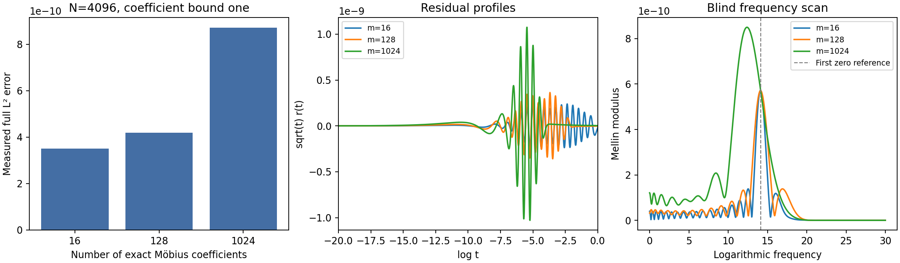

# Fixed-prefix chronological heat repair

**Status: numerical research, not a proof.** Original [R] remains open. No
computational result enters Lean. All mathematical computations ran on the
authorized Runpod, in `/root/chronological-fixed-prefix-20260906`.
[Frozen protocols and analytic gap](../../../1-in-progress/chronological-fixed-prefix-repair.md).

## Question and outcome

Can a bounded tail repair the heat residual while keeping early coefficients
exactly equal to μ(k)? Earlier experiments reset coefficients of an existing
vector without reoptimizing; they could not answer this question.

**Yes at the tested finite scales.** With N=512 and |a_k|≤1, fixing all first
128 coefficients still permits measured L² error 4.3471e−9, close to the earlier
unrestricted vector's 4.1182e−9. Rewriting early coefficients is not necessary
for that finite accuracy. This does not establish asymptotic convergence.

The quarter-prefix construction's rapid initial decay then slows substantially:

| N | Exact prefix m=N/4 | Retained C=1 error | Retained C=2 error |
|---:|---:|---:|---:|
| 128 | 32 | 2.35669e−7 | 2.17191e−7 |
| 256 | 64 | 3.30323e−8 | 3.30323e−8 |
| 512 | 128 | 4.34707e−9 | 4.25933e−9 |
| 1024 | 256 | 1.01003e−9 | 8.35033e−10 |
| 2048 | 512 | 9.52919e−10 | 7.62466e−10 |
| 4096 | 1024 | 8.71476e−10 | 6.79454e−10 |

These are errors of explicit feasible vectors, **not certified optima**. The
quarter-prefix constraints change with N, so their feasible sets are not nested.
Balancing higher-mode errors improved the N=4096, C=1 fit from 1.00906e−9 to
8.71476e−10. Larger errors from other solver candidates were discarded.

At N=4096 with C=1, the shorter-prefix construction gives:

| Frozen prefix m | Retained error |
|---:|---:|
| 16 | 3.50601e−10 |
| 128 | 4.18541e−10 |
| 1024 | 8.71476e−10 |

Thus a wider adjustable tail improves these finite fits. Independent quadrature,
extended-precision profiles and 80-digit spot checks agree; the largest D3
residual discrepancy is 1.18e−13. This is not an optimality comparison.

## Accuracy and the zero invariant

All retained prefixes and coefficient boxes are checked exactly on the stored
floating-point vectors. Training uses logarithmic Gauss–Legendre quadrature;
independent meshes shift interval boundaries and increase the order through 60.
Below δ=1e−30/(1+2N)² the omitted energy is ≤1e−30. Above t=80 the algebraic
tail S²/80, S=Σa_k/k, is included; the exponentially small correction is bounded
as in the [original experiment](../chronological-bounded-repair-2026-09-06/REPORT.md).

For each extended retained vector, 112 residual evaluations were compared with
80-digit mpmath. The largest discrepancy among quarter-prefix cases was
1.64e−13. Independent 63-bit-mantissa logarithmic profiles also reproduce the
L² errors. These checks are numerical validation, not interval certificates.

No zero data entered coefficient fitting. Afterwards the logarithmic Fourier
transform of sqrt(t)r(t) was checked against the already-proved Mellin invariant.
At the numerically evaluated first critical zero, |Γ(ρ)|≈5.70884e−10. The
N=4096, C=1 transform agrees with Γ(ρ) to relative error 8.86e−8. Its largest
spectral peak on frequencies [2,30] is around **12.4**, not 14.1347; this is not
a numerical discovery of a zero. After widening the repair window, the largest
peaks move to **14.10** (m=16) and **14.125** (m=128), near the first ordinate
14.1347. The Mellin invariant is then reproduced to relative errors 6.02e−7 and
7.35e−8. These are spectral diagnostics with no zero data used in fitting, not
certified zero locations. The known universal floor at N=4096, C=1 is
approximately 2.53563e−11 using this numerical reference, below all reported fits.
[Unconditional Lean theorem and its limits](../../../3-formalized/chronological-heat-error-floor.md).

## Reproduction and limitations

- `kernel_reference.py`: archived original kernel and quadrature implementation.
- `fixed_prefix.py`: frozen D grid, N=128,256,512; prefixes 4,8,16, floor(sqrt N),
  N/4; C=1,2. Retains stronger-prefix, smaller-budget and compatible padded vectors.
- `extend.py`, `balanced_modes.py`: D2 quarter-prefix extension and solver check.
- `validate.py`, `profile_audit.py`: independent precision and spectral checks.
- `wider_window.py`, `wider_audit.py`: D3 shorter-prefix construction and validation.
- `results.json`, `extension.json`, `balanced.json`, `*_audit.json`, coefficient
  CSVs and profile NPZs contain complete outputs. Driver order is `fixed_prefix`,
  `validate`, `extend`, `balanced_modes`, `profile_audit`, `wider_window`,
  `wider_audit`. The kernel module is imported, not executed as a driver.
  Plotting uses the prior experiment's isolated matplotlib dependencies.

Parallelism: four independent workers × four BLAS threads for small fits/audits;
two workers for extended fits. Extended initial SVD fits use eight BLAS threads.
The default simplex run for D3 stalled without returning a candidate and was
terminated; `wider_window_simplex.py` preserves that attempt. The replacement
uses interior-point LP with a 60-second limit per solve. Solver stalls and
negative quadrature dual bounds are not mathematical obstructions. Stored
floating-point singular-projection bounds are diagnostics, not certificates.

**Consequence for research:** tail-only repair survives the finite test. The
remaining theorem needs one coefficient budget and full norm decay at unbounded
cutoffs. A construction that freezes increasing history additionally needs
quantitative control of that prefix; [R] itself imposes no such restriction. Neither
finite optimization nor cancellation of finitely many scalar zero phases
provides that estimate. No RH proof, new field, or novelty claim results here.
All outputs were downloaded. Owned computation processes finished or were
explicitly terminated; none remain. No Lean process was launched in this run.
