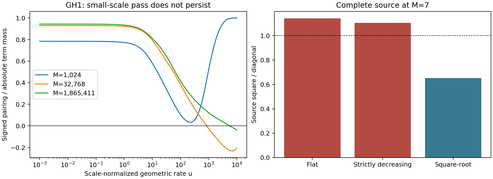

# Complete-source smoothing: three failed producer proposals

**No all-scale RH producer is proved.** Ordinary decreasing weights fail in Lean. Two stronger
mixed-pairing attempts fail numerically. In particular, a geometric-pairing claim passes the
entire initial endpoint grid, then fails at larger scales. The original square-root diagonal
claim SD1 remains unchanged and open.

## Source and frozen claims

Use the actual divisor source `D(q)=log(q!)-sum_(n<=q)tau(n)+2 gamma q` and
`C_d(M,w)=mu(d)sum_(k=d)^(M-1)w_k D(floor(k/d))`. Let `S(w)=sum_d C_d(M,w)` and
`B_M(w,v)=sum_d C_d(M,w)C_d(M,v)-S(w)S(v)`. All channels and terminal blocks are retained.
The half-order weights are `h_k=sqrt(k+1)-sqrt(k)`; SD1 asks `B_M(h,h)>=0` at every endpoint.

The [protocol](PROTOCOL.md) records three independently frozen proof-directed bridges:

| Claim | Proposed producer | Outcome |
|---|---|---|
| DW1 | `B_M(w,w)>=0` for every nonnegative decreasing w | False in Lean, M=7 |
| PH1 | `B_M(h,1_(k<=t))>=0` for every prefix t and endpoint M | Numerical failure M=17, t=6 |
| GH1 | `B_M(h,q^k)>=0` for every 0<q<1 and endpoint M | Numerical failure M=1802, q=1/1000000 |

DW1 would explain SD1 by monotone smoothing. PH1 would imply it by finite Abel decomposition.
GH1 would imply it by the positive Laplace representation of h, after proving that integral
identity and interchange. None of these implications is a producer once its input fails.
No smaller weight cone or cutoff range replaces a rejected frozen claim.

## Experiments and numerical evidence

For DW1, the entire finite decreasing-weight cone is represented by nonnegative mixtures of
flat prefixes. Nonnegative least squares projects both source orientations onto the actual
channel cone. Full coefficients and KKT residuals are retained; numerical optimization is
not a proof that a reported optimum is global. At M=128, the negative-source witness uses
prefixes 6,16,102 and gives source-square/diagonal about1.3260718785. The first numerical
failure in the small-endpoint scan is M=7, where a single flat prefix suffices.

At that endpoint, independent original-double-sum audits at60/100 digits give:

| Weights, k=1,...,6 | Source square / diagonal | Diagonal minus source square |
|---|---:|---:|
| 1 | 1.142427362469414 | -0.1043569077919154 |
| 1-(k-1)/100 | 1.104553238469362 | -0.0722859027310708 |
| sqrt(k+1)-sqrt(k) | 0.652349437455913 | 0.0169570024439121 |

An exploratory power-weight scan through M=512 found no failure for sampled exponents
-1/2,0,1/4,1/2,3/4, but failures for1,5/4,2. Here weights are the divided increments of
x^alpha, with logarithmic increments at alpha=0. This does not establish an all-scale
exponent interval or monotonicity in alpha.

GH1 first passed every M=2,...,512 at113 rates `q=exp(-u/M)`, with logarithmically spaced
u from1e-3 to1e4. Excluding the exact one-channel equality M=2, the smallest recorded
normalized pairing was about0.1012488456 at M=17 near q=1. A rational nearby q was audited
at60/100 digits. PH1 nevertheless fails there: at t=6 its margin is
`-0.03675559974242209089618122121712185832259...` at both precisions.

The larger GH1 experiment uses product-event accumulation and exact finite quotient-block
formulas, evaluated in floating point. It tests the same rate grid at selected dyadic
endpoints through1048576 and the previously recorded SD1 late maximum M=1865411. Negative
pairings occur at32768,131072,1865411. This is a selected-endpoint test, not an exhaustive
large-endpoint grid. Also, a scale-normalized rate grid does not cover every fixed q at large M.

A complementary necessary-condition test avoids that blind spot. The coefficient of q in
`B_M(h,q^k)` is exactly `D(1)*(C_1(M,h)-S(h))`. It first becomes negative at M=1802 in an
exhaustive floating-point scan through2097152, with915034 negative coefficients recorded.
An independent original-double-sum audit at the explicit q=1/1000000 confirms

`B_1802(h,q^k)=-0.00000001384119929382780758453361453474956705...`.

The60/100-digit results agree beyond50 decimal places. This rejects GH1 numerically;
it is not an interval certificate or a Lean counterexample. PH1 and GH1 receive no formal
closure claim. The robust nonzero witnesses, rather than their optimizer locations or
floating-point failure counts, are the evidence for rejection.

## Analytic proof and formal positive residue

[MobiusDivisorMonotoneWeightObstruction.lean](../../../../../../formal/GaloisForLFunctions/RHTower/MobiusDivisorMonotoneWeightObstruction.lean)
proves DW1 false for the literal source. Write `g=gamma`, `a=log2`, `b=log3`, `c=log5`.
At M=7 with flat weights the nonzero channels are exactly

`12a+5b+2c-41+42g`, `13-18g-3a-b`, `6-10g-a`, `2-4g`, `2g-1`.

Their sum is `8a+4b+2c-21+12g`. Symbolic expansion and the corpus's analytic logarithm
bounds, together with analytically proved `0.545<g<0.577216`, prove that its square exceeds
the sum of the channel squares. No decimal obtained from the experiment enters this proof.
Continuity in q then proves existence of a positive strictly decreasing geometric sequence
with the same failure. Thus strict decrease does not repair DW1.

The positive survivor is an exact all-scale representation, not a replacement sign theorem:

`C_d(M,w)=sum_(t=1)^(M-1)C_d(t+1,1)*(w_t-w_(t+1))+C_d(M,1)*w_M`.

It retains every prefix mixture and terminal coefficient. Its paper proof is finite summation
by parts and is formalized unconditionally. A separate unconditional theorem identifies the
half-order instance with the existing literal dilation channel. This is a source instance of
the corpus Abel identity, not a claim of a new general summation theorem. The failed PH1
experiment shows why requiring each of these mixed prefix pairings to be positive loses the
remaining cancellation. The failed GH1 experiment shows the same problem for a Laplace
mixture: individual geometric contributions may be negative even when the diagonal claim
passes at the tested endpoint. The required total signed estimate remains unproved.

Formal audit: source check with `lake env lean`, final named-leaf build, and umbrella import
completed. Only this leaf was rebuilt in the final audit; the12861-job graph count includes
cached dependencies. No full or umbrella build was requested. All four public theorems have
only `propext`, `Classical.choice`, and `Quot.sound` as logical dependencies. No added axioms,
`sorryAx`, native arithmetic certificate, or experimental proof input occurs.

## Reproduction

All mathematical computation ran on the authorized Runpod, using at most8 worker processes
and one BLAS/OMP/MKL thread per worker. Main batches took0.04s (cone),0.05s (small audits and
power scan),0.15s (small geometric grid),0.19s (prefix tests), and2.43s (large geometric grid).
The independent M=1802 high-precision audit took48.37s. Every batch had a120-second cap;
no owned remote computation or Lean process remains running.

Protocol deviation: the PH1 script also evaluated its already fixed larger endpoints after
the small-grid failure, rather than conditionally skipping them. Their results are retained
and are not used to change the frozen claim.

Run `search.py`, `small_scan.py`, `followup.py`, `geometric_cross.py`, `prefix_cross.py`,
`geometric_scale.py`, then `scale_audit.py`. The final script also creates the plot.
Full JSON results, scripts, plot, and checksums are retained here. The shared `source.npz`
input is retained in the adjacent [source experiment](../mobius-divisor-scale-coordination-2026-09-06/REPORT.md);
its remote path is `/root/rh-mobius-divisor-coordination-20260906/source.npz`.
Python3.8.10, NumPy1.24.4, SciPy1.10.1, mpmath1.3.0, Matplotlib3.7.5.
These experiments expose failed producer mechanisms; they do not prove or disprove RH.
