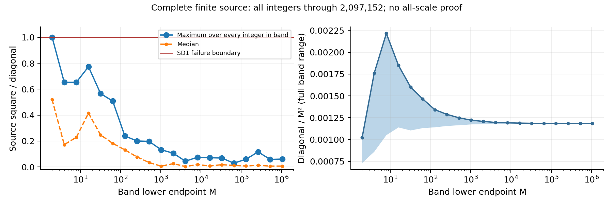

# Complete-source diagonal dominance: finite evidence and open sign

**The all-scale producer remains unproved.** SD1 survives an exhaustive numerical search over
all integers through 2,097,152. A stronger attempt to produce it by monotonicity fails. The
unconditional Lean results bound the diagonal and give its exact evolution; they do not bound
the complete signed source by that diagonal.

## Source and frozen claims

Use the literal source

`D(q)=log(q!)-sum_(n<=q)tau(n)+2 gamma q`,

`C_d(M)=mu(d) sum_(k=d)^(M-1) (sqrt(k+1)-sqrt(k)) D(floor(k/d))`,

`S(M)=sum_(d<=M) C_d(M)`, `Q(M)=sum_(d<=M) C_d(M)^2`.

No dilation, terminal quotient block, prime power or arithmetic tail is discarded.
The data vectors store `S/M`, `Q/M^2`, and `S^2/Q`.

- **[BRIDGE] SD1, open:** `S(M)^2 <= Q(M)` for every integer M>=1.
- **[BRIDGE] SD2, numerically rejected:** `E(M)=Q(M)-S(M)^2` is nondecreasing for every M>=1.
  Since E(1)=0, SD2 would imply SD1. Its failure does not refute SD1.

The [protocol](PROTOCOL.md) fixes factor one and includes small endpoints. These are
proof-directed proposals, not claims of novelty or consequences of a random-sign model.

## Measurements

SD1 has no apparent violation for 3<=M<=2,097,152. M=1 is empty; M=2 has exactly one nonzero
channel and exact equality. The largest ratio outside those cases is

`S(17)^2/Q(17) = 0.773063650278335659550960108552152...`.

All ten largest ratios were checked independently at 60 and 100 decimal digits using trial
factorization, integer divisor sums and the original double sum, rather than the quotient-block
algorithm. The ratios agree across precisions beyond 50 decimal places. This audits those
extrema, not every endpoint at arbitrary precision.

| Complete band | Maximum ratio | Location |
|---|---:|---:|
| 64–127 | 0.508043012459 | 103 |
| 2,048–4,095 | 0.105905217554 | 3,547 |
| 65,536–131,071 | 0.028907935809 | 128,969 |
| 1,048,576–2,097,151 | 0.060688530032 | 1,865,411 |

The late-band maximum rises again. Finite safety margins do not justify extrapolating a
monotone decline or an all-scale estimate. In the last complete band `Q/M^2` ranges from
0.00118438105246 to 0.00118463653069. Apparent stabilization is numerical evidence only.

SD2 has 21,863 negative adjacent changes below the scan ceiling (float threshold -1e-10).
The first is M=4 to 5:

`E(5)-E(4) = -0.0131233065660142069109224977293672924002113264...`.

An independent 60/100-digit evaluation confirms this negative value. The diagonal drops by
about 0.00606238226050 while the source square rises by 0.00706092430552. The largest recorded
absolute drop is at M=1,851,018: direct update gives about -1026.24311118. Here the diagonal
rises by 4360.32741074 but the source square rises by 5386.57052192. Thus the failed
monotonicity is visible both near the origin and far into the scan; it is not repaired by
observing that each diagonal term is a square. These numerical rejections are not Lean
counterexample certificates.

## Exact mathematical residue

Write `w=sqrt(M+1)-sqrt(M)` and `v_d=mu(d)D(floor(M/d))`. Every existing channel has the exact
update `C_d(M+1)=C_d(M)+w v_d`; the new terminal channel is zero. Consequently

`Q(M+1)-Q(M)=2w sum_d C_d(M)v_d+w^2 sum_d v_d^2`.

These two source identities are unconditional Lean theorems in
[MobiusDivisorAbelDiagonalBound.lean](../../../../../../formal/GaloisForLFunctions/RHTower/MobiusDivisorAbelDiagonalBound.lean).
Together with the existing exact source increment `S(M+1)-S(M)=w psiDefect(M)`, they give

`E(M+1)-E(M)=2w(sum_d C_d v_d-S psiDefect(M))
             +w^2(sum_d v_d^2-psiDefect(M)^2)`.

This retains the signed terms that any replacement barrier must control. The displayed
combined-margin formula is an algebraic consequence, not a newly named Lean theorem or an
inequality. No damped version is substituted for the rejected SD2.

The same new Lean module proves, for every M, the analytic bound

`Q(M) <=144 M^2 sum_(d<=M)1/d`.

Its proof uses the corpus theorem `|D(q)|<=24sqrt(q)` and
`(sqrt(k+1)-sqrt(k))*sqrt(k)<=1/2`, giving `sqrt(d)|C_d(M)|<=12M` before summation.
No numerical result enters Lean. This elementary diagonal bound is supporting infrastructure,
not a claimed solution of the arithmetic cancellation problem.

## Remaining mathematical obstruction

SD1 is equivalent to a nonpositive total off-diagonal sum. Gcd reindexing retains orientations
`mu(ab)` multiplying squarefree cofactor mass; both signs remain. The completely collapsed
negative two-prime renewal determinant likewise supplies no inverse-source norm estimate.
Neither identity currently controls the required total.

The harmonic diagonal bound alone combines with SD1 to give `S(M)/M=O(sqrt(log M))`;
the exact uniform-boundedness RH receiver does not automatically accept that loss. The
source-average improvement is now closed independently of this experiment:
`RHTower.sum_mobiusDivisorDilationChannel_sq_le_quadratic` proves `Q(M)<=722M²` by
signed hyperbola summation before squaring. Consequently SD1 would give
`|S(M)/M|<=sqrt(722)` and feed the existing receiver directly. The cross-term sign
remains open. No numerical result enters that proof, and no RH route is retired by SD2.

## Reproduction and audit

Runpod: Python 3.8.10, NumPy 1.24.4, mpmath 1.3.0, SciPy 1.10.1. The main search uses eight
processes with BLAS/OMP/MKL set to one thread; elapsed 3.30 seconds. The extrema audit takes
0.15 seconds and the monotonicity audit 0.20 seconds. Commands have a 120-second cap. Plotting
and all mathematical computation run on the Runpod.

Input `source.npz` is retained in the previous
[complete-dilation experiment](../mobius-divisor-scale-coordination-2026-09-06/REPORT.md).
The scripts refer to its documented Runpod directory. `search.py` accumulates the three
quadratic coefficients of `C_d(M)^2` at every product d*q<=N, using a hyperbola split and
O(N log N) updates. All 80 earlier independently computed diagonals agree within 8.52e-15
in normalized units. A direct next-step identity audits the two reported monotonicity failures
without subtracting two large diagonal values.

Run `search.py`, `audit.py`, `monotonicity.py`, then `summarize.py`. The last plot uses only
complete bands; the terminal singleton remains in `bands.json` and the raw vectors.
`all-endpoints.npz` contains every endpoint, including unselected values. `search.json`,
`audit.json`, `monotonicity.json` and `bands.json` contain the numerical summaries. Downloaded
artifacts are checked against `SHA256SUMS`. Finite floating-point evidence is not a rigorous
interval enclosure or an all-scale proof.

Formal audit: direct `lake env lean` check and named leaf `lake build` audit pass; the module
is imported by `RHTower.lean`. No umbrella build was run. `scripts/formal_tools.py lint
--check-generated` passes, with pre-existing file-size warnings. All four exported theorems
have only the standard logical dependencies `propext`, `Classical.choice`, `Quot.sound`;
there is no added arithmetic axiom, `sorryAx`, or native-computation certificate.
