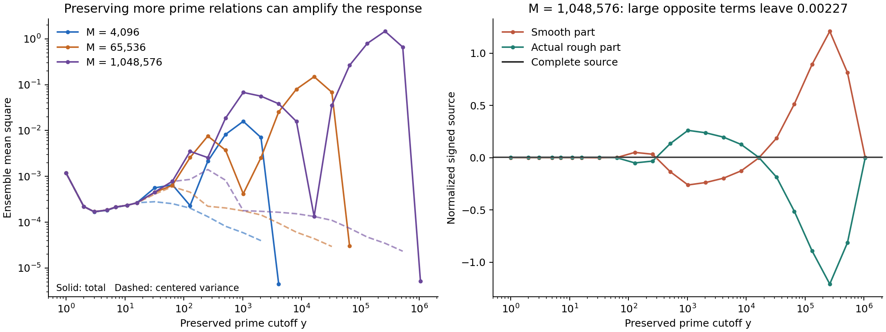

# Complete arithmetic dilation coordination

**Outcome:** strong finite cancellation survives arithmetic-preserving controls, but no independent
all-scale estimate or RH proof was found. The largest aperture effect is mostly deterministic
bias canceled by the actual prime tail. Its location has an explicit small-cofactor explanation.
Numerical results are not Lean proof inputs.

## Source and reproducibility

The source is exactly `mobiusDivisorSquareRootAbelMoment(M)/M` from the current Lean corpus.
With `D(q)=log(q!)-sum_(n<=q)tau(n)+2 gamma q` and
`A(q)=sum_(k=1)^q D(k)(sqrt(k+1)-sqrt(k))`, each integer dilation contributes

`C_d(M)=mu(d)/M [sqrt(d)A(Q-1)+D(Q)(sqrt(M)-sqrt(d Q))]`, `Q=floor(M/d)`.

All dilations `1<=d<=M` and the clipped terminal block are retained. The independent source is
`sum_(k<M)(psi(k)-k+2 gamma)(sqrt(k+1)-sqrt(k))/M`, assembled from prime powers.
The maximum discrepancy across the 320 original endpoints was `8.97e-13`.

Runpod: 155,611 primes and arithmetic arrays through 2,097,152; eight worker processes and one
BLAS thread each. Preparation took 0.619 s; the longest main computation took 1.456 s.
Independent 60-digit audit took 0.128 s. Timings are measured computation times, excluding SSH
and artifact transfer. Every command had a 120-second cap; none reached it.

Reproduce with `experiment.py prepare`, then `experiment.py discovery` and `validation`,
`arithmetic_control.py discovery` and `validation`, `aperture.py`, `audit.py`, and
`explain_and_plot.py`. Run mathematical calculations on the designated Runpod. Protocols were
written before the respective runs; the aperture profile is explicitly exploratory.

## Findings

Groups use `j=floor(log2(floor(M/d)))`. Discovery bands have exponents 12, 14, 16; held-out
bands have exponents 18, 20. Each contains 64 predetermined endpoints.

| Band starts at | Full / separate-group variance | Adjacent share of net cancellation | Preserving primes through 31: ensemble / actual mean square |
|---:|---:|---:|---:|
| 4,096 | 0.02929 | 1.3496 | 43.46 |
| 16,384 | 0.06245 | 1.3359 | 28.27 |
| 65,536 | 0.04270 | 1.3748 | 30.74 |
| 262,144 | 0.08374 | 1.4053 | 20.14 |
| 1,048,576 | 0.05354 | 1.3965 | 23.90 |

C1 (adjacent share at least 75%) and C2 (last ratio at least four) pass all prescribed bands.
They are finite observations, not uniform bounds. Shares greater than one mean adjacent
covariances over-cancel: more distant covariances have a net positive contribution. Ignoring
those terms would give a negative purported variance on these bands.

The last column uses 16 predetermined endpoints per band and **raw mean squares**; the first
two columns use 64 endpoints and **centered variances**. These statistics are not interchangeable.
Endpoint permutations are descriptive controls; nearby arithmetic endpoints are not independent
samples, and no significance test is claimed.

## Preserve arithmetic in the control

For a cutoff y, let `r_y(d)` be the part of d left after removing prime factors at most y.
The control coefficient is `mu(d) epsilon(r_y(d))`, with independent mean-zero signs for rough
parts greater than one and `epsilon(1)=1`. Actual squarefree support and every legal small-prime
multiplication relation survive. Relations among larger primes do not.

Let `B_r=sum_(r_y(d)=r) C_d`. Then the control has mean `B_1`, variance `sum_(r>1)B_r^2`,
and mean square `sum_r B_r^2`. The calculation uses this finite identity, not Monte Carlo.
It is not the distribution of the literal Möbius function or a fully multiplicative random model.

Adding small-prime relations is not numerically monotone. At M=4096, moving from primes through
3 to primes through 5 changes the mean square from

`0.0001680422905287111043351665411269`

to

`0.0001823423551684758426798846683132`.

The positive difference `0.0000143000646397647383447181271863` is independently audited with
trial factorization and 60-digit arithmetic. Float errors were below `5.3e-19`. Inserting p
merges old squarefree rough fibers r and p*r, giving the exact algebraic change
`2 sum_(p not dividing r) B_r B_(p*r)`. Its sign is not supplied by knowing the individual
small-prime relations. This observation was discovered after C2; it is not mislabelled as a
prospectively frozen monotonicity test.

## Interrogate the apparent large effect

The aperture scan uses 12 fixed endpoints and a fixed geometric cutoff grid. Its recorded
maxima occur at y/M between 1/5 and 1/3. At M=1,048,576, y=262,144:

- smooth-fiber mean: `1.2099879679508614`;
- actual rough sum: `-1.2077175453102682`;
- complete source: `0.0022704226398066432`;
- deterministic squared bias: 99.9976% of the control's mean square.

This peak is primarily a failure to reproduce the actual tail's mean cancellation, rather than
an increase in its centered variance. It must not be presented as an unexplained fluctuation.

There is a finite source explanation. Put `b(k)=psi(k)-k+2 gamma` and

`F(t)=sum_(1<=k<=floor(t)) b(k)(sqrt(min(t,k+1))-sqrt(k))`.

For y>sqrt(M), a nontrivial squarefree rough part is one prime p>y. Its complete cofactor fiber
is exactly

`B_p(M)=-sqrt(p) F(M/p)/M`.

To derive this, reindex multiples as d=p*s. Since s<p, `mu(p*s)=-mu(s)`. Reindex the time
coordinate into quotient blocks and use the corpus identity
`sum_(s<=k) mu(s)D(floor(k/s))=b(k)` before summing the clipped square-root weights.
This uses complete arithmetic cofactor families, not a prime-pair heuristic. All 12 numerical
fiber reconstructions agree within `8.1e-13`.

On `4<=t<=5`, the displayed kernel is `F(4)+b(4)(sqrt(t)-2)`. The audited values are
`F(4)=0.001104192939908941894...`, `b(4)=log(12)-4+2 gamma<0`. Its candidate crossing gives
`1/t=0.249236360763320237...`, explaining the grid peak near M/4. Numerical signs and the
crossing are diagnostics here, not a formal all-scale extremum theorem. Other aperture
windows remain possible; no global-maximality claim is made.

## Mathematical consequence and remaining gap

The experiment separates three demands that looked alike in a single variance plot: adjacent
scale anticorrelation, orientation across additional prime factors, and cancellation of a
large smooth-part bias by its actual rough complement. The first survives finite testing;
the second is non-monotone; the third has a transparent finite cofactor explanation.

A proof still needs a uniform bound on the complete signed residual. The endpoint identity and
the small-cofactor peak do not bound it. Subtracting a predicted prime-density main term merely
leaves a weighted prime-counting error unless a new estimate is proved. Neither the control
second moment nor the fact that it is nearly scale-stable bounds every actual endpoint.

**Positive-salvage audit:** the prime-insertion cross term and the terminal prime-fiber identity
explain the observed effects, but are finite consequences of existing square expansion and
Möbius inversion. They are not claimed as new independent producers. The uniform residual
estimate has no dependency-closed proof. No route is retired; no new Lean theorem or RH result
is claimed. Generic rearrangements were not added as apparent formal progress.

Related external technique is established: conditioning and covariance analysis of random
multiplicative functions appears in [Harper's paper](https://arxiv.org/abs/2012.15809). The initial
Voronoi idea was checked against [Huxley–Ivić](https://emis.de/ft/41261) and the corpus's existing
`mu(n)tau(n)` reciprocal-zeta-square obstruction. No priority claim is made for either framework.

Artifacts: frozen protocols, all scripts, five endpoint/covariance NPZ files, discovery and
validation JSON, all aperture rows, independent audit, explanation checks, and PNG/PDF figure.
`manifest.json` records hashes of downloaded numerical artifacts. `source.npz` is reproducible
input data; it is retained on Runpod and can be regenerated from `experiment.py prepare`.
