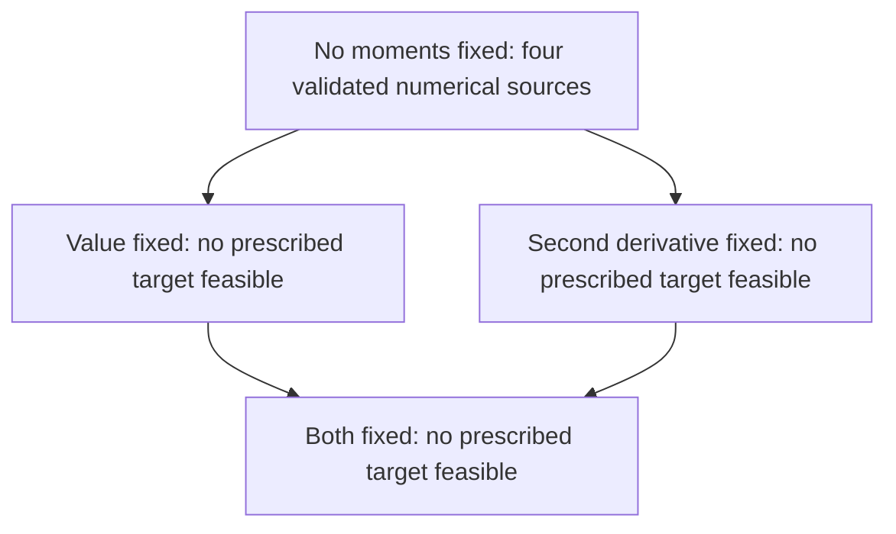

# Each singleton moment blocks the prescribed finite construction

At period41, all twelve singleton-moment LP problems were numerically infeasible: retain either X_a(0) alone or X_a''(0) alone at the baseline value, crossed with t=20,40,80 plus i/8 or i/4. The coefficient cone, DFT symmetry, cusp residue, target points and fixed bounds are unchanged. No accepted sources or source-validation claims exist for this run.

The moment-subset lattice at heights20 and40 is:

Thus the observed finite obstruction does not require interaction of both moments: either singleton is enough to block the same prescribed points in this box. This does not say either moment selects real zeros globally. Fixed target interpolation and an arbitrary off-axis zero are different problems, and bounded numerical infeasibility has no exact dual certificate here. Positive salvage is a constraint-attribution result. Further enlargement of coefficient bounds, periods or target scans is not admitted as a response; that would shift the question toward numerical thresholds instead of the missing original-source mechanism.

Current deep/source-method searches are archived, but no fresh kernel compilation was run. These periodic Poisson sources are broader arithmetic controls, not original HB fields. Runtime and exact environment are archived; all downloads checksum-verified.
