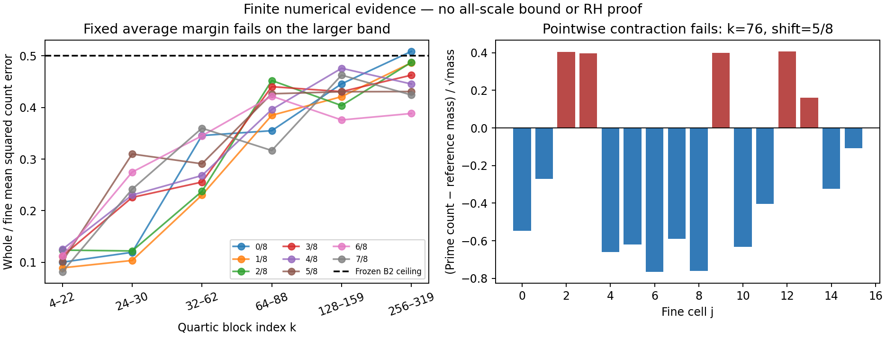

# Prime-block feedback: average cancellation hides local amplification

**Status: numerical investigation, not a paper or Lean proof. RH remains open.** The containing computations directory does not confer theorem status. No result here is an input to a Lean proof.

## Outcome

Feedback, uniform per-merge contraction, pointwise contraction, and persistence of a fixed average margin fail their frozen tests. A weaker empirical bridge survives on the initial held-out ranges, but its extension to a larger scale band fails. No source estimate controlling all scales or Mellin phases was found.

| Candidate | Frozen test | Outcome |
|---|---|---|
| Count/centroid feedback | Eight previous count and centroid coordinates must improve screening MSE by 5% over count-only prediction, and 5% over the mean baseline, at resolution 16 | **Failed.** Centroid gain 2.16%; coarser predictions deteriorate. Forward/backward gains almost equal. |
| M1, uniform merge contraction | Every doubling of cell width reduces mean squared normalized error by at least 20%, in both discovery ranges | **Failed.** Ratios include 0.8401 in training and 0.9169 in screening. No M1 validation was run. |
| [BRIDGE] B2, boundary robustness | Whole-block/fine-cell mean squared error at most 1/2, at every one of eight fixed boundary shifts and in each held-out range | **Survived these finite tests.** Validation ratios 0.2303–0.3599; final-range ratios 0.3166–0.4524. |
| C2, pointwise block contraction | Every individual quartic block and prescribed shift satisfies the sixteen-cell inequality below | **Numerically falsified.** No discovery violations in 208 overlapping observations; 43 violations in 448 validation observations. Worst amplification 3.77018. |
| E3/E4, fixed average margin at larger scales | Same 1/2 ceiling at every phase, on the proportional bands `[K,5K/4)` | **E3 passes; E4 fails.** Ratios 0.3759–0.4761 at `k=128..159`; unshifted ratio **0.50882142** at `k=256..319` exceeds 1/2. Seven shifted phases still pass. |

All candidates and thresholds were written before their relevant tests. B2 is a weaker bridge, not a rescue or proof of M1. C2 was frozen after discovery and before validation. Eight boundary shifts share primes; they are not independent statistical replications. Numerical failures of these candidates do not retire the arithmetic RH route.

The larger bands were frozen sequentially before accessing their data. E3's success justified exactly one final doubled band E4, with the same proportional width, reference, eight phases, and threshold. E4 disproves persistence of the stated fixed margin across these bands; it does not disprove every possible scale-dependent or phase-selected estimate. Its failure is retained without changing the ceiling.

## Source and methods

The corpus's `PrimeLogBlockCompression` retains prime count and sum of prime logarithms per quartic interval, with a rigorously controlled discarded remainder. The experiment asks whether the retained data themselves reveal cancellation. Other seeds were `XiPhysicalPrimeApertureMertensCoboundary`, `ConstitutiveSplitFormationParallax`, `PrimeBoundaryMonodromyEscape`, `MaynardMultiscaleReferenceTelescope`, `CoprimeBlockMultiplicationFiber`, and `PrimeSourceCancellationBudget`. Corpus searches covered feedback, prediction, signed/source scale, multiscale cancellation, block collision, coboundaries, semiprimes, and translations. These are idea sources, not claims that those modules prove the tested inequalities.

Construct all 3,874,451 primes below `90^4=65,610,000`. In `[k^4,(k+1)^4)`, use 1, 4, and 16 equal physical-width cells with integer endpoints. In a cell `[a,b)`, put

`L = integral_a^b dx/log x`, `C = #{primes in [a,b)} - L`, `A = C/sqrt(L)`.

The second coordinate is the centered prime-log sum divided by the square root of its reference second moment; see [PROTOCOL.md](PROTOCOL.md) for its exact definition and ridge model. This reference density and normalization are diagnostics, not an asserted stochastic model of primes.

Predictor training: `k=4..23`; screening: `24..31`. M1 uses these same discovery ranges. For B2 and C2, shifts `t/8` of one fine cell use exact endpoints

`k^4 + floor(((k+1)^4-k^4)*(8*j+t)/128)`, `j=0..16`, `t=0..7`.

Boundary discovery ranges: `4..22`, `24..30`; held-out ranges: `32..62`, `64..88`. Omitting final blocks keeps shifted windows inside their data partitions. The original predictor and M1 never consumed their held-out outcomes; those data were subsequently opened only under the frozen B2/C2 protocol.

The extension sieves every required block for `k=128..159` and `256..319`, with all eight shifts, without generating a global prime list to the larger endpoint. Endpoint formulas and normalization are unchanged. `extension-k256.json` contains every phase's result; `extension_audit.py` independently recomputes every reference mass in this final band through a 60-digit exponential-integral antiderivative. Its unshifted ratio is `0.5088214224386661837756`, exceeding the frozen ceiling by `0.0088214224386661837756`; all eight high-precision pass/fail verdicts agree with the original quadrature.

The multiscale diagnostic decomposes the whole-block mean square into diagonal terms and signed cross terms at separations 1 through 15. In training, diagonal contribution 0.24505 falls to 0.02494 after all cross terms. In screening, 0.31265 falls to 0.04593. Cross terms have both signs: separation 10 changes from −0.04739 to +0.04733. Nearest-neighbor anticorrelation does not supply a termwise or uniform per-merge rule. The 256 shuffled-array controls in `multiscale-discovery.json` preserve the observed marginal values but break chronology; they are not altered prime systems or zero-preserving deformations.

## Audited counterexample to C2

The frozen inequality was

`(sum_j C_j)^2 / (sum_j L_j) <= (1/16) sum_j C_j^2/L_j`.

At `k=76`, shift `5/8`, with full interval `[33,432,131,35,222,996)`, direct high-precision evaluation gives

| Quantity | Value |
|---|---:|
| Whole-block normalized square | 0.95501418499890592025 |
| Mean fine-cell normalized square | 0.25330754213746253724 |
| Difference, left minus right | **0.70170664286144338300** |
| Ratio, left/right | **3.77017666722551778467** |

[worst-block.csv](worst-block.csv) contains all sixteen integer intervals and prime counts. `audit.py` enumerates its sieve base primes by trial division, resieves this interval afresh, and checks every cell count against the original global data. It recomputes the reference integrals through the exponential-integral antiderivative at 60 and 90 digits, with agreement beyond 45 digits in the ratio; separate 90-digit direct quadrature checks the masses. This is strong numerical falsification with a wide margin, not an interval-arithmetic certificate or a Lean no-go theorem.



## Interpretation, novelty, and positive residue

The literal source displays both aggregate cancellation and locally coherent deficits. Thus the observed average contraction cannot justify an argument requiring every retained block to contract. The largest violation has eleven deficit cells and five surplus cells; combining them amplifies the normalized error. The remaining source problem concerns exceptional clusters and their accumulation, including the relevant Mellin phases, rather than a fitted short-memory recurrence or a fixed decrement at each merge.

A post-discovery primary-source check identifies established related work: Montgomery–Soundararajan, [*Primes in short intervals*](https://arxiv.org/abs/math/0409258), develops evidence for a variance smaller than the elementary independent-prime prediction; Gorodetsky, [*The variance of integers without small prime factors in short intervals*](https://arxiv.org/abs/2111.00853), proves suppression for rough integers in stated ranges. These concern different observables and averaging regimes from our moving quartic blocks. They prevent treating suppression alone as a new mechanism; they neither prove nor refute C2 for these blocks.

The serious positive-salvage pass tested boundary robustness, then its stronger pointwise version, and then two larger scale bands on untouched data. B2 survives only on its original finite ranges; the proposed fixed-margin persistence fails E4. No extrapolation has a dependency-closed paper proof. The exact cross-term decomposition is generic algebra, already available in the corpus, and is not counted as new mathematical knowledge. **NO POSITIVE SALVAGE FOUND at the level of a new dependency-closed theorem.** No Lean module was added for these computations, no numerical result was promoted to universal-law status, and no route was declared mathematically impossible.

## Reproduction and verification

Run only on the authorized Runpod, in this directory, with `OPENBLAS_NUM_THREADS=1 OMP_NUM_THREADS=1 MKL_NUM_THREADS=1`:

```text
python3 experiment.py prepare
python3 experiment.py discovery
python3 multiscale.py discovery
python3 boundary.py discovery
python3 boundary.py validation
python3 extension.py
python3 extension.py --start 256 --stop 320
python3 extension_audit.py
python3 audit.py
```

The scripts enforce discovery gates before validation. M1 validation intentionally refuses to run. Use the four protocol files to preserve when each candidate was frozen. The prime sieve uses eight workers; coordinate generation uses three; boundary sweeps and the final reference audit use eight. Small regressions and the individual counterexample audit are cheaper serially. Each command was capped at 120 seconds. Preparation took 2.07 seconds; initial discovery and validation phases each took under 0.1 seconds, E3 took 0.37 seconds, and E4 took 24.14 seconds on this pod, excluding plotting and SSH overhead.

The segmented prime array was checked in full against a separate nonsegmented sieve. Every original cell's 32-point quadrature was compared with 64 points; all shifted reference masses agree to relative error below `6e-16`. Reference variances and tiny centered moments have their own recorded relative errors in `metadata.json`. Full-block aggregation agrees with the independently computed coarse rows. The high-precision counterexample has the additional checks described above.

Python 3.8.10, NumPy 1.24.4, SciPy 1.10.1; plotting uses Matplotlib 3.7.5. Raw row arrays, models, diagnostics, protocols, scripts, audit, and figures are retained locally. The 30 MB prime cache is reproducibly generated and remains on the pod; the saved cell counts and sieve script contain all information needed to reproduce the reported tests.
