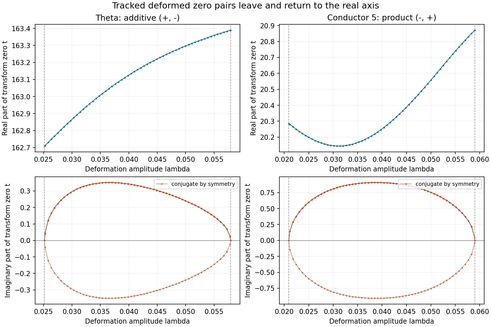

# A source deformation can lose and recover real zeros

## Question

Earlier local double-root solves did not establish whether they marked entry, return, or a different branch from an independently verified nonreal zero. This experiment follows the actual complex witness in both deformation directions and repeats at half the step. A double root is attached only inside a traversed lambda bracket near the tracked height.

## Observed boundaries

| Witness | Source direction | Product strength | Direction from witness | Boundary height | Boundary lambda | Multiplier bound |
|---:|---|---:|---|---:|---:|---:|
| 0 | -1,1 | 1 | back | 111.3483512892 | 0.007508532487749 | 0.01063919939 |
| 1 | 1,-1 | 1 | back | 134.5686422981 | 0.01761271280029 | 0.02502110405 |
| 2 | -1,1 | 0 | back | 111.3058586929 | 0.009096418039103 | 0.01286427776 |
| 3 | 1,-1 | 0 | back | 162.7095164825 | 0.02518582140479 | 0.03561813021 |
| 3 | 1,-1 | 0 | forward | 163.3887456874 | 0.05789056734524 | 0.08186962547 |

For the additive direction (+,-)/sqrt(2), numerical continuation attaches the witnessed nonreal pair near 163.219±0.303674i to a lower boundary at lambda≈0.0251858214048, height162.7095164825, and an upper boundary at lambda≈0.0578905673452, height163.3887456874. The sufficient global multiplier bound throughout this interval is at most 0.081870<1. Thus this is a positive multiplier applied to the literal positive theta source.

The other three witnesses attach to their lower collisions and stay nonreal at the sampled continuation points through 1.6 times their witness amplitude. This is a finite upper-end non-detection, not a claim that those branches never return.

## Interpretation

The high-lambda nearby collision was a numerical return boundary of the same witnessed pair. It was not its first entry threshold. This rejects a one-way-loss model for these specific deformations: the count of nonreal roots of the tracked pair is not monotone in deformation amplitude. It does not say that the entire deformed transform returns to an all-real zero set, or that these are the globally first collisions. The observations also show why nearest-height Newton localization cannot establish onset.

The local coefficient `-2*F_lambda/F_tt` in `(t-t_c)^2≈[-2*F_lambda/F_tt]*(lambda-lambda_c)` is negative at the lower boundary and positive at the upper boundary. Both coefficients are finite and nonzero in the high-precision evaluations. This independently checks the local directions of splitting. It does not certify the whole path between them.

## Validation, reproducibility and limits

16 tracks completed without reported errors; 5 distinct boundaries received 100/160-digit solves. Halving the continuation step changes attached boundary coordinates by at most 6.1137561500E-37. The maximum 100/160-digit coordinate difference is 3.34536973643655929942061115760594898972291349371761980556989564E-95. Independent190-digit literal source integration checks both F and F_t at every boundary and at height+.125; maximum discrepancy is 3.314829105468310408282900328888619830438758818280864477600155404523351280258414604937573189642521909E-145 in units of `exp(-pi*t/4)*(1+t*t)^0.875`.

The interior complex witness was independently source-validated before this run; its hash and parameters are retained. Every accepted continuation point and failed attempt outcome is saved. These are high-precision numerical trajectories, not interval-certified continuous curves. The source quadrature uses the documented x=4 tail truncation and finite theta/character sums. Neither generic conjugation symmetry nor square-root splitting is claimed as a discovery.

Guarded wall time 111.938s; recorded worker time 479.232s, including screening, finer trajectories, precision and source checks. All interventions share the same ten-minute guard. Up to 14 worker processes, native threads1, isolated environment recorded. Download hashes passed; REMOTE-SHA256SUMS preserves the original manifest. No Lean builds.

## Consequence for HB/RH and next discriminator

Mass preservation, second-moment preservation and a positive deformation multiplier allow a finite interval of nonreal roots in these sources. Source-selection experiments must therefore follow branches and retain interactions, rather than treat each local collision as permanent loss or a global bound. This computation supplies no off-line zero of undeformed zeta or a Dirichlet L-function. Full physical HB identification and source-enforced extinction remain open. The next useful analytic target is a certified local return interval or a source constraint that excludes this behavior; a larger unqualified collision scan would add little.

## Recorded trajectories

Dots are recorded points from the finer continuation and refined boundary roots. Lines guide the eye; they do not certify intermediate points. Lower curves are the conjugates inferred from the real-source symmetry. The conductor-5 real coordinate reverses direction inside its nonreal interval, whereas the plotted theta coordinate does not. This geometric contrast is exploratory, not a new monotonicity theorem. Rendering recorded data took1.133 seconds under a separate35-second artifact guard; no new numerical solve was performed.
