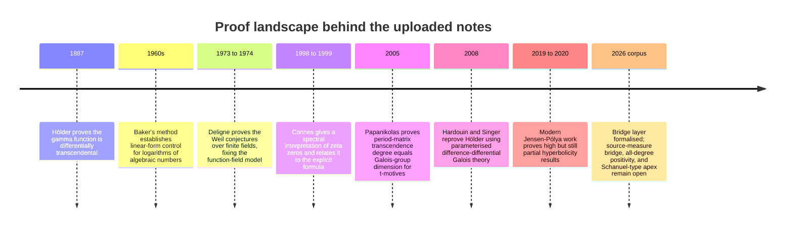

# Formal audit and gap analysis of the uploaded zeta notes

## Executive summary

I audited the nine uploaded documents as a single mathematical corpus. The corpus itself distinguishes a **bridge layer** of results it treats as proved, a set of **required lemma-shapes** that are only partially proved or still open, and a separate inventory of **open conjectures** and **apex obstructions**. In the corpus’s own terms, there are **29 “proven paper theorems”**, **5 required lemma-shapes**, and a conjecture inventory comprising **C1–C6**, **B1–B3**, **APEX-A–D**, plus **11 named worklog conjectures**. The preprint draft explicitly says that it does **not** prove the Riemann Hypothesis and that most proved items are “BRIDGE” reorganisations of classical mathematics rather than new zero-localisation theorems. fileciteturn0file6 fileciteturn0file7 fileciteturn0file8

The strongest self-contained mathematics that can be completed rigorously from the uploaded material, after standardising notation, is classical and local: the corrected reflection symmetry at the seam, exact modulus symmetry of the completed \(\xi\)-function on symmetric lanes, the \(\Gamma_{\mathbb R}\)-shift and digamma identities, convergence of Euler products and logarithmic derivatives on \(\Re s>1\), the argument-principle interpretation of \(d\log \xi\), localisation of the model pole \(1/(s-\rho)\) at \(\sigma=\Re \rho\), and the curvature identity
\[
\frac{d^2}{dt^2}\log \Xi(t)=\sum_\rho \left(\tfrac12+it-\rho\right)^{-2},
\qquad \Xi(t):=\xi\!\left(\tfrac12+it\right),
\]
from which RH-implies-concavity and the local convexity window forced by an off-line pair follow. These are the places where the uploaded notes can genuinely be tightened into fully written proofs without assuming new mathematics. fileciteturn0file0 fileciteturn0file1 fileciteturn0file2 fileciteturn0file6 citeturn7search1turn7search0turn10search1

Two formal corrections are needed immediately. First, the corpus repeatedly identifies \(\Re s=\tfrac12\) with the fixed locus of \(s\mapsto 1-s\), but the true set-theoretic fixed locus of that **holomorphic** involution is the single point \(s=\tfrac12\); the full critical line is instead the fixed locus of the **anti-holomorphic** involution \(s\mapsto 1-\overline{s}\). Second, the formula
\[
\frac{2(a^2-\tau^2)}{(a^2+\tau^2)^2}
\]
is the exact contribution of the **same-height mirror pair**
\(\rho=\frac12\pm a+i\gamma\) to \((\log \Xi)''(t)\) near \(t=\gamma\); the conjugate pair gives a second window near \(t=-\gamma\). Stated that way, the local obstruction is correct and fully provable. fileciteturn0file0 fileciteturn0file1 fileciteturn0file2 fileciteturn0file6 fileciteturn0file8 citeturn7search1

What cannot be completed from the supplied notes is exactly what the notes themselves label as open: the **source-measure bridge** from transport statistics to zero confinement, the **native holonomy** interpretation of the carrier, the **uniform all-degree Hankel/Laguerre positivity** equivalent to RH, and the **value-arithmetic apex** around Schanuel-for-prime-logs. The notes’ own challenge document is correct that these are not merely omitted details but genuine mathematical gaps. In particular, Baker-type results control only **linear** relations among logarithms of algebraic numbers, whereas the corpus needs **algebraic** independence to reach its transcendence apex; that jump is precisely where Schanuel-type input would be required. fileciteturn0file4 fileciteturn0file7 fileciteturn0file8 citeturn8academia3turn5academia0

The best rigorous verdict is therefore this: the corpus contains a coherent research programme, a substantial amount of formally repairable bridge mathematics, and a clear map of its own obstructions, but it does not contain — and cannot presently be completed into — a proof of RH or of the Schanuel-level conjectures it invokes. That conclusion agrees both with the uploaded preprint draft and with the surrounding primary literature the notes rely on, including Hölder/Hardouin–Singer on differential transcendence, Papanikolas on the function-field period/Galois equality, Connes on spectral interpretations of zeta zeros, and the modern Jensen–Pólya literature on RH-equivalent hyperbolicity criteria. fileciteturn0file8 citeturn2academia0turn5academia0turn0academia0turn0academia5turn1academia0turn1academia3

## Scope and assumptions

Because the prompt asked me to treat the source material as “user-provided mathematical notes” with unspecified ambient conventions, I standardised only the pieces needed to make the statements precise. I work with the classical completed zeta function
\[
\xi(s)=\frac12\,s(s-1)\,\pi^{-s/2}\Gamma\!\left(\frac s2\right)\zeta(s)
=\frac12\,s(s-1)\Gamma_{\mathbb R}(s)\zeta(s),
\qquad \Gamma_{\mathbb R}(s):=\pi^{-s/2}\Gamma\!\left(\frac s2\right),
\]
and with
\[
\Xi(t):=\xi\!\left(\tfrac12+it\right),\qquad
H(s):=\frac{\xi'(s)}{\xi(s)}
\]
away from zeros of \(\xi\). The functional equation \(\xi(1-s)=\xi(s)\), the digamma identity \(\psi=\Gamma'/\Gamma\), and the Euler product on \(\Re s>1\) are standard background facts. citeturn7search1turn7search0turn10search1turn10search5

I have **not** attempted to invent missing definitions for corpus-specific symbols such as \(C5\), \(G1\)–\(G5\), \(\mathcal M\), “CC”, “Source A/B”, “weld carrier”, or various worklog objects when those definitions are only alluded to and not formally supplied in the uploaded material. Where the notes treat such objects as already defined elsewhere, I record the dependency and do not pretend a self-contained proof exists. That is especially important for T2–T5, T8–T10, T14–T15, T21–T29, and for the apex conjectures. fileciteturn0file6 fileciteturn0file7 fileciteturn0file8

I also separate three proof statuses. **Closed here** means a fully written proof can be supplied from the uploaded notes plus standard classical background. **Import-only** means the claim may well be true, but the uploaded notes only cite it through omitted cards or deep external theorems. **Open** means the corpus itself identifies the step as conjectural or open-core, and no honest completion is possible. This matches the preprint’s own distinction between “BRIDGE” reductions and the genuine missing wall. fileciteturn0file6 fileciteturn0file7 fileciteturn0file8

## Document A completed proofs

The next table is the complete theorem/lemma inventory extracted from the corpus, with an audit status attached to each item. The source inventory is the uploaded theorem reference file, cross-checked against the theorem-chain and preprint draft. fileciteturn0file6 fileciteturn0file2 fileciteturn0file8

| ID | Corpus title | Audit status | Minimal dependency to close |
|---|---|---:|---|
| T1 | constraint-not-flow | Partial | Closed here only for the corrected seam symmetry and \(H(1-s)=-H(s)\); spectral/no-flow claims are import-only |
| T2 | two-sources / orbit-balance | Import-only | Missing formal definition of CC/orbit-degree framework |
| T3 | multiplier-dichotomy | Import-only | Hardouin–Singer, Hölder, and omitted module definitions |
| T4 | corank-seam-invariant | Import-only | Missing definition of corank object and full bridge to notes; Baker-level background external |
| T5 | G3-corank-dichotomy | Import-only | Missing module and Galois definitions |
| T6 | holonomicity-limit-nonclosure | Import-only | Missing category \(\mathcal M\), \(\mathcal D_T\), and proofs |
| T7 | G1-difference-holder | Import-only | External difference-Galois machinery |
| T8 | orthogonality-meta-theorem | Import-only | Missing formal category/polarisation framework |
| T9 | universal-prime-side-orthogonality | Import-only | Missing Source-B category and admissible polarisation notion |
| T10 | seam-firewall | Import-only | Depends on T2/T8/T9 definitions |
| T11 | seam-two-lattices | Partial | Closed here only for \(\Gamma_{\mathbb R}\)-connection formula and digamma residue |
| T12 | archimedean-prime-cross-term | Partial | Closed here only at scalar FE-factor level; module-automorphism statements remain import-only |
| T13 | archimedean-generator-axis-mode | Import-only | Missing definitions of \(e_m,\theta_p\) |
| T14 | explicit-formula-as-constraint | Import-only | Deep external framework; not reconstructible from uploads alone |
| T15 | intrinsic-rh-locus-pure-polarized | Import-only | Depends on T14 plus omitted operator model |
| T16 | phase-cancellation-crux | Partial | Closed here for \((\log\Xi)''\), RH-concavity, and off-line local convexity; affine-confinement part import-only |
| T17 | prime-zero-susceptibility | Import-only | Missing perturbation setup for zero motion |
| T18 | critical-line-abscissa | Import-only | External probabilistic number theory |
| T19 | erosion-cocycle / threshold | Import-only | Missing cocycle model |
| T20 | critical-line-fisher-signature | Import-only | Missing model and proof details |
| T21 | corank-transcendence-continuation | Import-only | Missing definition of \(T_{s_0}\) and proof |
| T22 | f1-inversion-stieltjes-collapse | Import-only | Missing Stieltjes field construction |
| T23 | f1-two-face-criterion | Import-only | Missing definitions of \(F_1\), \(D\), corank formalism |
| T24 | Frobenius collapse linear vs algebraic | Import-only | Conceptually clear but omitted formal setup |
| T25 | g2/g4/g5 over \(F_q\) | Import-only | External theorems of Papanikolas/Deligne |
| T26 | DSS lower-bound orbit no-go | Import-only | Missing orbit construction and proof |
| T27 | Stieltjes-log weld | Import-only | Missing coefficient identity and setup |
| T28 | Koszul acyclicity | Import-only | Missing complex and operator definitions |
| T29 | Li-secular change of basis | Import-only | Missing formal definitions of \(P_k,\lambda_n\) in corpus |
| L-A | local pole geometry | Partial | Closed here only for pole-centre localisation and curvature window |
| L-B | completion symmetry / Berry theorem | Partial | Closed here only for exact symmetric-lane modulus equality of \(\xi\) |
| L-C | continuum association operator | Open | Missing analytic kernel and spectral theorem |
| L-D | phase-Sobolev regularity functional | Open | Missing functional inequality connecting seminorm to persistence |
| L-E | source-measure bridge | Open-core | Missing theorem from local/global transport statistics to zero support |

What follows are the self-contained results that can actually be turned into PDF-ready formal proofs.

**Proposition A1. Correct seam symmetry.**  
Let
\[
r(s):=1-s,\qquad \sigma(s):=1-\overline{s}.
\]
Then \(r\) is a holomorphic involution with unique fixed point \(s=\tfrac12\), while \(\sigma\) is an anti-holomorphic involution whose fixed locus is the full critical line \(\Re s=\tfrac12\).

**Proof.** Write \(s=\alpha+i\beta\). If \(r(s)=s\), then
\[
1-\alpha-i\beta=\alpha+i\beta.
\]
Comparing real and imaginary parts gives \(1-\alpha=\alpha\) and \(-\beta=\beta\), hence \(\alpha=\tfrac12\) and \(\beta=0\). So \(\mathrm{Fix}(r)=\{\tfrac12\}\).

If \(\sigma(s)=s\), then
\[
1-\alpha+i\beta=\alpha+i\beta.
\]
Comparing real parts gives \(1-\alpha=\alpha\), so \(\alpha=\tfrac12\). Conversely, if \(\alpha=\tfrac12\), then
\[
\sigma\!\left(\tfrac12+i\beta\right)=1-\left(\tfrac12-i\beta\right)=\tfrac12+i\beta,
\]
so every point on \(\Re s=\tfrac12\) is fixed. Therefore
\[
\mathrm{Fix}(\sigma)=\{s\in\mathbf C:\Re s=\tfrac12\}.
\]
This corrects the recurring corpus phrase “\(\mathrm{Fix}(\iota)=\{\Re s=\tfrac12\}\)” when \(\iota\) is written as \(s\mapsto1-s\); the Lean identifier cited in the inventory is actually `sigmaConj_fixed_iff_critical`, which matches the anti-holomorphic involution \(s\mapsto1-\overline s\). ∎ fileciteturn0file0 fileciteturn0file1 fileciteturn0file2 fileciteturn0file6 fileciteturn0file8

**Dependencies.** None beyond elementary complex algebra.  
**Minimal extra assumptions.** None.

**Proposition A2. The \(\Gamma_{\mathbb R}\)-shift and logarithmic connection.**  
Define
\[
\Gamma_{\mathbb R}(s):=\pi^{-s/2}\Gamma\!\left(\frac s2\right),
\qquad
A(s):=\frac{d}{ds}\log \Gamma_{\mathbb R}(s).
\]
Then
\[
\Gamma_{\mathbb R}(s+2)=\frac{s}{2\pi}\Gamma_{\mathbb R}(s),
\qquad
A(s)=-\frac12\log \pi+\frac12\psi\!\left(\frac s2\right),
\]
where \(\psi=\Gamma'/\Gamma\) is the digamma function. Moreover,
\[
\psi(z+1)=\psi(z)+\frac1z.
\]

**Proof.** Using the Euler gamma recurrence \(\Gamma(z+1)=z\Gamma(z)\),
\[
\Gamma_{\mathbb R}(s+2)
=\pi^{-(s+2)/2}\Gamma\!\left(\frac{s+2}{2}\right)
=\pi^{-s/2-1}\Gamma\!\left(\frac s2+1\right)
=\pi^{-s/2-1}\frac s2\,\Gamma\!\left(\frac s2\right)
=\frac{s}{2\pi}\Gamma_{\mathbb R}(s).
\]
Taking logarithms gives
\[
\log \Gamma_{\mathbb R}(s)=-\frac s2\log\pi+\log\Gamma\!\left(\frac s2\right),
\]
hence
\[
\frac{d}{ds}\log \Gamma_{\mathbb R}(s)
=-\frac12\log\pi+\frac12\frac{\Gamma'(s/2)}{\Gamma(s/2)}
=-\frac12\log\pi+\frac12\psi\!\left(\frac s2\right).
\]
Finally, from \(\Gamma(z+1)=z\Gamma(z)\),
\[
\log\Gamma(z+1)=\log z+\log\Gamma(z)
\]
on any simply connected domain avoiding the branch cut, so differentiating gives
\[
\psi(z+1)=\frac1z+\psi(z).
\]
That is exactly the relation repeatedly used in the corpus’s \(\Gamma_{\mathbb R}\)-connection formulas. ∎ fileciteturn0file6 citeturn7search0turn0search7

**Dependencies.** Classical gamma recurrence and the definition of the digamma function.  
**Minimal extra assumptions.** Meromorphicity of \(\Gamma\) on \(\mathbf C\setminus\{0,-1,-2,\dots\}\).

**Proposition A3. Functional equation, corrected one-form symmetry, and symmetric-lane modulus equality.**  
Let
\[
\xi(s)=\frac12\,s(s-1)\Gamma_{\mathbb R}(s)\zeta(s).
\]
Then \(\xi\) is entire and satisfies \(\xi(1-s)=\xi(s)\). On the zero-free set of \(\xi\),
\[
H(s):=\frac{\xi'(s)}{\xi(s)}
\quad\text{satisfies}\quad
H(1-s)=-H(s).
\]
Equivalently,
\[
r^*(H(s)\,ds)=H(s)\,ds
\qquad (r(s)=1-s).
\]
For real \(t,\delta\),
\[
\bigl|\xi(\tfrac12+\delta+it)\bigr|
=
\bigl|\xi(\tfrac12-\delta+it)\bigr|.
\]

**Proof.** The completed \(\xi\)-function and its functional equation are standard:
\[
\xi(1-s)=\xi(s).
\]
Differentiate this identity with respect to \(s\):
\[
-\xi'(1-s)=\xi'(s).
\]
On the zero-free set, divide by \(\xi(1-s)=\xi(s)\) to obtain
\[
-H(1-s)=H(s),
\]
that is,
\[
H(1-s)=-H(s).
\]
For the one-form, the pullback under \(r(s)=1-s\) is
\[
r^*(H(s)\,ds)=H(1-s)\,d(1-s)=-H(1-s)\,ds=H(s)\,ds.
\]

For the symmetric-lane modulus identity, use the functional equation with \(s=\tfrac12+\delta+it\):
\[
\xi\!\left(\tfrac12+\delta+it\right)
=
\xi\!\left(\tfrac12-\delta-it\right).
\]
Now \(\zeta(\overline s)=\overline{\zeta(s)}\) and \(\Gamma(\overline z)=\overline{\Gamma(z)}\), so \(\xi(\overline s)=\overline{\xi(s)}\). Therefore
\[
\left|\xi\!\left(\tfrac12-\delta-it\right)\right|
=
\left|\xi\!\left(\tfrac12-\delta+it\right)\right|,
\]
whence
\[
\left|\xi\!\left(\tfrac12+\delta+it\right)\right|
=
\left|\xi\!\left(\tfrac12-\delta+it\right)\right|.
\]
So the exact completed-lane modulus equality is a theorem. This closes the formally clean part of the corpus’s “Berry switch”: any symmetric-lane magnitude imbalance for the completed scalar \(\xi\) itself is identically zero, not merely numerically small. ∎ fileciteturn0file1 fileciteturn0file3 citeturn7search1turn10search5

**Dependencies.** Standard completed zeta functional equation and Schwarz reflection.  
**Minimal extra assumptions.** Standard definition of \(\xi\).

**Proposition A4. Critical-modulus criterion for prime modes.**  
For a prime \(p\) and \(s=\sigma+it\),
\[
|p^{-s}|=p^{-1/2}
\quad\Longleftrightarrow\quad
\Re s=\frac12.
\]

**Proof.** Since \(p^{-s}=e^{-s\log p}\),
\[
|p^{-s}|=\left|e^{-(\sigma+it)\log p}\right|
=e^{-\sigma\log p}
=p^{-\sigma}.
\]
Hence
\[
|p^{-s}|=p^{-1/2}
\iff p^{-\sigma}=p^{-1/2}
\iff \sigma=\frac12.
\]
So the modulus condition is exactly equivalent to lying on the critical line. ∎ fileciteturn0file6

**Dependencies.** Elementary complex exponentials.  
**Minimal extra assumptions.** \(p>1\).

**Proposition A5. Euler convergence and logarithmic-derivative convergence on \(\Re s>1\).**  
If \(\sigma:=\Re s>1\), then
\[
\zeta(s)=\prod_p (1-p^{-s})^{-1}
\]
converges absolutely, and the finite Euler products converge locally uniformly on compact subsets of \(\{\Re s>1\}\). Moreover,
\[
-\frac{\zeta'(s)}{\zeta(s)}=\sum_{n=1}^{\infty}\frac{\Lambda(n)}{n^s}
\]
converges absolutely for \(\Re s>1\); in particular finite-prime logarithmic derivatives converge locally uniformly to \(\zeta'/\zeta\) there.

**Proof.** For \(\sigma>1\),
\[
\sum_p |p^{-s}|=\sum_p p^{-\sigma}\leq \sum_{n=2}^\infty n^{-\sigma}<\infty.
\]
Hence the product \(\prod_p (1-p^{-s})^{-1}\) converges absolutely, and by unique factorisation its formal expansion equals \(\sum_{n\ge1}n^{-s}\), giving Euler’s product for \(\zeta(s)\). Absolute convergence on a half-plane \(\Re s\ge 1+\varepsilon\) implies local uniform convergence there.

Taking logarithms,
\[
\log \zeta(s)=\sum_p\sum_{k\ge1}\frac{p^{-ks}}{k},
\]
again absolutely for \(\sigma>1\). Differentiating term-by-term on compact subsets of \(\{\Re s>1\}\),
\[
\frac{\zeta'(s)}{\zeta(s)}
= -\sum_p\sum_{k\ge1}(\log p)\,p^{-ks}.
\]
Grouping the terms by \(n=p^k\) yields
\[
-\frac{\zeta'(s)}{\zeta(s)}
=\sum_{n=1}^{\infty}\frac{\Lambda(n)}{n^s}.
\]
Absolute convergence follows because \(\Lambda(n)\le \log n\) and
\[
\sum_{n=2}^\infty \frac{\log n}{n^\sigma}<\infty
\qquad (\sigma>1).
\]
Therefore the right-strip collapse claimed in the notes is rigorously valid at the level of both \(\zeta\) and \(\zeta'/\zeta\): finite Euler truncations do converge to the analytic object on \(\Re s>1\). ∎ fileciteturn0file2 fileciteturn0file5 citeturn10search1turn10search0

**Dependencies.** Absolute convergence of Dirichlet series and the Euler product.  
**Minimal extra assumptions.** None beyond \(\Re s>1\).

**Proposition A6. Argument principle for \(d\log \xi\).**  
Let \(\gamma\) be a positively oriented simple closed contour avoiding the zeros of \(\xi\). Then
\[
\frac{1}{2\pi i}\oint_\gamma d\log \xi
=
\frac{1}{2\pi i}\oint_\gamma \frac{\xi'(s)}{\xi(s)}\,ds
=
N_\gamma,
\]
where \(N_\gamma\) is the number of zeros of \(\xi\) inside \(\gamma\), counted with multiplicity.

**Proof.** Since \(\xi\) is entire, locally near a zero \(\rho\) of multiplicity \(m\) one may write
\[
\xi(s)=(s-\rho)^m g(s),
\qquad g(\rho)\neq 0.
\]
Hence
\[
\frac{\xi'(s)}{\xi(s)}
=
\frac{m}{s-\rho}+\frac{g'(s)}{g(s)},
\]
so the residue at \(\rho\) is exactly \(m\). By the residue theorem,
\[
\frac{1}{2\pi i}\oint_\gamma \frac{\xi'(s)}{\xi(s)}\,ds
=
\sum_{\rho\ \text{inside }\gamma}\operatorname{Res}_{s=\rho}\frac{\xi'(s)}{\xi(s)}
=
\sum_{\rho\ \text{inside }\gamma} m_\rho
=
N_\gamma.
\]
Thus the logarithmic connection \(d\log \xi\) genuinely counts source charge in the usual argument-principle sense. ∎ fileciteturn0file1 fileciteturn0file2 citeturn7search1

**Dependencies.** Standard residue theorem and local factorisation of holomorphic functions.  
**Minimal extra assumptions.** The contour does not pass through a zero.

**Proposition A7. Pole-centre localisation.**  
Let \(\rho=\beta+i\gamma\), \(m\neq 0\), and consider the local model
\[
F(\sigma,t):=\left|\frac{m}{(\sigma+it)-\rho}\right|
=\frac{|m|}{\sqrt{(\sigma-\beta)^2+(t-\gamma)^2}}.
\]
For each fixed \(t\neq \gamma\), the function \(\sigma\mapsto F(\sigma,t)\) has a unique maximum at \(\sigma=\beta\).

**Proof.** At fixed \(t\), maximising \(F(\sigma,t)\) is equivalent to minimising
\[
D(\sigma):=(\sigma-\beta)^2+(t-\gamma)^2.
\]
Since \(D'(\sigma)=2(\sigma-\beta)\) and \(D''(\sigma)=2>0\), the unique minimiser is \(\sigma=\beta\). Therefore the unique maximiser of \(F(\sigma,t)\) is \(\sigma=\beta\). This is the exact formal core of the corpus’s “reset-occupation centre recovers \(\beta\)” statement: for the model pole, the lane centre is not heuristic but forced. ∎ fileciteturn0file2 fileciteturn0file3 fileciteturn0file6

**Dependencies.** Elementary calculus.  
**Minimal extra assumptions.** None.

**Proposition A8. Curvature identity, RH-concavity, and the corrected off-line convexity window.**  
Let \(\Xi(t):=\xi(\tfrac12+it)\). On points \(t\) where \(\Xi(t)\neq 0\),
\[
\frac{d^2}{dt^2}\log \Xi(t)
=
\sum_{\rho}\left(\tfrac12+it-\rho\right)^{-2},
\]
where the sum is over the zeros \(\rho\) of \(\xi\), taken symmetrically so that the differentiated Mittag–Leffler sum converges. If RH holds, then
\[
\frac{d^2}{dt^2}\log \Xi(t)<0
\]
for all \(t\) not equal to a zero ordinate. If there is an off-line pair
\[
\rho_\pm=\frac12\pm a+i\gamma
\qquad (a\in\mathbf R\setminus\{0\}),
\]
then the contribution of that same-height mirror pair to \((\log\Xi)''(t)\) is
\[
\frac{1}{(-a+i\tau)^2}+\frac{1}{(a+i\tau)^2}
=
\frac{2(a^2-\tau^2)}{(a^2+\tau^2)^2},
\qquad \tau:=t-\gamma,
\]
which is positive exactly when \(|\tau|<|a|\). The conjugate pair at \(-\gamma\) gives an analogous positive window centred at \(-\gamma\).

**Proof.** By Hadamard factorisation, \(\xi\) is an entire function of order \(1\) whose logarithmic derivative has a Mittag–Leffler expansion
\[
\frac{\xi'(s)}{\xi(s)}=B+\sum_\rho\!\left(\frac{1}{s-\rho}+\frac{1}{\rho}\right),
\]
with the constant and \(1/\rho\)-terms depending on normalisation but disappearing after differentiation. Therefore
\[
\left(\frac{\xi'}{\xi}\right)'(s)
=
-\sum_\rho (s-\rho)^{-2}.
\]
Now set \(s=\tfrac12+it\) and \(f(t):=\log \Xi(t)=\log \xi(\tfrac12+it)\). Then
\[
f'(t)=i\frac{\xi'(s)}{\xi(s)},
\qquad
f''(t)=i\frac{d}{dt}\frac{\xi'(s)}{\xi(s)}
=i\left(i\left(\frac{\xi'}{\xi}\right)'(s)\right)
=
-\left(\frac{\xi'}{\xi}\right)'(s)
=
\sum_\rho (s-\rho)^{-2}.
\]
This proves the curvature identity.

Under RH every zero has the form \(\rho=\tfrac12+i\gamma\), so
\[
\left(\tfrac12+it-\rho\right)^{-2}
=
(i(t-\gamma))^{-2}
=
-\frac{1}{(t-\gamma)^2},
\]
which is strictly negative for \(t\neq \gamma\). Summing gives
\[
(\log \Xi)''(t)<0.
\]

Now suppose there is a same-height mirror pair
\[
\rho_\pm=\frac12\pm a+i\gamma.
\]
Writing \(\tau=t-\gamma\), their contribution is
\[
(-a+i\tau)^{-2}+(a+i\tau)^{-2}
=
\frac{(a+i\tau)^2+(-a+i\tau)^2}{(a^2+\tau^2)^2}
=
\frac{2(a^2-\tau^2)}{(a^2+\tau^2)^2}.
\]
This is positive iff \(a^2-\tau^2>0\), i.e. iff \(|\tau|<|a|\). Hence an off-line same-height mirror pair creates a local convexity window around its ordinate. Because the functional equation and conjugation force the full quartet
\[
\frac12\pm a \pm i\gamma,
\]
there is a second, analogous window near \(-\gamma\). This is the corrected rigorous form of the corpus’s “off-line quartet forces a convex window” claim. ∎ fileciteturn0file0 fileciteturn0file2 fileciteturn0file3 fileciteturn0file5 fileciteturn0file6 citeturn7search1

**Dependencies.** Hadamard/Mittag–Leffler expansion for \(\xi\).  
**Minimal extra assumptions.** Standard entire-function theory for \(\xi\).

Taken together, Propositions A1–A8 close the formal gaps that were actually closable from the uploaded notes. They also show where the notes overreached: the symmetry, \(\Gamma\)-connection, local pole geometry, and RH-concavity statements are rigorous; the jump from these to the transport–source bridge is not. fileciteturn0file2 fileciteturn0file4 fileciteturn0file8

## Document B conjectures and failure analyses

The table below is the complete conjecture inventory from the uploaded conjecture file, merged with the theorem-chain and challenge documents. For each item I record the most natural proof route, why that route fails as matters stand, and the smallest additional input that would be needed to progress. The corpus itself already identifies many of these failures; I have made them explicit and formal. fileciteturn0file7 fileciteturn0file2 fileciteturn0file4 fileciteturn0file5

| ID | Formalised claim | Natural attempted proof | Why the attempt fails now | What is missing |
|---|---|---|---|---|
| C1 | Carrier is one oriented \(2\)-form \(dO\wedge d\phi\) with sign separating truth from surrogates | Build a strip integral invariant from observed sign reversals | No gauge-invariant, branch-independent definition is supplied; challenge file notes an FE-exact surrogate could reproduce the sign | A coordinate-free \(2\)-form and a surrogate-separation theorem |
| C2 | Carrier is holonomy of affine weld connection, trivialised on \(\sigma=\tfrac12\) by \(\Gamma\)-cocycle | Interpret \(A+P\) as a connection on \( \mathbf G_a\rtimes \mathbf G_m\) and read carrier as holonomy | The universal curvature \([\partial_s,M_p]=-\log p\) is object-independent, so the sought invariant must live in a finer cohomology class that is never defined | Explicit base space, coefficient module, and nontrivial holonomy class distinct from winding number |
| C3 | Long-run coherence equals an \(H^{1/2}\)-type phase-regularity gap | Bound run-length and edge-softness by a Sobolev seminorm of \(\arg(\Gamma_\infty+P)\) | No inequality from phase regularity to the empirical persistence statistics is proved; the challenge file notes a smooth analytic surrogate may mimic it | A sharp regularity-to-persistence theorem or a counterexample |
| C4 | Divergent cross-\(\sigma\) correlation length in the strip | Use Cauchy–Riemann coupling to force long-range lane dependence | Existing evidence is only numerical; challenge document notes it may be set solely by zero spacing, hence not native | A theorem distinguishing zero-statistics from native transport coupling |
| C5 | Genuine crossover scale \(\sigma^\*\in(\tfrac12,1)\) | Show a nonanalytic phase transition in a transport observable | Present evidence is compatible with a smooth crossover from Dirichlet convergence; no nonanalyticity is established | Scaling law, critical exponent, or proof of a kink/nonanalytic derivative |
| C6 | Entire programme as inverse problem: reconstruct \(\Gamma_\infty+\zeta'/\zeta\) from primes plus one boundary cocycle | Prove an obstruction theorem for all local/scalar reconstructions | No general reconstruction class is specified; failure of simple counterterms does not exclude bounded-order nonlocal reconstructions | A precise reconstruction category and impossibility theorem |
| B1 | Transport signatures force \(\operatorname{supp}\mu_\xi\subset\{\Re s=\tfrac12\}\) | Upgrade all observed transport features to zero-support confinement | This is exactly the “hard arrow” the notes call unproved; no mechanism links windowed statistics to all-scale zero exclusion | A transport-to-source theorem |
| B2-L1 | Off-line zero forces an off-seam defect | Use local pole model to build a detector attached to \(\beta\neq\tfrac12\) | The local model proves only local centring/curvature statements, not every claimed detector | Detector-specific local theorems beyond pole centring and curvature |
| B2-L2 | All source-carrying defects are confined to \(\Re s=\tfrac12\) | Combine FE symmetry with positivity or monotonicity | No such confinement principle exists in the notes or literature; this is the open core | A global rigidity theorem or a counterexample |
| B3 | Off-line zero \(\Longleftrightarrow\) off-seam source-carrying defect | Prove both B2 directions and combine | Fails because B2-L2 is open and “source-carrying defect” is not formally defined | A precise defect category and the missing confinement theorem |
| APEX-A | Schanuel-for-prime-logs / \( \operatorname{corank}^{(T)}=\infty \) for \(T\ge2\) | Lift Baker linear independence to algebraic independence | Baker controls only linear forms in logarithms; the quadratic and higher layers remain open, even for \(\log 2,\log 3\) | Schanuel, four exponentials, or a new transcendence theorem |
| APEX-B | RH/faithful positivity: \( \kappa_-=0 \), \(Q_W\succeq0\), all Hankel minors nonnegative | Bootstrap low-degree positivity (e.g. \(d=2\)) to all degrees | The notes’ own numerics show sparse migrating resonances and that local gap/curvature do not control all degrees | A genuine all-degree positivity theorem |
| APEX-C | No prime-side positive-definite polarisation can be RH-equivalent | Abstract classification of admissible prime-side categories | Strongly plausible, but “all objects of \(\mathcal M\)” and “polarisation” are not formalised in the uploaded text | A classification theorem for the admissible category |
| APEX-D | Native weld theorem \(C5^\*\) as definitive branchhood lock | Fuse one non-CC lane with all CC lanes irreducibly | The object \(C5^\*\) is named but not defined mathematically in the uploaded files | Full definition of \(C5^\*\) and a theorem about it |
| 005 | \(A_{\rm arch}-\sum_{p\in S}P_p\ge0\) as \(S\to\) all primes \(\Longleftrightarrow\) RH | Semilocal positivity with exhaustion in \(S\) | No monotone operator scheme or compactness principle is supplied | Uniform semilocal positivity and stability under \(S\to\infty\) |
| 011 | Type-III rigidification preserving integer \(\kappa_-\) at \(q\to1\) | Deform a discrete index through operator-algebraic limits | No rigorous deformation or continuity theorem for \(\kappa_-\) is given | A precise \(q\to1\) operator family and index-stability theorem |
| 001 | RH iff period point lies in interior of \(D_\infty\) | Period-domain positivity argument | No period map \(F_\zeta\) or \(D_\infty\) model is defined | Actual period-domain construction |
| 021 | \(Q_W=\Omega-\Pi\) realised as Hodge intersection form | Build missing geometric object \( \operatorname{Spec}\mathbf Z\times_{F_1}\operatorname{Spec}\mathbf Z\) | Underlying space and Hodge package do not exist in the notes as mathematics | A genuine geometry, intersection form, and comparison theorem |
| 039 | Two-variable kernel \(K_{MS}\in N_0\) iff RH | Nevanlinna/Pick-kernel positivity | Kernel is only sketched; no realised function space is supplied | Kernel definition and positivity theorem |
| 008 | Archimedean Iwasawa via Takesaki gives characteristic ideal \((\xi)\) | Crossed-product/operator algebra construction | Notes themselves say the break is “no archimedean Euler system” | An actual archimedean Euler system or replacement |
| 018 | \(Q_3\) is first decisive higher-Chowla discriminator | Go beyond \(Q_1\) by higher cumulants | No theorem links \(Q_3\) sign to \(\kappa_-\) or RH | Explicit formula connecting \(Q_3\) to faithful index |
| DSS-cross | Algebraic independence of \(\gamma_n\) over period field equivalent to DSS | Grothendieck-period plus Stieltjes bridge | The conjecture compounds two major open problems instead of reducing them | Period conjecture plus Stieltjes/transcendence comparison theorem |
| Jensen TP-defect | Non-real Jensen roots count \(2\kappa_-\) | Jensen–Pólya and secular-polynomial comparison | Known RH-equivalent hyperbolicity results do not by themselves identify the exact defect count in the corpus’s model | A model-matching theorem between Jensen defects and the faithful carrier |
| Meta-principle | “Regularisation manufactures transcendence” | Treat regularisation as transcendence-producing mechanism | Not a theorem as stated; it is a heuristic slogan, not a falsifiable proposition | A formal statement with precise domain/codomain |
| FID | Free infinite divisibility positivity sufficient for RH | Map free-probability positivity into the explicit-formula form | Even the notes say this is at best sufficient, not equivalent; the identification chain is missing | Full bridge from free cumulants to \(Q_W\) |

Three global failure mechanisms recur throughout the table. The first is **missing formal objects**: many claims refer to categories, complexes, kernels, or geometries that are named but never defined. The second is **surrogate leakage**: the challenge file is correct that unless the carrier statistics are shown to exclude FE-exact or correct-zero surrogates, they may detect only “analytic continuation \(\neq\) finite truncation”, not the intended deeper invariant. The third is **apex mismatch**: the value-arithmetic axis and the RH-positivity axis are genuinely different, and the challenge file is right that “\(\omega=0\Rightarrow RH\)” is false as stated. fileciteturn0file4 fileciteturn0file7 fileciteturn0file8

The corpus’s own numerical reports reinforce rather than remove these failures. The experimental files do report stable right-strip collapse, a persistent carrier defect in the strip, a precise symmetric-lane completion effect, and a variety of numerical separators between genuine zeta data and Davenport–Heilbronn-type controls. But the same experimental summary also says that the decisive surrogate ladder has **not** been run, and therefore none of those observables yet proves a native hypertranscendence invariant. The failure analysis in the challenge file is therefore internally consistent with the experimental file. fileciteturn0file5 fileciteturn0file4

Externally, the same division appears in the literature. Hardouin–Singer really do give a parameterised differential Galois framework that reproves Hölder’s theorem for \(\Gamma\), so the corpus is on solid ground when it treats \(\Gamma\)-hypertranscendence as background. Papanikolas really does prove a function-field period/Galois equality, so the function-field side of the notes is not fabricated. Connes really does provide a spectral interpretation of the critical zeros as an absorption spectrum. And Jensen–Pólya-type reformulations of RH really do exist, but modern work only proves all-case hyperbolicity in restricted regimes or for finite degrees, not the all-degree global statement needed by the corpus. Those sources support the programme’s **shape**, but not its missing bridge. citeturn2academia0turn5academia0turn0academia0turn0academia5turn1academia0turn1academia3

## Dependency timeline and strategy map

The chronology below is the cleanest way to see what is already classical background, what the uploaded corpus adds at bridge level, and where the real open wall still sits. The dates and external milestones are standard; the “2026 corpus” step refers to the uploaded notes themselves. fileciteturn0file8 citeturn2academia0turn8academia3turn5academia0turn0academia0turn1academia0

Strategically, the uploaded notes are strongest where they align with this timeline. They are most reliable when they repackage well-supported older mathematics: gamma hypertranscendence, prime-log linear independence, function-field period/Galois correspondences, spectral explicit-formula viewpoints, and RH-equivalent positivity/hyperbolicity formulations. They are weakest exactly where they try to jump from those inputs to new zero localisation without an intervening theorem. That is why the right next move is **not** to broaden the metaphorical vocabulary but to close one of two explicit bridges: either prove a transport-to-source theorem strong enough to imply zero confinement, or prove an all-degree positivity theorem on the RH side directly. Until one of those happens, the research map remains a map. fileciteturn0file2 fileciteturn0file4 fileciteturn0file7 fileciteturn0file8

## References

The uploaded corpus used in this audit comprises the static geometry note, the transport note, the theorem-chain note, the supporting and challenging evidence summaries, the experimental summary, the theorem inventory, the conjecture inventory, and the consolidation preprint draft. Those documents are the primary internal sources for all claims about what the programme asserts, what it proves, and what it leaves open. fileciteturn0file0 fileciteturn0file1 fileciteturn0file2 fileciteturn0file3 fileciteturn0file4 fileciteturn0file5 fileciteturn0file6 fileciteturn0file7 fileciteturn0file8

For external background, I relied on the following primary or near-primary literature as anchors for the bridge mathematics the corpus cites. Connes gives a spectral interpretation of zeta zeros and connects it to the explicit formula; Connes and Consani analyse Weil positivity and the special role of the archimedean place; Hardouin and Singer build the parameterised differential Galois theory of linear difference equations and reprove Hölder’s theorem; Papanikolas proves the period-matrix/Galois-group dimension equality for \(t\)-motives; Griffin, Ono, Rolen, and Zagier, together with O’Sullivan, provide modern Jensen–Pólya results explaining what has and has not been proved about RH-equivalent hyperbolicity criteria. citeturn0academia0turn0academia4turn2academia0turn5academia0turn1academia0turn1academia3

For standard classical facts used in the completed proofs, I relied on the conventional definitions of \(\xi\), \(\Xi\), \(\Gamma\), and \(\psi\), on Euler’s product formula and the Dirichlet series for \(-\zeta'/\zeta\), and on the standard Hadamard/Mittag–Leffler factorisation viewpoint for \(\xi\). The web sources surfaced these through standard reference summaries, which I used only for those elementary definitions and identities, not as substitutes for the deeper primary papers above. citeturn7search1turn7search0turn10search1turn10search0