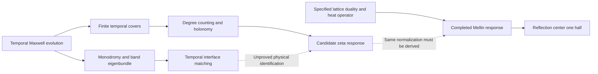

# Native objects and the missing identification

This is an investigation of constructions, not a theorem asserting that a photonic time crystal realizes Riemann zeros.

## 1. Begin with the physical geometry

Fix an ideal spatially homogeneous, lossless, nondispersive, nonmagnetic medium with positive periodic permittivity `ε(t+T)=ε(t)`. At fixed spatial momentum `k`, the transverse displacement satisfies the temporal wave equation

\[
 D''(t)+\frac{k^2}{\mu\epsilon(t)}D(t)=0.
\]

At ideal switches, the appropriate displacement and magnetic field components are continuous. One-period evolution defines a two-dimensional monodromy `M(k)`. In a normalized counter-propagating basis it has determinant one and preserves an indefinite form. Write its multipliers as `λ` and `λ⁻¹`; quasifrequency is specified by `λ=exp(-iΩT)`. This physical formulation and its assumptions are documented in the [PTC quantum account, §III.1](https://arxiv.org/html/2605.30850v1#S3.SS1).

There are several different spaces here:

| Native space/object | What it records |
|---|---|
| Physical temporal circle `R/TZ` | One material modulation cycle |
| Dual quasifrequency circle `Ω mod 2π/T` | Floquet boundary conditions |
| Band eigenline over that dual circle | Berry transport and temporal Zak phase |
| Spectral relation `det(M(k)-λI)=0` | Momentum, multipliers, and their branch structure |
| Projective two-mode space | Relative mode amplitudes and squeezing geometry |
| Two-media temporal interface | Matching of modes selected by opposite temporal ends |

The Zak invariant belongs to band transport around the dual circle. It requires the specified symmetry and band isolation. [Original PTC topology paper](https://arxiv.org/abs/1803.08731).

The quantum projective description uses a Poincaré disk and Möbius evolution; elliptic, hyperbolic, and parabolic dynamics distinguish regimes. A hyperbolic disk by itself does not specify a lattice quotient or prime orbit lengths. [Quantum geometry paper](https://arxiv.org/abs/2511.17317).

## 2. First construction test: covers of the temporal circle

A connected degree-`n` cover corresponds to the subgroup `nZ` of `π₁(S¹)=Z`. There is exactly one such subgroup for each positive integer. Composition multiplies degrees, and indecomposable positive degrees under nontrivial composition are primes. Therefore the degree Dirichlet series of cover isomorphism classes is

\[
 Z_{\rm cov}(s)=\sum_{[C\to S^1]}\deg(C/S^1)^{-s}
 =\sum_{n\ge1}n^{-s}=\zeta(s),\qquad\Re s>1.
\]

This is a genuine way for arithmetic to arise from a circle's covering structure. It is also classical subgroup-zeta mathematics, not an original result or a demonstrated optical response. [Cyclic subgroup-zeta example](https://www.research.unipd.it/retrieve/e14fb269-2fb8-3de1-e053-1705fe0ac030/perfect.pdf).

Two tests prevent premature promotion:

- The cover has `n` deck automorphisms. Inverse-automorphism weighting changes the sum to `ζ(s+1)`. The physical construction must select the measure, rather than choose it to obtain the desired center.
- Pulling a fixed temporal medium to its `n`-period cover gives monodromy `M(k)^n`. Thus the actual cover carries wave transport, not only an integer degree. Dropping that transport discards the distinctive photonic information.

**Whole-route meaning:** finite covers supply arithmetic intrinsically, but counting their bare classes does not yet solve the requested native photonic construction.

## 3. Retain holonomy instead of erasing it

For a chosen scalar holonomy `h`, winding a circle `n` times gives `h^n`. A possible degree-weighted response is

\[
 Z(s,h)=\sum_{n\ge1}\frac{h^n}{n^s}=\operatorname{Li}_s(h).
\]

This is a proposed observable, not a derived Maxwell measurement. Its classical specializations are

\[
 Z(s,1)=\zeta(s),\qquad
 Z(s,-1)=-(1-2^{1-s})\zeta(s).
\]

The second identity follows by separating even and odd integers in the convergent half-plane and then continuing analytically. [Polylogarithm definition](https://dlmf.nist.gov/25.12.E10).

If `h` is Berry holonomy, these specializations distinguish inversion-quantized Zak sectors. If `h` is a Floquet multiplier, they distinguish periodic and antiperiodic dynamical boundary conditions. These are different constructions and cannot be interchanged.

For actual monodromy, the corresponding proposed matrix observable is

\[
 \mathcal R_s(M)=\sum_{n\ge1}n^{-s}M^n.
\]

Even this definition has a physical obstruction to resolve: a multiplier with modulus greater than one prevents convergence for every fixed `s`, since exponential growth defeats polynomial damping. An additional regulator and a justified continuation would be necessary in the momentum-gap regime. Choosing that continuation is part of the model, not an automatic consequence of temporal periodicity.

**Whole-route meaning:** the band bundle suggests a holonomy-dependent family containing zeta. It does not identify zeta alone as the universal band invariant, and its continuation into amplified regimes must be derived.

## 4. Where could the critical line come from?

The physical multiplier circle `|λ|=1` is native. Its numerical identification with `Re s=1/2` is not. Defining `λ=exp(T(s-1/2))` installs the requested line by hand.

A separate classical construction uses the temporal circle's integer harmonic lattice and its dual. With a specified normalized quadratic heat operator, form

\[
 \Theta(u)=\sum_{n\in\mathbb Z}e^{-\pi n^2u},\qquad u>0.
\]

Fourier duality gives `Θ(u)=u^{-1/2}Θ(1/u)`. Mellin transformation yields, in its initial domain,

\[
 \int_0^\infty \frac{\Theta(u)-1}{2}u^{s/2}\frac{du}{u}
 =\pi^{-s/2}\Gamma(s/2)\zeta(s),\quad\Re s>1.
\]

After the usual polar subtraction, the completed function satisfies `ξ(s)=ξ(1-s)`. Its conjugate-reflection fixed locus is `Re s=1/2`. [Theta lattice transformation](https://dlmf.nist.gov/20.7.E32); [completed reflection formula](https://dlmf.nist.gov/25.4.E3).

This explains the half through a rank-one lattice duality, but uses a heat operator, measure, Mellin transform, and polar prescription. None has yet been derived as the response of the modulated Maxwell problem above. Nor is the heat variable `u` automatically laboratory time.

**Whole-route meaning:** a possible origin of `1/2` exists in the temporal circle's spectral geometry. The missing result is a physical identification of this geometry and normalization with the same construction that detects zeros.

## 5. Which native zeros should be compared?

At a temporal interface, choose a mode decaying toward the far past in the left bulk and a mode decaying toward the far future in the right bulk. At the matching time, their two state vectors define a determinant

\[
 E(k)=\det(v_{\rm past}(k),v_{\rm future}(k)).
\]

Its vanishing expresses the existence of a nonzero solution obeying both end conditions. This matching criterion is meaningful wherever those selected one-dimensional spaces exist. A global analytic determinant needs compatible local normalizations and continuation across branch points; that construction is not being assumed here.

PTC temporal interface modes lie in momentum gaps, where the constituent bulk solutions grow or decay. Consequently these modes cannot simultaneously be identified with neutral bulk modes without a separate relation between the spectral variables. [Temporal localization](https://arxiv.org/abs/1803.08731). Recent work also derives temporal localization in two-mode PT-symmetric systems beyond periodic driving, reinforcing that localization alone is not specifically arithmetic. [Sheppard and collaborators, July 2026](https://www.sciencedirect.com/science/article/pii/S2950636026002240).

The hard construction target is now concrete: derive a specified medium or a specified geometric family of media for which the globally defined, appropriately completed matching object agrees with the completed cover response, preserving its zeros and multiplicities. The medium, coordinate, completion, and measure must be fixed independently of zeta zeros. Even an identity with `ξ` must be proved, not made its definition.

## 6. Discriminating questions

1. Does repeating a physical cell select `M^n`, a cover trace, a Berry holonomy, or a different object? Derive the observable from wave evolution.
2. Why does that observable weight a degree by `n^{-s}`? What measurable or geometric parameter is `s`?
3. Does changing permittivity within the same topological phase preserve the claimed zeta object, only its divisor, or neither?
4. Do the period circle and its dual produce the required heat/Mellin duality within this same model?
5. Are the resulting zeros transmission cancellations, temporal bound states, exceptional points, or cohomology jumps? These are different notions.
6. Can one prove the native confinement statement without building zero confinement into the medium or its admissible states?

Until those questions have one coherent answer, the result is a research direction with classical components, not a completed topological reframing of RH.
