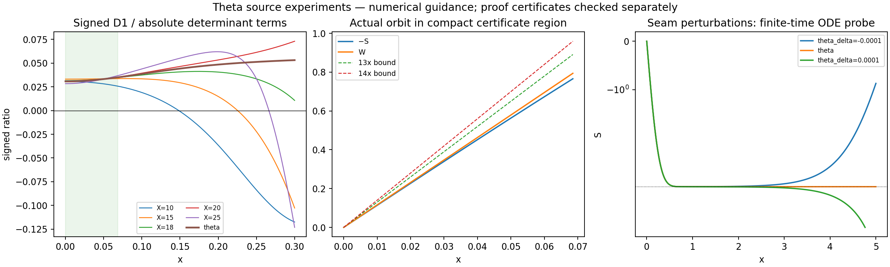

# Theta modular orbit discrimination

## Question and source

Can the exact modular theta dynamics keep the actual source inside a robust positive region
for its eighth-order reflected rank-three determinant D1? The corpus had D1 strict at the
self-dual seam and for `x >= 137/2000`, with the intervening compact interval open.

The experiment uses the literal source's existing three-coordinate closure:

```
S' = 3 - S²/3 - 3A/4
A' = -2AW
W' = 2 + A/2 + 2S²/9 - 2SW/3
(S,A,W)(0) = (0,X,0)
```

The theta value is `X = (pi theta(1)^4)^2`, approximately
`19.1570717979704364866246455267860126330559274789`.
Mass-normalized jets obey `H0=1`, `H_(n+1)=(L-S/6)H_n`, and
`f_n=(H_(n+2)-H_n/4)/2`. The complete reflected D1 is `H^6 P(S,A,W)`.
These identities come from the checked corpus, not a fitted model.

## Experiments and discriminating outcomes

1. **Nearby seam scales.** DOP853 integrates 17 initial values, with 129 compact-interval
   points and 94 additional points through `x=.3`. Compact D1 is positive at every sampled
   point for tested `X>=10`, while `X=6.25` fails. Scales `10,15,25,40` develop negative
   D1 by `.3`; the actual theta scale and tested scales from 18 through 20 do not.
   Thus generic ODE closure or a positive seam value does not itself produce the global sign.
2. **A full region, not only the trajectory.** 8192 scrambled Sobol points in
   `-1<=S<=0, 17<=A<=20, 0<=W<=6/5` have no negative D1. The smallest sampled determinant
   divided by the sum of absolute determinant terms is about `.0129513`.
3. **Frozen [BRIDGE] B1, exact candidate.** After the region observation, the protocol freezes
   positivity on that entire box. Exact rational conversion finds all 3900 tensor Bernstein
   coefficients positive. The polynomial has 540 monomials and multidegree `(24,12,11)`;
   minimum normalized Bernstein coefficient is
   `7029676472845213862296857/3355443200000000`.
4. **Positive residue / stronger derived region.** Expanding in ordinary powers of `A-17`
   leaves 13 bivariate coefficients with positive Bernstein representations in the bounded
   coordinates. Therefore the polynomial certificate needs only `A>=17`; no upper bound
   on A is necessary. `slices.json` records the independently checkable rational candidates.
5. **Independent source evaluation.** A separate differentiated theta-atom recurrence,
   using 20 shells, evaluates raw D1 divided by the common mass to the sixth power at seven
   locations. 70- and 110-digit runs agree in all 65 stored digits. At the compact endpoint
   the result is approximately `11976296222.89344656`, consistent with the ODE calculation.
   This numerical audit has no certified infinite-tail error bound and is not a proof.
6. **Longer source dynamics.** Finite-time continuation to `x=5`, stopping at state norm
   `1e5`, suggests strong separation of nearby seam values. For example `X=19.2` reaches
   the norm cap at approximately `3.62597`, and theta scale multiplied by `1.0001` at
   approximately `4.76368`. This is a possible rigidity lead. No blow-up, uniqueness,
   asymptotic classification, or zero-location theorem follows from these integrations.

## Analytic proof exposed by the data

The actual source obeys `A<20`, `-S>=0`, `W>=0`, and `A(0)>191/10` by existing unconditional
theta theorems. On `0<=x<=137/2000`, first-contact differential comparisons give

```
-S <= 13x,
 W <= 14x,
 A >= A(0)-300x²-x > 17.
```

At `-S=13x`, its derivative is strictly below 13. Given that fence, at `W=14x`, its
derivative is strictly below 14. Finally `(-A)'=2AW<=560x<600x+1` gives the third fence.
Consequently the literal full theta source lies in B1's region. This admission argument
has passed Lean in scratch and is in `ThetaCuspModularCompactTube.lean`.

The polynomial jet expansion, Bernstein identities, and final source sign weld are being
checked separately. **Until those checks pass, B1 and compact/global D1 are proof candidates.**
No numerical assertion is used as a Lean premise: emitted expressions must satisfy exact
ring identities and ordered-field proofs inside Lean.

## Consequences and limits

This exposes a plausible closure of the actual finite-order D1 gap after the full arithmetic
theta tail has already been combined. It does not provide the requested all-degree producer.
The corpus has explicit entire-function counterexamples to inferring real-rootedness even
from complete strict reflected-Hankel positivity. A successor must therefore connect actual
theta-specific identities to Xi's divisor, rather than extrapolate these finite signs.



## Reproduction

All mathematical computations ran on the authorized Runpod in
`/root/rh-theta-modular-orbit-20260906`, Python 3.8.10. Numerical source scans and independent
precision audits use 8 workers with BLAS/OpenMP threads set to 1. Individual jobs have a
120-second timeout. Recorded core runtimes are about 1.50 seconds (ODE and box), .39 seconds
(full rational certificate), 6.60 seconds (alternative representations), .47 seconds
(slice compression), and .03 seconds (independent precision audit). No hour-long job ran.

Run `experiment.py`, `bernstein.py`, `structure.py`, `slices.py`, `audit.py`, `emit_lean.py`,
and `plot.py` in that order. JSON records retain raw values and rational coefficients;
`box.npz` retains the sampled region. Generated Lean files are candidate proof source,
not trusted certificates or imported numerical evidence. Final checked modules and their
audit status are authoritative.
