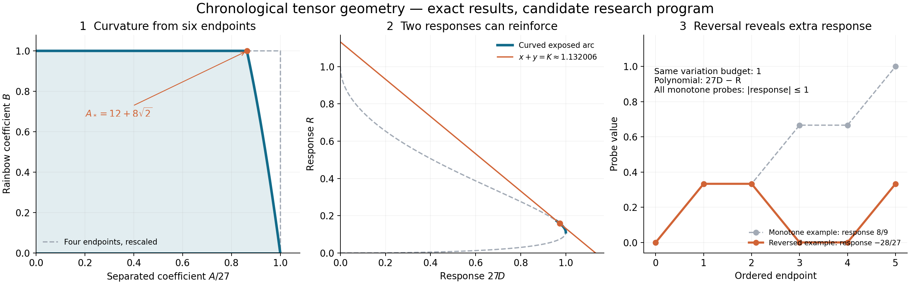

# Chronological tensor geometry: a formalized research seed

**Status:** 107 individual Lean builds passed; all 1134 declarations axiom-audited (843 theorems, 291 definitions). This is a candidate research program, not an established new field. Neither its overall novelty nor priority for its individual results has been established.

**Question.** What geometric information becomes visible when alternating tensors are tested by an ordered probe with a limited budget for changing its value?

## Objects and scope

Take ordered endpoints `0,…,2r−1`, a real probe value `x_i` at each endpoint, and a pairing D of endpoints. Set

\[
P_D(x)=\prod_{(i,j)\in D,\ i<j}(x_j-x_i),\qquad
V(x)=\sum_{i=0}^{2r-2}|x_{i+1}-x_i|.
\]

Each factor is the alternating contraction of affine vectors `(1,x_i)` and `(1,x_j)`. In gap coordinates `g_i=x_{i+1}−x_i`, it is the sum of gaps in the interval `[i,j)`. For a real linear combination P of these products define

\[
\mathcal C(P)=\sup_{V(x)\le1}|P(x)|.
\]

Translation disappears in gap coordinates. Degree r controls scaling. Two coefficient descriptions represent the same object when their response polynomials agree. The resulting space carries a norm; coefficient presentations carry a seminorm because diagram identities can produce a kernel.

`Foundations.lean` implements the more general finite-window construction, its bounded supremum, an actual mathlib `Seminorm`, and the observational kernel. It also constructs the interval specialization. It does not formalize the full invariant-theory identification with all `SL₂` tensors, or a quotient normed-space instance. Those identifications are not needed for the results below. `Models.lean` realizes the four- and six-endpoint polynomials as explicit window families and identifies their actual capacity suprema with the sharp constants and supporting arc below.

This is geometry of response polynomials. It is not a knot-isotopy invariant, a metric on physical spacetime, or a claim about quantum or gravitational dynamics.

## Foundations

For any finite window W,

\[
\left|\sum_{i\in W}g_i\right|\le\sum_{i\in W}|g_i|\le\sum_i|g_i|.
\]

Products and the triangle inequality imply `|P(g)|≤(Σ|c_D|)V(g)^r`. Thus the capacity is finite. Taking suprema of the pointwise triangle and scalar identities gives the seminorm laws. The kernel consists exactly of combinations vanishing on every budgeted probe.

The Lean construction uses the explicit map `g↦g/max(1,V(g))`; this maps onto the closed unit-variation ball and is idempotent. It avoids leaving a budget assumption as a theorem premise. `chronologicalSeminorm` is built from the proved laws, not from an assumed norm contract.

For a single diagram, replacing gaps by their absolute values preserves cost and can only increase absolute response. This assertion does **not** extend to arbitrary signed linear combinations; the reversal theorem below supplies a counterexample.

## Four endpoints: a rectangular ball

With three gaps `(u,v,w)`, let

\[
D=uw,\qquad N=v(u+v+w),\qquad C=(u+v)(v+w).
\]

The Plücker identity is `C=D+N`. The exact capacity is

\[
\boxed{\mathcal C(aD+bN)=\max(|a|/4,|b|).}
\]

**Proof.** Put `U=|u|`, `B=|v|`, `W=|w|`, `T=U+B+W`. Triangle inequalities and `(U−W)²≥0` give `4|D|+|N|≤T²`. Hence the displayed maximum is an upper bound. The unit-cost probes `(1/2,0,1/2)` and `(0,1,0)` attain `|a|/4` and `|b|`, respectively. The coefficient unit ball is therefore `|a|≤4`, `|b|≤1`. All statements are formalized in `FourPoint.lean`.

## Six endpoints: curved support and an exact transition

With gaps `(a,b,c,d,e)`, put

\[
D=ace,\qquad R=(a+b+c+d+e)(b+c+d)c.
\]

These are the separated pairing `(01)(23)(45)` and the rainbow pairing `(05)(14)(23)`. Write `T=|a|+|b|+|c|+|d|+|e|`, `x=|b|+|c|+|d|`, `y=|a|+|e|`, so `T=x+y`. For arbitrary real A,B,

\[
|AD+BR|\le\frac{|A|}{4}xy^2+|B|(x+y)x^2.\tag{1}
\]

**Proof of (1).** Bound the two interval sums by T and x; use `|c|≤x` and `|a||e|≤y²/4`. Every factor subsequently multiplied is nonnegative. For `A,B≥0`, equality is achieved by gaps `(y/2,0,x,0,y/2)`. Thus the positive coefficient quadrant reduces exactly to the response curve

\[
\phi(z)=\left(\frac{z(1-z)^2}{4},z^2\right),\quad 0\le z\le1.
\]

For `1/3≤q≤√2−1`, coefficients and capacity are

\[
A=8q,\quad B=(3q-1)(1-q),\quad L=q^2(1-q^2).
\]

**Exact support certificate.** For all x,y,q,

\[
L(x+y)^3-\{2qxy^2+(3q-1)(1-q)(x+y)x^2\}
=(x-q(x+y))^2\{(1-q^2)(x+y)-2qx\}.
\]

On the stated q interval and for nonnegative x,y, the final factor is nonnegative because `1−q²−2q≥0`. Equation (1) therefore proves the global upper bound `L T³`. Gaps `((1−q)/2,0,q,0,(1−q)/2)` have cost one and attain L. In Lean the interval is generated by clamping an arbitrary real parameter; its bounds are proved internally.

The **actual** first and second derivatives satisfy

\[
\det(\phi'(q),\phi''(q))=\frac{1-3q^2}{2}>0
\]

on this whole arc. `Curvature.lean` proves the derivative statements, supporting bound, and attainment. This establishes a strictly turning dual response arc; it is not a formal proof of every topological property of the entire unit-ball boundary.

For the ray `AD+R`, the exact plateau endpoint is

\[
\boxed{A_*=12+8\sqrt2.}
\]

**Transition proof.** At this weight,

\[
(x+y)^3-\left\{\frac{A_*}{4}xy^2+(x+y)x^2\right\}
=y(\sqrt2x-y)^2.\tag{2}
\]

Hence capacity is one at the threshold, and stays one for `0≤A≤A_*`: the upper bound decreases with A, while a pure central jump always attains one. At `q=√2−1`, the distributed unit-cost probe also attains one. Its D-value is strictly positive, so every `A>A_*` gives response strictly above one at that same probe. This proves the iff classification. Equation (2) also classifies equality in the reduced mass problem: `y=0` or `y=√2x`. `Transition.lean` checks the classification and both distinct optimizing probes.

## An algebraic capacity greater than one

For `27D+R`, define

\[
q_0=\frac{50-\sqrt{313}}{81},\qquad
K=\frac{27}{4}q_0(1-q_0)^2+q_0^2\approx1.132005672.
\]

Then `C(27D+R)=K>1`.

**Proof.** The quadratic equation `81q₀²−100q₀+27=0` and bounds `0≤q₀≤5/12` follow from `(√313)²=313`. The cubic gap factors as

\[
K(x+y)^3-\left\{\frac{27}{4}xy^2+(x+y)x^2\right\}
=(x-q_0(x+y))^2\left\{\left(\frac{25}{2}-\frac{27q_0}{2}\right)(x+y)-\frac{27x}{4}\right\}.
\]

The last factor is nonnegative for x,y≥0 by the displayed bound on q₀. Apply (1). The same distributed probe at q₀ attains K. The rational probe `(1/3,0,1/3,0,1/3)` already attains `10/9`, proving `K>1` without estimating the radical. `SixPoint.lean` proves the global bound and both witnesses.

## Reversing a probe reveals additional information

Individually `C(27D)=C(R)=1`. For the separated term this follows from (1) and

\[
(x+y)^3-\frac{27}{4}xy^2=(x-y/2)^2(x+4y),
\]

with equality at three equal separated gaps. For R, bound each interval factor by T; a pure central jump attains one.

On monotone probes both normalized terms lie in `[0,T³]`, so

\[
|27D-R|\le T^3.
\]

The pure central jump attains absolute value one. In contrast, gaps `(1/3,0,−1/3,0,1/3)` have cost one and response `−28/27`. Thus **the signed capacity is strictly greater than the monotone capacity**. `Reversal.lean` proves both claims. The exact signed optimum is not asserted.

## Amplification at every finite scale

Take n independent six-endpoint blocks and write `P_i=27D_i+R_i`. Use the shared cost `T=ΣT_i` and the normalized product

\[
F_n=n^{3n}\prod_{i=1}^n P_i.
\]

Then

\[
\boxed{\mathcal C(F_n)=K^n.}
\]

**Proof.** The six-endpoint bound gives `|∏P_i|≤Kⁿ(∏T_i)³`. Finite AM–GM gives `nⁿ∏T_i≤(ΣT_i)ⁿ`. Combining proves the upper bound. Scale every optimal unit-cost block probe by `1/n`; the shared cost is one and its response is exactly Kⁿ. Scaling the rational probes instead gives `(10/9)ⁿ`. `Fusion.lean` proves this for every n, including an empty-product bound and constructive witnesses for every positive n.

Expanding the product yields `2ⁿ` terms indexed by choices of a separated or rainbow block. **Each individual normalized term has capacity exactly one.** The upper bound uses the same AM–GM argument with each individual block capacity one. Attainment follows by choosing an optimal unit probe for the selected block type and scaling by `1/n`. `Amplification.lean` proves the expansion, all individual bounds, and witnesses for every choice.

Consequently the maximum of the individual normalized coefficient magnitudes does not control the capacity by any degree-independent constant. This is a property of this explicit graded family, not a general theorem claiming that collective amplification or tensor-product norm phenomena were previously unknown. Between-block connector gaps, if included in a single long endpoint sequence, do not affect any response and only add cost; setting them to zero gives the same optimum.

## Enclosure depth competes with degree

There is a further operation intrinsic to the chord description: add an outer chord whose two probe values equal the initial and final values of the existing history. The added factor is total signed displacement `S=Σg_i`. Repeating it k times multiplies the response by `S^k`. The extra endpoints can be assigned repeated probe values, so the variation cost is unchanged. This is an algebraic enclosure operation with prescribed repeated endpoint values. Allowing the new outer endpoints to vary freely introduces padding gaps and a different capacity optimization; the present theorems must not silently be read as statements about that larger optimization. No physical-horizon claim is made.

For n independent reversal blocks define

\[
E_{n,k}=S^k n^{3n}\prod_{i=1}^n(27D_i-R_i).
\]

For every n≥1 and k≥0 its monotone capacity is exactly one. The upper bound combines the monotone block estimate, finite AM–GM, and `S=T` on monotone probes. Repeating the pure central jump at block cost `1/n` attains absolute value one.

Repeating the reversed rational probe at block cost `1/n` gives total displacement `1/3`, hence the exact unit-cost response magnitude

\[
\boxed{|E_{n,k}|=(28/27)^n/3^k.}
\]

Bernoulli's inequality gives `(28/27)^54≥1+54/27=3`. Consequently, for every k, choosing `n=54(k+1)` produces a signed unit-cost probe with response at least three, while the entire monotone unit ball remains bounded by one.

Thus no finite enclosure depth can uniformly remove reversal advantage across this graded family. The positive quantitative content is the exact witness law and an explicit sufficient linear degree-versus-depth bound. This does not rule out convergence to monotone capacity when the underlying response polynomial is fixed and only k tends to infinity. `Enclosure.lean` checks this whole argument, including the exact witnesses, monotone upper bound, and survival at every finite depth.

## Every fixed response stabilizes after finite enclosure

Let P be a homogeneous window polynomial of degree r on at least one gap, with coefficient presentation `P=Σ c_D P_D`. Put

\[
M=\sup_{g_i\ge0,\,\sum g_i\le1}|P(g)|,\qquad L=r\sum_D|c_D|,
\qquad C_k=\sup_{V(g)\le1}|S(g)^kP(g)|.
\]

Then, for every integer k≥1,

\[
\boxed{M\le C_k\le\max\{M,L/k\}.}\tag{3}
\]

Consequently **every fixed P has a finite enclosure depth after which `C_k=M` exactly**. If M>0, every integer k≥1 with kM≥L suffices. If M=0, P vanishes identically and all capacities are zero. The bound depends on the chosen coefficient presentation; minimal stabilization depth is an intrinsic quantity and may be much smaller.

**Proof of the comparison estimate.** Each window has absolute value at most one on the unit-variation ball. Telescoping a product of r window values therefore bounds its change between g and h by `r V(g−h)`. Summing with absolute coefficients gives `|P(g)−P(h)|≤L V(g−h)`. Orient g so that S(g)≥0; this preserves |P(g)| by homogeneity. Replacing g by |g| then has exact distance `V(g)−|S(g)|≤1−|S(g)|`. Writing z=|S(g)| gives

\[
|P(g)|\le M+L(1-z),\qquad 0\le z\le1.
\]

For k≥0 the elementary inequality `z^k(1+k(1−z))≤1` follows by induction: the expression decreases at step k by `(k+1)z^k(1−z)²`. Set `B=max(M,L/k)` for k≥1. Then

\[
z^k|P(g)|\le Bz^k(1+k(1-z))\le B.
\]

This proves the upper bound. For the lower bound, every nonnegative unit-sphere probe has S=1. Radial scaling shows that their supremum equals M; when the original probe is zero, use a unit coordinate probe and homogeneity. Thus multiplying by S^k preserves all these unit-sphere responses.

**The zero case is proved, not assumed away.** If M=0, homogeneity makes P vanish on the entire nonnegative orthant. For arbitrary g, the univariate polynomial

\[
q(t)=P\bigl(|g|+t(g-|g|)\bigr)
\]

vanishes on `[0,1/2]`, where every coordinate of its argument is nonnegative. Infinitely many roots force q=0, hence P(g)=q(1)=0. In Lean this is an actual `Polynomial ℝ` with a checked evaluation identity.

For the six-endpoint reversal form, `M=1` and `L=3·28=84`. `SealingExamples.lean` proves `C_(84+k)=1` for every natural k. This is a sufficient depth, with no claim of minimality.

`ProbeComparison.lean` proves the telescoping estimate and orientation argument. `Sealing.lean` defines both capacity suprema, proves (3), proves equality of the monotone and signed observational kernels, and closes `eventual_exact_sealing` with no nonzero-response premise. This is stronger than the earlier proposed convergence statement. Together with the enclosure survivors, it shows a genuine distinction between fixing a polynomial and allowing its degree to grow; no conflict between the two quantifier orders occurs.

## A universal bound depending only on degree

For every homogeneous window form of degree d≥2, on any nonempty finite gap space,

\[
\boxed{C_{d(d-1)+k}=M\quad\text{for every integer }k\ge0.}\tag{4}
\]

The bound is independent of coefficients and the number of gaps. In particular, the original cubic reversal form stabilizes by depth six. The claim here is a universal upper bound; optimality of this degree bound for genuine chord pairings is not asserted.

**Chebyshev growth ingredient.** The classical extremal theorem bounds a degree-d polynomial q with `|q|≤1` on `[-1,1]` by `|q(x)|≤T_d(x)` for x≥1. This theorem is already formalized in mathlib. The further elementary majorant

\[
T_d(x)\le x^{d^2}\qquad(x\ge1)
\]

follows from `cosh(dt)≤cosh(t)^(d²)` for t≥0. Here is a direct proof of the latter. Hyperbolic addition inductively gives `sinh(nt)cosh(t)≤n sinh(t)cosh(nt)`. Writing c=cosh(t), s=sinh(t), this and Bernoulli's inequality give

\[
\cosh((n+1)t)c\le\cosh(nt)\{1+(n+1)s^2\}
\le\cosh(nt)c^{2(n+1)}.
\]

Induction, cancellation of c>0, and `n²+2(n+1)=(n+1)²+1` finish. Substitute t=arcosh(x). `ChebyshevGrowth.lean` checks this argument without estimates or numerical certificates.

**Jordan reduction.** Take a unit-budget signed probe g. Reverse its global sign if needed, so `S=Σg_i≥0`, and put `V=Σ|g_i|≤1`. The nonnegative vectors `|g|+g` and `|g|−g` have masses V+S and V−S. Normalize them to monotone unit probes u,v, choosing any unit coordinate probe if a mass vanishes. For S>0,

\[
g=S\left\{\frac{1+V/S}{2}u+\frac{1-V/S}{2}v\right\}.
\]

Restrict P to the segment between u and v. This produces a polynomial q of degree at most d, bounded in absolute value by M on `[-1,1]`. Homogeneity and Chebyshev growth imply

\[
|P(g)|=S^d|q(V/S)|\le M S^d(V/S)^{d^2}.
\]

Multiplication by `S^(d(d−1))` cancels the denominator exactly and leaves `M V^(d²)≤M`. When S=0 the positive enclosure exponent makes the response zero. Monotone unit probes supply the reverse inequality. Finally, enclosure capacity decreases with depth since `|S|≤1`, so equality persists.

`SegmentExtrapolation.lean` builds the actual segment polynomial and checks its degree, evaluation, and norm bound, including M=0. `DegreeSealing.lean` proves the Jordan identity, (4), depth monotonicity, and the cubic depth-six corollary. General polynomial growth is established mathematics; this enclosure specialization is being developed as a structural ingredient of the research program.

## The degree bound is sharp for finite windows

For d≥2, let `p_d(t)=T_d(2t−1)` and define the genuine homogeneous polynomial

\[
H_d(x,y)=\sum_{i=0}^d [t^i]p_d(t)\,x^i(x+y)^{d-i}.
\]

This definition is valid even at x+y=0. Away from that line it equals
`(x+y)^d T_d((x−y)/(x+y))`. Each monomial is a product of d allowed windows: i copies of the singleton window `{0}` and d−i copies of the full two-gap window. `BinaryWindows.lean` constructs these windows recursively and proves their evaluation and homogenization formulas for arbitrary univariate polynomials.

On x,y≥0 with x+y≤1, write S=x+y. If S>0, the Chebyshev argument is in `[-1,1]`, giving `|H_d(x,y)|≤S^d≤1`; S=0 gives x=y=0. The probe (1,0) attains one. `ChebyshevWindows.lean` therefore proves that the actual monotone capacity is exactly one, including the normalized-supremum definition.

For any k<d(d−1), put `Q(t)=T_d(t)−t^(d+k)`. The classical endpoint identities give

\[
Q(1)=0,\qquad Q'(1)=d^2-d-k>0.
\]

Consequently some t>1 has `T_d(t)>t^(d+k)`. At the signed probe

\[
(x,y)=\left(\frac{t+1}{2t},\frac{1-t}{2t}\right)
\]

variation is exactly one, displacement is 1/t, and enclosed response is
`t^(−d−k)T_d(t)>1`. Thus the capacity cannot have stabilized at depth k. Together with (4), this proves

\[
\boxed{N(H_d)=d(d-1),\qquad C_k(H_d)=1\iff k\ge d(d-1).}
\]

Its enclosure curvature is positive precisely at `k=0,…,d(d−1)−1`. `SharpDepth.lean` proves the endpoint existence argument through real derivatives and neighborhood filters, builds the signed probe, and establishes exact depth and curvature support. All three leaf builds and all eighteen declaration axiom audits passed. No computation was needed.

This establishes optimality in the unrestricted finite-window class. The repeated windows do not assert a presentation by perfect matchings of distinct ordered endpoints. Sharpness for those more structured spaces remains a separate question. The Chebyshev polynomial and its extremal mechanisms are classical; this result is an enclosure-depth application, with priority still under review.

**Perfect-pairing separation in degree two.** The three pairings of four ordered endpoints give `D=uw`, `N=v(u+v+w)`, and `X=(u+v)(v+w)=D+N`. Hence every coefficient triple c has response `(c₀+c₂)D+(c₁+c₂)N`. The four-endpoint capacity formula is attained by monotone unit probes, so every enclosed capacity is already equal to monotone capacity and every such form has depth zero. `PairingDepth.lean` proves the exact capacities, depth zero for all three-generator combinations, and the explicit contrast with `N(H₂)=2`. Its final build and all nine declaration axiom audits passed. Thus the sharp generic degree bound is demonstrably not sharp in the perfect-pairing subspace in degree two.

## Reversal has a sharp three-gap activation threshold

For every nonempty perfect-pairing family, a signed probe that exceeds monotone capacity must have at least three nonzero increments. This bound is attained by the six-endpoint reversal form and its unit probe `(1/3,0,−1/3,0,1/3)` of response `−28/27`.

The structural reason is incidence rigidity. Two active gaps split the endpoints into three consecutive blocks of sizes a,b,c. A pairing with an intrablock chord vanishes. Every other pairing has exactly `d−c` chords between the first two blocks, `d−a` between the last two, and `d−b` between the first and last. Thus all nonzero restrictions share the monomial `u^(d−c) v^(d−a) (u+v)^(d−b)`. Arbitrary coefficient cancellation reduces to a common scalar. Replacing u,v by their absolute values increases absolute response while preserving variation.

`ThreeBlock.lean` derives these incidence identities from actual endpoint bijections. `TwoGap.lean` connects them to interval windows and the normalized capacity. `Activation.lean` handles arbitrary supports of size at most two and constructs the sharp three-gap witness with genuine pairings. All three final builds and all 55 declaration axiom audits passed. The [complete proof and representation details](chronological-two-gap-rigidity.md) distinguish consecutive chronological blocks from repeated visits to three spatial values.

## One enclosure: an exact cubic depth

**Theorem.** For arbitrary signed gaps,

`|S(27D−R)| ≤ V⁴`, where `S=a+b+c+d+e` and `V=|a|+|b|+|c|+|d|+|e|`.

`OneEnclosure.lean` has passed its final leaf build. The following proof uses no optimizer output.

First put `x=|b|+|c|+|d|`, `y=|a|+|e|`. The majorant for the cubic has the rational envelope `|27D−R|≤(8/7)V³`, certified by

`(8/7)(x+y)³−[27xy²/4+(x+y)x²]`
`= (3x−2y)²(x+21y)/75 + (x−y/2)²(x+4y)/81 + 149(x+y)³/14175`.

Thus `|S|≤7V/8` proves the desired quartic inequality. Otherwise reverse all gaps if necessary so that `S≥7V/8`. Write `M=b+c+d`, `L=|b|+|c|+|d|`, `u=a+e`, `w=|a|+|e|`. The response is `c(27ae−SM)`.

When `ae` and `M` have the same weak sign, the two terms subtract with the same sign. The individual bounds `|27D|≤V³`, `|R|≤V³`, and `S≤V` suffice.

If `ae≥0` and `M≤0`, then `u≥0` and `w=u`. Triangle inequalities give `2|c|≤V−S`, hence `S|c|≤V²/8`. Also `4ae≤u²` and `4S(−M)≤u²≤V²`. Therefore `27ae−SM≤7V²`, and the enclosed response is at most `7V⁴/8`.

If `ae≤0` and `M≥0`, put `z=u+L`. Then `S≤z≤V`, `2L≤V+z`, and `w²−u²=−4ae`. Replacing `M` and `|c|` by their bounds `L` reduces the response to

`f(L)=27Lz(V²−z²)/4−L²z(27V−29z)/2`.

Set `H=(V+z)/2`. The exact difference is

`f(H)−f(L)=(H−L)z[27(V²−z²)/4−(27V−29z)(H+L)/2]`.

The bracket is nonnegative: if `27V−29z≤0`, both terms have the required sign; otherwise use `H+L≤V+z` and `31z≥27V`. Thus `f(L)≤f(H)=z²(V+z)²/4≤V⁴`. Zero variation is already included in every inequality.

**Cone consequence (final Lean audit passed in EnclosureCone).** For `0≤A≤27B`, write `AD−BR=B[q(27D−R)−(1−q)R]`, with `0≤q≤1`. Triangle inequality gives `|S(AD−BR)|≤BV⁴`. A pure central jump attains `B`, and the monotone lower bound persists at every depth. Thus `C_k(AD−BR)=M=B` for all `k≥1`. For `A=27,B=1`, the earlier rational reversal witness proves `C_0>1`; its exact minimum enclosure depth is therefore one. The broader claim that this convexity argument covers the entire coefficient plane was rejected: for `A>27B`, cancellation can make monotone capacity strictly smaller than `A/27`.

The remote [enclosure search](../2-fully-proven/computations/chronological-chord-capacity/ENCLOSURE-REPORT.md) prompted this proof and found an unsealed response near `1.04387639`. Identification of that value as the global signed optimum remains open.

## Finite curvature and reconstruction

Let `C_k` be the enclosed capacity and `M` the monotone capacity, on a nonempty finite gap space. Define

`κ_k = C_k−2C_(k+1)+C_(k+2)`.

**Theorem.** The capacity sequence is log-convex, `C_(k+1)²≤C_k C_(k+2)`. Moreover,

- `C_k=C_(k+1)` iff `C_k=M`;
- `C_(k+1)<C_k` iff `M<C_k`;
- `κ_k≥0`, and `κ_k=0` iff `C_k=M`.

For each fixed probe the absolute enclosed response is a geometric sequence. Its middle value squared equals the product of its neighbors. Bounding both neighbors by their capacity suprema and then taking the middle supremum proves log-convexity, including zero capacities. If adjacent capacities agree at a positive value, log-convexity and monotonicity force the next capacity to agree; induction makes the entire tail constant. Finite exact stabilization identifies that constant as M. At value zero, nonnegativity and the monotone lower bound give the same result. The second-difference claims follow from log-convexity and the nonnegative square `(C_k−C_(k+2))²`. These arguments are checked in `EnclosureCurvature.lean`.

Define the **enclosure depth** `N` as the least natural k with `C_k=M`. Existence is already proved, so this definition requires no additional hypothesis. Then

`κ_k>0 ⇔ k<N`, and `κ_k=0 ⇔ N≤k`.

Thus curvature has finite support with no gaps. The degree bound gives `N≤d(d−1)` for d≥2, while the cubic reversal form has `N=1`.

**Reconstruction theorem.** For every k,

`C_k−C_(k+1)=Σ_(j<N) κ_(k+j)`,

`C_k=M+Σ_(j<N) (j+1)κ_(k+j)`.

The proof is finite telescoping. For an arbitrary sequence F,

`Σ_(j<N)(j+1)[F_(k+j)−2F_(k+j+1)+F_(k+j+2)]`
`=F_k−(N+1)F_(k+N)+N F_(k+N+1)`.

Both terminal values are M for the capacity sequence. No limiting interchange or numerical approximation is involved. `CurvatureDepth.lean` checks the least-depth definition, exact support, and both reconstruction identities; its final leaf audit passed. Curvature here is a discrete second difference of an operational norm profile, not Riemannian curvature. Log-convexity and finite-difference inversion are familiar mathematics; the contribution under investigation is their combination with finite enclosure stabilization in this tensor setting.

## Free padding and common-cut reduction

Append an unused gap p to the observer. The payload polynomial does not change, but its enclosing displacement becomes `p+S` and cost becomes `|p|+V`. `Padding.lean` proves that this operation preserves signed and monotone capacities, can only increase enclosed capacity and minimal depth, and retains the degree bound because payload degree is unchanged. Its final leaf build passed.

For the cubic, the free-padding estimate is particularly direct:

`|(p+S)(27D−R)|≤|p|(8/7)V³+V⁴≤(|p|+V)⁴`.

The last gap equals `|p|⁴+4|p|³V+6|p|²V²+(20/7)|p|V³`, termwise nonnegative. `PaddedCubic.lean` has passed its final leaf build and proves exact minimal depth one even with this additional freedom.

For a family of outer chords, let q be their padding gaps. Every outer factor has the form `S+Σ_(i∈W_j)q_i`. If the windows share a padding cut, each absolute factor is at most `|S|+Σ|q_i|`. Concentrating all padding variation in the shared cut, with sign aligned to S, attains every such bound simultaneously and preserves cost. Fully nested outer chords have such a cut immediately outside the original history.

The Lean presentation generates each outer window as `{0}∪succ(W_j)`, so the common cut is built into the object without an external assumption. `CommonCut.lean` proves cost-preserving domination and simultaneous attainment. `OuterCapacity.lean` constructs the full capacity with a shared normalization factor `max(1,V_payload+V_padding)` and proves

`outerCapacity(D,c,W)=sealedCapacity(padWindows(D),c,k)`.

For the upper bound, concentrate the normalized padding at the shared cut and apply the padded capacity bound; the resulting combined probe still has variation at most one. For the reverse bound, take any normalized padded probe and insert its padding coordinate at the shared cut, setting all other padding gaps to zero. Joint normalization then fixes the probe and reproduces its response exactly. Both leaf builds and all declaration axiom audits passed.

Consequently the detailed outer-window arrangement is invisible to this capacity whenever a shared padding cut exists. The positive statement is the exact reduced model, with its degree bound and curvature reconstruction; the cubic remains depth one with free padding. The formalization covers the generated finite outer windows. An explicit constructor connecting them to the corpus ChordData record has not yet been added.

## The exact cubic norm and the information lost by retraction

The five genuine noncrossing pairing coordinates on the physical gaps are

`ace`, `ad(c+d+e)`, `be(a+b+c)`, `Sbd`, `Sc(b+c+d)`,

where S is the total gap sum. CubicPairings supplies explicit endpoint bijections and identifies their actual monotone capacity with the supremum on the physical sparse section. Define

`J(A,E)=max_(0≤t≤1) |(A/4)t(1−t)²+Et²|`.

CubicArcNorm and CubicNorm prove the exact formula

`M(A,B,C,D,E)=max(J(A,E),4|B|/27,4|C|/27,|D|/4)`.

The physical complex has one triangular face with support {0,2,4} and three additional edges. Fixing the middle coordinate t on the triangle, the product of the outer coordinates lies between zero and (1−t)²/4. The absolute affine response is bounded by its two endpoint values; the first is at most |E|, which the balanced arc already attains at t=1. The three edges have sharp constants 4/27, 4/27, and 1/4, attained by the explicitly formalized probes. This proves both sides of the actual supremum formula.

The unit ball is therefore the J-ball in (A,E) times the intervals |B|≤27/4, |C|≤27/4, |D|≤4. CubicNormLaws proves absolute homogeneity, triangle inequalities, trivial kernels, and actual maximum attainment. The five observations are independent on the physical section.

The ring retraction induces the coefficient projection (A,B,C,D,E)↦(0,B,C,D,0). It has norm at most one and retains exactly the three interval factors. Its kernel is the entire curved J-plane, and

`M(A,B,C,D,E)=max(M(A,0,0,0,E),M(0,B,C,D,0))`.

Thus this homotopy equivalence loses a precisely classified normed subspace. The full paper proof is in [monotone coalescence](../2-fully-proven/chronological-monotone-coalescence.md).

## Zeta from the algebra of lost observations

The [observation cusp](../2-fully-proven/chronological-observation-cusp.md) now has a second complete geometry-to-zeta chain. Let W be the smallest linear space containing the original five pairing observations and preserved by every intermediate retraction. Let L=W∩ker T₀, where T₀ is pullback by the final ring retraction. These definitions refer only to the original observations and their physical flow.

CubicInvariantSpace proves dim W=6 and its minimality; CubicCanonicalLoss proves dim L=3. With c the middle gap, its basis is

`u=ace+c²/2−c³/4`, `v=c²`, `w=c³`.

The algebra generated by L is precisely A=ℝ[u,c²,c³] as actual functions on the physical section. CubicPolynomial proves that u and c are algebraically independent using two infinite-root arguments. CubicCuspAlgebra identifies A with the polynomials whose coefficient of c is zero. Hence the algebra was selected by the lost observations, and its presentation is faithful.

CubicCuspNormalization proves that B=ℝ[u,c] is the integral closure of A in their common fraction field. CubicCuspQuotient constructs the actual vector-space equivalence B/A≃ℝ[u] and its basis `[u^n c]`, n≥0. CubicCuspFlow proves that polynomial substitution agrees with physical pullback, descends to this quotient, and acts on the nth basis vector by q^(n+1).

CubicCuspHeat defines each heat summand as the corresponding diagonal coefficient of this actual quotient operator. For τ>0 their sum and its continuous reference are

`H(τ)=Σ_(n≥1)exp(−nτ)=1/(exp τ−1)`, `C(τ)=∫_(x>0)exp(−xτ)dx=1/τ`.

CubicCuspMellin proves absolute Mellin convergence of C−H on 0<Re s<1, and

`∫_(τ>0)τ^(s−1)(C(τ)−H(τ))dτ=−Γ(s)ζ(s)`.

It proves equality with zeta's zero locus and every zero multiplicity on that strip. The construction contains no prime data or zeta zeros in its definitions. The explicit three-variable ideal quotient ℝ[U,V,W]/(W²−V³) remains a paper presentation; the equivalent concrete subalgebra and all bridges needed for this response are formal.

This identifies a precise mechanism, not a priority claim. Cusp normalization is classical. In particular, the normalization quotient underlying the delta invariant and its related series are established singularity theory; see [Cogolludo-Agustín et al. (2024), §2.3](https://doi.org/10.1007/s40687-024-00457-8). He [§4.1.2](https://arxiv.org/pdf/1003.2986) has the identical weighted Hilbert series, and [He–McKay, §5](https://arxiv.org/pdf/1308.5233) already connect Hilbert coefficients and Dirichlet series. The candidate contribution is the canonical chronological selection and its consequences.

The [observation-repair extension](../2-fully-proven/chronological-observation-repair.md) is now formalized in eleven additional leaves. Every intermediate algebra corresponds to an ideal of ℝ[u], and B remains its integral closure in the same fraction field. Preserving the single half-retraction already forces the complete list A and A_k=ℝ[u,c²,c³,u^k c], with unique k. The actual quotient B/A_k has dimension k and physical flow weights 1,…,k. Adding any polynomial observation P and taking the least invariant algebra yields A when coeff_c(P)=0, otherwise A_ord₀(coeff_c(P)).

Its actual finite heat and matching continuum integral satisfy

`H_k(τ)=(1−exp(−kτ))/(exp τ−1)`, `C_k(τ)=∫_0^k exp(−xτ)dx=(1−exp(−kτ))/τ`.

Thus the finite response kernel is b_k=(1−exp(−kτ))b. CubicRepairLimit proves an exact exponential kernel error, absolute Mellin convergence, and `lim_k mellin(b_k)(s)=−Γ(s)ζ(s)` throughout the open unit strip. No statement identifies each finite response's zeros with zeta's zeros. The explicit finite Gamma/power-sum expression remains paper-only. Novelty remains unestablished.

CubicRecovery resolves the [uniform-recovery stress test](../2-fully-proven/chronological-observation-recovery.md). It constructs P₀=0 and P_(n+1)=P_n+(c²−P_n²)/2 inside A, proves physical uniform error ≤2/(n+2), and rules out any positive uniform separation of c from A. This distinguishes exact algebraic loss from finite-accuracy recovery. The positive survivor is an explicit recovery family with a certified rate. The [flow-compatible recovery theorem](../2-fully-proven/chronological-equivariant-recovery.md) is now formal in four additional leaves. Define admissibility directly on observed functions f in the lost algebra by T_(1/2)f=f/2. Such functions are exactly αu. Their minimum physical uniform error for recovering c is

`δ=(17√17−55)/118>0`, uniquely at `α=(126+34√17)/59`.

The two realizing probes have c=1 and c=(√17−3)/4 on the physical edge (1−c,0,c,0,0). CubicRecoveryGeometry proves the matching global bound and uniqueness; CubicEquivariantRecovery transfers them to the intrinsic set of actual observed functions. This supplies a positive separation when recovery must preserve the physical scaling, despite unrestricted recovery having error tending to zero.

The [general homogeneous-boundary reduction](../2-fully-proven/chronological-homogeneous-boundary.md) is now formal in seven leaves, 66 declarations. Every physical (u,c) pair is a contraction of a realized edge point, including the degenerate corners. Every homogeneous physical capacity is an attained edge maximum; its seminorm has zero kernel. The weight-k polynomial space is explicitly equivalent to ℝ^(k+1), and cusp membership excludes exactly the u^(k−1)c coefficient for positive k.

For k≥1, the set of every possible homogeneous recovery error for u^(k−1)c is exactly the set of values

`max_(0≤r≤1/4) (1−√(1−4r))^k |R(r)|`, with `deg R≤k`, `coeff_(k−1)R=1`.

Both the coefficient correspondence and the inverse change of variable are formal; this is not merely an upper bound. The [weighted coefficient-duality paper](../2-fully-proven/chronological-weighted-coefficient-duality.md) derives the unique optimizer from classical weighted Chebyshev alternation and interpolation. The general Chebyshev optimizer and uniqueness remain paper-only; positive optimal gaps and attainment are now formal via finite-dimensional compactness.

The [graded Hilbert construction](../2-fully-proven/chronological-graded-hilbert-defect.md) adds eight leaves and 79 declarations. At weight k+1, the normalized residuals form a nonempty closed affine hyperplane in a proper finite-dimensional normed space. The physical norm attains a strictly positive minimum δ_k there. The sharp bound δ_k|λ_k(P)|≤‖P‖ is attained at every coefficient. The actual quotient by available homogeneous observations therefore has the attained infimum norm δ_k|λ_k|.

Each quotient becomes a complete real Hilbert line with inner product δ_k²λ_k(x)λ_k(y). Their orthogonal sum H is complete. The original normalization quotient B/A embeds into H with exact missing-coefficient recovery, injectivity, and dense range. Pulling back the norm and inner product equips B/A with the graded physical geometry

`‖x‖²=Σ_(k≥0) δ_k² |coeff_k(cubicCuspDefectEquiv x)|²`.

The embedding is an isometry, and CubicDefectCompletion constructs an actual AbstractCompletion with carrier H. In particular ‖[u^k c]‖=δ_k. This topology preserves each grade's optimal physical recovery cost; the unrestricted uniform quotient seminorm still vanishes on c. Six further leaves, 59 declarations, now complete the analytic trace and rigidity bridges. The physical flow has a unique continuous extension to H, is positive and symmetric, satisfies T_qT_r=T_(qr), and has exact operator norm q. The physically normalized vectors b_k=[u^k c]/δ_k form an actual Hilbert basis.

For 0≤q<1, T_q is Hilbert–Schmidt and factors as T_(√q)T_(√q). The corpus's basis-independent analytic ContinuousLinearMap.opTrace then gives

`tr(T_q)=q/(1−q)`, hence `tr(T_(exp(−τ)))=1/(exp τ−1)` for τ>0.

CubicHilbertTrace also proves that the diagonal sum converges to this value in every Hilbert basis. CubicHilbertMellin forms the response from this operator trace and the actual continuous reference integral. Its absolutely convergent Mellin transform on 0<Re s<1 is −Γ(s)ζ(s), with exactly the zeta zero locus and every zero multiplicity there.

CubicHilbertRigidity characterizes the graded inner product directly on original B/A: among real bilinear forms, the physical diagonal values B(e_k,e_k)=δ_k² and symmetry of the single half-flow select exactly one form. Orthogonality and positive definiteness follow from that characterization.

[Multiplication by the actual mode u](../2-fully-proven/chronological-recovery-shift.md) is now formalized in five additional leaves (45 declarations). It induces a unique bounded Hilbert operator with weights δ_(k+1)/δ_k≤1/4 and covariance T_qU=qUT_q. Its exact backward adjoint gives a nonzero self-commutator; positivity of that operator on the entire completion is equivalent to gap log-convexity. These weighted-shift principles are classical. The unresolved mathematical target is the behavior of this particular sequence. A new [paper proof of its exponential rate](../2-fully-proven/chronological-recovery-exponential-rate.md) derives lim δ_k^(1/k)=ρ≈0.01736004210 from a convex external potential, forcing the endpoint ρ² of any compact moment measure. This asymptotic result is not yet formalized; it does not prove a measure exists.

The [delayed-obstruction paper](../2-fully-proven/chronological-delayed-moment-obstruction.md) gives a separate structural result: explicit semialgebraic domains preserve arbitrarily long prefixes of actual recovery costs, then force their first negative moment square at an exactly specified degree. Their thermal zeta response stays unchanged. `RecoverySurgeryGrid` formalizes the key polynomial perturbation and preservation of all lower alternation grids (40 declarations); the geometric quotient-norm identities and negative-square theorem remain paper-only. This does not settle the original cubic gap sequence.

## Relation to existing mathematics and novelty limits

- The ambient geometry is polynomial sup-norm geometry, an established subject. García et al. study explicit polynomial norm balls and their extreme points in [Geometry of homogeneous polynomials in ℝ²](https://arxiv.org/html/2408.01741v1). Pérez-García and Villanueva study norm attainment over ℓ₁ balls in [Where do homogeneous polynomials on ℓ₁ⁿ attain their norm?](https://doi.org/10.1016/j.jat.2004.01.001). Our chronological restriction is additional structure; the word “curvature” by itself supplies no novelty.
- Alternating tensor contractions, chord descriptions, and Plücker identities are standard algebraic ingredients. In particular, chord products identify, up to orientation sign, with classical Specht polynomials for the two-row partition (r,r), by Definition 8 of Moustrou–Riener–Verdure, [Symmetric ideals, Specht polynomials and solutions to symmetric systems of equations](https://arxiv.org/pdf/1912.05266). Their chronological norm is the extra structure being investigated. The corpus supplies `KnotTheory/ChordData.lean`; no claim of a new braid or knot invariant is made.
- An earlier switching-only proposal overlapped directly with Lotter and Preiß's [Piecewise Symmetric Tensors](https://arxiv.org/html/2607.04712v1). It was rejected as a novelty claim.
- Single-diagram optimization has a close predecessor in interval entropy. Van der Hoog et al., [Sorting under partial (interval order) information, §3.1](https://jocg.org/index.php/jocg/article/download/3924/3645/15790), explicitly optimize products of interval lengths over embeddings preserving an induced partial order, following Cardinal et al. Their admissible embeddings need not preserve the full endpoint order fixed here. Equality of those suprema remains to prove; this primitive is not claimed as an invention.
- The extrapolation ingredient is classical polynomial growth, reviewed by Révész in [Some polynomial inequalities on real normed spaces](https://arxiv.org/pdf/math/0703386). The enclosure proof uses that theorem rather than claiming a new extrapolation principle.
- Finite stabilization is related to established exact-penalty theory: Jane J. Ye, [Exact Penalty Principle](https://web.uvic.ca/~janeye/hosted/papers/ExactPenaltyFinal.pdf), presents Lipschitz/error-bound mechanisms enforcing constraints at a finite penalty weight. Our multiplicative enclosure bound is an explicit application of the same general mechanism, rather than evidence that finite penalties were invented here.
- Coalescence has a classical comparison in [Hefetz–Keevash, Lemma 2.3](https://people.maths.ox.ac.uk/keevash/papers/lagrangian-journal.pdf), where a minimal-support hypergraph Lagrangian optimizer must cover pairs. Our signed gap polynomials use endpoint transfer affinity; the elementary mass-transfer principle is not claimed as new.
- The specific package of chronological capacities, the exact displayed constants, reversal witnesses, and graded comparisons are candidates for further novelty review. Searches have not established priority. A research field would require substantially more than naming this package.

## Next mathematical questions

1. Classify the full signed six-endpoint coefficient ball, using the now formalized [sharp activation threshold](chronological-two-gap-rigidity.md). The [coalescence paper proof](../2-fully-proven/chronological-monotone-coalescence.md) reduces monotone probes to nonadjacent support of size ≤d and gives the full five-generator monotone norm. The finite coalescence reduction and physical unit-capacity bridge are formalized. The actual strong deformation, diamond homeomorphism, and exact readout loss are formalized. The full five-generator monotone norm, its product unit ball, norm laws, and physical maximum attainment are now formalized. A [bounded numerical search](../2-fully-proven/computations/chronological-chord-capacity/PAIRING-DEPTH-REPORT.md) found no robust failure of depth one in degrees three or four; this is not a universal proof.
2. Determine sharp stabilization depths for actual endpoint pairings. The unrestricted finite-window bound `d(d−1)` is now sharp in every degree d≥2. Its extremizer need not be a perfect-pairing form; the original six-endpoint cubic has exact depth one.
3. Prove general fusion and nesting laws for arbitrary chord forms, beyond the repeated family above.
4. Identify order-preserving maps, their contraction constants, and invariants of the resulting graded spaces. Determine which facts survive comparison with polynomial Banach spaces, planar algebras, and graph entropy.
5. The [fusion zeta response](chronological-fusion-zeta-response.md) now has a closed capacity→actual faces→join Euler heat→continuous-reference integral→Mellin divisor chain. Extend beyond the single cubic seed and audit novelty. The separate [topological spectrum construction](../1-in-progress/chronological-topological-spectrum.md): the sparse norming complexes across all pairing degrees would yield a graded eta response, with exactly the zeta zeros in the open critical strip. Path-complex topology and eta analysis are classical. The actual geometry-to-homology bridge and an observation-sensitive refinement remain to formalize; this is outside RH research.

## Artifacts and verification

Lean directory: `formal/GaloisForLFunctions/HTGeometry/ChronologicalTensor/`. 106 modules: `Foundations`, `FourPoint`, `SixPoint`, `Curvature`, `Transition`, `Reversal`, `Fusion`, `Amplification`, `Enclosure`, `Models`, `ProbeComparison`, `Sealing`, `SealingExamples`, `ChebyshevGrowth`, `SegmentExtrapolation`, `DegreeSealing`, `OneEnclosure`, `EnclosureCone`, `EnclosureCurvature`, `CurvatureDepth`, `Padding`, `PaddedCubic`, `CommonCut`, `OuterCapacity`, `BinaryWindows`, `ChebyshevWindows`, `SharpDepth`, `PairingDepth`, `ThreeBlock`, `TwoGap`, `Activation`, `EndpointAffinity`, `GapTransfer`, `MonotoneMerge`, `Coalescence`, `SparseCapacity`, `UnitCapacity`, `CubicComplex`, `CubicFaces`, `CubicRealization`, `CubicRetraction`, `CubicDiamond`, `CubicObservation`, `CubicPairings`, `CubicArcNorm`, `CubicNorm`, `CubicNormLaws`, `CubicFlow`, `CubicExtended`, `CubicInvariantSpace`, `CubicPolynomial`, `CubicCuspAlgebra`, `CubicCanonicalLoss`, `CubicCuspQuotient`, `CubicCuspNormalization`, `CubicCuspFlow`, `CubicCuspHeat`, `CubicCuspMellin`, `FusionCapacity`, `FusionHeat`, `CubicJoin`, `FusionMellin`, `FusionDivisor`, `GeometricFusion`, `CubicRepairAlgebra`, `CubicRepairQuotient`, `CubicRepairPower`, `CubicRepairBasis`, `CubicRepairRigidity`, `CubicRepairClassification`, `CubicRepairNormalization`, `CubicRepairFlow`, `CubicRepairHeat`, `CubicRepairLimit`, `CubicRepairClosure`, `CubicRecovery`, `CubicEquivariantAlgebra`, `CubicRecoveryConstants`, `CubicRecoveryGeometry`, `CubicEquivariantRecovery`, `CubicRadialCoordinates`, `CubicHomogeneousBoundary`, `CubicHomogeneousNorm`, `CubicHomogeneousCoordinates`, `CubicWeightedProfile`, `CubicWeightedRecovery`, `CubicWeightedInterval`, `CubicHomogeneousMetric`, `CubicGradedRecovery`, `CubicGradedCoefficient`, `CubicGradedDefect`, `CubicGradedLine`, `CubicDefectHilbert`, `CubicDefectEmbedding`, `CubicDefectCompletion`, `CubicHilbertFlow`, `CubicHilbertExtension`, `CubicHilbertBasis`, `CubicHilbertTrace`, `CubicHilbertMellin`, `CubicHilbertRigidity`, `CubicRecoveryMultiplier`, `CubicCuspMultiplier`, `CubicHilbertShift`, `CubicRecoveryCommutator`, `CubicRecoveryPositivity`. All are wired into `HTGeometry.lean`.

All development checks used foreground `lake env lean` on scratch files, sequentially. All 106 individual `lake build GaloisForLFunctions.HTGeometry.ChronologicalTensor.<Module>` targets passed without warnings; no umbrella or full build was run. Scratch `#print axioms` audits checked every one of the 1094 declarations (810 theorems and 284 definitions). Every declaration depends only on `propext`, `Classical.choice`, and `Quot.sound`; no added axiom or proof placeholder occurs. These are Lean/mathlib's standard logical foundations, not an axiom-free foundational system.

The index was refreshed and final authoritative repository-wide lint passed. Existing file-size warnings remain. Results: `/tmp/chronological-recovery-shift-index.txt` and `/tmp/chronological-recovery-shift-lint.txt`. All 106 chronological leaves are wired and individually audited. Other researchers' files were not modified.

Numerical leads and reproducible sources: [computation report](../2-fully-proven/computations/chronological-chord-capacity/REPORT.md). No numerical results enter any Lean proof. Symbolic proofs use algebraic identities, inequalities, differentiation rules, and finite AM–GM.
