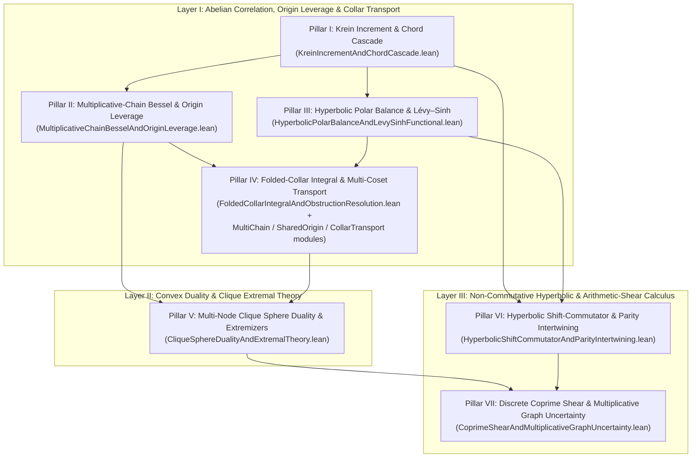

# Bi-Scale / Logarithmic-Grid Uncertainty Theory (`GaloisForLFunctions.BiScaleUncertainty`)

## 1. Motivation: Why a New Mathematical Field Is Needed

Classical harmonic analysis is built around the representation theory of a **single** locally
compact abelian group at a time:
- **Additive Fourier analysis** on $(\mathbb{R}, +)$ with uniform lattices $\mathbb{Z} \subset \mathbb{R}$,
  where translation-invariant operators are diagonalized by $e^{i r x}$ and discrete-to-continuum
  comparison is governed by Poisson summation and Euler–Maclaurin quadrature.
- **Multiplicative Mellin analysis** on $(\mathbb{R}_+^\times, \times)$, which becomes additive
  Fourier analysis in logarithmic coordinates $x = \log t$, turning multiplicative dilations
  $t \mapsto \lambda t$ into linear shifts $x \mapsto x + \log \lambda$.

Whenever a mathematical problem is simultaneously governed by **multiplicative dilation** and
**additive translation**, a fundamental structural conflict arises. In logarithmic scale coordinates
$x = \log t$:
1. **Multiplicative correlations** are translation-invariant positive-definite kernels
   $$h(x) = (g \star \tilde{g})(x) = \int_{\mathbb{R}} g(u)\,g(u+x)\,du, \qquad \hat{h}(r) = |\hat{g}(r)|^2 \ge 0.$$
2. **The uniform additive lattice $\mathbb{N}$** becomes the **exponentially compressing
   logarithmic grid**
   $$\Lambda_{\log} = \{\log n : n \ge 2\}, \qquad \Delta x_n = \log(n+1) - \log n = \log\!\left(1 + \frac{1}{n}\right) \asymp e^{-x},$$
   whose local spacing is $O(1)$ near the origin ($[0, \log 2]$) and shrinks exponentially as
   $x \to \infty$.
3. **The additive continuum measure $dt$** becomes the **hyperbolic exponential weight**
   $e^{x/2}$ / $\cosh(x/2)$ (arising from the Mellin transform at the arithmetic poles $s = 1, 0$,
   i.e., spectral frequencies $r = \pm i/2$).
4. **The archimedean scale-dilation generator** produces a **singular non-local Lévy increment
   measure**
   $$\mathcal{J}_{\mathrm{arch}}(h) = \int_0^\infty \bigl(h(0) - h(x)\bigr)\,\frac{e^{x/2}}{\sinh x}\,dx, \qquad \frac{e^{x/2}}{\sinh x} = 2\sum_{k=0}^\infty e^{-(2k+1/2)x} \sim \frac{1}{x} \quad (x \to 0^+).$$

---

## 2. The Seven Structural Traps: Why Existing Methods Fail and What the New Field Must Overcome

Extensive formal investigations across `GaloisForLFunctions.RHTower` (`CHMD`, `HF`, `OWU`, `EWU`)
and `GaloisForLFunctions.BiScaleUncertainty` have uncovered **seven structural traps**—four
classical single-group traps and three deeper frontier traps that govern the design of this field.

### Part A: The Four Single-Group Traps

1. **Trap 1 — The Spectral-Moment / Derivative-Truncation Trap:**
   On the spectral side, the archimedean symbol $\Omega(r) = \operatorname{Re}\psi(1/4 + ir/2) - \log\pi$
   achieves its minimum $\Omega(0) = -\left(\frac{\gamma}{2} + \frac{\pi}{4} + \frac{3}{2}\log 2 + \frac{1}{2}\log\pi\right) \approx -2.752$
   at $r = 0$ and grows as $\ln|r|$. Any bound that replaces $\Omega(r)$ by $\Omega(0)$ or by a
   polynomial Taylor moment $S(g) = \int r^2|\hat{g}(r)|^2\,dr = -h''(0)$ **discards the
   physical-space Lévy integral $\mathcal{J}_{\mathrm{arch}}(h)$**. Once $\mathcal{J}_{\mathrm{arch}}(h)$
   is discarded, the discrete grid constraints $h(\log n) = 0$ are rendered invisible in the
   high-frequency regime $S(g)/L(g) \to \infty$.
2. **Trap 2 — The Ground-Subtraction / Translation-Invariance Trap:**
   Subtracting a translation-invariant continuum mean-field cannot distinguish the discrete
   logarithmic grid $\Lambda_{\log}$ from a shifted continuum unless the exact arithmetic
   multiplicative relations among the nodes $\log n$ are coupled directly to the positive-definite
   cone.
3. **Trap 3 — The Beurling–Deny Sign-Changing Nodal Collar Trap:**
   Standard Dirichlet-form / Beurling–Deny contraction (`|u|` lowers jump energy) operates on a
   single state $u$. When applied to an odd or sign-changing state $u = u^+ - u^-$, non-local jump
   operators across the nodal boundary generate a positive cross-collar attraction
   $\langle u^+, P u^-\rangle$ that competes against stationary jump stiffness unless constrained
   by multi-point Gram/Toeplitz positive-definiteness or additive regularity.
4. **Trap 4 — The Single-Point Non-Dyadic Interpolation Trap ($x = \frac{4}{5}\log 2$):**
   Even when $h(\log 2) = 0$ for a smooth positive-definite autocorrelation $h$, one **cannot** bound
   $h(0) - h(x) \ge c(x) h(0) > 0$ pointwise at every individual non-dyadic point $x \in (0, \log 2)$.
   As proved in `EvenSectorSmoothBlindInterpolationObstruction.lean`, a smooth pulse train $g_N$ with
   spacing $a = \frac{4}{5}\log 2$ satisfies $h_N(\log 2) = 0$ while
   $(h_N(0) - h_N(\frac{4}{5}\log 2)) / h_N(0) = \frac{1}{N+1} \to 0$.
   - **Resolution (`FoldedCollarIntegralAndObstructionResolution.lean`):** By the **Reflected-Collar
     Euclidean Sphere Law** $h(x)^2 + h(\log 2 - x)^2 \le h(0)^2$, making $h(\frac{4}{5}\log 2) \to h(0)$
     forces the reflected point $h(\frac{1}{5}\log 2) \to 0$. Folding the integral around the
     midpoint $\frac{1}{2}\log 2$ pairs $x$ with $\log 2 - x$ and restores an unconditional,
     strictly positive lower bound across all smooth tests!

### Part B: The Three Deep Frontier Traps (Why Layer I Must Extend to Layers II & III)

5. **Trap 5 — The Distant-Copy Polar Decoupling Trap (`DistantCopyPolarEnforcement.lean`):**
   Suppose we impose only **finitely many** logarithmic grid zeros $h(\log n) = 0$ ($2 \le n \le N$)
   on a compactly supported source $f$ (say supported in $[-D/2, D/2]$). Then replacing $f(u)$ by
   $$\operatorname{polarCopy}(f, T)(u) := f(u) - e^{-T/2} f(u - T)$$
   for a very large translation $T \gg \max(D, \log N)$ **automatically enforces the hyperbolic polar
   hyperplane constraint** $\int_0^\infty h(x)\cosh(x/2)\,dx = 0$, **preserves all grid zeros**
   $h(\log n) = 0$ for $2 \le n \le N$, and changes the normalized archimedean energy
   $\mathcal{J}_{\mathrm{arch}}(h) / h(0)$ by only $O(e^{-T}) \to 0$ as $T \to \infty$!
   - **Strategic Consequence:** For finite truncation $N$, the polar hyperplane constraint
     $\int_0^\infty h(x)\cosh(x/2)\,dx = 0$ cannot increase the infimum of
     $\mathcal{J}_{\mathrm{arch}}(h)/h(0)$ over compactly supported functions unless the logarithmic
     grid constraints $\Lambda$ also constrain the distant scale $T$ (where the logarithmic grid
     spacing $\Delta x_n \asymp e^{-T}$ becomes exponentially denser than the support diameter $D$).
6. **Trap 6 — The Commutative Bochner / Beurling Trap:**
   As long as our theorems only use inner products of **additive translations**
   $\langle U_{t_i} f, U_{t_j} f \rangle = h(t_i - t_j)$ on $L^2(\mathbb{R})$, all operators $U_t$
   **commute** ($U_t U_s = U_{t+s}$) and are simultaneously diagonalized by the Fourier transform
   $\hat{h}(\omega) = |\hat{f}(\omega)|^2 \ge 0$. Moreover, difference-closed chains on
   $\Lambda_N = \{\log n\}$ only see the **multiplicative semigroup** $(\mathbb{N}, \times)$ via
   divisibility $m \mid n \implies \log n - \log m = \log(n/m)$. Any Beurling generalized number
   system has the exact same divisibility chains, even when it violates the Riemann Hypothesis!
   - **Strategic Consequence:** While commutative Bochner–Gram bounds can close finite-$N$ threshold
     bounds in the even sector once $\mathcal{C}(\Lambda_N, w_{\mathrm{arch}}) \ge |\Omega(0)|$, a
     complete theory must incorporate the **non-commutative affine $(ax+b)$ algebra** linking
     multiplicative dilations ($n \mapsto pn$, linear shifts $x \mapsto x + \log p$) to the
     **additive ring generator** ($n \mapsto n + 1$, the exponential shear $x \mapsto \log(e^x + 1)$
     and hyperbolic multipliers $e^{\pm x/2}$).
7. **Trap 7 — The Odd-Sector / Nodal Blind Spot (`OWU` / `HF` / `CHMD`):**
   Origin-Singularity Leverage relies on $h(0) = \|f\|_2^2 > 0$ sitting directly on top of the
   $\frac{1}{\sinh x} \sim \frac{1}{x}$ singularity at $x = 0$. For an **odd** test function
   (`OWU` / `HF`) or a **signed nodal eigenfunction** on `SourceGraph` (`CHMD`), the origin pole is
   canceled or changes sign across the nodal boundary.
   - **Strategic Consequence:** The field must include **Hyperbolic Parity-Intertwining Operators**
     ($f(u) \mapsto \sinh(\alpha u) f(u)$ and $f(u) \mapsto \cosh(\alpha u) f(u)$), which map odd
     wavefunctions into even wavefunctions with strictly positive origin energy and satisfy the
     exact intertwining law
     $$\operatorname{autocorr}(\cosh(\alpha \cdot) f)(x) - \operatorname{autocorr}(\sinh(\alpha \cdot) f)(x) = \cosh(\alpha x)\,\operatorname{autocorr}(f)(x),$$
     as well as **Discrete Coprime Shear Uncertainty** on $\mathbb{N}^+$ coupling multiplicative
     shifts $n \mapsto kn$ to additive successor differences $v(n+1) - v(n)$.

---

## 3. Core Architecture: The Three Layers & Seven Pillars of `BiScaleUncertainty`

To meet the standards of an independent mathematical discipline—with intrinsic invariants, exact
extremal duality, non-commutative operator calculus, and discrete-to-continuum bridges—the library
is organized into **three layers** spanning **seven foundational pillars**:

---

### Layer I: Abelian Correlation, Origin Leverage & Collar Transport (Pillars I–IV)

#### Pillar I: Krein Increment & Chord Cascade Geometry (`KreinIncrementAndChordCascade.lean`)
Studies the intrinsic metric geometry induced on $\mathbb{R}$ by an autocorrelation
$h(x) = \int_{\mathbb{R}} g(u)g(u+x)\,du \in \mathcal{P}(\mathbb{R})$ via the **translation chord
distance** $d_g(x, y) := \|T_x g - T_y g\|_{L^2} = \sqrt{2\bigl(h(0) - h(x - y)\bigr)}$:
- **Cauchy–Schwarz & Pointwise Increment Nonnegativity:** $|h(x)| \le h(0)$ and
  $0 \le h(0) - h(x) \le 2 h(0)$.
- **Krein's Positive-Definite Increment Inequality:**
  $\bigl(h(x) - h(y)\bigr)^2 \le 2 h(0)\bigl(h(0) - h(x - y)\bigr)$.
- **Subadditive Chord Triangle Law & Quadratic Multiple Cascade:**
  $\sqrt{h(0) - h(x + y)} \le \sqrt{h(0) - h(x)} + \sqrt{h(0) - h(y)}$ and
  $h(0) - h(m x) \le m^2\bigl(h(0) - h(x)\bigr)$.
- **Derivative-Free Harmonic & Dyadic Sub-Grid Lower Bounds:**
  Whenever $h(x_0) \le 0$, $h(0) - h(x_0 / m) \ge \frac{1}{m^2} h(0)$ and
  $h(0) - h(x_0 / 2^k) \ge 4^{-k} h(0)$.

#### Pillar II: Multiplicative-Chain Bessel & Origin-Singularity Leverage (`MultiplicativeChainBesselAndOriginLeverage.lean`)
Develops the multi-node Hilbert-space geometry of translates on non-uniform and logarithmic grids:
- **Multi-Node Orthogonal-Frame Bessel Inequality (`autocorr_finset_bessel_sq_le`):**
  For any pairwise difference-orthogonal set $\{t_i\}_{i \in s}$ ($h(t_i - t_j) = 0$ for $i \ne j$),
  $\sum_{i \in s} h(y - t_i)^2 \le h(0)^2$ for every $y \in \mathbb{R}$.
- **Origin-Anchored & Reflected-Collar Euclidean Sphere Laws:**
  $h(y)^2 + \sum_{k=1}^M h(t_k \pm y)^2 \le h(0)^2$ and
  $(h(0) - h(y)) + (h(0) - h(t_1 - y)) \ge (2 - \sqrt{2})\,h(0)$.
- **The Origin-Singularity Leverage Theorem:**
  $$W_0 (R - u_0) + \sum_{k=1}^M w_k (R - u_k) \ge \left(W_0 + \sum_{k=1}^M w_k - \sqrt{W_0^2 + \sum_{k=1}^M w_k^2}\right) R \ge \left(\sum_{k=1}^M w_k - \frac{\sum_{k=1}^M w_k^2}{2 W_0}\right) R.$$
- **Logarithmic Divisibility & Dyadic-Coset Orthogonality:**
  On $\Lambda_N = \{\log n : 2 \le n \le N\}$, the dyadic-odd cosets
  $\mathcal{C}_m = \{m \cdot 2^k : 2 \le m \cdot 2^k \le N\}$ ($m$ odd) form disjoint
  difference-closed orthogonal chains.

#### Pillar III: Hyperbolic Polar Balance & Lévy–Sinh Functional (`HyperbolicPolarBalanceAndLevySinhFunctional.lean`)
Couples the hyperbolic polar hyperplane $\int_0^\infty h(x)\cosh(x/2)\,dx = 0$ to the positive-definite
cone and the singular Lévy–sinh energy `biScaleLevyEnergy`:
- **Exact Pole-Eliminated Weil–Lévy Identity (`weilArchRe_eq_polar_levy_sinh_form`):**
  $\operatorname{weilArchRe}(f) = \Omega(0)\,h(0) + \operatorname{biScaleLevyEnergy}(f)$.
- **Hyperbolic Positive/Negative Lobe Conservation (`integral_autocorrPos_cosh_eq_autocorrNeg_cosh`):**
  $\int_0^\infty h^+(x)\cosh(x/2)\,dx = \int_0^\infty h^-(x)\cosh(x/2)\,dx$.
- **Polar–Lévy Kernel Deformation & Crossover Floor (`polar_levy_deformation_lower_bound`).**

#### Pillar IV: Folded-Collar Integral Bounds & Multi-Coset Transport
- `FoldedCollarIntegralAndObstructionResolution.lean`: Midpoint-folded reflected-collar integral
  lower bound resolving the $x = \frac{4}{5}\log 2$ single-point obstruction unconditionally across
  all smooth real EWU tests (`RealSmoothEvenPolarTestFn.weilArchRe_ge_folded_collar_of_log_two_blind`).
- `SharedOriginMultiCosetLeverage.lean`, `MultiChainToeplitzGramCoupling.lean`,
  `OptimalOriginAllocation.lean`: Shared-origin multi-coset sphere bounds, full Gram-energy square
  remainder identities, and proportional origin-weight allocation.
- `OverlapSafeCollarMeasureTransport.lean`, `LogarithmicCollarCoverage.lean`: Overlap-safe collar
  measure transport and exact coverage of $(\frac{1}{2}\log 2, \log N)$ by half-$\log 2$ collars
  around $\Lambda_N$.
- `SignedDyadicCollarPartition.lean`, `IntegratedOriginCollarLeverage.lean`: Literal signed odd-coset
  partition, measurable optimal origin shares, and the integrated finite-interval bound with a
  strictly positive finite real coefficient for compact-continuous sources. Physical shares use
  equal multiplicity; their global optimization remains open. Working facts and failures:
  [transport ledger](OriginCollarTransport-FACTS.md).
- `DistantCopyPolarEnforcement.lean`: Distant translated-copy subtraction proving Trap 5 (exponentially
  small archimedean energy perturbation under finite-grid polar enforcement).

---

### Layer II: Convex Duality & Clique Extremal Theory (Pillar V)

#### Pillar V: Multi-Node Clique Sphere Duality & Extremizers (`CliqueSphereDualityAndExtremalTheory.lean`)
Establishes the canonical convex duality and extremal theory for arbitrary difference-orthogonal
cliques $s$ ($h(t_i - t_j) = 0$ for distinct $i, j \in s$):
1. **Exact Quadratic Sphere Defect Identity (`clique_sphere_quadratic_defect_identity`):**
   For any weights $w : \iota \to \mathbb{R}$, state vector $u : \iota \to \mathbb{R}$, radius $R$,
   and $W_2 := \sqrt{\sum_{i \in s} w_i^2}$:
   $$2 W_2 R \left(\sum_{i \in s} w_i (R - u_i) - \left(\sum_{i \in s} w_i - W_2\right) R\right) = W_2^2 \left(R^2 - \sum_{i \in s} u_i^2\right) + \sum_{i \in s} \left(W_2 u_i - w_i R\right)^2.$$
   This single algebraic identity simultaneously proves:
   - The **Multi-Node Clique Sphere Lower Bound**
     $\sum_{i \in s} w_i (h(0) - h(y - t_i)) \ge \left(\sum_{i \in s} w_i - \sqrt{\sum_{i \in s} w_i^2}\right) h(0)$,
   - **Exactness and Uniqueness of the Extremal Ray** $u_i^* = \frac{w_i}{W_2} R$ on the Euclidean
     sphere $\sum_{i \in s} u_i^2 = R^2$.
2. **Clique-Rank Amplification Law (`autocorr_clique_uniform_collar_sum_ge`):**
   For any $M$-element difference-orthogonal clique $s$ ($M = s.\mathrm{card}$),
   $$\sum_{i \in s} \bigl(h(0) - h(y - t_i)\bigr) \;\ge\; \bigl(M - \sqrt{M}\bigr)\,h(0) \qquad (\forall y \in \mathbb{R}),$$
   so the average collar defect per node is at least $\left(1 - \frac{1}{\sqrt{M}}\right) h(0) \to h(0)$
   as the clique size $M \to \infty$ (e.g. along growing dyadic chains $\{2^k\}$).
3. **Multi-Node Collar Integral Theorem (`integral_autocorr_clique_collar_ge`):**
   Integrates the $M$-node clique sphere bound against any family of continuous collar weights
   $w_i(y) \ge 0$ on $[a, b]$.

---

### Layer III: Non-Commutative Hyperbolic & Arithmetic-Shear Calculus (Pillars VI & VII)

#### Pillar VI: Hyperbolic Shift-Commutator & Parity Intertwining (`HyperbolicShiftCommutatorAndParityIntertwining.lean`)
Breaks out of the Commutative Bochner Trap (Trap 6) and the Odd-Sector Blind Spot (Trap 7) by
introducing the non-commutative calculus of **hyperbolic multipliers**
$(C_\alpha f)(u) = \cosh(\alpha u) f(u)$ and $(S_\alpha f)(u) = \sinh(\alpha u) f(u)$ alongside
translations $T_x$:
1. **Hyperbolic Parity Intertwining:**
   If $f$ is odd ($f(-u) = -f(u)$), then $S_\alpha f$ is **even** and $C_\alpha f$ is **odd**;
   conversely, if $f$ is even, $S_\alpha f$ is odd and $C_\alpha f$ is even. Thus $S_\alpha$ lifts
   odd prime-blind states (`OWU` / `HF`) directly into the even sector with origin energy
   $h_{S_\alpha f}(0) = \int_{\mathbb{R}} \sinh(\alpha u)^2 f(u)^2\,du \ge 0$.
2. **The Fundamental Hyperbolic Autocorrelation Intertwining Law (`autocorr_coshMultiplier_sub_sinhMultiplier`):**
   Because $\cosh(\alpha u)\cosh(\alpha(u+x)) - \sinh(\alpha u)\sinh(\alpha(u+x)) = \cosh(\alpha x)$
   is independent of $u$, every $f \in C_c(\mathbb{R})$ satisfies the exact identity:
   $$\operatorname{autocorr}(C_\alpha f)(x) - \operatorname{autocorr}(S_\alpha f)(x) = \cosh(\alpha x)\,\operatorname{autocorr}(f)(x) \qquad (\forall x \in \mathbb{R}).$$
3. **Zero-Grid Coincidence & Unconditional $\cosh$-Increment Coercivity (`autocorr_coshMultiplier_sub_ge_of_zero`):**
   - At $x = 0$: $h_{C_\alpha f}(0) = h_f(0) + h_{S_\alpha f}(0)$.
   - At any zero node $x_0$ where $h_f(x_0) = 0$: $h_{C_\alpha f}(x_0) = h_{S_\alpha f}(x_0) \le h_{S_\alpha f}(0)$.
   - Therefore, at every zero node $x_0$ of $f$, the $\cosh$-weighted autocorrelation increment is
     bounded below by the **full unweighted origin energy $h_f(0)$**:
     $$h_f(x_0) = 0 \implies h_{C_\alpha f}(0) - h_{C_\alpha f}(x_0) \;\ge\; h_f(0),$$
     and along all harmonic subdivisions $x_0 / m$ ($m \ge 1$):
     $$h_{C_\alpha f}(0) - h_{C_\alpha f}(x_0 / m) \;\ge\; \frac{1}{m^2} h_f(0)!$$

#### Pillar VII: Discrete Coprime Shear & Multiplicative Graph Uncertainty (`CoprimeShearAndMultiplicativeGraphUncertainty.lean`)
Establishes the discrete arithmetic-archimedean foundation on $\mathbb{N}$ that overcomes the
Beurling Obstruction (Trap 6) and couples the multiplicative prime graph (`CHMD` / `SourceGraph`)
to the additive successor lattice:
1. **Non-Commutative Multiplicative-Additive Telescoping (`mulShift_addShift_diff_eq_sum`):**
   For any sequence $v : \mathbb{N} \to \mathbb{R}$ and dilation factor $k \ge 1$, the dilated
   additive step $v(k(n+1)) - v(kn)$ telescopes across $k$ unit additive steps:
   $$v(k(n+1)) - v(kn) = \sum_{j=0}^{k-1} \bigl(v(kn + j + 1) - v(kn + j)\bigr).$$
2. **Bi-Scale Multiplicative-to-Additive Dirichlet Energy Inequality (`sum_mulShift_diff_sq_le_mul_sum_add_diff_sq`):**
   Using Cauchy–Schwarz and the disjointness of the residue blocks $\{kn + j : 0 \le j < k\}$,
   $$\sum_{n=0}^{N-1} \bigl(v(k(n+1)) - v(kn)\bigr)^2 \;\le\; k \sum_{m=0}^{kN - 1} \bigl(v(m+1) - v(m)\bigr)^2.$$
3. **Coprime Successor Coercivity on Prime-Multiple Fibers (`add_diff_sq_eq_self_sq_of_prime_supp`):**
   Because $\gcd(n, n+1) = 1$, no divisor $d \ge 2$ can divide both $n$ and $n+1$
   (`not_dvd_succ_of_dvd`). Hence if $v$ is supported on multiples of $d \ge 2$, every active node
   $d \mid n$ ($n \ge 1$) has $v(n+1) = 0$, forcing $\bigl(v(n+1) - v(n)\bigr)^2 = v(n)^2$.
4. **Nodal Sign-Change vs. Multiplicative Jump Decomposition (`nodal_mulShift_jump_decomp`):**
   Decomposing $v = v^+ - v^-$ into positive and negative lobes yields the exact identity
   $$\bigl(v(kn) - v(n)\bigr)^2 = \bigl(|v(kn)| - |v(n)|\bigr)^2 + 4\bigl(v^+(kn)v^-(n) + v^-(kn)v^+(n)\bigr),$$
   bounding the opposite-sign multiplicative pairing $4\bigl(v^+(kn)v^-(n) + v^-(kn)v^+(n)\bigr)$
   directly by the multiplicative jump energy $\bigl(v(kn) - v(n)\bigr)^2$.
