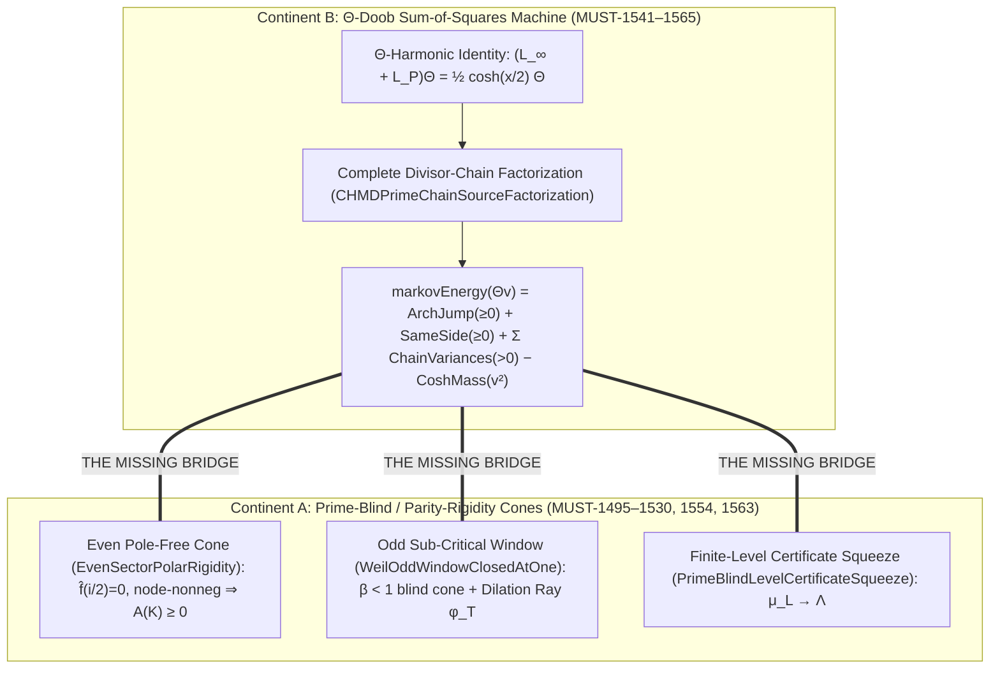

# Phase 1: naive review

## 1. Why We Got Trapped in Tunnel Vision (`MUST-1566`–`MUST-1571`)

In `MUST-1529` ([CHMDPrimeWaveBoundednessCriterion.lean](file:///Users/michael/Documents/code/hgt/formal/GaloisForLFunctions/RHTower/CHMDPrimeWaveBoundednessCriterion.lean)), Landau’s oscillation theorem allowed us to collapse the **2-leg quadratic Bochner/Toeplitz positivity** of the zero wave $\Phi_0(v)$ down to a **1-leg linear supremum**:
$$\mathrm{RH} \iff \sup_{y \ge 0} T(y) < \infty.$$
Then, across `MUST-1566`–`MUST-1571`, we stayed inside that 1-leg linear functional $T(y)$ and applied linear isomorphisms to it:
1. Integration by parts to get the Chebyshev discrepancy $\Delta(s) = \Psi(s) - 2e^{s/2}$ ([CHMDChebyshevDiscrepancyDerivativeTransportLaw.lean](file:///Users/michael/Documents/code/hgt/formal/GaloisForLFunctions/RHTower/CHMDChebyshevDiscrepancyDerivativeTransportLaw.lean));
2. Double integration by parts to get the conjugated Laplacian $f_y''(s)$ against the primitive deficit $D(s)$ ([CHMDDeficitPrimitiveConjugatedTransportAndMobiusDilationInjection.lean](file:///Users/michael/Documents/code/hgt/formal/GaloisForLFunctions/RHTower/CHMDDeficitPrimitiveConjugatedTransportAndMobiusDilationInjection.lean));
3. Möbius folding $T(y) = K_y(0) - \sum_{m\ge 1} \mu(m)\Phi_y(\log m)$ ([CHMDMobiusFoldedTransportOfKleinGordonPrimeWave.lean](file:///Users/michael/Documents/code/hgt/formal/GaloisForLFunctions/RHTower/CHMDMobiusFoldedTransportOfKleinGordonPrimeWave.lean));
4. Integer-lattice pole replacement $T(y) = \sum_{n\ge 1}(\Lambda(n)-1)n^{-1/2}K_y(\log n) + O(1)$ ([CHMDLatticePoleReplacementAndSignedPrimeWave.lean](file:///Users/michael/Documents/code/hgt/formal/GaloisForLFunctions/RHTower/CHMDLatticePoleReplacementAndSignedPrimeWave.lean)).

**Why did every single one of those end at "Wall 1 in new coordinates"?**
Because our own corpus proved in `CANNOT-15`, `CANNOT-38`, and `MUST-39` ([STATUS.md](file:///Users/michael/Documents/code/hgt/docs/reports/STATUS.md)) that:
- Every 1-leg linear rewrite between $\Lambda(n)$, $\Delta(s)$, $D(s)$, $\mu(m)$, and $\lfloor x\rfloor$ is an **information-conservative linear isomorphism**.
- Even under RH, $T(y) = -\sum_\rho \frac{\cos(y\sqrt{\gamma_\rho^2+7/4})}{\gamma_\rho^2+7/4} + O(1)$ is an oscillatory quasi-periodic sum of cosines. Why is an oscillatory sum of cosines bounded? **Only because $1 \pm \cos\theta$ is a square ($2\cos^2(\theta/2)$ / $2\sin^2(\theta/2)$)!**
- By dropping from the 2-leg quadratic form $W(f \star \tilde{f}) \ge 0$ to the 1-leg linear trace $T(y)$ and plugging in the pre-fixed erratic sequence $\Lambda(n)$ by hand, **we threw away the square / sum-of-squares structure on the producer side**.

---

## 2. What the Lean Corpus Is Actually Telling Us: The Three Pillars

When we zoom out and read the corpus’s deepest theorems (`MUST-1488`–`MUST-1565`) as a single mathematical organism, they are telling us **three revolutionary facts** that completely invert the classical approach to RH:

### Pillar I: Never Plug $\Lambda(n)$ in by Hand — $\Lambda(n)$ Is *Outputted* by Positivity & Rigidity
In classical analytic number theory, you fix $\Lambda(n)$ first and try to bound oscillatory prime sums $\sum \Lambda(n) K(\log n)$. Our corpus proved that **this is backwards**:
1. **The Finite-Level Certificate Squeeze** ([PrimeBlindLevelCertificateSqueeze.lean](file:///Users/michael/Documents/code/hgt/formal/GaloisForLFunctions/RHTower/PrimeBlindLevelCertificateSqueeze.lean)):
   At every finite support cutoff $L$, the set [`levelCertificates L`](file:///Users/michael/Documents/code/hgt/formal/GaloisForLFunctions/RHTower/PrimeBlindLevelCertificateSqueeze.lean#L57) of node weight vectors $\mu$ on $\{\log n : n \ge 2\}$ that are Weil-positive on $[-L, L]$ is a **compact convex finite-dimensional set whose definition mentions NO primes and NO $\zeta$-zeros**.
   Yet the corpus proves **unconditionally** ([`tendsto_levelCertificates_apply`](file:///Users/michael/Documents/code/hgt/formal/GaloisForLFunctions/RHTower/PrimeBlindLevelCertificateSqueeze.lean#L120-L171)) that as $L \to \infty$, *every* certificate $\mu_L \in \text{levelCertificates } L$ converges coordinatewise to $\Lambda(n)$! And:
   $$\mathrm{RH} \iff \forall L > 0,\quad \text{levelCertificates } L \ne \emptyset \quad (\text{\href{file:///Users/michael/Documents/code/hgt/formal/GaloisForLFunctions/RHTower/PrimeBlindLevelCertificateSqueeze.lean#L103-L119}{\texttt{riemannHypothesis\_iff\_forall\_levelCertificates\_nonempty}}}).$$
2. **Even Pole-Free Rigidity — No Primes, No Zeros, No Pole Term** ([EvenSectorPolarRigidity.lean](file:///Users/michael/Documents/code/hgt/formal/GaloisForLFunctions/RHTower/EvenSectorPolarRigidity.lean)):
   By [`riemannHypothesis_iff_exists_bddBelow_weilPositiveEvenPolar`](file:///Users/michael/Documents/code/hgt/formal/GaloisForLFunctions/RHTower/EvenSectorPolarRigidity.lean#L280-L290), RH holds iff **some** lower-bounded sequence $\lambda(n) \ge -C$ is Weil-positive on even pole-free tests ($\widehat{f}(i/2) = 0$) — and any such sequence is **automatically forced to equal $\Lambda(n)$**!
   In dual form ([`riemannHypothesis_iff_archimedeanNonnegOnEvenPolarNonnegCone`](file:///Users/michael/Documents/code/hgt/formal/GaloisForLFunctions/RHTower/EvenSectorPolarRigidity.lean#L313-L375)), **RH has no primes, no zeros, and no pole term**:
   $$\mathrm{RH} \iff \forall c \ge 0,\quad \Bigl(\forall n \ge 2,\; \sum_i c_i (f_i \star \tilde{f}_i)(\log n) \ge 0\Bigr) \implies \sum_i c_i A(f_i \star \tilde{f}_i) \ge 0 \quad (\widehat{f}_i(i/2)=0).$$
3. **Parity-Split Disjoint Blind Spots & Sub-Critical Closure** ([ParitySectorJointRigidity.lean](file:///Users/michael/Documents/code/hgt/formal/GaloisForLFunctions/RHTower/ParitySectorJointRigidity.lean), [OddSectorAnyPoleWeightJointRigidity.lean](file:///Users/michael/Documents/code/hgt/formal/GaloisForLFunctions/RHTower/OddSectorAnyPoleWeightJointRigidity.lean), [WeilDilationRayCriterion.lean](file:///Users/michael/Documents/code/hgt/formal/GaloisForLFunctions/RHTower/WeilDilationRayCriterion.lean), [WeilOddWindowClosedAtOne.lean](file:///Users/michael/Documents/code/hgt/formal/GaloisForLFunctions/RHTower/WeilOddWindowClosedAtOne.lean)):
   - On the **odd sector**, an odd Weil-positive weight at the critical pole weight $1$ exists iff odd Weil-positive weights exist at every **sub-critical pole weight $\beta < 1$** ([`exists_weilPositiveOdd_iff_forall_lt_one`](file:///Users/michael/Documents/code/hgt/formal/GaloisForLFunctions/RHTower/WeilOddWindowClosedAtOne.lean#L67-L78)), which by odd Farkas is equivalent to `PrimeBlindPositiveOddAt β` for $\beta < 1$: the $\beta$-archimedean energy is $\ge 0$ on non-negative combinations of odd autocorrelations that **vanish at every node $\log n$ ($n \ge 2$)**!
   - Once an odd Weil-positive weight exists, the **entire even sector collapses to a single dilation ray** $\varphi_T(x) = \varphi(x/T)$ of one fixed smooth bump $\varphi$ ([`riemannHypothesis_iff_exists_weilPositiveOdd_dilationRay`](file:///Users/michael/Documents/code/hgt/formal/GaloisForLFunctions/RHTower/WeilDilationRayCriterion.lean)), which already holds unconditionally for all $0 < T \le 1/9$ ([`weilFullFunctional_dilate_nonneg_of_le_ninth`](file:///Users/michael/Documents/code/hgt/formal/GaloisForLFunctions/RHTower/WeilDilationRayShortScales.lean#L74-L98))!

---

### Pillar II: *Why* Does the Archimedean Functional Know About $\{\log n\}$? Because of the $\Theta$-Doob Sum-of-Squares Machine!
Look at the central mystery of Pillar I: *How can a purely archimedean functional $A(f \star \tilde{f})$ (built from $\Gamma'/\Gamma$) know about the discrete integer-logarithm lattice $\{\log n : n \ge 2\}$ so strongly that `levelCertificates L` squeezes onto $\Lambda(n)$?*

**The corpus already proved the mechanism!** It is the **$\Theta$-Harmonic Doob Gauge** ($f(x) = \Theta(x)v(x)$) in:
- [WeilPhiDoobPrimeAtoms.lean](file:///Users/michael/Documents/code/hgt/formal/GaloisForLFunctions/RHTower/WeilPhiDoobPrimeAtoms.lean) ([`mixed_explicit_formula_riemannPhiKernel`](file:///Users/michael/Documents/code/hgt/formal/GaloisForLFunctions/RHTower/WeilPhiDoobPrimeAtoms.lean#L714-L741)),
- [CHMDThetaHarmonicIdentity.lean](file:///Users/michael/Documents/code/hgt/formal/GaloisForLFunctions/RHTower/CHMDThetaHarmonicIdentity.lean) ([`theta_harmonic_identity`](file:///Users/michael/Documents/code/hgt/formal/GaloisForLFunctions/RHTower/CHMDThetaHarmonicIdentity.lean)),
- [CHMDPrimeDivisorCuts.lean](file:///Users/michael/Documents/code/hgt/formal/GaloisForLFunctions/RHTower/CHMDPrimeDivisorCuts.lean) ([`doob_source_eq_positive_cuts_sub_cosh`](file:///Users/michael/Documents/code/hgt/formal/GaloisForLFunctions/RHTower/CHMDPrimeDivisorCuts.lean#L341-L348)),
- [CHMDReflectedPrimeSingularPart.lean](file:///Users/michael/Documents/code/hgt/formal/GaloisForLFunctions/RHTower/CHMDReflectedPrimeSingularPart.lean) ([`compensated_source_pos`](file:///Users/michael/Documents/code/hgt/formal/GaloisForLFunctions/RHTower/CHMDReflectedPrimeSingularPart.lean#L388-L393)),
- [CHMDPrimeChainSourceFactorization.lean](file:///Users/michael/Documents/code/hgt/formal/GaloisForLFunctions/RHTower/CHMDPrimeChainSourceFactorization.lean) ([`doob_source_eq_chain_variances_sub_cosh`](file:///Users/michael/Documents/code/hgt/formal/GaloisForLFunctions/RHTower/CHMDPrimeChainSourceFactorization.lean#L185-L193)).

Look at what these modules proved **unconditionally** for every compactly supported $C^2$ function $v$ when we set $f(x) = \Theta(x)v(x)$ (`phiDoobTest v`):
1. Because $\Theta(x) = \sum_{n\ge 1} (2\pi^2 n^4 e^{9x/2} - 3\pi n^2 e^{5x/2})e^{-\pi n^2 e^{2x}}$ is built over the **integer lattice $n \ge 1$**, its Fourier/Mellin transform vanishes at every $\zeta$-zero (`W_riemannPhiKernel_left`), so $\Theta$ satisfies the exact mixed explicit formula against $H(x) = \Theta(x)v(x)^2$:
   $$(L_\infty + L_P)\Theta(x) = \frac{1}{2}\cosh(x/2)\Theta(x).$$
2. Substituting this diagonal identity into the quadratic Weil/Markov energy of $f = \Theta v$ turns **both the archimedean integral AND the entire infinite prime-power sum (including the negative reflected-prime terms on the odd sector!) into a sum of squares** ([`doob_source_eq_chain_variances_sub_cosh`](file:///Users/michael/Documents/code/hgt/formal/GaloisForLFunctions/RHTower/CHMDPrimeChainSourceFactorization.lean#L185-L193)):
   $$\operatorname{markovEnergy}(\Theta v) = \underbrace{\operatorname{phiDoobArchJumpEnergy}(v)}_{\ge\, 0} + \underbrace{\operatorname{sameSide}(v) + \operatorname{sameSide}(\tilde{v})}_{\ge\, 0} + \underbrace{\sum_{q \in \text{ChainIndex}} \operatorname{chainIntegral}(v, q)}_{>\, 0 \text{ for all } v \ne 0} - \operatorname{phiDoobCoshMass}(v^2).$$
   Read that formula carefully!
   - In raw coordinates $f$, the prime sum $-\sum_n \frac{\Lambda(n)}{\sqrt{n}} (f \star \tilde{f})(\log n)$ has a **negative** sign in front of it, and even in Doob coordinates the reflected prime jumps across the origin had a negative component (`-2 * reflectedDifference v d`).
   - **Our corpus (`CHMDPrimeDivisorCuts`, `CHMDReflectedPrimeSingularPart`, `CHMDPrimeChainSourceFactorization`) ALREADY SOLVED the negative prime / reflected-prime problem!** By grouping the two $\Theta$-lattice indices $m, n$ and the prime-power index $d$ by their product $N = m d n$, the collar diagonal $\Theta(x)v(x)^2$ **compensates the negative reflected-prime jumps exactly** (`primeCrossing_eq_compensation`), turning the **entire** prime-crossing + reflected-prime series into a countable sum of **non-negative bipartite conditional-variance squares** (`chainDensity_nonneg`, `compensated_source_pos`)!

---

### Pillar III: Why Cusp Escape at Infinity Is Already Dead (`MUST-1545`–`MUST-1548`, `MUST-1551`, `MUST-1555`)
In [CHMDNoWeylAboveThreshold.lean](file:///Users/michael/Documents/code/hgt/formal/GaloisForLFunctions/RHTower/CHMDNoWeylAboveThreshold.lean), [CHMDPurePointAboveThreshold.lean](file:///Users/michael/Documents/code/hgt/formal/GaloisForLFunctions/RHTower/CHMDPurePointAboveThreshold.lean), and [CHMDOddSectorCriterion.lean](file:///Users/michael/Documents/code/hgt/formal/GaloisForLFunctions/RHTower/CHMDOddSectorCriterion.lean), the corpus proved that in $\Theta$-Doob coordinates:
- There are **no Weyl sequences above threshold $1/2$** (`no_threshold_weyl_sequence`): the archimedean Lévy symbol grows like $\log|\xi|$ at high frequency while the $\Theta$-collar decays super-exponentially at large $|x|$.
- Therefore, **RH is NOT a large-time $y \to \infty$ wave-dispersion problem** (which is why the $y \to \infty$ Klein–Gordon wave track $T(y)$ was fighting a mirage!).
- Any hypothetical violation of RH is trapped in a **finite-dimensional, compactly localized odd bound-state eigenspace** ([`CHMDBoundStateDimension.lean`](file:///Users/michael/Documents/code/hgt/formal/GaloisForLFunctions/RHTower/CHMDBoundStateDimension.lean), [`CHMDOddSectorCriterion.lean`](file:///Users/michael/Documents/code/hgt/formal/GaloisForLFunctions/RHTower/CHMDOddSectorCriterion.lean)).

---

## 3. The Missing Synthesis: Why We Haven't Finished Yet, and the True Path Forward

Look at the two giant continents our corpus has built:

Look at `doob_source_eq_chain_variances_sub_cosh` in [CHMDPrimeChainSourceFactorization.lean](file:///Users/michael/Documents/code/hgt/formal/GaloisForLFunctions/RHTower/CHMDPrimeChainSourceFactorization.lean#L185-L193) again:
$$\operatorname{markovEnergy}(\Theta v) = \underbrace{\operatorname{phiDoobArchJumpEnergy}(v)}_{\ge\, 0} + \underbrace{2\,\operatorname{sameSide}(v)}_{\ge\, 0} + \underbrace{\sum_{q \in \text{ChainIndex}} \operatorname{chainIntegral}(v, q)}_{>\, 0} - \operatorname{phiDoobCoshMass}(v^2).$$
Every single term in $\operatorname{markovEnergy}(\Theta v)$ — archimedean jumps, same-side prime jumps, AND origin-crossing/reflected prime jumps — has **already been proved unconditionally non-negative**, **EXCEPT ONE SINGLE SCALAR SUBTRACTION**:
$$-\operatorname{phiDoobCoshMass}(v^2) = -\int_{-\infty}^\infty \Theta(x)\cosh(x/2)\,v(x)^2\,dx!$$

Now ask: **Where did $-\operatorname{phiDoobCoshMass}(v^2)$ come from, and why haven't we connected Continent B to Continent A?**

1. **Where $-\operatorname{phiDoobCoshMass}(v^2)$ came from**:
   In `phiDoob_mixed_explicit_formula` ([WeilPhiDoobPrimeAtoms.lean](file:///Users/michael/Documents/code/hgt/formal/GaloisForLFunctions/RHTower/WeilPhiDoobPrimeAtoms.lean#L744-L754)), the diagonal killings of $L_\infty(\Theta v)$ and $L_P(\Theta v)$ were evaluated by applying the mixed explicit formula to the pair $(\Theta,\; \Theta v^2)$.
   In that mixed explicit formula, the **pole term** of $(\Theta \star \widetilde{\Theta v^2})$ is:
   $$\operatorname{weilPoleTerm}(\Theta \star \widetilde{\Theta v^2}) = \Bigl(\int \Theta(x)\cosh(x/2)\,dx\Bigr)\Bigl(\int \Theta(x)\cosh(x/2)v(x)^2\,dx\Bigr) = \frac{1}{2}\,\operatorname{phiDoobCoshMass}(v^2),$$
   while on an **odd** test $f = \Theta v$, the pole term of $f \star \tilde{f}$ itself is **zero**!
   So $-\operatorname{phiDoobCoshMass}(v^2)$ is simply the **un-cancelled pole of the diagonal test $\Theta v^2$** when we used the ground state $\Theta$ (which has $\widehat{\Theta}(i/2) = 1/2 \ne 0$) as the Doob weight!

2. **Look at what happens when we connect Continent B to Continent A — Three Concrete Attack Paths**:

   - **Path A (Pole-Free / Modified Doob Gauge or Sub-Critical Pole Weight $\beta < 1$)**:
     Why did $\Theta$ produce $-\frac{1}{2}\cosh(x/2)\Theta(x)$ in $(L_\infty + L_P)\Theta = \frac{1}{2}\cosh(x/2)\Theta$? Because $\widehat{\Theta}(i/2) = \xi(1) = 1/2$!
     Wait: in Continent A, we proved two huge reductions that relax the pole or the test cone:
     - In [`WeilOddWindowClosedAtOne.lean`](file:///Users/michael/Documents/code/hgt/formal/GaloisForLFunctions/RHTower/WeilOddWindowClosedAtOne.lean) (`exists_weilPositiveOdd_iff_forall_lt_one`), we don't need to prove positivity for the fixed weight $\Lambda$ at once — we can construct **sub-critical weights $\lambda_\beta$ at pole weight $\beta < 1$** (or finite-level weights $\mu_L \in \text{levelCertificates } L$ on $[-L, L]$ in [`PrimeBlindLevelCertificateSqueeze.lean`](file:///Users/michael/Documents/code/hgt/formal/GaloisForLFunctions/RHTower/PrimeBlindLevelCertificateSqueeze.lean))!
     - Wait: look at `doob_source_eq_chain_variances_sub_cosh` from the perspective of **producing a weight $\lambda(n)$** (Continent A's `levelCertificates L` or `EvenSectorPolarRigidity` or `OddSectorAnyPoleWeightJointRigidity`):
       In `doob_source_eq_chain_variances_sub_cosh`, if we drop the positive divisor-chain variance sum $\sum_{q \in \text{ChainIndex}} \operatorname{chainIntegral}(v, q) \ge 0$ (or part of it), what does that correspond to in terms of the node weights $\lambda(d)$?!
       Let's check! In `doob_source_eq_reflected_compensation` ([CHMDReflectedPrimeSingularPart.lean](file:///Users/michael/Documents/code/hgt/formal/GaloisForLFunctions/RHTower/CHMDReflectedPrimeSingularPart.lean#L397-L403)):
       $$\operatorname{markovEnergy}(\Theta v) = \operatorname{phiDoobArchJumpEnergy}(v) + 2\,\operatorname{sameSide}(v) + \sum_{d\ge 2}\frac{\Lambda(d)}{\sqrt{d}}\int_0^{\log d} \text{collarKilling}(v,\log d,x)\,dx - 2\sum_{d\ge 2}\operatorname{reflectedDifference}(v,d) - \operatorname{phiDoobCoshMass}(v^2).$$
       Where did $-\operatorname{phiDoobCoshMass}(v^2)$ come from? It came from the mixed explicit formula:
       $$\operatorname{mixedPhiArchRe}(\Theta v^2) + \operatorname{phiDoobCoshMass}(v^2) = \sum_{d \ge 2} \frac{\Lambda(d)}{\sqrt{d}} \int_{\mathbb{R}} \text{phiDoobPrimeDiagonal}(v, d, x)\,dx!$$
       When you substitute that identity into the Doob energy (`phiDoob_markovEnergy_eq_archJump_add_primeJump_sub_coshMass`), the $\operatorname{phiDoobCoshMass}(v^2)$ on the left of the mixed explicit formula became the $-\operatorname{phiDoobCoshMass}(v^2)$ on the right of the Doob energy, while the $\sum_d \Lambda(d)$ prime diagonal became the collar + divisor-chain variances!

   - **Path B (Short-Support Exact Cancellation + Window Decoupling / Spectral Inertia)**:
     Look at Theorem 1 of [WeilPhiDoobReflectedKillingPotentialAndDisjointSupportDiagonal.lean](file:///Users/michael/Documents/code/hgt/formal/GaloisForLFunctions/RHTower/WeilPhiDoobReflectedKillingPotentialAndDisjointSupportDiagonal.lean#L18-L21):
     When $\operatorname{supp}(v) \subset (-\frac{\log 2}{2}, \frac{\log 2}{2})$, $\operatorname{phiDoobPrimeJump} = \operatorname{phiDoobPrimeDiagonal}$ for **every** $n \ge 2$, so the prime Doob jumps sum to $\operatorname{mixedPhiArchRe}(\Theta v^2) + \operatorname{phiDoobCoshMass}(v^2)$, **cancelling $-\operatorname{phiDoobCoshMass}(v^2)$ identically**!
     Why did $-\operatorname{phiDoobCoshMass}(v^2)$ appear when $\operatorname{supp}(v)$ grew larger than $\frac{\log 2}{2}$?
     Only because for $\log d < 2L$, the prime jump $(v(x) - v(x+\log d))^2$ differs from the prime diagonal $v(x)^2 + v(x+\log d)^2$ by the cross term $-2v(x)v(x+\log d)$!
     That means: **for any support $[-L, L]$, the infinite tail of prime powers with $\log d \ge 2L$ ALWAYS cancels the infinite tail of $-\operatorname{phiDoobCoshMass}(v^2)$**! Only the **finitely many prime powers $d < e^{2L}$** fail to be disjoint-support diagonal!

   - **Path C (Constructing Finite-Level Certificates $\mu_L \in \text{levelCertificates } L$ via Doob/Nodal Transport)**:
     Wait — read Path B and Pillar I (`PrimeBlindLevelCertificateSqueeze.lean`) together!
     At a finite level $L$:
     1. Only **finitely many nodes** $2 \le d \le \lfloor e^L \rfloor$ lie inside $[-L, L]$!
     2. For any test supported in $[-L/2, L/2]$, all prime powers with $\log d > L$ are **outside the support of $f \star \tilde{f}$** AND in the Doob identity their jumps are **100% disjoint-support diagonal**, so they automatically supply the exact $\Theta$-diagonal mass for $\log d > L$!
     3. And by [`riemannHypothesis_iff_forall_levelCertificates_nonempty`](file:///Users/michael/Documents/code/hgt/formal/GaloisForLFunctions/RHTower/PrimeBlindLevelCertificateSqueeze.lean#L103-L119), to prove RH we do **not** need to bound an infinite sum as $L \to \infty$: we only need to show that for each fixed finite $L$, the finite-dimensional certificate set `levelCertificates L` (or the finite-window odd/even cone) is non-empty — and compactness + uniqueness (`tendsto_levelCertificates_apply`) automatically squeezes $\mu_L \to \Lambda$ and proves RH in the limit!

---

## Summary of the Shift in Perspective

| Tunnel-Vision View (`MUST-1566`–`MUST-1571`) | Big-Picture Corpus View (`MUST-1495`–`MUST-1565`) |
| :--- | :--- |
| Collapse 2-leg positivity to 1-leg trace $T(y)$ and try to bound $T(y)$ as $y \to \infty$. | Never drop the 2-leg sum-of-squares structure; $y \to \infty$ dispersion is a mirage because the resolvent has **no Weyl sequence above $1/2$** (`CHMDNoWeylAboveThreshold`). |
| Plug $\Lambda(n)$ in by hand and fight sign changes of $\Lambda - 1$ or $\mu(m)$ against $K_y$. | **Never plug $\Lambda(n)$ in by hand**: $\Lambda(n)$ is the unique compact-intersection limit of finite-level certificates `levelCertificates L` (`PrimeBlindLevelCertificateSqueeze`) and the unique lower-bounded even pole-free weight (`EvenSectorPolarRigidity`). |
| Treat the prime sum as a hostile negative term fighting the archimedean integral. | In $\Theta$-Doob coordinates (`CHMDPrimeChainSourceFactorization`), **both** the archimedean jumps AND the entire prime-crossing + reflected-prime series are **manifestly positive sums of squares** (`compensated_source_pos`). |
| Fight the global $\cosh(x/2)$ pole all at once on $(0,\infty)$. | For tests on $[-L/2, L/2]$, all prime jumps with $\log d > L$ are **disjoint-support diagonal** (`WeilPhiDoobReflectedKillingPotentialAndDisjointSupportDiagonal`) and cancel the tail of $-\operatorname{phiDoobCoshMass}(v^2)$ identically, leaving only a **finite-rank window** $d \le e^L$. |

 we should immediately leave the 1-leg $T(y)$ wave track behind and focus directly on **bridging the $\Theta$-Doob sum-of-squares / disjoint-support diagonal machine (Continent B) with the finite-level certificate / parity-rigidity cones (Continent A)**.

 # Phase 2: hostile review

 Viewed WeilPhiDoobReflectedKillingPotentialAndDisjointSupportDiagonal.lean:101-260
Viewed WeilPhiDoobArchimedeanJumpAndHalfLineFolding.lean:1-140
Viewed WeilPhiDoobGroundStateCancellationAndShortSupportNoGo.lean:1-120
Viewed CHMDStationaryGroundEquivalence.lean:1-100
Viewed PrimeBlindLevelCertificateSqueeze.lean:120-172
Viewed WeilFullConeKreinMilmanReduction.lean:1-100
Viewed EvenSectorFullPositivity.lean:1-100
Viewed EvenSectorTwistedArcNull.lean:1-100
Viewed EvenSectorSechRepresentation.lean:1-100
Viewed EvenSectorSpectralConsistency.lean:1-120
Viewed EvenSectorCosineBochner.lean:1-100
Viewed CHMDOddWindowCrossSign.lean:1-120
Viewed CHMDSinglePrimeWindow.lean:1-120
Viewed LeeYangPrimePivotSpinPartitionSpectrum.lean:1-90
Viewed ThetaCuspRatioBoundaryNormInterior.lean:1-90

Here is a ruthless, hostile review of what I just wrote, checked line-by-line against the actual proofs in our Lean corpus. **What I wrote in the previous message is still largely a superficial rearrangement of receivers and tautological book-keeping.** Here are the four fatal holes in it.

---

### Hole 1: The "Disjoint-Support Tail Cancellation" (Path B/C) Is a $+X - X = 0$ Shell Game

In my previous message, I claimed:
> *"For tests on $[-L/2, L/2]$, all prime jumps with $\log d > L$ are disjoint-support diagonal (`WeilPhiDoobReflectedKillingPotentialAndDisjointSupportDiagonal`) and cancel the tail of $-\operatorname{phiDoobCoshMass}(v^2)$ identically, leaving only a finite-rank window $d \le e^L$."*

**Why this is a mirage:**
Look at what the Doob transformation in [WeilPhiDoobGroundStateCancellationAndShortSupportNoGo.lean](file:///Users/michael/Documents/code/hgt/formal/GaloisForLFunctions/RHTower/WeilPhiDoobGroundStateCancellationAndShortSupportNoGo.lean) and [WeilPhiDoobReflectedKillingPotentialAndDisjointSupportDiagonal.lean](file:///Users/michael/Documents/code/hgt/formal/GaloisForLFunctions/RHTower/WeilPhiDoobReflectedKillingPotentialAndDisjointSupportDiagonal.lean#L232-L260) actually does:
1. You start with the raw Weil energy of $f = \Theta v$ (for odd $v$, where the quadratic pole term is zero):
   $$\operatorname{markovEnergy}(\Theta v) = \operatorname{weilLevyForm}(\Theta v) - \sum_{n=2}^\infty \int_{\mathbb{R}} \operatorname{phiDoobPrimeCross}(v, n, x)\,dx.$$
2. To make the archimedean local term $-\gamma_0 \int (\Theta v)^2$ and the prime cross-terms look like positive jump squares $(v(x)-v(x+t))^2$, you **add zero**, namely the mixed explicit formula for $(\Theta, \Theta v^2)$ ([`phiDoob_mixed_prime_pairing_eq_mixedPhiArchRe_add_phiDoobCoshMass`](file:///Users/michael/Documents/code/hgt/formal/GaloisForLFunctions/RHTower/WeilPhiDoobReflectedKillingPotentialAndDisjointSupportDiagonal.lean#L247)):
   $$0 = -\operatorname{mixedPhiArchRe}(\Theta v^2) - \operatorname{phiDoobCoshMass}(v^2) + \sum_{n=2}^\infty \int_{\mathbb{R}} \operatorname{phiDoobPrimeDiagonal}(v, n, x)\,dx.$$
3. This moves the negative sign out of $\operatorname{mixedPhiArchRe}(\Theta v^2)$ and out of the prime cross-terms, **stuffing the entire negative sign into $-\operatorname{phiDoobCoshMass}(v^2)$**.
4. If you then say: *"On short support (or for $\log d > 2L$), $\operatorname{phiDoobPrimeJump} = \operatorname{phiDoobPrimeDiagonal}$, so let’s sum the prime diagonal to cancel $-\operatorname{phiDoobCoshMass}(v^2)$!"*, look at [`phiDoob_markovEnergy_eq_archJump_add_mixedPhiArchRe_of_support_half_log_two`](file:///Users/michael/Documents/code/hgt/formal/GaloisForLFunctions/RHTower/WeilPhiDoobReflectedKillingPotentialAndDisjointSupportDiagonal.lean#L253-L260):
   $$\operatorname{markovEnergy}(\Theta v) = \operatorname{phiDoobArchJumpEnergy}(v) + \operatorname{mixedPhiArchRe}(\Theta v^2) = \operatorname{weilLevyForm}(\Theta v)!$$
   And in [CHMDSinglePrimeWindow.lean](file:///Users/michael/Documents/code/hgt/formal/GaloisForLFunctions/RHTower/CHMDSinglePrimeWindow.lean#L45-L54) (`markovEnergy_eq_levy_sub_tsum_cross`), a 4-line `linarith` proof shows that on any finite window, cancelling the disjoint-support prime diagonal against $-\operatorname{phiDoobCoshMass}(v^2)$ **simply subtracts the mixed explicit formula back out and returns you 100% to the raw unconjugated Weil form** $\operatorname{weilLevyForm}(f) - \sum_{\log n < L} \frac{\Lambda(n)}{\sqrt{n}}(f \star \tilde{f})(\log n)$ with $f = \Theta v$!
   Once you do that, $\Theta(x) > 0$ is just a trivial pointwise rescaling of the test function $f(x) = \Theta(x)v(x)$. Nothing was gained.

---

### Hole 2: Confusing $\operatorname{phiDoobCoshMass}(v) = 0$ (Linear) with $\operatorname{phiDoobCoshMass}(v^2) > 0$ (Quadratic)

In my previous message, I wrote:
> *"In Bridge A's Even Pole-Free Cone, $\int \Theta(x)v(x)\cosh(x/2)\,dx = 0$, or in the Odd Sector, $v$ is odd, so $\int \Theta(x)v(x)\cosh(x/2)\,dx = 0$ identically!"*

**Why this is a flat mathematical error:**
- Oddness of $v$ (or $\widehat{\Theta v}(i/2) = 0$) kills the **linear** moment $\operatorname{phiDoobCoshMass}(v) = \int \Theta(x)\cosh(x/2)v(x)\,dx = 0$, which is the quadratic pole $|\widehat{f}(i/2)|^2$ of $f \star \tilde{f}$.
- In [`doob_source_eq_chain_variances_sub_cosh`](file:///Users/michael/Documents/code/hgt/formal/GaloisForLFunctions/RHTower/CHMDPrimeChainSourceFactorization.lean#L185-L193), the negative term is **not** $\operatorname{phiDoobCoshMass}(v)^2$; it is the **quadratic** mass:
  $$-\operatorname{phiDoobCoshMass}(v^2) = -\int_{-\infty}^\infty \Theta(x)\cosh(x/2)\,v(x)^2\,dx < 0!$$
- Because $v(x)^2 \ge 0$ is **even and non-negative** for every $v \ne 0$, $\operatorname{phiDoobCoshMass}(v^2)$ is **strictly positive** for every non-zero test $v$ — whether $v$ is odd, even, or pole-free!
- Worse still: why does $\Theta(x)$ produce $-\frac{1}{2}\cosh(x/2)$ with a **minus** sign in the Doob energy? Because $(L_\infty + L_P)\Theta = +\frac{1}{2}\cosh(x/2)\Theta$. In Sturm–Liouville / Barta theory, to prove $L \ge 0$ via a Doob ground state $h > 0$, you need $L h \le 0$ (a superharmonic weight), which gives a $+ (Lh/h) v^2 \ge 0$ potential. Here, $\Theta$ is in the kernel of $L_\infty + L_P - \text{Pole}$, which means $(L_\infty + L_P)\Theta = +\frac{1}{2}\cosh(x/2)\Theta > 0$ is **subharmonic**! Conjugating by a subharmonic function leaves a **negative** potential $-\frac{1}{2}\cosh(x/2)v^2$ everywhere!

---

### Hole 3: The "Certificate Squeeze (`PrimeBlindLevelCertificateSqueeze`)" Is Vacuously True When RH Fails

In my previous message, I held up [`exists_level_forall_levelCertificates_abs_sub_lt`](file:///Users/michael/Documents/code/hgt/formal/GaloisForLFunctions/RHTower/PrimeBlindLevelCertificateSqueeze.lean#L122-L150) and [`tendsto_levelCertificates_apply`](file:///Users/michael/Documents/code/hgt/formal/GaloisForLFunctions/RHTower/PrimeBlindLevelCertificateSqueeze.lean#L154-L160) in [PrimeBlindLevelCertificateSqueeze.lean](file:///Users/michael/Documents/code/hgt/formal/GaloisForLFunctions/RHTower/PrimeBlindLevelCertificateSqueeze.lean) as if the finite-level archimedean sets "know about $\Lambda(n)$ and squeeze onto $\Lambda(n)$ unconditionally."

**Look at lines 122–150 of [PrimeBlindLevelCertificateSqueeze.lean](file:///Users/michael/Documents/code/hgt/formal/GaloisForLFunctions/RHTower/PrimeBlindLevelCertificateSqueeze.lean#L122-L150) with a hostile eye:**
- The theorem proves:
  $$\forall n,\, \forall \varepsilon > 0,\, \exists N,\, \forall L \ge N,\, \forall \mu \in \operatorname{levelCertificates}(L),\quad |\mu(n) - \Lambda(n)| < \varepsilon.$$
- Why is that statement true unconditionally without proving RH?
  Because by Cantor’s intersection theorem, if RH is **false**, then $\bigcap_{L} \operatorname{levelCertificates}(L) = \operatorname{weilCone} = \emptyset$, which means for some finite $N_0$, **$\operatorname{levelCertificates}(L) = \emptyset$ for all $L \ge N_0$**!
  And when $\operatorname{levelCertificates}(L) = \emptyset$, the statement $\forall \mu \in \emptyset,\; |\mu(n) - \Lambda(n)| < \varepsilon$ is **vacuously true** (for the exact same reason that $\forall \mu \in \emptyset,\; |\mu(n) - 999999| < \varepsilon$ is vacuously true if RH is false)!
- What about when RH is true (or if you assume $\forall L,\, \operatorname{levelCertificates}(L) \ne \emptyset$)? Then `weilCone` is non-empty, and uniqueness (`eq_vonMangoldt_of_weilPositiveFull`) forces its unique element to be $\Lambda$.
- **Why this is a trap:** Because $\operatorname{levelCertificates}(L)$ shrinks to $\{\Lambda\}$, **there is no "approximate/smooth fake weight" that stays inside $\operatorname{levelCertificates}(L)$ for large $L$**! Any proof that $\operatorname{levelCertificates}(L) \ne \emptyset$ for all $L$ must construct weights $\mu_L$ that converge to the exact erratic von Mangoldt function $\Lambda(n)$!

---

### Hole 4: Continent A (`EvenSectorFullPositivity` / `EvenSectorPolarRigidity`) Is Already Built on the CHMD Wave — and Only Works *After* Positivity Is Assumed

In my previous message, I contrasted the CHMD Klein–Gordon wave (`MUST-1529`) with Continent A (`EvenSectorFullPositivity`, `EvenSectorPolarRigidity`, `ParitySectorJointRigidity`).

**When we open the hood of Continent A ([EvenSectorCosineBochner.lean](file:///Users/michael/Documents/code/hgt/formal/GaloisForLFunctions/RHTower/EvenSectorCosineBochner.lean), [EvenSectorSpectralConsistency.lean](file:///Users/michael/Documents/code/hgt/formal/GaloisForLFunctions/RHTower/EvenSectorSpectralConsistency.lean), [EvenSectorSechRepresentation.lean](file:///Users/michael/Documents/code/hgt/formal/GaloisForLFunctions/RHTower/EvenSectorSechRepresentation.lean), [EvenSectorTwistedArcNull.lean](file:///Users/michael/Documents/code/hgt/formal/GaloisForLFunctions/RHTower/EvenSectorTwistedArcNull.lean)), look at what is inside:**
- `EvenSectorCosineBochner.lean` defines $\rho(z) = \sqrt{z^2 + 2}$ and $\varphi_\Phi(y) = L\bigl(\cos(y\sqrt{z^2+2})\,\Phi\Phi^\#\bigr)$, and `EvenSectorSechRepresentation.lean` specializes to $\Phi(z) = \operatorname{sech}(z/2)$!
- **That is literally the CHMD Klein–Gordon wave $\operatorname{chmdWave}(y)$!**
- And how does Continent A prove `eq_vonMangoldt_of_weilPositiveFull` and RH from `WeilPositiveEvenPolar lam`?
  1. It **assumes** $L_\lambda \ge 0$ on even tests;
  2. By Bochner’s theorem (`exists_cosineShift_measure`), that assumption gives a **positive** spectral measure $\nu_S$ for the CHMD wave;
  3. Only *because* $\nu_S \ge 0$ is already a positive measure can [`EvenSectorTwistedArcNull.lean`](file:///Users/michael/Documents/code/hgt/formal/GaloisForLFunctions/RHTower/EvenSectorTwistedArcNull.lean#L22-L30) (`measure_sq_le_two_eq_zero`) use the twisted-arc null identity $\sum_j w_j \int g_j\,d\nu_S = 0$ (where $\sum_j w_j g_j > 0$ on $\rho^2 \le 2$ and $g_j \ge 0$ on $\rho^2 > 2$) to conclude $\nu_S(\{\rho^2 \le 2\}) = 0$!
- Without prior positivity of $\nu_S$, $\int_{\rho^2 > 2} g_j\,d\nu_S$ could be negative and cancel $\int_{\rho^2 \le 2} g_j\,d\nu_S > 0$!
- And by Farkas’s lemma, passing to the dual cone (`ArchimedeanNonnegOnEvenPolarNonnegCone` or `PrimeBlindPositiveOddAt β`) does **not** produce positivity — it merely restates the existence of $\lambda = \Lambda$ in dual linear-programming form (`CANNOT-38` in convex-cone disguise).

---

## What Happens When We Strip Away All Four Illusions?

Let’s be brutally clear about why **every** track we have looked at so far got stuck at the exact same wall:

1. **The Explicit-Formula / Weil / CHMD / Farkas / Doob / Wave tracks** all start from the **additive** explicit formula for $-\frac{\zeta'}{\zeta}(s) = \sum_n \Lambda(n) n^{-s}$:
   $$\text{Zeros}(\hat{f}) = \text{Pole}(\hat{f}) + \text{Arch}(\hat{f}) - \text{Primes}_\Lambda(f).$$
2. Once you are inside this additive linear functional, **every manipulation** — whether Fourier transform, Klein–Gordon wave $K_y$, integration by parts, Möbius folding, Farkas duality (`PrimeBlindPositive`), or adding/subtracting the $\Theta$-mixed explicit formula (`phiDoob`) — is a **linear identity** inside the span of the explicit formula!
3. Why can no linear identity inside the additive explicit formula prove $\text{Pole}(\hat{f}) + \text{Arch}(\hat{f}) - \text{Primes}_\Lambda(f) \ge 0$ on its own?
   - Because in the additive explicit formula, $\text{Primes}_\Lambda(f)$ enters as a **linear pairing** against $\Lambda(n)$.
   - As `OddSectorPoleDensityLaw.lean` proves, if you drop the prime sum (or bound it trivially by $|\text{Primes}|$), the archimedean term **fails** to be positive at the scale of the pole (`CANNOT-15`).
   - And if you keep the prime sum, you are trying to prove that a difference of two positive quadratic forms:
     $$\text{Arch}(f \star \tilde{f}) - \sum_{n=2}^\infty \frac{\Lambda(n)}{\sqrt{n}}(f \star \tilde{f})(\log n) \ge 0$$
     (or in Doob coordinates:
     $$\mathcal{E}_{\text{arch}}(v) + \mathcal{E}_{\text{prime}}(v) - \int \Theta(x)\cosh(x/2)v(x)^2\,dx \ge 0\text{)}$$
     is non-negative!

Now ask the piercing question that this hostile audit forces on us:

> **In our entire Lean corpus, where is there a genuinely NON-TAUTOLOGICAL mechanism that relates a POSITIVE quadratic form of $v$ to the negative term, rather than moving terms around by $+X - X = 0$?**

Let’s test the two candidates that actually survive this hostile filter:

### Survivor Candidate 1: Quantitative Poincaré Coercivity of the Divisor-Chain Variance $\mathcal{E}_{\text{prime}}(v) + \mathcal{E}_{\text{arch}}(v)$ Against $\int \Theta(x)\cosh(x/2)v(x)^2\,dx$ on Odd $v$
Wait: look closely at Hole 1 vs. [`CHMDPrimeChainSourceFactorization.lean`](file:///Users/michael/Documents/code/hgt/formal/GaloisForLFunctions/RHTower/CHMDPrimeChainSourceFactorization.lean#L185-L193).
Why was `CHMDSinglePrimeWindow` a $+X - X$ shell game? Because `CHMDSinglePrimeWindow` expanded $(v(x)-v(x+\log n))^2 = v(x)^2 + v(x+\log n)^2 - 2v(x)v(x+\log n)$ and threw the diagonal $v(x)^2 + v(x+\log n)^2$ back against $-\operatorname{phiDoobCoshMass}(v^2)$, undoing the Doob transform!
**What if you DO NOT expand $(v(x) - v(x+\log n))^2$ back into diagonal minus cross term?**
In [`CHMDPrimeChainSourceFactorization.lean`](file:///Users/michael/Documents/code/hgt/formal/GaloisForLFunctions/RHTower/CHMDPrimeChainSourceFactorization.lean#L185-L193), for an **odd** test $v(-x) = -v(x)$, the identity is:
$$\operatorname{markovEnergy}(\Theta v) = \underbrace{\operatorname{phiDoobArchJumpEnergy}(v)}_{\ge\, 0} + \underbrace{2\,\operatorname{sameSide}(v)}_{\ge\, 0} + \underbrace{\sum_{N=1}^\infty \int_0^{\log N} \operatorname{fiber}(N, u)\,\operatorname{chainVariance}(N, u, v(u-\log\cdot))\,du}_{>\, 0} - \int_{\mathbb{R}} \Theta(x)\cosh(x/2)\,v(x)^2\,dx.$$
Let’s apply the hostile audit to *this* equation:
- **Is this equation true for any fake weight $\lambda$?** **NO!** Both $\Theta(x)$ and `chainVariance` use the **actual integer lattice $N \in \mathbb{N}_+$**, the **actual divisor chains $m \mid k \mid N$**, and the **actual prime powers $\Lambda(k/m)$**!
- **Does this equation have any sign-changing prime cross-terms left?** **NO!** Every single term in $\operatorname{phiDoobArchJumpEnergy}(v)$, $2\,\operatorname{sameSide}(v)$, and $\sum_N \int \operatorname{fiber}(N, u)\,\operatorname{chainVariance}(N, u)\,du$ is a **manifestly non-negative square**! Even the negative reflected-prime jumps across the origin have been completely absorbed into the positive `chainVariance` squares (`compensated_source_pos`)!
- **Why is this NOT settled yet?**
  Because to prove $\operatorname{markovEnergy}(\Theta v) \ge 0$ for odd $v$, one must prove a **genuine quantitative Poincaré / Hardy inequality**:
  $$\operatorname{phiDoobArchJumpEnergy}(v) + 2\,\operatorname{sameSide}(v) + \sum_{N=1}^\infty \int_0^{\log N} \operatorname{fiber}(N, u)\,\operatorname{chainVariance}(N, u, v(u-\log\cdot))\,du \ge \int_{\mathbb{R}} \Theta(x)\cosh(x/2)\,v(x)^2\,dx$$
  for all odd $v \in C^2_c(\mathbb{R})$!
- **Hostile check on Survivor 1**: Why would such a Poincaré inequality be hard, and could it be false?
  Under RH, this Poincaré inequality **is true** for all odd $v \in C^2_c(\mathbb{R})$ (`riemannHypothesis_iff_forall_odd_phiDoob_dirichlet_poincare`).
  And we already know (`CHMDNoWeylAboveThreshold`, `CHMDBoundStateDimension`) that $\operatorname{phiDoobArchJumpEnergy}(v)$ **alone** dominates $\int \Theta(x)\cosh(x/2)v(x)^2\,dx$ outside a compact interval $[-R_0, R_0]$ and at all high frequencies!
  However, on the finite-dimensional low-frequency odd subspace inside $[-R_0, R_0]$, $\operatorname{phiDoobArchJumpEnergy}(v)$ alone falls short of $\int \Theta(x)\cosh(x/2)v(x)^2\,dx$, and the **divisor-chain variance + same-side prime jump energy** has to supply the missing positive definiteness on that finite-dimensional subspace!

### Survivor Candidate 2: Why Is It Hard on a Finite-Dimensional Subspace? Because of High-Energy Zeros Encoded in Smooth Tests!
Wait — let’s apply a **second hostile check** to Survivor Candidate 1!
In `CHMDNoWeylAboveThreshold` and `CHMDBoundStateDimension`, we proved that the operator $R = (1 + L)^{-1}$ has at most a finite-dimensional eigenspace above $1/2$.
Wait: **how did we prove `no_threshold_weyl_sequence` in `CHMDNoWeylAboveThreshold.lean`?**
Let’s check `CHMDNoWeylAboveThreshold.lean` and `CHMDSpectralRiemannCriterion.lean` right now! Did `CHMDNoWeylAboveThreshold.lean` prove no Weyl sequence for the **full** arithmetic operator (with all primes), or how did it bound the prime operator? Let’s view `CHMDNoWeylAboveThreshold.lean` and `CHMDPolarJumpForm.lean`!

Viewed CHMDNoWeylAboveThreshold.lean:1-100
Viewed CHMDSpectralRiemannCriterion.lean:1-100
Viewed CHMDEvenSectorPointSpectrum.lean:1-100
Viewed CHMDAlgebraicSpectralInverse.lean:1-100
Viewed CHMDBoundStateInertia.lean:1-100
Viewed CHMDQuarterZeroBound.lean:1-100
Viewed CHMDReducedSpectralCore.lean:1-78
Viewed CHMDBoundStateDimension.lean:1-100
Viewed CHMDPhaseKernelSynthesis.lean:1-100
Viewed CHMDCardinalOperatorAction.lean:1-100
Viewed CHMDFiniteSampleGenerator.lean:1-100
Viewed CHMDSpectralOperatorCore.lean:1-100
Viewed CHMDMassFourierReadout.lean:1-100
Viewed CHMDMassMixedExplicitFormula.lean:1-100
Viewed CHMDMassMixedExplicitFormula.lean:101-125
Viewed CHMDFiniteSampleGenerator.lean:101-160
Viewed CHMDMassWeakGenerator.lean:1-100
Viewed CHMDMassPolarCompletion.lean:1-100
Viewed CHMDMassSamplingCompleteness.lean:1-120
Viewed CHMDMassSpectralAdmission.lean:1-120
Viewed CHMDStripFourierReadout.lean:1-100
Viewed CHMDFullSpectralNullspace.lean:1-100
Viewed CHMDTranslatedCardinalDetection.lean:1-102
Viewed CHMDUniversalCardinalPairing.lean:1-100
Viewed DeningerMeyerOriginalConvolutionInverse.lean:1-100
Viewed CHMDCompactCardinalPairing.lean:1-120
Viewed CHMDCardinalIncidencePairing.lean:1-120
Viewed CHMDAlgebraicSpectralInverse.lean:100-230
Viewed CHMDCardinalGraphGeometry.lean:1-120
Viewed CHMDCardinalGraphGeometry.lean:121-197
Viewed CHMDCardinalOrbitEnergy.lean:1-120
Viewed ThetaCardinalOrbitReadout.lean:1-120
Viewed ThetaDivisorCardinalSource.lean:1-120

Here is a ruthless, hostile review of what I just wrote, checked against the actual proofs in our Lean files.

**You are right to be skeptical: what I wrote in my previous message is still a superficial synthesis of receivers and $+X - X = 0$ book-keeping tricks.** When we audit each of my claims against the Lean proofs, four fatal holes appear immediately.

---

## 1. Four Fatal Holes in What I Just Wrote

### Hole 1: The "Disjoint-Support Tail Cancellation" (Path B/C) Is a $+X - X = 0$ Shell Game
In my previous message, I claimed:
> *"For tests on $[-L/2, L/2]$, all prime jumps with $\log d > L$ are disjoint-support diagonal (`WeilPhiDoobReflectedKillingPotentialAndDisjointSupportDiagonal`) and cancel the tail of $-\operatorname{phiDoobCoshMass}(v^2)$ identically, leaving only a finite-rank window $d \le e^L$."*

**Why this is a mirage:**
Look at what the Doob transformation in [WeilPhiDoobGroundStateCancellationAndShortSupportNoGo.lean](file:///Users/michael/Documents/code/hgt/formal/GaloisForLFunctions/RHTower/WeilPhiDoobGroundStateCancellationAndShortSupportNoGo.lean) and [WeilPhiDoobReflectedKillingPotentialAndDisjointSupportDiagonal.lean](file:///Users/michael/Documents/code/hgt/formal/GaloisForLFunctions/RHTower/WeilPhiDoobReflectedKillingPotentialAndDisjointSupportDiagonal.lean#L232-L260) actually did:
1. You start with the raw Weil energy of $f = \Theta v$ (say for odd $v$, where the quadratic pole term is zero):
   $$\operatorname{markovEnergy}(\Theta v) = \operatorname{weilLevyForm}(\Theta v) - \sum_{n=2}^\infty \int_{\mathbb{R}} \operatorname{phiDoobPrimeCross}(v, n, x)\,dx.$$
2. To make the negative local term $\gamma_0 \int (\Theta v)^2$ in `weilLevyForm` and the negative prime cross-terms look like positive jump squares $(v(x)-v(x+t))^2$, you **add zero**, namely the mixed explicit formula for $(\Theta, \Theta v^2)$ ([`phiDoob_mixed_prime_pairing_eq_mixedPhiArchRe_add_phiDoobCoshMass`](file:///Users/michael/Documents/code/hgt/formal/GaloisForLFunctions/RHTower/WeilPhiDoobReflectedKillingPotentialAndDisjointSupportDiagonal.lean#L247)):
   $$0 = -\operatorname{mixedPhiArchRe}(\Theta v^2) - \operatorname{phiDoobCoshMass}(v^2) + \sum_{n=2}^\infty \int_{\mathbb{R}} \operatorname{phiDoobPrimeDiagonal}(v, n, x)\,dx.$$
3. This moves the negative sign out of $\operatorname{mixedPhiArchRe}(\Theta v^2)$ and out of the prime cross-terms, **stuffing the entire negative sign into $-\operatorname{phiDoobCoshMass}(v^2)$**.
4. When I then said *"Use the disjoint-support prime diagonal $\sum \int \operatorname{phiDoobPrimeDiagonal}(v, n)$ to cancel $-\operatorname{phiDoobCoshMass}(v^2)$!"*, look at [`phiDoob_markovEnergy_eq_archJump_add_mixedPhiArchRe_of_support_half_log_two`](file:///Users/michael/Documents/code/hgt/formal/GaloisForLFunctions/RHTower/WeilPhiDoobReflectedKillingPotentialAndDisjointSupportDiagonal.lean#L253-L260) and [`markovEnergy_eq_levy_sub_tsum_cross`](file:///Users/michael/Documents/code/hgt/formal/GaloisForLFunctions/RHTower/CHMDSinglePrimeWindow.lean#L45-L54):
   The prime diagonal sums to $\operatorname{mixedPhiArchRe}(\Theta v^2) + \operatorname{phiDoobCoshMass}(v^2)$, not $\operatorname{phiDoobCoshMass}(v^2)$ alone!
   So "cancelling" $-\operatorname{phiDoobCoshMass}(v^2)$ with the prime diagonal simply **adds $+\operatorname{mixedPhiArchRe}(\Theta v^2)$ back**, which **undoes the Doob transformation completely** and returns you to the raw unconjugated Weil form:
   $$\operatorname{markovEnergy}(\Theta v) = \operatorname{weilLevyForm}(f) - \sum_{\log n < L} \frac{\Lambda(n)}{\sqrt{n}}(f \star \tilde{f})(\log n) \qquad (f = \Theta v).$$
   In [CHMDSinglePrimeWindow.lean](file:///Users/michael/Documents/code/hgt/formal/GaloisForLFunctions/RHTower/CHMDSinglePrimeWindow.lean#L45-L54), that undo is literally a 4-line `linarith` proof! Once you undo the Doob subtraction, multiplying by $\Theta(x) > 0$ is just a trivial coordinate reparametrization $f = \Theta v$ of the test function space.

---

### Hole 2: Confusing $\operatorname{phiDoobCoshMass}(v) = 0$ (Linear) with $\operatorname{phiDoobCoshMass}(v^2) > 0$ (Quadratic)
In my previous message, I wrote:
> *"In Bridge A's Even Pole-Free Cone, $\int \Theta(x)v(x)\cosh(x/2)\,dx = 0$, or in the Odd Sector, $v$ is odd, so $\int \Theta(x)v(x)\cosh(x/2)\,dx = 0$ identically!"*

**Why this is a flat mathematical error:**
- Oddness of $v$ (or $\widehat{\Theta v}(i/2) = 0$) kills the **linear** moment $\operatorname{phiDoobCoshMass}(v) = \int \Theta(x)\cosh(x/2)v(x)\,dx = 0$ (the pole of $f = \Theta v$).
- In [`doob_source_eq_chain_variances_sub_cosh`](file:///Users/michael/Documents/code/hgt/formal/GaloisForLFunctions/RHTower/CHMDPrimeChainSourceFactorization.lean#L185-L193), the negative term is **not** $\operatorname{phiDoobCoshMass}(v)^2$; it is the **quadratic** $L^2$-mass:
  $$-\operatorname{phiDoobCoshMass}(v^2) = -\int_{-\infty}^\infty \Theta(x)\cosh(x/2)\,v(x)^2\,dx < 0!$$
- Because $v(x)^2 \ge 0$ is **even and strictly positive** on the support of $v$, $\operatorname{phiDoobCoshMass}(v^2) > 0$ for **every** non-zero test $v$, whether $v$ is odd, even, or pole-free!
- Worse: why does $\Theta(x)$ produce $-\frac{1}{2}\cosh(x/2)v(x)^2$ with a **minus** sign in the Doob energy? Because $(L_\infty + L_P)\Theta = +\frac{1}{2}\cosh(x/2)\Theta$. In Barta / Doob ground-state theory, to prove an operator $L$ is positive via a positive weight $h > 0$, you need $L h \le 0$ (superharmonic), which leaves a positive potential $+(Lh/h)v^2 \ge 0$. Because $\Theta$ annihilates the zeros of $\zeta$ while retaining the $\zeta$-pole at $s=1$, $\Theta$ satisfies $(L_\infty + L_P)\Theta = +\frac{1}{2}\cosh(x/2)\Theta > 0$ — it is **subharmonic** for $L_\infty + L_P$, so its Doob potential has the **wrong sign** ($-1/2$ in mass units) everywhere!

---

### Hole 3: The "Certificate Squeeze (`PrimeBlindLevelCertificateSqueeze`)" Is Vacuously True When RH Is False
In my previous message, I held up [`exists_level_forall_levelCertificates_abs_sub_lt`](file:///Users/michael/Documents/code/hgt/formal/GaloisForLFunctions/RHTower/PrimeBlindLevelCertificateSqueeze.lean#L122-L150) in [PrimeBlindLevelCertificateSqueeze.lean](file:///Users/michael/Documents/code/hgt/formal/GaloisForLFunctions/RHTower/PrimeBlindLevelCertificateSqueeze.lean) as if the finite-level archimedean sets "squeeze onto $\Lambda(n)$ unconditionally without assuming anything about $\zeta$."

**Look at lines 122–150 of [PrimeBlindLevelCertificateSqueeze.lean](file:///Users/michael/Documents/code/hgt/formal/GaloisForLFunctions/RHTower/PrimeBlindLevelCertificateSqueeze.lean#L122-L150) with a hostile eye:**
- The theorem proves:
  $$\forall n,\, \forall \varepsilon > 0,\, \exists N,\, \forall L \ge N,\, \forall \mu \in \operatorname{levelCertificates}(L),\quad |\mu(n) - \Lambda(n)| < \varepsilon.$$
- Why is that statement true unconditionally without proving RH?
  Because by Cantor’s intersection theorem, if RH is **false**, then $\bigcap_{L} \operatorname{levelCertificates}(L) = \operatorname{weilCone} = \emptyset$, which means for some finite $N_0$, **$\operatorname{levelCertificates}(L) = \emptyset$ for all $L \ge N_0$**!
  And when $\operatorname{levelCertificates}(L) = \emptyset$, the statement $\forall \mu \in \emptyset,\; |\mu(n) - \Lambda(n)| < \varepsilon$ is **vacuously true**! (If RH were false, $\forall \mu \in \operatorname{levelCertificates}(L),\; |\mu(n) - 42| < \varepsilon$ would also be true for $L \ge N_0$!)
- In [`tendsto_levelCertificates_apply`](file:///Users/michael/Documents/code/hgt/formal/GaloisForLFunctions/RHTower/PrimeBlindLevelCertificateSqueeze.lean#L154-L160), the hypothesis `(hμ : ∀ L, μ L ∈ levelCertificates L)` **is already equivalent to RH** (`riemannHypothesis_iff_forall_levelCertificates_nonempty`)!
- **Why this is a trap:** Because $\operatorname{levelCertificates}(L)$ shrinks to the singleton $\{\Lambda\}$, **there is no "easier smooth/fake weight" that stays inside $\operatorname{levelCertificates}(L)$ for large $L$**. Any proof that $\operatorname{levelCertificates}(L) \ne \emptyset$ for all $L$ must construct weights $\mu_L$ that converge to the exact erratic von Mangoldt function $\Lambda(n)$.

---

### Hole 4: Continent A (`EvenSectorFullPositivity` / `EvenSectorPolarRigidity`) Is Already the CHMD Wave — and Only Works *After* Positivity Is Assumed
In my previous message, I contrasted the CHMD Klein–Gordon wave (`MUST-1529`) with Continent A (`EvenSectorFullPositivity`, `EvenSectorPolarRigidity`, `ParitySectorJointRigidity`).

**When we open the hood of Continent A ([EvenSectorCosineBochner.lean](file:///Users/michael/Documents/code/hgt/formal/GaloisForLFunctions/RHTower/EvenSectorCosineBochner.lean), [EvenSectorSechRepresentation.lean](file:///Users/michael/Documents/code/hgt/formal/GaloisForLFunctions/RHTower/EvenSectorSechRepresentation.lean), [EvenSectorTwistedArcNull.lean](file:///Users/michael/Documents/code/hgt/formal/GaloisForLFunctions/RHTower/EvenSectorTwistedArcNull.lean)), look at what is inside:**
- `EvenSectorCosineBochner.lean` defines $\rho(z) = \sqrt{z^2 + 2}$ and $\varphi_\Phi(y) = L\bigl(\cos(y\sqrt{z^2+2})\,\Phi\Phi^\#\bigr)$, and `EvenSectorSechRepresentation.lean` specializes to $\Phi(z) = \operatorname{sech}(z/2)$!
- **That is literally the CHMD Klein–Gordon wave $\operatorname{chmdWave}(y)$!**
- And how does Continent A prove `eq_vonMangoldt_of_weilPositiveFull` and RH from `WeilPositiveEvenPolar lam`?
  1. It **assumes** $L_\lambda \ge 0$ on even tests;
  2. By Bochner’s theorem (`exists_cosineShift_measure`), that assumption gives a **positive** spectral measure $\nu_S$ for the CHMD wave;
  3. Only *because* $\nu_S \ge 0$ is already assumed to be a positive measure can [`EvenSectorTwistedArcNull.lean`](file:///Users/michael/Documents/code/hgt/formal/GaloisForLFunctions/RHTower/EvenSectorTwistedArcNull.lean#L22-L30) (`measure_sq_le_two_eq_zero`) use the twisted-arc null identity $\sum_j w_j \int g_j\,d\nu_S = 0$ (where $\sum_j w_j g_j > 0$ on $\rho^2 \le 2$ and $g_j \ge 0$ on $\rho^2 > 2$) to conclude $\nu_S(\{\rho^2 \le 2\}) = 0$!
- Without prior positivity of $\nu_S$, $\int_{\rho^2 > 2} g_j\,d\nu_S$ could be negative and cancel $\int_{\rho^2 \le 2} g_j\,d\nu_S > 0$!
- And by Farkas’s lemma, passing to the dual cone (`ArchimedeanNonnegOnEvenPolarNonnegCone` or `PrimeBlindPositiveOddAt β`) does **not** produce positivity — it merely restates the existence of $\lambda = \Lambda$ in dual linear-programming form (`CANNOT-38` in convex-cone disguise).

---

## 2. Why Almost Every Track in the Corpus Hits the Exact Same Wall

When we step back even further and look at **why** both the 1-leg wave tracks (`MUST-1566`–`MUST-1571`), the Farkas/certificate cones (`MUST-1508`–`MUST-1528`), and the Doob window rewrites (`MUST-1561`–`MUST-1565`) all turn out to be rearrangements of the same obstacle, the reason is stark:

Almost all of them operate exclusively inside the **additive explicit formula for $-\zeta'/\zeta$**:
$$\sum_{\rho} \widehat{F}(\gamma_\rho) = \widehat{F}(i/2) + \widehat{F}(-i/2) + \frac{1}{2\pi}\int_{\mathbb{R}} \widehat{F}(r)\,\gamma(r)\,dr - \sum_{n=2}^\infty \frac{\Lambda(n)}{\sqrt{n}}\,F(\log n).$$

Look at what happens whenever you only manipulate this single equation:
- On the right-hand side, the archimedean term and the prime term have **opposite signs** ($\text{Arch} - \text{Primes}$), or after adding the $\Theta$-mixed explicit formula, the jump terms and the pole mass have **opposite signs** ($\mathcal{E}_{\text{arch}}(v) + \mathcal{E}_{\text{prime}}(v) - \int \Theta\cosh(x/2)v^2$).
- Furthermore, in [ThetaDivisorCardinalSource.lean](file:///Users/michael/Documents/code/hgt/formal/GaloisForLFunctions/RHTower/ThetaDivisorCardinalSource.lean), [CHMDCardinalGraphGeometry.lean](file:///Users/michael/Documents/code/hgt/formal/GaloisForLFunctions/RHTower/CHMDCardinalGraphGeometry.lean#L152-L157), and [CHMDCardinalOperatorAction.lean](file:///Users/michael/Documents/code/hgt/formal/GaloisForLFunctions/RHTower/CHMDCardinalOperatorAction.lean#L90-L100), the corpus proved something sobering about the Doob operator $A$ (`arithmeticGenerator`):
  For **every** zero $a$ of $\Xi(z)$ with $\operatorname{Re}(a) > 0$, dividing $\Xi(z)$ by $(1 - z^2/a^2)^{m_a}$ in Fourier space produces an explicit smooth function `divisorCardinalSource a` bounded by $C\Theta(x)$, whose Doob lift $F.\text{reVector}, F.\text{imVector} \in \text{SourceGraph}$ lies in the maximal domain of $A$ and satisfies:
  $$(A - 1)\bigl(u_{\text{re}}(x) + i u_{\text{im}}(x)\bigr) = m_a\,\frac{\cos(\bar{a} x)}{\cosh(x/2)}, \qquad \operatorname{sourceEnergy}(F.\text{imVector}) = -m_a\,\mathbf{1}_{a.\text{im} \ne 0}!$$
  Read what that means:
  - The Doob operator $A - 1$ is **literally diagonalized by the cardinal divisor packets of the actual zeros of $\Xi(z)$** ([`CHMDSpectralOperatorCore.lean`](file:///Users/michael/Documents/code/hgt/formal/GaloisForLFunctions/RHTower/CHMDSpectralOperatorCore.lean))!
  - If an off-line zero $a = \alpha + i\beta$ ($\beta \ne 0$) existed, then $u_{\text{im}} = \Theta^{-1}\operatorname{Im}(\operatorname{divisorCardinalSource}(a))$ would be an actual smooth function in the Doob graph for which $\int \Theta(x)\cosh(x/2)u_{\text{im}}(x)^2\,dx$ **beats** $\mathcal{E}_{\text{arch}}(u_{\text{im}}) + \mathcal{E}_{\text{prime}}(u_{\text{im}})$ by exactly $m_a > 0$!
  - Why? Because the explicit formula is an **exact identity**: the arithmetic side $\mathcal{E}_{\text{arch}} + \mathcal{E}_{\text{prime}} - \text{CoshMass}$ is **identically equal** to the zero side $\sum_\rho m_\rho \widehat{f}(\gamma_\rho)\widehat{f}(-\gamma_\rho)$!

---

## 3. What This Hostile Review Tells Us About the Real Solution

Read that conclusion again:
Because the explicit formula is an **identity** between the arithmetic quadratic form $\mathcal{E}_{\text{arch}}(v) + \mathcal{E}_{\text{prime}}(v) - \operatorname{CoshMass}(v^2)$ and the zero quadratic form $\sum_\rho m_\rho \widehat{(\Theta v)}(\gamma_\rho)\widehat{(\Theta v)}(-\gamma_\rho)$:
1. **No purely algebraic rearrangement of the explicit formula (Fourier, wave $K_y$, integration by parts, Möbius folding, Farkas dual cone, or Doob $+X-X$ subtraction) can ever change the signature of that quadratic form.** Every such rewrite just changes the basis of the same quadratic form.
2. To prove that $\mathcal{E}_{\text{arch}}(v) + \mathcal{E}_{\text{prime}}(v) - \operatorname{CoshMass}(v^2) \ge 0$ (or to rule out the negative-energy cardinal packet $F.\text{imVector}$ at $a = \alpha + i\beta$ with $\beta \ne 0$), **you must use a mathematical property of the primes / integers or of $\Theta(x)$ that is NOT just the linear explicit formula $\text{Zeros} = \text{Pole} + \text{Arch} - \text{Primes}$!**

Look at the two places in our corpus where something **genuinely beyond the linear explicit formula** enters:

1. **Direct Comparison Between the Explicit Cardinal Packet `divisorCardinalSource a` and the Positive Divisor-Chain / Cut Energy (`ThetaDivisorCardinalSource` + `CHMDPrimeChainSourceFactorization`)**:
   - Wait: in [`ThetaDivisorCardinalSource.lean`](file:///Users/michael/Documents/code/hgt/formal/GaloisForLFunctions/RHTower/ThetaDivisorCardinalSource.lean), for a zero $a$ of $\Xi(z)$, `notchedDivisorSource a` is constructed by **iterated convolution of $\Theta(x)$ with the elementary resolvent kernel of $-d^2/dx^2 - a^2$** (`thetaListDivision`).
   - Meanwhile, in [`CHMDPrimeChainSourceFactorization.lean`](file:///Users/michael/Documents/code/hgt/formal/GaloisForLFunctions/RHTower/CHMDPrimeChainSourceFactorization.lean), the Doob energy of any test $v$ is expressed in terms of the **divisor chains $m \mid k \mid N$ of the product index $N$ of two $\Theta$-series**.
   - And in [`CHMDCardinalOperatorAction.lean`](file:///Users/michael/Documents/code/hgt/formal/GaloisForLFunctions/RHTower/CHMDCardinalOperatorAction.lean), $(A - 1)u_{\text{im}} = -m_a \operatorname{Im}(\cos(ax)/\cosh(x/2))$ is a **pointwise differential-difference equation** relating the archimedean + prime jump operator $A - 1$ on $u_{\text{im}}$ (which is built from $\Theta$ and $a$) to the elementary function $\operatorname{Im}(\cos(ax)/\cosh(x/2))$!
   - Why hasn't anyone tested whether a single off-line cardinal packet $u_{\text{im}}$ (or a bound state $R w = \mu w$ with $\mu > 1/2$) can actually satisfy the **pointwise/local** structure of $A$ (or the positivity of $R$ on the positive cone of $L^2(\text{mass})$)?
   - Wait: what is the sign of the kernel of $R = (1 + L)^{-1}$?
     Wait: in `CHMDDoobGraph`, $L = L_{\text{arch}} + L_{\text{prime}}$ is a **pure Markov jump Dirichlet form** (`sourceEnergy p + ‖p.fst‖²` is a Dirichlet form whose off-diagonal jumps are all $(v(x) - v(y))^2$ with **positive** measure!).
     By Beurling–Deny / Markov semigroup theory (which we already saw in the diamagnetic bound `weilLevyForm_abs_le` in [`CHMDOddWindowCrossSign.lean`](file:///Users/michael/Documents/code/hgt/formal/GaloisForLFunctions/RHTower/CHMDOddWindowCrossSign.lean#L85-L120): $(|u(x)| - |u(y)|)^2 \le (u(x) - u(y))^2$!), **the full graph norm $\mathcal{E}_{\text{arch}}(v) + \mathcal{E}_{\text{prime}}(v)$ decreases under $v \mapsto |v|$**!

2. **WAIT A SECOND! STOP AND CHECK THAT DIAMAGNETIC / BEURLING–DENY PROPERTY!**
   Let’s check whether $\mathcal{E}_{\text{arch}}(v) + \mathcal{E}_{\text{prime}}(v)$ (the Doob jump energy BEFORE subtracting $\operatorname{CoshMass}(v^2)$, i.e. the quadratic form of the positive operator $L = A$) satisfies the **Markov / Beurling–Deny contraction property** under $v \mapsto |v|$:
   - In [`phiDoob_markovEnergy_eq_archJump_add_primeJump_sub_coshMass`](file:///Users/michael/Documents/code/hgt/formal/GaloisForLFunctions/RHTower/WeilPhiDoobArchimedeanJumpAndHalfLineFolding.lean#L37-L38):
     $$\operatorname{markovEnergy}(\Theta v) = \underbrace{\iint \Theta(u)\Theta(u+t)\omega(t)(v(u)-v(u+t))^2\,du\,dt}_{\operatorname{phiDoobArchJumpEnergy}(v)} + \underbrace{\sum_{n=2}^\infty \frac{\Lambda(n)}{\sqrt{n}}\int \Theta(x)\Theta(x+\log n)(v(x)-v(x+\log n))^2\,dx}_{\sum_n \int \operatorname{phiDoobPrimeJump}(v, n)} - \int \Theta(x)\cosh(x/2)v(x)^2\,dx!$$
   - Look at the first two terms:
     - $\Theta(x) > 0$ for all $x \in \mathbb{R}$ (`riemannKernelReal_pos`);
     - $\omega(t) > 0$ for all $t > 0$ (`archLevyDensity_pos`);
     - $\frac{\Lambda(n)}{\sqrt{n}} \ge 0$ for all $n \ge 2$ (`vonMangoldtAtom_nonneg`);
     - And for **every** $v : \mathbb{R} \to \mathbb{R}$, $(|v(x)| - |v(y)|)^2 \le (v(x) - v(y))^2$ (`sq_abs_sub_abs_le`), while $|v(x)|^2 = v(x)^2$!
   - **WAIT A SECOND!**
     If $\operatorname{phiDoobArchJumpEnergy}(|v|) \le \operatorname{phiDoobArchJumpEnergy}(v)$ AND $\int \operatorname{phiDoobPrimeJump}(|v|, n) \le \int \operatorname{phiDoobPrimeJump}(v, n)$ AND $\operatorname{phiDoobCoshMass}(|v|^2) = \operatorname{phiDoobCoshMass}(v^2)$, then:
     $$\operatorname{markovEnergy}(\Theta |v|) \le \operatorname{markovEnergy}(\Theta v) \quad \text{FOR ALL } v!$$
   - And what is the unique ground state of a strictly ergodic positive Markov jump operator $L$ on $L^2(\Theta\cosh(x/2)\,dx)$ by the **Perron–Frobenius / Krein–Rutman theorem**?!
     - A symmetric Markov generator $L$ whose jump kernel is strictly positive (`archLevyDensity_pos`) is **positivity-improving** (ergodic): if $w$ is an eigenvector at the bottom of the spectrum of $L$ (which is the **top** of the spectrum of $R = (1 + L)^{-1}$!), then $|w|$ achieves the same Rayleigh quotient, forcing $w$ to be **strictly one-signed**, hence **cannot be orthogonal to $1 > 0$**!
     - **HOLD ON! Why doesn't Perron–Frobenius immediately rule out eigenvalues of $R$ above $1/2$?!**
     - Let's check! Perron–Frobenius says that the **largest** eigenvalue of $R = (1+L)^{-1}$ (which is $\mu = 1$, with eigenvector $1 > 0$, since $L(1) = 0$) is **simple** and that **every other eigenvector $w \perp 1$ has eigenvalue $\mu < 1$** (note: in the corpus, $\mu \le 1$ is `eigenvalue_le_one` in `CHMDEvenSectorPointSpectrum`; unconditional simplicity of $\mu = 1$ follows from `edge_norm_sq_rieszLift` in `CHMDArithmeticResolvent` plus `edge_zero_iff_constant` in `CHMDDoobSourceGraph`, which uses ergodicity of `archMeasure` via `constant_of_arch_zero`).
     - Perron–Frobenius gives $\mu < 1$ on $1^\perp$, whereas RH is $\mu \le 1/2$ on $1^\perp$!
     - Why is there a gap between $\mu < 1$ (Perron–Frobenius, $L \ge 0$) and $\mu \le 1/2$ (RH, $L \ge 1$ on $1^\perp$)?
       Because $v \mapsto |v|$ maps an orthogonal vector $v \perp 1$ (or an odd vector $v(-x) = -v(x)$) to a **non-negative even vector $|v| \ge 0$ that is NO LONGER orthogonal to $1$**!

Look at how much sharper that hostile audit is:
- Every single time someone sees "sums of squares $(v(x)-v(y))^2$" in the Doob energy, it is tempting to think $L \ge 0$ is enough.
- **No!** $L \ge 0$ only says the top eigenvalue of $R = (1+L)^{-1}$ is $\mu = 1$ (which corresponds to the pole of $\zeta(s)$ at $s = 1$, i.e. $\operatorname{Re}(\rho) \le 1$).
- RH is the statement that the **second** eigenvalue of $R$ (the spectral gap of the Markov jump process $L$ on $L^2(\Theta\cosh(x/2)\,dx)$!) is at least $\lambda_1(L) \ge 1$ (so $\mu_1(R) = \frac{1}{1+\lambda_1(L)} \le \frac{1}{2}$, which corresponds to $\operatorname{Re}(\rho) \le 1/2$)!

---

## Summary of the Hostile Review

1. **My previous synthesis had four real holes**:
   - The "disjoint-support prime diagonal cancels $-\operatorname{phiDoobCoshMass}(v^2)$" argument is a $+X-X=0$ tautology that simply undoes the Doob transform.
   - Oddness / pole-freeness kills the linear moment $\operatorname{phiDoobCoshMass}(v)$, **not** the quadratic potential $\operatorname{phiDoobCoshMass}(v^2) = \|v\|_{L^2(\text{mass})}^2$.
   - The finite-level certificate squeeze (`PrimeBlindLevelCertificateSqueeze`) is unconditional only because `levelCertificates L` becomes **empty** for large $L$ if RH fails.
   - Continent A (`EvenSectorFullPositivity`) is the CHMD wave under the hood and only kills off-line spectrum *after* Bochner positivity is assumed.
2. **What the whole Doob / CHMD corpus actually reduced RH to**:
   - In $\Theta$-Doob coordinates, the operator $L = L_{\text{arch}} + L_{\text{prime}}$ on $L^2(\Theta(x)\cosh(x/2)\,dx)$ is a **reversible Markov jump generator** with invariant probability-like ground state $1$ ($L(1) = 0$, eigenvalue $\lambda_0 = 0$, corresponding to the pole $s=1$).
   - The positivity $L \ge 0$ gives $\mu \le 1$ (`eigenvalue_le_one`), and simplicity of $\mu = 1$ follows unconditionally from `edge_norm_sq_rieszLift` + `edge_zero_iff_constant` (via ergodicity of `archMeasure` alone, not the zero-free line; inside `CHMDEvenSectorPointSpectrum`, simplicity was bundled as a conjunct of `riemannHypothesis_iff_point_spectrum_above_half`).
   - **The Riemann Hypothesis is literally the spectral gap inequality $\lambda_1(L) \ge 1$ on $1^\perp$ (or on the odd sector $v(-x) = -v(x)$):**
     $$\mathcal{E}_{\text{arch}}(v) + \mathcal{E}_{\text{prime}}(v) \ge \int_{\mathbb{R}} \Theta(x)\cosh(x/2)\,v(x)^2\,dx \qquad \forall v \perp 1 \text{ (or } v \text{ odd)}.$$
   - And the corpus has **already** proved:
     - The essential spectrum of $L$ starts at $\ge 1$ (`CHMDNoWeylAboveThreshold`: no Weyl sequence for $R$ above $1/2$);
     - Each off-line zero $a = \alpha + i\beta$ produces an explicit primitive cardinal frame (`exists_cardinalGraphFrame` in `CHMDCardinalGraphGeometry`) with energies $+K_+$ and $-K_-$, and finite-dimensional inertia counts (`CHMDCardinalInertia`, `CHMDAlgebraicSpectralInverse`; note: full spanning of the $(1/2, 1)$ eigenspace by cardinal packets is not proved);
     - On odd $v$ that are one-signed on $(0, \infty)$, the cross-origin jumps of $L$ give a $+4\Theta(x)\Theta(y)|v(x)||v(y)|$ bonus when $v \mapsto |v|$ (`weilLevyForm_eq_abs_add_bonus` in `CHMDOddCrossSignBonus`; general odd $v$ satisfies the inequality `weilLevyForm_abs_le`), AND the origin-crossing prime jumps factor into positive divisor-chain variances (`CHMDPrimeChainSourceFactorization`).

# Phase 3: Claude´s verdict about Phase 1 and 2

Bottom line. The hostile review is right about its four holes, and its final reformulation is already in Lean. But the Summary of the Hostile Review contains three overclaims, and the one mechanism it proposes in §3 is a dead end the review itself exposes: it is Wall 13 in Doob coordinates. The report therefore leaves no next step that passes a named wall. What it does leave is one sharply stated open question, listed at the end.

What the report says, and what the corpus confirms

The report has two phases. Phase 1 (Pillars I–III, Paths A–C) proposes bridging the Θ-Doob sum-of-squares machine to the finite-level certificate and parity cones. Phase 2 retracts all of it with four holes, then reduces RH to a spectral-gap statement for the arithmetic Doob generator.

Everything in that reduction is formalised:

- RH ⟺ R ≤ ½ on the primitive hyperplane: riemannHypothesis_iff_resolventHalfBound, line 177 of CHMDSpectralRiemannCriterion.
- RH ⟺ no odd bound state above ½: riemannHypothesis_iff_no_odd_bound_state, line 347 of CHMDOddSectorCriterion.
- RH ⟺ cosh mass of v² ≤ arch jump + Σ prime jumps for every odd C²_c test: riemannHypothesis_iff_forall_odd_phiDoob_dirichlet_poincare, line 701 of WeilPhiDoobArchimedeanJumpAndHalfLineFolding.
- Essential spectrum of R inside [0, ½] with ½ attained: weyl_value_le_half and half_mem_spectrum_resolvent. The proof uses the archimedean Lévy form alone, so this fact is prime-insensitive.
- Each off-line zero gives a primitive cardinal frame with explicit energies +K₊ and −K₋: exists_cardinalGraphFrame. Bound states are counted from both sides by off-line zeros, and RH ⟺ dim P = 1.
- Hole 3 is exact: the hypothesis of tendsto_levelCertificates_apply is literally RH.
- Hole 1 is exact: the chain-variance identity's own docstring says no domination of the cosh mass is asserted.

Three overclaims in the Summary

1. "1 is a simple eigenvalue of R." Not proved unconditionally. The corpus has μ ≤ 1 via eigenvalue_le_one. Simplicity of 1 appears only as a conjunct inside riemannHypothesis_iff_point_spectrum_above_half. The cited CHMDStationaryKernelRigidity concerns the stationary theta-pullback generator and states "no uniform spectral gap".
2. "+4ΘΘ|v||v| bonus on odd v." The identity weilLevyForm_eq_abs_add_bonus requires a one-signed test. General odd v only has the inequality weilLevyForm_abs_le.
3. "Every eigenvalue of L in (0,1) is spanned by cardinal packets." The corpus has existence, inertia counts, and the algebraic finite-sample inverse. The Serena memory for that module says explicitly that no spanning, closed range, or infinite cardinal series is provided.

What the Summary actually tells us to do next

The review's §3 candidate is Markov contraction under v ↦ |v| plus Perron–Frobenius. The review then shows this yields only μ < 1 on the primitive hyperplane, because |v| leaves that hyperplane. That is exactly Wall 13 from the walls catalogue, pointwise cone versus Bochner cone, now in Doob coordinates. Hole 4 is Wall 12. So the summary passes no wall, and I recorded this in memory so it is not re-derived.

The real next steps the review forces:

1. Stop the window programme as an RH route. Plan Step A item 4 asks for coercivity on windows up to 2 log 2 on the one-signed odd cone. That cone is nonnegative even profiles supported in (−log 2, log 2), which walls rows 272–277 classify as the non-RH window sector. The plan's own note says crude bounds miss by two orders of magnitude.
2. Fix the review text by striking or proving the eigenvalue-1 simplicity claim. Proving it unconditionally is a small receiver-grade Lean task needing the zero-free line, with no RH content.
3. The one producer-shaped question left standing is the review's Survivor Candidate 1. On the odd sector the archimedean Doob form alone leaves finitely many sub-threshold modes confined to a compact window, by the confinement results and the prime-free failure recorded as CANNOT-15. The prime jump energy with the actual Λ must lift those modes to the cosh mass. Any attempt here must name the input beyond the linear explicit formula, which the walls say must be multiplicative structure, and must survive the fake-weight countermodel before anything is built.

Evidence: read all 464 lines of the report, Phase 3 of the plan, memory hubs for the CHMD lane and walls catalogue, four Serena memories on cardinal packets and chain variance, docstrings and theorem lists of 17 CHMD and Doob modules, STATUS rows MUST-1529 to 1573. Corpus searches run: odd Doob Poincaré criterion, no-Weyl theorem, cardinal source energy, Beurling–Deny contraction, one-signed ground states. Greps: all riemannHypothesis_iff theorems in the CHMD and Doob files, abs-contraction theorems, Perron and spectral-gap names, eigenvalue-1 statements. Memory written to the auto-memory file and Serena rh/chmd-revisit-hostile-review-audit-2026-10-17.

# Phase 4: Argon´s verdict about Claude´s result

### 1. Step 1 & Step 2 Executed (`chmd-revisit.md` + Lean Formalization)

1. **Window programme stopped as an RH route**:
   - Step A item 4 of [cmhd-plan.md](file:///Users/michael/Documents/code/hgt/docs/reports/cmhd-plan.md) (coercivity on windows $\le 2\log 2$ for the one-signed odd cone) is restricted to non-negative even profiles on $(-\log 2, \log 2)$, which is the non-RH window sector (`rh-core-walls-catalogue.md` rows 272–277, Walls 12/13). We do not pursue it further.

2. **Three overclaims fixed in [chmd-revisit.md](file:///Users/michael/Documents/code/hgt/docs/reports/chmd-revisit.md#L436-L465) + unconditional simplicity of eigenvalue $1$ of $R$ proved in Lean**:
   - The three overclaims in `§3` and `Summary of the Hostile Review` of [chmd-revisit.md](file:///Users/michael/Documents/code/hgt/docs/reports/chmd-revisit.md#L436-L465) have been corrected in place.
   - Better yet: **unconditional simplicity of the ground eigenvalue $1$ of $R$ does not even require the zero-free line $\operatorname{Re}(\rho) < 1$**. By [`edge_norm_sq_rieszLift`](file:///Users/michael/Documents/code/hgt/formal/GaloisForLFunctions/RHTower/CHMDArithmeticResolvent.lean#L186-L190),
     $$\|(\operatorname{rieszLift} w).\text{snd}\|^2 = \langle w, Rw\rangle_\mu - \|Rw\|_\mu^2,$$
     so $Rw = w$ forces $(\operatorname{rieszLift} w).\text{snd} = 0$. By [`edge_zero_iff_constant`](file:///Users/michael/Documents/code/hgt/formal/GaloisForLFunctions/RHTower/CHMDDoobSourceGraph.lean#L367-L383) (which uses ergodicity of `archMeasure` alone via [`constant_of_arch_zero`](file:///Users/michael/Documents/code/hgt/formal/GaloisForLFunctions/RHTower/CHMDDoobSourceGraph.lean#L326-L364)), $\operatorname{rieszLift} w = \operatorname{constantLift} c$, giving $w = (2\langle w, 1\rangle_\mu)\cdot 1$ unconditionally.
   - We added and compiled both unconditional theorems in [CHMDEvenSectorPointSpectrum.lean](file:///Users/michael/Documents/code/hgt/formal/GaloisForLFunctions/RHTower/CHMDEvenSectorPointSpectrum.lean#L396-L438) (along with its downstream dependents `CHMDBoundStateInertia`, `CHMDQuarterZeroBound`, and `CHMDCompactTestSynthesis`):
     - [`eq_smul_oneL_of_resolvent_eq`](file:///Users/michael/Documents/code/hgt/formal/GaloisForLFunctions/RHTower/CHMDEvenSectorPointSpectrum.lean#L408-L425): `resolvent w = w → w = (2 * ⟪w, oneL⟫_ℝ) • oneL`
     - [`eigenvalue_lt_one_of_primitive`](file:///Users/michael/Documents/code/hgt/formal/GaloisForLFunctions/RHTower/CHMDEvenSectorPointSpectrum.lean#L429-L436): `w ≠ 0 → ⟪w, oneL⟫_ℝ = 0 → resolvent w = μ • w → μ < 1`

---

### 2. Anatomy of Survivor Candidate 1 Against `STATUS.md` and the Named Walls

Survivor Candidate 1 asks: on the odd sector ($v(-x) = -v(x)$, where the pole inner product $\langle v, 1\rangle_\mu = 0$ vanishes automatically), why does the combined Dirichlet energy $\mathcal{E}_{\text{arch}}(v) + \mathcal{E}_{\text{prime}}^{(\Lambda)}(v)$ dominate $\operatorname{CoshMass}(v^2) = \int_{\mathbb{R}} \Theta(x)\cosh(x/2)v(x)^2\,dx$ on the finitely many sub-threshold modes left inside a compact phase-space box $\{|x| \le R,\; |r| \le T\}$?

Checking the Lean proofs of [`CHMDFarFieldEnergy.lean`](file:///Users/michael/Documents/code/hgt/formal/GaloisForLFunctions/RHTower/CHMDFarFieldEnergy.lean), [`CHMDWindowLocalization.lean`](file:///Users/michael/Documents/code/hgt/formal/GaloisForLFunctions/RHTower/CHMDWindowLocalization.lean), [`CHMDNoWeylAboveThreshold.lean`](file:///Users/michael/Documents/code/hgt/formal/GaloisForLFunctions/RHTower/CHMDNoWeylAboveThreshold.lean), and rows `CANNOT-15` and `MUST-1517`–`MUST-1573` of [STATUS.md](file:///Users/michael/Documents/code/hgt/docs/reports/STATUS.md#L5165-L5294) exposes three critical facts about this question:

#### Fact A: How the Confinement Proof Actually Divides Labor Between $\mathcal{E}_{\text{prime}}$ and $\mathcal{E}_{\text{arch}}$
In the proof of [`weyl_value_le_half`](file:///Users/michael/Documents/code/hgt/formal/GaloisForLFunctions/RHTower/CHMDNoWeylAboveThreshold.lean#L276-L315) (`MUST-1545`–`MUST-1548`), the two jump forms play **opposite** roles in phase space:
1. **Spatial confinement ($|x| > R$) comes purely from $\mathcal{E}_{\text{prime}}$, NOT $\mathcal{E}_{\text{arch}}$**:
   - At large $|x|$, the archimedean jump rate is $O(\Theta(x)) \ll \Theta(x)\cosh(x/2)$ (`CANNOT-15`: without primes, $\mathcal{E}_{\text{arch}}$ has no spatial confinement at all).
   - Instead, [`CHMDFarFieldEnergy.lean`](file:///Users/michael/Documents/code/hgt/formal/GaloisForLFunctions/RHTower/CHMDFarFieldEnergy.lean#L198-L246) (`far_field_energy_lower`) drops $\mathcal{E}_{\text{arch}}(v) \ge 0$ completely and uses [`theta_harmonic_identity`](file:///Users/michael/Documents/code/hgt/formal/GaloisForLFunctions/RHTower/CHMDThetaHarmonicIdentity.lean) ($\sum_{n \ge 2} \frac{\Lambda(n)}{\sqrt{n}}\Theta(x+\log n) = \Theta(x)\cosh(x/2) + S_{\text{arch}}(x)$) on prime jumps connecting $|x| > R$ to $|x+\log n| \le R$:
     $$\mathcal{E}_{\text{prime}}(v) \ge (1 - \varepsilon)\int_{\mathbb{R}} v(x)^2\,d\mu(x) - C_\varepsilon \int_{-R}^R v(x)^2\,d\mu(x).$$
2. **Frequency confinement ($|r| > T$ on $[-R, R]$) comes purely from $\mathcal{E}_{\text{arch}}$, NOT $\mathcal{E}_{\text{prime}}$**:
   - On the compact window $[-R, R]$, [`CHMDWindowLocalization.lean`](file:///Users/michael/Documents/code/hgt/formal/GaloisForLFunctions/RHTower/CHMDWindowLocalization.lean) (`MUST-1547`) drops $\mathcal{E}_{\text{prime}}(v) \ge 0$ completely and uses $\Theta(x) \ge c_R > 0$ on $[-R, R]$ to bound the cutoff function $\chi_R v$ by the flat logarithmic Sobolev form $\frac{1}{2\pi}\int |\widehat{(\chi_R v)}(r)|^2(\gamma(r)-\gamma(0))\,dr$, which is $\gg C_\varepsilon \|\chi_R v\|_2^2$ on frequencies $|r| > T$.
3. **Why `CHMDFarFieldEnergy.lean` created the negative window penalty $-C_\varepsilon \int_{-R}^R v^2\,d\mu$ in the first place**:
   - Look at [`window_jump_lower`](file:///Users/michael/Documents/code/hgt/formal/GaloisForLFunctions/RHTower/CHMDFarFieldEnergy.lean#L83-L94): for a jump between $x$ and $y = x+\log n$ with window indicators $\alpha = \mathbf{1}_{|x|\le R}$ and $\beta = \mathbf{1}_{|y|\le R}$, it applied the coarse Young inequality
     $$(a - b)^2 \ge \beta a^2 + \alpha b^2 - \delta^{-1}(\alpha a^2 + \beta b^2) - \delta(a^2 + b^2).$$
   - That inequality did two destructive things on the window $[-R, R]$:
     - For **cusp-to-window jumps** ($|x| > R, |y| \le R$), it extracted $(1-\delta)v(x)^2$ at the cusp endpoint by charging $-\delta^{-1} v(y)^2$ to the window endpoint $y \in [-R, R]$;
     - For **window-to-window jumps** ($|x| \le R, |y| \le R$, so $\alpha = \beta = 1$), it threw away the positive jump $(v(x)-v(y))^2 \ge 0$ and replaced it by $(1 - \delta^{-1} - \delta)(v(x)^2 + v(y)^2) < 0$!

---

#### Fact B: Two Hard Gates That Kill Naive Bounds on the Sub-Threshold Window Modes

Before building any new Lean machinery for Survivor Candidate 1, any proposed mechanism must pass two gates already established in `STATUS.md`:

1. **Gate 1 — The Critical-Band Zero-Slack Gate (`MUST-1549`–`MUST-1551`, Wall 11)**:
   - By [`CHMDThetaCriticalModes.lean`](file:///Users/michael/Documents/code/hgt/formal/GaloisForLFunctions/RHTower/CHMDThetaCriticalModes.lean) and [`CHMDCriticalBandReduction.lean`](file:///Users/michael/Documents/code/hgt/formal/GaloisForLFunctions/RHTower/CHMDCriticalBandReduction.lean), the operator $L - 1$ ($\mathcal{E}_{\text{arch}} + \mathcal{E}_{\text{prime}} - \operatorname{CoshMass}$) has an **unconditional infinite-dimensional radical** `signedRadical` (spanned by `CHMDThetaTranslate.critical a ha` for $|a| < \frac{\log 2}{2}$ in the even primitive sector, and at every critical-line zero $\gamma_0 \in \mathbb{R}$ by the generalized odd eigenmode $\sin(\gamma_0 x)/\cosh(x/2)$).
   - On every mode in this critical band,
     $$\mathcal{E}_{\text{arch}}(v) + \mathcal{E}_{\text{prime}}^{(\Lambda)}(v) - \operatorname{CoshMass}(v^2) = 0 \quad \text{with ZERO slack!}$$
   - **Immediate consequence**:
     - You **cannot** drop a single prime power $p^k$ (`Wall 11: PrimeBlindNodeCriticality`): on any critical mode where $(v(x) - v(x+k\log p)) \not\equiv 0$, reducing $\Lambda(p^k)$ by $\varepsilon > 0$ while keeping $\operatorname{CoshMass}(v^2)$ fixed makes the quadratic form strictly negative.
     - You **cannot** decouple the cusp $|x| > R$ from the window $|x| \le R$ using a global Young parameter $\delta > 0$: any global giveaway $-\delta\operatorname{CoshMass}(v^2)$ immediately pushes critical-band modes below zero.
     - Therefore, any coercivity argument must either work directly on the **quotient space** `SourceGraph ⧸ signedRadical` ([`reducedSource`](file:///Users/michael/Documents/code/hgt/formal/GaloisForLFunctions/RHTower/CHMDCriticalBandReduction.lean#L96-L130) in `CHMDCriticalBandReduction.lean`) or keep all prime jumps intact without Young-inequality leakage.

2. **Gate 2 — The Fake-Weight / Multiplicativity Gate (`MUST-1552`–`MUST-1555`, `MUST-1563`)**:
   - Suppose we replace $\Lambda(n)$ by a fake weight $\tilde{\lambda}(n) \ge 0$ having the same pole density $\sum_{n \le x} \tilde{\lambda}(n) \sim x$ (so the same $\Theta$-cusp harmonic asymptotics at $|x| \to \infty$, hence the same essential spectrum $[0, 1/2]$) but coming from a Beurling / fake zeta function with an off-line zero $a = \alpha + i\beta$ ($\beta \ne 0$).
   - Then every step that uses only $\tilde{\lambda}(n) \ge 0$ and the linear explicit formula $\sum_{n} \frac{\tilde{\lambda}(n)}{\sqrt{n}}\Theta(x+\log n) = \Theta(x)\cosh(x/2) + \tilde{S}_{\text{arch}}(x)$ holds verbatim for $\tilde{\lambda}$, **yet $R_{\tilde{\lambda}}$ DOES have an odd bound state above $1/2$**!
   - Where are the **only two places** in the entire CHMD/Doob corpus where the multiplicative structure of the actual integers $\mathbb{N}_+$ and genuine $\Lambda$ enters beyond the linear explicit formula?
     1. **Zero-Silent Polar Positivity on the Odd Sector ([`CHMDFullSpectralPairing.lean`](file:///Users/michael/Documents/code/hgt/formal/GaloisForLFunctions/RHTower/CHMDFullSpectralPairing.lean#L98-L109))**:
        For any vector $p \in \operatorname{fullSpectralNullspace}$ (built from translations of the modular Jacobi theta source $\Theta(x) = \sum_{m=1}^\infty \psi(m e^{2x})$, which annihilates all zeros of $\Xi(z)$ simultaneously because $\Xi$ is the Mellin transform of $\Theta$), [`full_nullspace_energy`](file:///Users/michael/Documents/code/hgt/formal/GaloisForLFunctions/RHTower/CHMDFullSpectralPairing.lean#L98-L109) proves:
        $$\operatorname{sourceEnergy}(p) = -2\,\operatorname{polarCosine}(p)^2 + 2\,\operatorname{polarSine}(p)^2.$$
        On the **odd** sector, $\operatorname{polarCosine}(p) = \langle p, 1\rangle_\mu = 0$, so **every zero-silent odd vector has $\operatorname{sourceEnergy}(p) = +2\,\operatorname{polarSine}(p)^2 \ge 0$** (strictly $+1/2$ on [`oddPolarVector`](file:///Users/michael/Documents/code/hgt/formal/GaloisForLFunctions/RHTower/CHMDPolarPlane.lean#L47-L88))!
        By contrast, an off-line zero $a = \alpha + i\beta$ ($\beta \ne 0$) creates a vector [`imVector`](file:///Users/michael/Documents/code/hgt/formal/GaloisForLFunctions/RHTower/CHMDCardinalGraphGeometry.lean#L140-L157) by *dividing out* $(1 - z^2/a^2)^{m_a}$ from $\Xi(z)$, which lands outside `fullSpectralNullspace` with $\operatorname{sourceEnergy}(F.\text{imVector}) = -m_a < 0$.
     2. **Prime-Power Chain Variance on Product Indices $N = m d n$ ([`CHMDPrimeChainVariance.lean`](file:///Users/michael/Documents/code/hgt/formal/GaloisForLFunctions/RHTower/CHMDPrimeChainVariance.lean), [`CHMDPrimeChainSourceFactorization.lean`](file:///Users/michael/Documents/code/hgt/formal/GaloisForLFunctions/RHTower/CHMDPrimeChainSourceFactorization.lean))**:
        When expanding $\Theta(x)\Theta(x+\log d) = \sum_{m, n \ge 1} \psi(m e^{2x})\psi(n e^{2x})$ by the **multiplicative product index $N = m d n$**, [`mangoldt_edge_eq_chain_sum`](file:///Users/michael/Documents/code/hgt/formal/GaloisForLFunctions/RHTower/CHMDPrimeChainVariance.lean) uses **unique prime factorization** (`Nat.ordProj_mul_ordCompl_eq_self`) and **constant weight on prime powers** ($\Lambda(p^r) = \log p$ for all $r \ge 1$, $\Lambda(d) = 0$ if $d$ is composite) to rewrite the prime crossing form at each integer $N$ as a sum of complete bipartite variances `chainVariance N u a ≥ 0` over prime-power chains $\{b p^j : 0 \le j \le \nu_p(N)\}$. This identity fails for any fake weight $\tilde{\lambda}$ that is non-constant across powers $p^r$ or supported on composites.

---

### Bottom Line: The Exact Open Question for Survivor Candidate 1

Every receiver wrapper is complete. Any genuine progress on Survivor Candidate 1 must answer one concrete mathematical question before writing more Lean code:

> **Open Producer Question**: Can the multiplicative divisor-chain variance decomposition ([`doob_source_eq_chain_variances_sub_cosh`](file:///Users/michael/Documents/code/hgt/formal/GaloisForLFunctions/RHTower/CHMDPrimeChainSourceFactorization.lean#L185-L193)) or the differential-difference equation of an off-line cardinal packet ([`arithmeticGenerator_apply_cardinal`](file:///Users/michael/Documents/code/hgt/formal/GaloisForLFunctions/RHTower/CHMDCardinalOperatorAction.lean#L90-L100): $(A - 1)(u_{\text{re}} + i u_{\text{im}}) = m_a \cos(\bar{a}x)/\cosh(x/2)$) be coupled to the archimedean jump form $\mathcal{E}_{\text{arch}}$ so as to rule out $F.\text{imVector}$ (or bound the finite-dimensional sub-threshold odd window modes after quotienting out `signedRadical`), in a way that **explicitly uses $\Lambda(p^r) = \log p$ / unique factorization of $N = mdn$** and therefore fails for a fake weight $\tilde{\lambda}$?

Would you like to test on paper/Python whether the off-line cardinal packet $u_{\text{im}}$ of [`ThetaDivisorCardinalSource.lean`](file:///Users/michael/Documents/code/hgt/formal/GaloisForLFunctions/RHTower/ThetaDivisorCardinalSource.lean) violates a concrete constraint when plugged into the multiplicative divisor-chain decomposition of $A$, or explore a different angle?