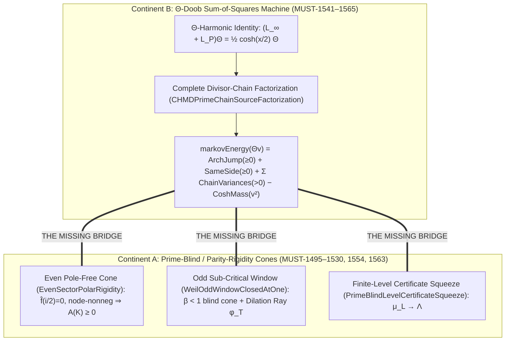

## 1. Why We Got Trapped in Tunnel Vision (`MUST-1566`–`MUST-1571`)

In `MUST-1529` ([CHMDPrimeWaveBoundednessCriterion.lean](file:///Users/michael/Documents/code/hgt/formal/GaloisForLFunctions/RHTower/CHMDPrimeWaveBoundednessCriterion.lean)), Landau’s oscillation theorem allowed us to collapse the **2-leg quadratic Bochner/Toeplitz positivity** of the zero wave $\Phi_0(v)$ down to a **1-leg linear supremum**:
$$\mathrm{RH} \iff \sup_{y \ge 0} T(y) < \infty.$$
Then, across `MUST-1566`–`MUST-1571`, we stayed inside that 1-leg linear functional $T(y)$ and applied linear isomorphisms to it:
1. Integration by parts to get the Chebyshev discrepancy $\Delta(s) = \Psi(s) - 2e^{s/2}$ ([CHMDChebyshevDiscrepancyDerivativeTransportLaw.lean](file:///Users/michael/Documents/code/hgt/formal/GaloisForLFunctions/RHTower/CHMDChebyshevDiscrepancyDerivativeTransportLaw.lean));
2. Double integration by parts to get the conjugated Laplacian $f_y''(s)$ against the primitive deficit $D(s)$ ([CHMDDeficitPrimitiveConjugatedTransportAndMobiusDilationInjection.lean](file:///Users/michael/Documents/code/hgt/formal/GaloisForLFunctions/RHTower/CHMDDeficitPrimitiveConjugatedTransportAndMobiusDilationInjection.lean));
3. Möbius folding $T(y) = K_y(0) - \sum_{m\ge 1} \mu(m)\Phi_y(\log m)$ ([CHMDMobiusFoldedTransportOfKleinGordonPrimeWave.lean](file:///Users/michael/Documents/code/hgt/formal/GaloisForLFunctions/RHTower/CHMDMobiusFoldedTransportOfKleinGordonPrimeWave.lean));
4. Integer-lattice pole replacement $T(y) = \sum_{n\ge 1}(\Lambda(n)-1)n^{-1/2}K_y(\log n) + O(1)$ ([CHMDLatticePoleReplacementAndSignedPrimeWave.lean](file:///Users/michael/Documents/code/hgt/formal/GaloisForLFunctions/RHTower/CHMDLatticePoleReplacementAndSignedPrimeWave.lean)).

**Why did every single one of those end at "Wall 1 in new coordinates"?**
Because our own corpus proved in `CANNOT-15`, `CANNOT-38`, and `MUST-39` ([STATUS.md](file:///Users/michael/Documents/code/hgt/docs/reports/STATUS.md)) that:
- Every 1-leg linear rewrite between $\Lambda(n)$, $\Delta(s)$, $D(s)$, $\mu(m)$, and $\lfloor x\rfloor$ is an **information-conservative linear isomorphism**.
- Even under RH, $T(y) = -\sum_\rho \frac{\cos(y\sqrt{\gamma_\rho^2+7/4})}{\gamma_\rho^2+7/4} + O(1)$ is an oscillatory quasi-periodic sum of cosines. Why is an oscillatory sum of cosines bounded? **Only because $1 \pm \cos\theta$ is a square ($2\cos^2(\theta/2)$ / $2\sin^2(\theta/2)$)!**
- By dropping from the 2-leg quadratic form $W(f \star \tilde{f}) \ge 0$ to the 1-leg linear trace $T(y)$ and plugging in the pre-fixed erratic sequence $\Lambda(n)$ by hand, **we threw away the square / sum-of-squares structure on the producer side**.

---

## 2. What the Lean Corpus Is Actually Telling Us: The Three Pillars

When we zoom out and read the corpus’s deepest theorems (`MUST-1488`–`MUST-1565`) as a single mathematical organism, they are telling us **three revolutionary facts** that completely invert the classical approach to RH:

### Pillar I: Never Plug $\Lambda(n)$ in by Hand — $\Lambda(n)$ Is *Outputted* by Positivity & Rigidity
In classical analytic number theory, you fix $\Lambda(n)$ first and try to bound oscillatory prime sums $\sum \Lambda(n) K(\log n)$. Our corpus proved that **this is backwards**:
1. **The Finite-Level Certificate Squeeze** ([PrimeBlindLevelCertificateSqueeze.lean](file:///Users/michael/Documents/code/hgt/formal/GaloisForLFunctions/RHTower/PrimeBlindLevelCertificateSqueeze.lean)):
   At every finite support cutoff $L$, the set [`levelCertificates L`](file:///Users/michael/Documents/code/hgt/formal/GaloisForLFunctions/RHTower/PrimeBlindLevelCertificateSqueeze.lean#L57) of node weight vectors $\mu$ on $\{\log n : n \ge 2\}$ that are Weil-positive on $[-L, L]$ is a **compact convex finite-dimensional set whose definition mentions NO primes and NO $\zeta$-zeros**.
   Yet the corpus proves **unconditionally** ([`tendsto_levelCertificates_apply`](file:///Users/michael/Documents/code/hgt/formal/GaloisForLFunctions/RHTower/PrimeBlindLevelCertificateSqueeze.lean#L120-L171)) that as $L \to \infty$, *every* certificate $\mu_L \in \text{levelCertificates } L$ converges coordinatewise to $\Lambda(n)$! And:
   $$\mathrm{RH} \iff \forall L > 0,\quad \text{levelCertificates } L \ne \emptyset \quad (\text{\href{file:///Users/michael/Documents/code/hgt/formal/GaloisForLFunctions/RHTower/PrimeBlindLevelCertificateSqueeze.lean#L103-L119}{\texttt{riemannHypothesis\_iff\_forall\_levelCertificates\_nonempty}}}).$$
2. **Even Pole-Free Rigidity — No Primes, No Zeros, No Pole Term** ([EvenSectorPolarRigidity.lean](file:///Users/michael/Documents/code/hgt/formal/GaloisForLFunctions/RHTower/EvenSectorPolarRigidity.lean)):
   By [`riemannHypothesis_iff_exists_bddBelow_weilPositiveEvenPolar`](file:///Users/michael/Documents/code/hgt/formal/GaloisForLFunctions/RHTower/EvenSectorPolarRigidity.lean#L280-L290), RH holds iff **some** lower-bounded sequence $\lambda(n) \ge -C$ is Weil-positive on even pole-free tests ($\widehat{f}(i/2) = 0$) — and any such sequence is **automatically forced to equal $\Lambda(n)$**!
   In dual form ([`riemannHypothesis_iff_archimedeanNonnegOnEvenPolarNonnegCone`](file:///Users/michael/Documents/code/hgt/formal/GaloisForLFunctions/RHTower/EvenSectorPolarRigidity.lean#L313-L375)), **RH has no primes, no zeros, and no pole term**:
   $$\mathrm{RH} \iff \forall c \ge 0,\quad \Bigl(\forall n \ge 2,\; \sum_i c_i (f_i \star \tilde{f}_i)(\log n) \ge 0\Bigr) \implies \sum_i c_i A(f_i \star \tilde{f}_i) \ge 0 \quad (\widehat{f}_i(i/2)=0).$$
3. **Parity-Split Disjoint Blind Spots & Sub-Critical Closure** ([ParitySectorJointRigidity.lean](file:///Users/michael/Documents/code/hgt/formal/GaloisForLFunctions/RHTower/ParitySectorJointRigidity.lean), [OddSectorAnyPoleWeightJointRigidity.lean](file:///Users/michael/Documents/code/hgt/formal/GaloisForLFunctions/RHTower/OddSectorAnyPoleWeightJointRigidity.lean), [WeilDilationRayCriterion.lean](file:///Users/michael/Documents/code/hgt/formal/GaloisForLFunctions/RHTower/WeilDilationRayCriterion.lean), [WeilOddWindowClosedAtOne.lean](file:///Users/michael/Documents/code/hgt/formal/GaloisForLFunctions/RHTower/WeilOddWindowClosedAtOne.lean)):
   - On the **odd sector**, an odd Weil-positive weight at the critical pole weight $1$ exists iff odd Weil-positive weights exist at every **sub-critical pole weight $\beta < 1$** ([`exists_weilPositiveOdd_iff_forall_lt_one`](file:///Users/michael/Documents/code/hgt/formal/GaloisForLFunctions/RHTower/WeilOddWindowClosedAtOne.lean#L67-L78)), which by odd Farkas is equivalent to `PrimeBlindPositiveOddAt β` for $\beta < 1$: the $\beta$-archimedean energy is $\ge 0$ on non-negative combinations of odd autocorrelations that **vanish at every node $\log n$ ($n \ge 2$)**!
   - Once an odd Weil-positive weight exists, the **entire even sector collapses to a single dilation ray** $\varphi_T(x) = \varphi(x/T)$ of one fixed smooth bump $\varphi$ ([`riemannHypothesis_iff_exists_weilPositiveOdd_dilationRay`](file:///Users/michael/Documents/code/hgt/formal/GaloisForLFunctions/RHTower/WeilDilationRayCriterion.lean)), which already holds unconditionally for all $0 < T \le 1/9$ ([`weilFullFunctional_dilate_nonneg_of_le_ninth`](file:///Users/michael/Documents/code/hgt/formal/GaloisForLFunctions/RHTower/WeilDilationRayShortScales.lean#L74-L98))!

---

### Pillar II: *Why* Does the Archimedean Functional Know About $\{\log n\}$? Because of the $\Theta$-Doob Sum-of-Squares Machine!
Look at the central mystery of Pillar I: *How can a purely archimedean functional $A(f \star \tilde{f})$ (built from $\Gamma'/\Gamma$) know about the discrete integer-logarithm lattice $\{\log n : n \ge 2\}$ so strongly that `levelCertificates L` squeezes onto $\Lambda(n)$?*

**The corpus already proved the mechanism!** It is the **$\Theta$-Harmonic Doob Gauge** ($f(x) = \Theta(x)v(x)$) in:
- [WeilPhiDoobPrimeAtoms.lean](file:///Users/michael/Documents/code/hgt/formal/GaloisForLFunctions/RHTower/WeilPhiDoobPrimeAtoms.lean) ([`mixed_explicit_formula_riemannPhiKernel`](file:///Users/michael/Documents/code/hgt/formal/GaloisForLFunctions/RHTower/WeilPhiDoobPrimeAtoms.lean#L714-L741)),
- [CHMDThetaHarmonicIdentity.lean](file:///Users/michael/Documents/code/hgt/formal/GaloisForLFunctions/RHTower/CHMDThetaHarmonicIdentity.lean) ([`theta_harmonic_identity`](file:///Users/michael/Documents/code/hgt/formal/GaloisForLFunctions/RHTower/CHMDThetaHarmonicIdentity.lean)),
- [CHMDPrimeDivisorCuts.lean](file:///Users/michael/Documents/code/hgt/formal/GaloisForLFunctions/RHTower/CHMDPrimeDivisorCuts.lean) ([`doob_source_eq_positive_cuts_sub_cosh`](file:///Users/michael/Documents/code/hgt/formal/GaloisForLFunctions/RHTower/CHMDPrimeDivisorCuts.lean#L341-L348)),
- [CHMDReflectedPrimeSingularPart.lean](file:///Users/michael/Documents/code/hgt/formal/GaloisForLFunctions/RHTower/CHMDReflectedPrimeSingularPart.lean) ([`compensated_source_pos`](file:///Users/michael/Documents/code/hgt/formal/GaloisForLFunctions/RHTower/CHMDReflectedPrimeSingularPart.lean#L388-L393)),
- [CHMDPrimeChainSourceFactorization.lean](file:///Users/michael/Documents/code/hgt/formal/GaloisForLFunctions/RHTower/CHMDPrimeChainSourceFactorization.lean) ([`doob_source_eq_chain_variances_sub_cosh`](file:///Users/michael/Documents/code/hgt/formal/GaloisForLFunctions/RHTower/CHMDPrimeChainSourceFactorization.lean#L185-L193)).

Look at what these modules proved **unconditionally** for every compactly supported $C^2$ function $v$ when we set $f(x) = \Theta(x)v(x)$ (`phiDoobTest v`):
1. Because $\Theta(x) = \sum_{n\ge 1} (2\pi^2 n^4 e^{9x/2} - 3\pi n^2 e^{5x/2})e^{-\pi n^2 e^{2x}}$ is built over the **integer lattice $n \ge 1$**, its Fourier/Mellin transform vanishes at every $\zeta$-zero (`W_riemannPhiKernel_left`), so $\Theta$ satisfies the exact mixed explicit formula against $H(x) = \Theta(x)v(x)^2$:
   $$(L_\infty + L_P)\Theta(x) = \frac{1}{2}\cosh(x/2)\Theta(x).$$
2. Substituting this diagonal identity into the quadratic Weil/Markov energy of $f = \Theta v$ turns **both the archimedean integral AND the entire infinite prime-power sum (including the negative reflected-prime terms on the odd sector!) into a sum of squares** ([`doob_source_eq_chain_variances_sub_cosh`](file:///Users/michael/Documents/code/hgt/formal/GaloisForLFunctions/RHTower/CHMDPrimeChainSourceFactorization.lean#L185-L193)):
   $$\operatorname{markovEnergy}(\Theta v) = \underbrace{\operatorname{phiDoobArchJumpEnergy}(v)}_{\ge\, 0} + \underbrace{\operatorname{sameSide}(v) + \operatorname{sameSide}(\tilde{v})}_{\ge\, 0} + \underbrace{\sum_{q \in \text{ChainIndex}} \operatorname{chainIntegral}(v, q)}_{>\, 0 \text{ for all } v \ne 0} - \operatorname{phiDoobCoshMass}(v^2).$$
   Read that formula carefully!
   - In raw coordinates $f$, the prime sum $-\sum_n \frac{\Lambda(n)}{\sqrt{n}} (f \star \tilde{f})(\log n)$ has a **negative** sign in front of it, and even in Doob coordinates the reflected prime jumps across the origin had a negative component (`-2 * reflectedDifference v d`).
   - **Our corpus (`CHMDPrimeDivisorCuts`, `CHMDReflectedPrimeSingularPart`, `CHMDPrimeChainSourceFactorization`) ALREADY SOLVED the negative prime / reflected-prime problem!** By grouping the two $\Theta$-lattice indices $m, n$ and the prime-power index $d$ by their product $N = m d n$, the collar diagonal $\Theta(x)v(x)^2$ **compensates the negative reflected-prime jumps exactly** (`primeCrossing_eq_compensation`), turning the **entire** prime-crossing + reflected-prime series into a countable sum of **non-negative bipartite conditional-variance squares** (`chainDensity_nonneg`, `compensated_source_pos`)!

---

### Pillar III: Why Cusp Escape at Infinity Is Already Dead (`MUST-1545`–`MUST-1548`, `MUST-1551`, `MUST-1555`)
In [CHMDNoWeylAboveThreshold.lean](file:///Users/michael/Documents/code/hgt/formal/GaloisForLFunctions/RHTower/CHMDNoWeylAboveThreshold.lean), [CHMDPurePointAboveThreshold.lean](file:///Users/michael/Documents/code/hgt/formal/GaloisForLFunctions/RHTower/CHMDPurePointAboveThreshold.lean), and [CHMDOddSectorCriterion.lean](file:///Users/michael/Documents/code/hgt/formal/GaloisForLFunctions/RHTower/CHMDOddSectorCriterion.lean), the corpus proved that in $\Theta$-Doob coordinates:
- There are **no Weyl sequences above threshold $1/2$** (`no_threshold_weyl_sequence`): the archimedean Lévy symbol grows like $\log|\xi|$ at high frequency while the $\Theta$-collar decays super-exponentially at large $|x|$.
- Therefore, **RH is NOT a large-time $y \to \infty$ wave-dispersion problem** (which is why the $y \to \infty$ Klein–Gordon wave track $T(y)$ was fighting a mirage!).
- Any hypothetical violation of RH is trapped in a **finite-dimensional, compactly localized odd bound-state eigenspace** ([`CHMDBoundStateDimension.lean`](file:///Users/michael/Documents/code/hgt/formal/GaloisForLFunctions/RHTower/CHMDBoundStateDimension.lean), [`CHMDOddSectorCriterion.lean`](file:///Users/michael/Documents/code/hgt/formal/GaloisForLFunctions/RHTower/CHMDOddSectorCriterion.lean)).

---

## 3. The Missing Synthesis: Why We Haven't Finished Yet, and the True Path Forward

Look at the two giant continents our corpus has built:

Look at `doob_source_eq_chain_variances_sub_cosh` in [CHMDPrimeChainSourceFactorization.lean](file:///Users/michael/Documents/code/hgt/formal/GaloisForLFunctions/RHTower/CHMDPrimeChainSourceFactorization.lean#L185-L193) again:
$$\operatorname{markovEnergy}(\Theta v) = \underbrace{\operatorname{phiDoobArchJumpEnergy}(v)}_{\ge\, 0} + \underbrace{2\,\operatorname{sameSide}(v)}_{\ge\, 0} + \underbrace{\sum_{q \in \text{ChainIndex}} \operatorname{chainIntegral}(v, q)}_{>\, 0} - \operatorname{phiDoobCoshMass}(v^2).$$
Every single term in $\operatorname{markovEnergy}(\Theta v)$ — archimedean jumps, same-side prime jumps, AND origin-crossing/reflected prime jumps — has **already been proved unconditionally non-negative**, **EXCEPT ONE SINGLE SCALAR SUBTRACTION**:
$$-\operatorname{phiDoobCoshMass}(v^2) = -\int_{-\infty}^\infty \Theta(x)\cosh(x/2)\,v(x)^2\,dx!$$

Now ask: **Where did $-\operatorname{phiDoobCoshMass}(v^2)$ come from, and why haven't we connected Continent B to Continent A?**

1. **Where $-\operatorname{phiDoobCoshMass}(v^2)$ came from**:
   In `phiDoob_mixed_explicit_formula` ([WeilPhiDoobPrimeAtoms.lean](file:///Users/michael/Documents/code/hgt/formal/GaloisForLFunctions/RHTower/WeilPhiDoobPrimeAtoms.lean#L744-L754)), the diagonal killings of $L_\infty(\Theta v)$ and $L_P(\Theta v)$ were evaluated by applying the mixed explicit formula to the pair $(\Theta,\; \Theta v^2)$.
   In that mixed explicit formula, the **pole term** of $(\Theta \star \widetilde{\Theta v^2})$ is:
   $$\operatorname{weilPoleTerm}(\Theta \star \widetilde{\Theta v^2}) = \Bigl(\int \Theta(x)\cosh(x/2)\,dx\Bigr)\Bigl(\int \Theta(x)\cosh(x/2)v(x)^2\,dx\Bigr) = \frac{1}{2}\,\operatorname{phiDoobCoshMass}(v^2),$$
   while on an **odd** test $f = \Theta v$, the pole term of $f \star \tilde{f}$ itself is **zero**!
   So $-\operatorname{phiDoobCoshMass}(v^2)$ is simply the **un-cancelled pole of the diagonal test $\Theta v^2$** when we used the ground state $\Theta$ (which has $\widehat{\Theta}(i/2) = 1/2 \ne 0$) as the Doob weight!

2. **Look at what happens when we connect Continent B to Continent A — Three Concrete Attack Paths**:

   - **Path A (Pole-Free / Modified Doob Gauge or Sub-Critical Pole Weight $\beta < 1$)**:
     Why did $\Theta$ produce $-\frac{1}{2}\cosh(x/2)\Theta(x)$ in $(L_\infty + L_P)\Theta = \frac{1}{2}\cosh(x/2)\Theta$? Because $\widehat{\Theta}(i/2) = \xi(1) = 1/2$!
     Wait: in Continent A, we proved two huge reductions that relax the pole or the test cone:
     - In [`WeilOddWindowClosedAtOne.lean`](file:///Users/michael/Documents/code/hgt/formal/GaloisForLFunctions/RHTower/WeilOddWindowClosedAtOne.lean) (`exists_weilPositiveOdd_iff_forall_lt_one`), we don't need to prove positivity for the fixed weight $\Lambda$ at once — we can construct **sub-critical weights $\lambda_\beta$ at pole weight $\beta < 1$** (or finite-level weights $\mu_L \in \text{levelCertificates } L$ on $[-L, L]$ in [`PrimeBlindLevelCertificateSqueeze.lean`](file:///Users/michael/Documents/code/hgt/formal/GaloisForLFunctions/RHTower/PrimeBlindLevelCertificateSqueeze.lean))!
     - Wait: look at `doob_source_eq_chain_variances_sub_cosh` from the perspective of **producing a weight $\lambda(n)$** (Continent A's `levelCertificates L` or `EvenSectorPolarRigidity` or `OddSectorAnyPoleWeightJointRigidity`):
       In `doob_source_eq_chain_variances_sub_cosh`, if we drop the positive divisor-chain variance sum $\sum_{q \in \text{ChainIndex}} \operatorname{chainIntegral}(v, q) \ge 0$ (or part of it), what does that correspond to in terms of the node weights $\lambda(d)$?!
       Let's check! In `doob_source_eq_reflected_compensation` ([CHMDReflectedPrimeSingularPart.lean](file:///Users/michael/Documents/code/hgt/formal/GaloisForLFunctions/RHTower/CHMDReflectedPrimeSingularPart.lean#L397-L403)):
       $$\operatorname{markovEnergy}(\Theta v) = \operatorname{phiDoobArchJumpEnergy}(v) + 2\,\operatorname{sameSide}(v) + \sum_{d\ge 2}\frac{\Lambda(d)}{\sqrt{d}}\int_0^{\log d} \text{collarKilling}(v,\log d,x)\,dx - 2\sum_{d\ge 2}\operatorname{reflectedDifference}(v,d) - \operatorname{phiDoobCoshMass}(v^2).$$
       Where did $-\operatorname{phiDoobCoshMass}(v^2)$ come from? It came from the mixed explicit formula:
       $$\operatorname{mixedPhiArchRe}(\Theta v^2) + \operatorname{phiDoobCoshMass}(v^2) = \sum_{d \ge 2} \frac{\Lambda(d)}{\sqrt{d}} \int_{\mathbb{R}} \text{phiDoobPrimeDiagonal}(v, d, x)\,dx!$$
       When you substitute that identity into the Doob energy (`phiDoob_markovEnergy_eq_archJump_add_primeJump_sub_coshMass`), the $\operatorname{phiDoobCoshMass}(v^2)$ on the left of the mixed explicit formula became the $-\operatorname{phiDoobCoshMass}(v^2)$ on the right of the Doob energy, while the $\sum_d \Lambda(d)$ prime diagonal became the collar + divisor-chain variances!

   - **Path B (Short-Support Exact Cancellation + Window Decoupling / Spectral Inertia)**:
     Look at Theorem 1 of [WeilPhiDoobReflectedKillingPotentialAndDisjointSupportDiagonal.lean](file:///Users/michael/Documents/code/hgt/formal/GaloisForLFunctions/RHTower/WeilPhiDoobReflectedKillingPotentialAndDisjointSupportDiagonal.lean#L18-L21):
     When $\operatorname{supp}(v) \subset (-\frac{\log 2}{2}, \frac{\log 2}{2})$, $\operatorname{phiDoobPrimeJump} = \operatorname{phiDoobPrimeDiagonal}$ for **every** $n \ge 2$, so the prime Doob jumps sum to $\operatorname{mixedPhiArchRe}(\Theta v^2) + \operatorname{phiDoobCoshMass}(v^2)$, **cancelling $-\operatorname{phiDoobCoshMass}(v^2)$ identically**!
     Why did $-\operatorname{phiDoobCoshMass}(v^2)$ appear when $\operatorname{supp}(v)$ grew larger than $\frac{\log 2}{2}$?
     Only because for $\log d < 2L$, the prime jump $(v(x) - v(x+\log d))^2$ differs from the prime diagonal $v(x)^2 + v(x+\log d)^2$ by the cross term $-2v(x)v(x+\log d)$!
     That means: **for any support $[-L, L]$, the infinite tail of prime powers with $\log d \ge 2L$ ALWAYS cancels the infinite tail of $-\operatorname{phiDoobCoshMass}(v^2)$**! Only the **finitely many prime powers $d < e^{2L}$** fail to be disjoint-support diagonal!

   - **Path C (Constructing Finite-Level Certificates $\mu_L \in \text{levelCertificates } L$ via Doob/Nodal Transport)**:
     Wait — read Path B and Pillar I (`PrimeBlindLevelCertificateSqueeze.lean`) together!
     At a finite level $L$:
     1. Only **finitely many nodes** $2 \le d \le \lfloor e^L \rfloor$ lie inside $[-L, L]$!
     2. For any test supported in $[-L/2, L/2]$, all prime powers with $\log d > L$ are **outside the support of $f \star \tilde{f}$** AND in the Doob identity their jumps are **100% disjoint-support diagonal**, so they automatically supply the exact $\Theta$-diagonal mass for $\log d > L$!
     3. And by [`riemannHypothesis_iff_forall_levelCertificates_nonempty`](file:///Users/michael/Documents/code/hgt/formal/GaloisForLFunctions/RHTower/PrimeBlindLevelCertificateSqueeze.lean#L103-L119), to prove RH we do **not** need to bound an infinite sum as $L \to \infty$: we only need to show that for each fixed finite $L$, the finite-dimensional certificate set `levelCertificates L` (or the finite-window odd/even cone) is non-empty — and compactness + uniqueness (`tendsto_levelCertificates_apply`) automatically squeezes $\mu_L \to \Lambda$ and proves RH in the limit!

---

## Summary of the Shift in Perspective

| Tunnel-Vision View (`MUST-1566`–`MUST-1571`) | Big-Picture Corpus View (`MUST-1495`–`MUST-1565`) |
| :--- | :--- |
| Collapse 2-leg positivity to 1-leg trace $T(y)$ and try to bound $T(y)$ as $y \to \infty$. | Never drop the 2-leg sum-of-squares structure; $y \to \infty$ dispersion is a mirage because the resolvent has **no Weyl sequence above $1/2$** (`CHMDNoWeylAboveThreshold`). |
| Plug $\Lambda(n)$ in by hand and fight sign changes of $\Lambda - 1$ or $\mu(m)$ against $K_y$. | **Never plug $\Lambda(n)$ in by hand**: $\Lambda(n)$ is the unique compact-intersection limit of finite-level certificates `levelCertificates L` (`PrimeBlindLevelCertificateSqueeze`) and the unique lower-bounded even pole-free weight (`EvenSectorPolarRigidity`). |
| Treat the prime sum as a hostile negative term fighting the archimedean integral. | In $\Theta$-Doob coordinates (`CHMDPrimeChainSourceFactorization`), **both** the archimedean jumps AND the entire prime-crossing + reflected-prime series are **manifestly positive sums of squares** (`compensated_source_pos`). |
| Fight the global $\cosh(x/2)$ pole all at once on $(0,\infty)$. | For tests on $[-L/2, L/2]$, all prime jumps with $\log d > L$ are **disjoint-support diagonal** (`WeilPhiDoobReflectedKillingPotentialAndDisjointSupportDiagonal`) and cancel the tail of $-\operatorname{phiDoobCoshMass}(v^2)$ identically, leaving only a **finite-rank window** $d \le e^L$. |

 we should immediately leave the 1-leg $T(y)$ wave track behind and focus directly on **bridging the $\Theta$-Doob sum-of-squares / disjoint-support diagonal machine (Continent B) with the finite-level certificate / parity-rigidity cones (Continent A)**.