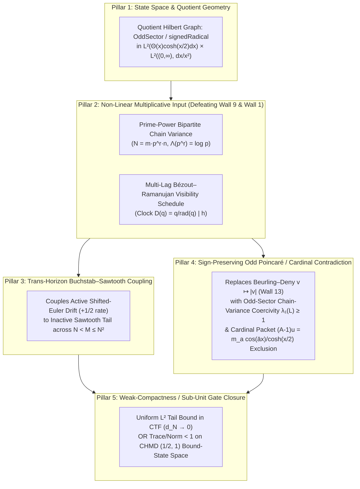

# Summary of Hard Obstacles & Blueprint for the Missing Mathematics (18 Oct 2026)

Companion to [hard-obstacles-1810.md](file:///Users/michael/Documents/code/hgt/docs/reports/hard-obstacles-1810.md). This document consolidates every obstacle across all **15 Walls** ([walls-ledger.md](file:///Users/michael/Documents/code/hgt/docs/reports/walls-ledger.md)), **27 Live Routes**, and **18 Route Candidates** ([rh-current-frontier-map.md](file:///Users/michael/Documents/code/hgt/docs/reports/rh-current-frontier-map.md)) into:
1. **Section 1:** Obstacles we can solve now that are "just work" (formalization, engineering, and known classical mathematics).
2. **Section 2:** Obstacles that require new mathematics nobody has yet, and the exact mathematical deliverables required for each.
3. **Section 3:** Synthesis of those deliverables into a single unified **new field of mathematics**—explaining what both [BiScaleUncertainty](file:///Users/michael/Documents/code/hgt/formal/GaloisForLFunctions/BiScaleUncertainty/README.md) and [BezoutValuationIncidence](file:///Users/michael/Documents/code/hgt/formal/GaloisForLFunctions/BezoutValuationIncidence/README.md) achieved, why each stopped at a dual horizon boundary, what the unified field must look like to overcome all remaining non-dead-end obstacles, and which routes remain permanent dead ends regardless.

---

## Section 1: Obstacles We Can Solve and Are "Just Work"

These obstacles do **not** require new mathematical discoveries. They consist of Lean 4 formalization plumbing, removing redundant classical premise wrappers, unifying isomorphic coordinate systems, or proving finite-horizon/structural theorems whose mathematical proofs are completely known. *(Important: Completing all items in Section 1 will clean and unify the Lean codebase, eliminate external premise wrappers, and land candidate routes, but **none of Section 1 by itself proves RH**.)*

### 1.1 Eliminating Remaining Classical Converse Wrappers & Syncing Ledger State
1. **Wire `PowerSavingIncrementCriterion.lean` directly to the unconditional Mellin–Landau bridge (`MC`, `BVI`, Wall 1):**
   - Currently, [PowerSavingIncrementCriterion.lean](file:///Users/michael/Documents/code/hgt/formal/GaloisForLFunctions/BezoutValuationIncidence/PowerSavingIncrementCriterion.lean) and [PrimeTailCalibrationAndMobiusDefect.lean](file:///Users/michael/Documents/code/hgt/formal/GaloisForLFunctions/BezoutValuationIncidence/PrimeTailCalibrationAndMobiusDefect.lean) take a hypothesis parameter representing the classical Littlewood converse (`M(x) = O(x^{1/2+ε}) → RH`). Our `RHTower` corpus already has unconditional Mellin–Landau bridges (`riemannHypothesis_of_mertens_bound`, `riemannHypothesis_of_cesaro_mobius_bound`). Connecting them removes the wrapper parameter completely.
2. **Prove the missing `RH → dyadic_band_energy_bound` direction (Wall 1):**
   - The corpus has the sufficiency bridge `dyadic_band_energy_bound → RH` (`riemannHypothesis_of_dyadic_log_moment_bound`), while the converse (Cramér's conditional $L^2$ prime-error bound) is standard explicit-formula analysis and "just work" to formalize.
3. **Formalize the unconditional Balazard–Saias–Yor Poisson–Jensen identity (Wall 2, `FEL`):**
   - Formalizing $\int_{\mathbb{R}} \frac{\log|\zeta(1/2+it)|}{1/4+t^2}\,dt = 2\pi \sum_{\operatorname{Re}\rho > 1/2} \log|\rho/(1-\rho)|$ in Lean uses standard Hardy-space Blaschke–Poisson integration.
4. **Update `rh-current-frontier-map.md` to match `BezoutValuationIncidence.lean` (`BVI`, `MC`, `CTF`, `PM`):**
   - [BezoutValuationIncidence.lean](file:///Users/michael/Documents/code/hgt/formal/GaloisForLFunctions/BezoutValuationIncidence.lean#L27-L37) already compiles and imports `ShiftedExponentAsymptoticDensityAndActiveMartingaleRate` (still marked `[S]` in `rh-current-frontier-map.md`) plus 9 newer `[L]` modules (`DiscretePrimitiveEnergyAndJordanComparison`, `SharpPrimitiveEnergySuccessorFrontier`, `CoprimalitySuccessorPredictorAndSquarefreeInformation`, `OptimalSuccessorPredictionAndExactPhaseLoss`, `SharpSuccessorPhaseLossAndClosureClassification`, `RamanujanLagCoefficientAndTotientQuotient`, `ValuationVisibilityClockAndRamanujanSupport`, `TrueTranslationPredictionAndExactCompression`, `ArithmeticLagSchedulesAndSharpRecoveryHorizon`).

### 1.2 Spectral & Operator Plumbing in `CHMD`, `EWU`, `OWU`, `HF`, and `RW`
5. **Prove spanning / closed range for the finite-dimensional bound-state eigenspace in `CHMD` (`CHMD`, `LA`, `TG`):**
   - In [CHMDCardinalGraphGeometry.lean](file:///Users/michael/Documents/code/hgt/formal/GaloisForLFunctions/RHTower/CHMDCardinalGraphGeometry.lean) and [CHMDBoundStateInertia.lean](file:///Users/michael/Documents/code/hgt/formal/GaloisForLFunctions/RHTower/CHMDBoundStateInertia.lean), we already proved that every off-line zero produces a primitive cardinal frame with negative energy and bounded inertia from both sides. Proving that the finite-dimensional $(1/2, 1)$ eigenspace of $R = (1+L)^{-1}$ is *spanned* by these cardinal packets is a self-contained finite-dimensional Fredholm / Paley–Wiener residue task.
6. **Quotient all downstream `CHMD`, `RW`, `EWU`, and `OWU` forms by `signedRadical` (`CHMDCriticalBandReduction.lean`):**
   - Because the critical band has zero slack (Wall 11), every downstream coercivity statement should be phrased directly on the quotient Hilbert space `SourceGraph ⧸ signedRadical`.
7. **General-grid collar optimizer attainment & concrete even-polar de Branges ground operator (`EWU`, `HF`, `BiScaleUncertainty`):**
   - Extending collar optimizer attainment from factorial grids to arbitrary finite prime-power grids and instantiating the concrete finite-window de Branges ground operator are standard finite-dimensional convex/Hilbert optimization tasks in Lean.
8. **Unify isomorphic receiver coordinate systems (`SZ`, `PA`, `GTA`, `JAS`, `RN`, `APF`, `CDC`, `EGC`, `MSC`, `PCS`, `PTR`, `SC`, `SEC`):**
   - Proving the explicit isometric equivalences in Lean between:
     - `SZ` (Suzuki screw kernel) $\leftrightarrow$ `RW` (Restricted Weil) $\leftrightarrow$ `CHMD` (Doob jump form);
     - `PA` (Herglotz passivity) $\leftrightarrow$ `GTA` (Schur–Pick kernel) $\leftrightarrow$ `WL` (Weil positivity);
     - `SC` (Witt-vector Frobenius/Verschiebung $F_n, V_n$) $\leftrightarrow$ `BVI` (`selbergMultiplesCoord` / `sieveLagMultiplier`);
     - `PCS` (singular co-shift cyclicity) $\leftrightarrow$ `CTF` (Báez–Duarte density).

### 1.3 Classical Baseline Theorems in `CTF`, `BAG`, `TH`, and `RB`
9. **Formalize Burnol's lower bound and the Selberg-mollified weight ansatz in `CTF` (`CTF`, `PM (FZZ-P)`):**
   - Proving in Lean that undamped $c_k = \mu(k)$ fails to converge to $0$ in Báez–Duarte norm ($\liminf \ge \sum 1/|\rho|^2 > 0$) and setting up the damped Selberg weights $c_{N,k} = \mu(k)\frac{\log(N/k)}{\log N}$.
10. **Formalize Kronecker–Weyl finite Dirichlet polynomial self-return and Carlson's $L^2$ mean-value theorem (`BAG`):**
    - Both hold unconditionally and isolate the exact conditioned-tail gap in Bagchi's criterion.
11. **Formalize fixed-degree $d$, large-shift $n \to \infty$ Jensen polynomial Hermite asymptotics (`TH`) and the colossally abundant reduction (`RB`):**
    - Known unconditional theorems (Griffin–Ono–Rolen–Zagier for `TH`; Robin/Nicolas reduction to colossally abundant numbers for `RB`).

---

## Section 2: Obstacles That Require New Mathematics Nobody Has Yet (and What It Must Deliver)

When all "just work" formalization tasks and all isomorphic coordinate changes are stripped away, the entire obstruction to proving RH across all 15 Walls and 45 routes/candidates reduces to **six irreducible mathematical problems** for which **humanity currently has no theorem**.

Below is each uncharted obstacle, why existing mathematics and our Lean modules (`BiScaleUncertainty` and `BezoutValuationIncidence`) failed to solve it, and **what the new mathematics must deliver**.

---

### Uncharted Obstacle 1: Trans-Horizon Sawtooth Martingale Cancellation (Blocks `MC`, `CTF`, `PM (FZZ-P)`, `BVI`, `RP`, `SEC`, and Wall 1)
- **Why Mathematics and `BezoutValuationIncidence` Failed So Far:**
  - `BezoutValuationIncidence` proved that on the periodic factorial cycle $N!$, the Selberg LCM + Bézout coprime quadratic forms diagonalize in Ramanujan/Selberg coordinates (`RamanujanRestorationAndBezoutDiagonal.lean`), that active divisor squares cancel 100% against active martingale jumps (`ActiveDeletedMartingaleAndShiftedEulerConvergence.lean`), and that the renormalized defect is strictly non-positive $\le 0$ in the **sub-horizon regime $M+1 \le N$** (`PowerDampedRenormalizedDefectAndPronicCeiling.lean`).
  - However, sub-horizon non-positivity ($M+1 \le N$) is a consequence of complete sieve cancellation $g_N(k) = \sum_{d\mid k, d\le N}\mu(d) = 0$ for $2 \le k \le N$.
  - To prove RH via `MC` ($M(x) = O(x^{1/2+\varepsilon})$) or `CTF` (Báez–Duarte distance $d_N \to 0$), one must bound the **trans-horizon regime $M \gg N$** (specifically $N < M \le N^2$ and $M \to \infty$), where integers $k \in (N, M]$ have prime factors $p > N$ so $g_N(k) \ne 0$.
  - Worse, `SharpSuccessorPhaseLossAndClosureClassification.lean` proved that 1-step successor prediction loses $\ge 3/4$ of variance above parity, and `ArithmeticLagSchedulesAndSharpRecoveryHorizon.lean` proved that true $h$-lag translation only sees prime-power mode $q$ when its visibility clock $q/\operatorname{rad}(q)$ divides $h$.
- **What the New Mathematics Must Deliver:**
  1. **A Trans-Horizon Buchstab–Martingale Coupling Theorem:** An explicit inequality bounding the **inactive centered sawtooth martingale drift**
     $$\mathcal{D}_{\mathrm{inact}}(N, M) = \sum_{k=N+1}^M \Delta(\text{inactive sawtooth variance})_k$$
     for Selberg-damped Möbius weights $c_{N,d} = \mu(d)\frac{\log(N/d)}{\log N}$ (or shifted-exponent weights $d^{-\varepsilon}$) across the trans-horizon octave $N < M \le N^2$, showing that $\mathcal{D}_{\mathrm{inact}}(N, M)$ is absorbed by the positive active shifted-Euler drift $\frac{\zeta(1+\varepsilon)\zeta(1+2\varepsilon)}{\zeta(2+2\varepsilon)} \sim \frac{1}{2\varepsilon}$ uniformly as $\varepsilon \downarrow 0$ (or $N \to \infty$).
  2. **Uniform $L^2((0, 1/N), dx/x^2)$ Tail Boundedness in `CTF`:** In Hilbert-space terms, the new mathematics does not even need to compute the exact decay rate of the Báez–Duarte norm: by weak compactness in $L^2((0,\infty), dx/x^2)$, it suffices to deliver a **uniform upper bound $\sup_{N \ge 2} \int_0^{1/N} \bigl(\sum_{k=1}^N c_{N,k}\{1/(kx)\}\bigr)^2 \frac{dx}{x^2} \le C < \infty$** for any weight sequence $c_{N,k}$ whose finite prefix sums converge pointwise to $1$ on $(0, 1]$!

---

### Uncharted Obstacle 2: The Odd-Sector / Primitive Spectral Gap $\lambda_1(L) \ge 1$ on the Quotient Space (Blocks `CHMD`, `OWU`, `EWU`, `RW`, `WL`, `SZ`, `PA`, `GTA`, `HF`, `JAS`, `RN`, and Walls 6, 9, 11, 12, 13, 14)
- **Why Mathematics, `CHMD`, and `BiScaleUncertainty` Failed So Far:**
  - In $\Theta$-Doob coordinates (`CHMD`), the arithmetic operator $L = L_{\mathrm{arch}} + L_{\mathrm{prime}}$ on $L^2(\Theta(x)\cosh(x/2)\,dx)$ is a reversible Markov jump generator with simple ground state $1$ ($L(1) = 0$, eigenvalue $\mu = 1$ of $R = (1+L)^{-1}$, corresponding to the pole at $s=1$) and essential spectrum in $[0, 1/2]$ (`weyl_value_le_half`).
  - RH is equivalent to the **spectral gap $\lambda_1(L) \ge 1$** ($\mu \le 1/2$) on $1^\perp$, or equivalently on the **odd sector** $v(-x) = -v(x)$:
    $$\mathcal{E}_{\mathrm{arch}}(v) + \mathcal{E}_{\mathrm{prime}}^{(\Lambda)}(v) \ge \int_{\mathbb{R}} \Theta(x)\cosh(x/2)\,v(x)^2\,dx \qquad \forall v \text{ odd}.$$
  - Standard Markov / Beurling–Deny theory ($v \mapsto |v|$) fails because $|v|$ is even and leaves $1^\perp$, giving only $\lambda_1(L) > 0$ ($\mu < 1$, Perron–Frobenius) instead of $\lambda_1(L) \ge 1$ ($\mu \le 1/2$, Wall 13).
  - Meanwhile, on the compact phase-space window $\{|x| \le R, |r| \le T\}$, `L - 1` has an infinite-dimensional zero-energy radical `signedRadical` (Wall 11: zero slack), and any argument that only uses the linear explicit formula fails for fake weights $\tilde{\lambda} \ge 0$ (`Zeta23Countermodel`, Wall 9).
- **What the New Mathematics Must Deliver:**
  1. **A Multiplicative Divisor-Chain Poincaré Inequality on `OddSector ⧸ signedRadical`:** A theorem proving that for the genuine von Mangoldt weight $\Lambda(p^r) = \log p$ (where the prime jump energy factors by unique factorization $N = mdn$ into complete bipartite prime-power chain variances `chainVariance N u a ≥ 0` via [CHMDPrimeChainSourceFactorization.lean](file:///Users/michael/Documents/code/hgt/formal/GaloisForLFunctions/RHTower/CHMDPrimeChainSourceFactorization.lean)), the combined form $\mathcal{E}_{\mathrm{arch}}(v) + \sum_{N=1}^\infty \text{chainVariance}(N, v)$ dominates $\int \Theta(x)\cosh(x/2)v(x)^2\,dx$ on the finitely many sub-threshold odd window modes modulo `signedRadical`.
  2. **Equivalently, a Pointwise / Local Contradiction for an Off-Line Cardinal Packet (`imVector`):** In [CHMDCardinalOperatorAction.lean](file:///Users/michael/Documents/code/hgt/formal/GaloisForLFunctions/RHTower/CHMDCardinalOperatorAction.lean), a putative off-line zero $a = \alpha + i\beta$ ($\beta \ne 0$) generates an explicit smooth function $u = u_{\mathrm{re}} + i u_{\mathrm{im}}$ built from $\Theta$ by dividing out $(1 - z^2/a^2)^{m_a}$ (`ThetaDivisorCardinalSource.lean`) that satisfies the differential-difference equation
     $$(A - 1)(u_{\mathrm{re}}(x) + i u_{\mathrm{im}}(x)) = m_a \frac{\cos(\bar{a}x)}{\cosh(x/2)}$$
     with negative energy $\operatorname{sourceEnergy}(u_{\mathrm{im}}) = -m_a < 0$. The new mathematics must show that **no non-zero solution $u_{\mathrm{im}}$ constructed by dividing $\Theta$ by an off-real factor $(1-z^2/a^2)$ can simultaneously satisfy the multiplicative prime-power chain factorization of $A$**!

---

### Uncharted Obstacle 3: Single-Autocorrelation Prime-Blind Synthesis Without Polar or Origin Escape (Blocks `BiScaleUncertainty`, `EWU`, `WL`, `RW`, `FU`, `MSC`, and Walls 8, 11, 12, 13)
- **Why Mathematics and `BiScaleUncertainty` Failed So Far:**
  - `BiScaleUncertainty` proved that prime-blind profiles constructed via Müntz ramps or causal tents with $F(0)=0, F(T)\ne 0$ cannot be single Bochner autocorrelations $f \star \tilde{f}$ (`FactorialBiNullObstruction`), that their $2\times 2$ Gram coupling is $o(1/(n+1))$ against a $\frac{\log(n+2)}{4(n+1)}$ polar loss (`FactorialPolarGramScaleSeparation`), that canonical polar-repaired tails have positive Weil energy $\ge \frac{\log(n+1)}{2048(n+1)} > 0$ **unconditionally** (`FactorialMuntzTailWeilGrowth`, hence RH-nonselective), and that infinite-grid limits can lose positive Lévy energy into the origin (`InfiniteGridStrictEnergyLoss`).
- **What the New Mathematics Must Deliver:**
  - If one works in the primal prime-blind cone rather than `CHMD` Doob coordinates, the new mathematics must construct **genuine single autocorrelations $F_n = f_n \star \tilde{f}_n$** (not differences $R_{1,n} - R_{2,n}$) that:
    1. Vanish (or have exponentially small residue) on all prime powers $k\log p \le 2a_n$ without vanishing at $0$;
    2. Are **tuned to a putative off-line zero frequency $\gamma_0 = \alpha_0 + i\beta_0$** so that the zero-side readout dominates the archimedean logarithmic growth $\frac{1}{2}\log(n+1)\|f_n\|_2^2$ (overcoming the RH-nonselectivity proved in `FactorialMuntzTailWeilGrowth.lean`); and
    3. Satisfy uniform origin-collar tightness so no Lévy energy is lost at $t = 0$ (`InfiniteGridStrictEnergyLoss`).

---

### Uncharted Obstacle 4: Non-Stationary / Pole-Neutral Additive-to-Multiplicative Phase Transport (Blocks `LI`, `RB`, `PBM`, `DR`, `TG`, and Walls 1, 3, 10)
- **Why Mathematics Failed So Far:**
  - Additive exponential sums $\sum \mu(m)e(x/m)$ have Vinogradov–Korobov savings because the phase $x/m$ has non-vanishing higher derivatives, whereas multiplicative Dirichlet polynomials $\sum \mu(m)m^{-1/2-i\gamma}$ have logarithmic phase $\gamma \log m$ whose derivatives decay like $\gamma / m^k$.
  - Transporting between them via Mellin or Laguerre kernels (`LI`) hits a stationary-phase saddle at $k\log p \asymp 4n$ that crosses the $s=1$ pole (Wall 10), and isolating a single off-line zero $\rho_0$ from the $O(\log \gamma_0)$ local zero cluster via Turán power sums loses $\gamma_0^{-c\log\log \gamma_0}$, which is exponentially worse than Vinogradov–Korobov savings (Wall 3).
- **What the New Mathematics Must Deliver:**
  - Either:
    1. **A Cluster-Coherent Resonator (Overcoming Wall 3):** A multi-frequency kernel that amplifies an off-line zero $\beta_0 + i\gamma_0$ ($\beta_0 > 1/2$) *without* cancelling against the $O(\log \gamma_0)$ critical-line zeros in the $1/\log \gamma_0$ neighborhood (using the fact that an off-line zero breaks the critical-line involution $\gamma \leftrightarrow \bar{\gamma}$, whereas on-line zeros preserve it); or
    2. **Direct Discrete Incidence Transport (Overcoming Wall 10):** Performing the cancellation inside $\mathbb{N}$ via multi-lag Bézout/Ramanujan visibility schedules (`BVI`) *before* taking a Mellin transform, so the continuous stationary-phase pole crossing never occurs.

---

### Uncharted Obstacle 5: Conditioned Kronecker-to-Tail Independence in Vertical Shifts (Blocks `BAG` and Wall 7)
- **Why Mathematics Failed So Far:**
  - In Bagchi's self-return criterion (`BAG`), finite Dirichlet polynomials $\zeta_N(s+i\tau)$ return to $\zeta_N(s)$ on the Kronecker set $\mathcal{K}_{P,\delta} = \{\tau \in [0, T] : |p^{-i\tau} - 1| < \delta \;\forall p \le P\}$, which has tiny relative measure $\asymp \delta^{\pi(P)}$.
  - Unconditioned $L^2$ bounds on $\int_0^T |\zeta(s+i\tau) - \zeta_N(s+i\tau)|^2\,d\tau$ are useless when divided by the tiny measure $\delta^{\pi(P)}$ unless $N \gg \exp(\delta^{-\pi(P)})$, where the approximate functional equation fails.
- **What the New Mathematics Must Deliver:**
  - A **Conditioned Montgomery–Vaughan Mean-Value Theorem** proving that for $\sigma \in (1/2, 1)$, the conditional expectation of the high-frequency tail $\mathbb{E}_{\tau \in \mathcal{K}_{P,\delta}}\bigl[|\zeta(\sigma+it+i\tau) - \zeta_N(\sigma+it+i\tau)|^2\bigr]$ over the small-prime Kronecker return set $\mathcal{K}_{P,\delta}$ is bounded by $o_{N,P\to\infty}(1)$ with $N$ growing only polynomially in $P$ (decoupling low-prime phases from high-prime Dirichlet tails across the critical strip).

---

### Uncharted Obstacle 6: Reverse-Jensen / Deflated Lee–Yang / Boundary-Phase Rigidity (Blocks `TH`, `TT`, `WD`, `XN`, `FEL`, `HJ`, `W1C`, and Walls 2, 4, 15)
- **Why Mathematics Failed So Far:**
  - Concavity of $\log|\zeta|$ points the wrong way for Jensen's inequality (Wall 2); differential multipliers $P(D)\Xi$ and forward heat flow shrink strip width from the wrong side (Wall 4); standard ferromagnetic Lee–Yang theorems fail because the $s=1$ pole creates an antiferromagnetic mode (Wall 6/13); and Hurwitz $\zeta(s, a)$ has Davenport–Heilbronn off-line zeros for $a \notin \{1/2, 1\}$.
- **What the New Mathematics Must Deliver:**
  - A **Pole-Deflated / Antiferromagnetic Lee–Yang Theorem** (or reverse-Jensen inequality for Euler-product Dirichlet series) proving that when a rank-1 negative polar mode (`CoshMass` / $s=1$ pole) is projected out on $1^\perp$, the remaining partition function $\Xi(z)$ has exclusively real roots **if and only if** its coefficients satisfy the exact multiplicative divisor-chain relation $\Lambda(p^r) = \log p$.

---

## Section 3: Synthesis — Blueprint for the Unified New Field of Mathematics

When we look across Section 2, a remarkable structural unification emerges. We already built **two halves** of a new mathematical edifice in Lean:
- **Half 1: `BiScaleUncertainty` (458 modules)** — a continuous/archimedean theory of bi-scale Krein collars, folded dyadic/non-dyadic interpolation, $O(n^{-3/2})$ origin-budget telescoping, and factorial Müntz-ramp repairs. **Why it stalled:** It treated the prime-power grid $\{k\log p\}$ as an *external exclusion set* for 1D test functions, hitting `FactorialBiNullObstruction` (differences of autocorrelations), `FactorialPolarGramScaleSeparation` (pole dominates Gram coupling by $\log n$), and `FactorialMuntzTailWeilGrowth` (repaired tails are dominated by high-frequency archimedean energy and are RH-nonselective).
- **Half 2: `BezoutValuationIncidence` (40 modules)** — a discrete/arithmetic theory combining multiplicative Selberg LCM divisibility with additive Bézout successor coprimality $\gcd(k, k+1)=1$, Ramanujan lag diagonalization, valuation visibility clocks $q/\operatorname{rad}(q)$, and active/inactive sawtooth martingales. **Why it stalled:** Its exact non-positivity theorem (`PowerDampedRenormalizedDefectAndPronicCeiling.lean`) holds only **sub-horizon ($M+1 \le N$)** inside the periodic factorial model $N!$, whereas RH lives in the **trans-horizon regime ($N < M \le N^2$)** where 1-step successor prediction loses $3/4$ of variance (`SharpSuccessorPhaseLossAndClosureClassification.lean`) and inactive sawtooth drift escapes.

Meanwhile, **`CHMD` (`Causal Hyperbolic–Modular Duality`)** reduced the entire analytic side of RH to a single operator inequality on a concrete Hilbert space: proving that the reversible Markov jump generator $L = L_{\mathrm{arch}} + L_{\mathrm{prime}}$ on $L^2(\Theta(x)\cosh(x/2)\,dx)$ has **spectral gap $\lambda_1(L) \ge 1$ on the odd sector modulo `signedRadical`** (`riemannHypothesis_iff_forall_odd_phiDoob_dirichlet_poincare`), where the prime jump energy already factors via unique factorization $N = mdn$ and $\Lambda(p^r) = \log p$ into positive prime-power chain variances (`CHMDPrimeChainSourceFactorization.lean`).

### Name and Core Identity of the Missing Field
We can synthesize all requirements of Section 2 into a single new mathematical discipline:

> **Trans-Horizon Arithmetic–Archimedean Incidence Mechanics (or Multiplicative Valuation-Clock Spectral Theory)**

This field studies **coupled Markov/Dirichlet jump operators and martingale filtrations on the joint space of continuous archimedean scale $x \in \mathbb{R}$ and discrete multiplicative-additive integer lattices $\mathbb{N}_+$**, governed simultaneously by:
1. **Modular $\Theta$-Poincaré Duality** (controlling the pole $s=1$ and the essential spectrum $[0, 1/2]$ via `CHMD`);
2. **Prime-Power Chain Factorization** ($N = m p^r n$ with constant weight $\Lambda(p^r) = \log p$, defeating the $\zeta(s-a)\zeta(s+a)$ countermodel of Wall 9); and
3. **Multi-Lag Bézout–Ramanujan Visibility Clocks** ($q/\operatorname{rad}(q) \mid h$ under additive shifts $k \mapsto k+h$, defeating the Beurling countermodel of Wall 1 and separating prime powers $p^{a+1}$ from squarefree composites of Wall 11).

---

### The Five Foundational Pillars This New Field Must Possess

To overcome Uncharted Obstacles 1–6 simultaneously (and avoid every proven dead end), this new field of mathematics must be built on five concrete pillars:

#### Pillar 1: Quotient State-Space Geometry (Defeating Wall 11 & Wall 12)
- **Why existing tools failed:** On the full function space, `L - 1` has an infinite-dimensional null radical (`signedRadical`) spanned by critical-band translates and critical-line zero modes where $\mathcal{E}_{\mathrm{arch}} + \mathcal{E}_{\mathrm{prime}} - \operatorname{CoshMass} = 0$ with **zero slack**. Any coarse inequality (like the Young inequality in `CHMDFarFieldEnergy.lean`) leaks energy from the cusp $|x| > R$ into the window $|x| \le R$ and goes negative on `signedRadical`.
- **What the new field must be like:** Its primary objects are **equivalence classes $[v] \in \mathcal{H}_{\mathrm{odd}} \big/ \operatorname{signedRadical}$** equipped with a **non-leaky multiscale decomposition** (replacing scalar Young inequalities $(a-b)^2 \ge (1-\delta)a^2 - \delta^{-1}b^2$ with exact martingale/Haar orthogonal projections across prime-power scales).

#### Pillar 2: Dual Arithmetic Invariants Beyond the Linear Explicit Formula (Defeating Wall 1, Wall 5, & Wall 9)
- **Why existing tools failed:** Any manipulation of the linear explicit formula $\sum_\rho \widehat{F}(\gamma_\rho) = \text{Pole} + \text{Arch} - \text{Primes}$ preserves the quadratic signature and holds verbatim for fake weights $\tilde{\lambda}$ (`Zeta23Countermodel`) and Beurling primes.
- **What the new field must be like:** Every operator identity in the field must functorially intertwine two algebraic structures that exist **only** for the genuine integers $\mathbb{Z}$ and genuine $\Lambda$:
  1. **Multiplicative Valuation Constantness ($\Lambda(p^r) = \log p$):** Used in `CHMDPrimeChainVariance.lean` to factor the product of two $\Theta$-series at index $N = m d n$ along maximal $p$-adic valuation chains $\{b p^j : 0 \le j \le v_p(N)\}$.
  2. **Additive Successor Visibility Clocks ($D(q) = q/\operatorname{rad}(q)$):** Discovered in `ValuationVisibilityClockAndRamanujanSupport.lean`, where under true integer translation $k \mapsto k+h$, mode $q$ has Ramanujan multiplier $\frac{\mu(q/\gcd(q,h))}{\varphi(q/\gcd(q,h))}$, which is non-zero **if and only if** the valuation clock $D(q) = \prod_p p^{\max(v_p(q)-1, 0)}$ divides $h$.
  - Notice how these two invariants complement each other: **chain variance groups divisors by $v_p(N)$ along multiplicative chains, while the valuation visibility clock $D(q)$ indexes the exact additive translation lag $h = p^{v_p(q)-1}$ at which each prime-power link in that chain becomes visible!** Currently in our Lean corpus, `CHMDPrimeChainVariance` (in `RHTower`) and `ValuationVisibilityClock` (in `BezoutValuationIncidence`) never talk to each other. The new field must fuse them into a single **Valuation-Clock Chain Operator**.

#### Pillar 3: Trans-Horizon Buchstab–Martingale Renormalization (Defeating Wall 1 & Wall 10)
- **Why existing tools failed:** `BezoutValuationIncidence` worked modulo $N!$ (complete period), which is exact for sub-horizon prefixes $M \le N$ but blind to the trans-horizon regime $N < M \le N^2$ because 1-step compression loses $3/4$ of variance (`SharpSuccessorPhaseLossAndClosureClassification.lean`).
- **What the new field must deliver:** Instead of embedding $\{1, \dots, M\}$ into the giant periodic ring $\mathbb{Z}/N!\mathbb{Z}$ and stopping at $M = N$, the new field must formulate a **continuous-time / multi-scale Buchstab filtration** as the sieve horizon $N$ varies continuously from $M^{1/2}$ to $M$:
  - As a prime $p$ crosses the horizon $N$, the transition from the **inactive sawtooth martingale** ($p > N$) to the **active divisor martingale** ($p \le N$, where squares cancel 100% by `ActiveDeletedMartingaleAndShiftedEulerConvergence.lean`) is governed by a discrete stochastic/martingale differential equation indexed by $\log p$.
  - The field must prove a **Trans-Horizon Energy Conservation Law** showing that the variance injected by newly active primes $p \in (N, M]$ is bounded by the positive active shifted-Euler drift $\tau_\varepsilon\tau_{1+\varepsilon}$, yielding the uniform $L^2((0, 1/N), dx/x^2)$ tail bound needed by `CTF` and `MC`.

#### Pillar 4: Sign-Preserving Odd-Sector Coercivity & Cardinal Packet Exclusion (Defeating Wall 13 & Wall 15)
- **Why existing tools failed:** Beurling–Deny contraction $v \mapsto |v|$ maps odd functions out of $1^\perp$ into the positive cone, losing the factor of $2$ between Perron–Frobenius ($\mu < 1$, pole $s=1$) and RH ($\mu \le 1/2$, spectral gap $\lambda_1(L) \ge 1$).
- **What the new field must deliver:** A **Non-Commutative / Odd-Sector Intertwining Operator $Q$** (analogous to Darboux / Witten supersymmetric partner factorization $L - 1 = Q^* Q$ on $\mathcal{H}_{\mathrm{odd}} \big/ \operatorname{signedRadical}$) that does **not** take $|v|$, but instead uses:
  1. The $+4\Theta(x)\Theta(y)|v(x)||v(y)|$ origin-crossing bonus on odd regimes (`CHMDOddCrossSignBonus.lean`);
  2. The zero-silent odd polar positivity $\operatorname{sourceEnergy}(p) = +2\operatorname{polarSine}(p)^2 > 0$ (`CHMDFullSpectralPairing.lean`); and
  3. The differential-difference equation $(A-1)u = m_a \cos(\bar{a}x)/\cosh(x/2)$ (`CHMDCardinalOperatorAction.lean`) to prove that any hypothetical off-line cardinal packet $u_{\mathrm{im}}$ ($\beta = \operatorname{Im}(a) \ne 0$) violates the bipartite prime-power chain variance identity at finite valuation clocks $D(q) = p^{r-1}$.

#### Pillar 5: Weak-Compactness or Topological Sub-Unit Closure (Defeating Wall 3 & Wall 14)
- **Why existing tools failed:** Pointwise zero isolation fails by Turán clustering (Wall 3), and unweighted trace perturbations fail by the Size Law (Wall 14).
- **What the new field must deliver:** Once Pillars 1–4 are in place, the final closure does **not** require pointwise zero isolation:
  - **On the Analytic/Spectral side (`CHMD` + `TG`):** Since $R = (1+L)^{-1}$ is already proved compact with essential spectrum in $[0, 1/2]$ (`weyl_value_le_half`) and each off-line zero contributes integer multiplicity $\ge 1$ to the $(1/2, 1)$ eigenspace (`CHMDBoundStateInertia.lean`), proving that the operator norm of $R$ on $\mathcal{H}_{\mathrm{odd}} \big/ \operatorname{signedRadical}$ is $\le 1/2$ (or that the trace of the spectral projection $P_{(1/2, 1)}$ is $< 1$) immediately forces $P_{(1/2, 1)} = 0$ and proves RH!
  - **On the Arithmetic/Hilbert side (`CTF` + `BVI`):** Since damped Selberg-Möbius combinations $\sum_{k=1}^N c_{N,k}\rho(\cdot/k)$ already cancel $\mathbf{1}_{(0,1]}$ on $(1/N, 1]$, proving a **mere uniform $L^2$ norm bound $\sup_N \|\sum_{k=1}^N c_{N,k}\rho(\cdot/k)\|_{L^2((0,1/N), dx/x^2)} < \infty$** implies weak convergence to $\mathbf{1}_{(0,1]}$ in $L^2((0,\infty), dx/x^2)$, which by Mazur's lemma / Banach–Saks forces strong $L^2$ distance $d_N \to 0$ and proves RH!

---

### Final Warning: What Must Be Abandoned Even Under the New Field
Even with this new mathematical field, the following approaches are **provably dead ends** and should never be pursued again:
1. **Do not** attempt to build prime-blind single autocorrelations from factorial Müntz ramps or causal-tent differences (`FactorialBiNullObstruction`, `FactorialPolarGramScaleSeparation`).
2. **Do not** rely on canonical polar-repaired factorial tails (`FactorialMuntzTailWeilGrowth`: they are dominated by $\frac{1}{2}\log n$ archimedean energy and are positive whether RH is true or false).
3. **Do not** use shift-gauge ground-state subtractions $A - m(a)J$ on prime-blind domains (`EvenSectorBlindGroundShiftInvariance`).
4. **Do not** look for stronger universal linear inequalities in Selberg variance $V$, Bézout covariance $C$, and primitive energy $E$ valid for *arbitrary* sieve weights $c$ (`SharpPrimitiveEnergySuccessorFrontier`: modes $\{1,2,3,4,6\}$ exhaust the universal cone). Any trans-horizon bound must use the specific multiplicative structure of $c = \mu$ (or damped $\mu$).
5. **Do not** iterate 1-step coprimality successor prediction as a proxy for $h$-step translation (`SharpSuccessorPhaseLossAndClosureClassification`: loses $\ge 3/4$ of variance per step).
6. **Do not** use Beurling–Deny contraction $v \mapsto |v|$ or the small-window $\le 2\log 2$ one-signed cone to bound the `CHMD` resolvent (`chmd-revisit.md` Phase 3 & 4: leaves $1^\perp$ and lands in the non-RH window sector).
