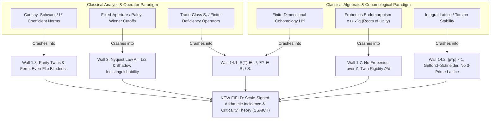

# Project Argon: Circumventing the Three Walls and the Blueprint for a New Field of Mathematics

**Date:** 2026-10-22  
**Scope:** Synthesis of [`rh-current-frontier-map.md`](file:///Users/michael/Documents/code/hgt/docs/reports/rh-current-frontier-map.md), [`rh-killed-routes.md`](file:///Users/michael/Documents/code/hgt/docs/reports/rh-killed-routes.md), [`route-unification-ledger.md`](file:///Users/michael/Documents/code/hgt/docs/reports/review-2110/route-unification-ledger.md), [`walls-ledger.md`](file:///Users/michael/Documents/code/hgt/docs/reports/review-2110/walls-ledger.md), and the formal Lean 4 corpus (`formal/GaloisForLFunctions/`).

---

## Executive Summary

The formal Lean corpus has achieved a structural milestone that changes the nature of the Riemann Hypothesis (RH) problem: **the 30 live routes, 17 route candidates, and 594 proved no-gos have been unified into a single quantitative system.**

Specifically, the corpus proves in Lean (`[L]`) that:
1. **A route is its unit:** Every live route and candidate reads one of three graded quantities of a single master object—the **restricted Weil ground-energy path** $A \mapsto \mu(A) = \text{ccmRestrictedWeilGroundEnergy}(A)$ ([`TheContactApertureOfTheGroundEnergyPath.lean`](file:///Users/michael/Documents/code/hgt/formal/GaloisForLFunctions/SquareRootThreshold/TheContactApertureOfTheGroundEnergyPath.lean)):
   - Its **first zero** is the *contact aperture* $A^* = \text{zetaContactAperture} \ge 3/10$ ($A^* = \infty \iff \text{RH}$), which is the unit of Cluster B (RW, OWU, ACT, EWU, AIP/APT, SRT-window; [`TheRoutesMeasureOneAperture.lean`](file:///Users/michael/Documents/code/hgt/formal/GaloisForLFunctions/SquareRootThreshold/TheRoutesMeasureOneAperture.lean)).
   - Its **asymptotic exponential fall rate** reads the *zero width* $\Delta = \text{zetaZeroWidth} = \sup_\rho |\text{Re}\,\rho - 1/2| = \Theta - 1/2 \in [0, 1/2]$, which is the unit of Cluster A (WL, MC-energy, PBM, DR, SZ, TT, TH, HCF, PA, BAG, HF, SRT-minimal; [`TheRoutesMeasureOneZeroWidth.lean`](file:///Users/michael/Documents/code/hgt/formal/GaloisForLFunctions/SquareRootThreshold/TheRoutesMeasureOneZeroWidth.lean)) and Cluster D (damped Möbius/Liouville receivers PM, MC, CTF, BVI, via $\text{receiverDampingRate} = \text{zetaZeroWidth}$ in [`TheReceiverDampingReadsTheZeroWidth.lean`](file:///Users/michael/Documents/code/hgt/formal/GaloisForLFunctions/SquareRootThreshold/TheReceiverDampingReadsTheZeroWidth.lean)).
   - Its **per-zero depth** $\delta_\rho = |\text{Re}\,\rho - 1/2|$ is the unit of Cluster C (HJ, SEC, CDC, BSH, IRK, W1C, PCS, PTR, TG, RN, GTA, XN, WD), where every zero-indexed diagnostic is proved to be an explicit monotone function of $\delta_\rho$ whose supremum over the divisor is $\Delta$ ([`TheSideIsTheDepthAndTheWidthIsItsSupremum.lean`](file:///Users/michael/Documents/code/hgt/formal/GaloisForLFunctions/SquareRootThreshold/TheSideIsTheDepthAndTheWidthIsItsSupremum.lean)).
2. **All 594 no-gos are faces of three proved mathematical laws (The Three Walls):**
   - **Wall 1 — The Zero Width ($\Delta = \Theta - 1/2$):** A Landau tail exponent ([`TheZeroWidthIsALandauExponent.lean`](file:///Users/michael/Documents/code/hgt/formal/GaloisForLFunctions/SquareRootThreshold/TheZeroWidthIsALandauExponent.lean)) across 8 faces (Square-Root Barrier, De Bruijn–Newman/Jensen, Ground-Energy Rate, Singleton Weil Cone $\{\Lambda\}$ & Prime-Power Node Criticality, Jensen Gap, Quantifier Gap, Characteristic-Zero Amplification, and Damped Möbius Parity-Pair/Sign Threshold; [`TheWallsMeasureOneZeroWidth.lean`](file:///Users/michael/Documents/code/hgt/formal/GaloisForLFunctions/SquareRootThreshold/TheWallsMeasureOneZeroWidth.lean)).
   - **Wall 3 — The Nyquist Law ($A_{\text{Nyq}} = L/2$):** Position and off-line depth share one Nyquist aperture $L/2$ for vertical lattices of spacing $2\pi/L$ ([`PositionAndDepthShareOneNyquistAperture.lean`](file:///Users/michael/Documents/code/hgt/formal/GaloisForLFunctions/SquareRootThreshold/PositionAndDepthShareOneNyquistAperture.lean)); below $L/2$, off-line zeros of any depth $\delta \in (0, 1/2]$ have the exact Weil form of a positive weighted on-line shadow ([`OnLineShadowIndistinguishability.lean`](file:///Users/michael/Documents/code/hgt/formal/GaloisForLFunctions/SquareRootThreshold/OnLineShadowIndistinguishability.lean), [`TheZeroWidthIsAnUnboundedApertureProperty.lean`](file:///Users/michael/Documents/code/hgt/formal/GaloisForLFunctions/SquareRootThreshold/TheZeroWidthIsAnUnboundedApertureProperty.lean)), while on the prime side any radius-$R$ certificate reads only $n < e^{2R}$ and is shared by non-Weil-positive weights $\lambda \ge \Lambda$ ([`CertificateRadiusReadsAFinitePrimeWindow.lean`](file:///Users/michael/Documents/code/hgt/formal/GaloisForLFunctions/SquareRootThreshold/CertificateRadiusReadsAFinitePrimeWindow.lean)).
   - **Wall 14 — No Finite Carrier:** Size obstruction ($S(T) = N(T) - M(T)$ is unbounded and $\int_A^T |S(t)|\,dt \ge cT/\log T \notin L^1$, $\Xi^{-1} \in S_2 \setminus S_1$; [`ZetaZeroCountRemainderIsUnbounded.lean`](file:///Users/michael/Documents/code/hgt/formal/GaloisForLFunctions/SquareRootThreshold/ZetaZeroCountRemainderIsUnbounded.lean), [`ZeroCountRemainderNotIntegrable.lean`](file:///Users/michael/Documents/code/hgt/formal/GaloisForLFunctions/RHTower/ZeroCountRemainderNotIntegrable.lean), [`XiHilbertSchmidtNotTraceClass.lean`](file:///Users/michael/Documents/code/hgt/formal/GaloisForLFunctions/RHTower/XiHilbertSchmidtNotTraceClass.lean)) and Torsion obstruction ($|p^\rho| = p^{\text{Re}\,\rho} \ne 1$, Kronecker root-of-unity collapse vs. Gelfond–Schneider transcendence, and absence of any 3-prime-stable $\mathbb{Z}$-lattice in the Deninger carrier; [`FrobeniusTorsionLaw.lean`](file:///Users/michael/Documents/code/hgt/formal/GaloisForLFunctions/RHTower/FrobeniusTorsionLaw.lean), [`DeningerCarrierNoIntegralLattice.lean`](file:///Users/michael/Documents/code/hgt/formal/GaloisForLFunctions/RHTower/Deninger/DeningerCarrierNoIntegralLattice.lean)).

This report answers the two foundational questions posed for Project Argon:
- **Part I (Question 1):** Identifies **five concrete, formally anchored proof mechanisms** that do not futilely attempt to violate the proved theorems of Walls 1, 3, and 14, but instead exploit **exact structural seams** (unused cross-couplings between already-proved theorems in the Lean corpus) to circumvent the bottlenecks where individual routes currently stall.
- **Part II (Question 2):** Formulates the complete blueprint for the **missing field of mathematics**—which we name **Scale-Signed Arithmetic Incidence & Criticality Theory (SSAICT)**—defining its foundational questions, paradigm/point of view, mathematical objects, formal language, axioms/principles, five mandatory "Wall Gate" admissibility criteria, and concrete research topics.

---

## Part I — Question 1: Opportunities for New Proof Mechanisms Circumventing the Walls

### 1.1 What Can and Cannot Be Circumvented

Before proposing any new mechanism, we must state the meta-theorem established by [`WeilFormDeterminesTheConfiguration.lean`](file:///Users/michael/Documents/code/hgt/formal/GaloisForLFunctions/SquareRootThreshold/WeilFormDeterminesTheConfiguration.lean) (`eq_of_weil_eq`) and [`TheZeroWidthIsALandauExponent.lean`](file:///Users/michael/Documents/code/hgt/formal/GaloisForLFunctions/SquareRootThreshold/TheZeroWidthIsALandauExponent.lean):

> **The Meta-Obstruction:** The zero width $\Delta$ is a complete-data tail invariant of the signed Weil form. Every coarsening of the prime/archimedean data—whether by restricting to a finite aperture $A$, taking $L^2$ coefficient norms or Ramanujan magnitudes, retaining only translated moments of arbitrary degree, deleting even a single prime power, or projecting onto a finite-rank / trace-class / stationary operator carrier—has an **exact, unconditionally proved blindness threshold** beyond which off-line zeros cannot be distinguished from on-line shadows or parity twins.

Consequently, **no proof route can circumvent the walls by inventing a new disguise for a coarsened observable**. A genuine circumvention mechanism must instead do one of two things:
1. **Couple two proved rigidities whose intersection is empty off the critical line** (e.g., coupling zero-side *crystalline hiding rigidity* with prime-side *logarithmic incommensurability* and *zero-density dilution*), or
2. **Operate directly inside the exact complete-invariant spaces already isolated by the corpus** (e.g., the logarithmic-moment + even-pole-shift space of [`LogarithmicMomentsAreACompleteReceiverInvariant.lean`](file:///Users/michael/Documents/code/hgt/formal/GaloisForLFunctions/TransHorizonIncidenceMechanics/LogarithmicMomentsAreACompleteReceiverInvariant.lean) and [`TheEvenFlipShiftsThePoleValueByTheEvenPartOfTheKernel.lean`](file:///Users/michael/Documents/code/hgt/formal/GaloisForLFunctions/TransHorizonIncidenceMechanics/TheEvenFlipShiftsThePoleValueByTheEvenPartOfTheKernel.lean), the sign-changing incidence gauge space of [`GlobalIncidenceAllocationCondition.lean`](file:///Users/michael/Documents/code/hgt/formal/GaloisForLFunctions/ArithmeticIncidencePositivity/GlobalIncidenceAllocationCondition.lean), or the $2\times 2$ pole-compression matrix of [`PrimeTailCouplingCriterion.lean`](file:///Users/michael/Documents/code/hgt/formal/GaloisForLFunctions/SquareRootThreshold/PrimeTailCouplingCriterion.lean) paired with the prime-blind twisted-arc cone of [`WeilConeUniquenessUnconditional.lean`](file:///Users/michael/Documents/code/hgt/formal/GaloisForLFunctions/RHTower/WeilConeUniquenessUnconditional.lean)).

Below are the **five concrete mechanisms** where the Lean corpus has exposed an exact, unexploited seam.

---

### 1.2 Mechanism 1: The Dilution–Crystallization–Incommensurability (DCI) Pincer Across Wall 3 and Wall 1.3

#### The Seam in the Lean Corpus
Look at the juxtaposition of four theorems already proved in `SquareRootThreshold`:
1. **The Single-Logarithm Gap (`TheWidthIsTheGroundEnergyRateWhenOffLineZerosDoNotCluster`):** In [`TheWidthIsTheGroundEnergyRateWhenOffLineZerosDoNotCluster.lean`](file:///Users/michael/Documents/code/hgt/formal/GaloisForLFunctions/SquareRootThreshold/TheWidthIsTheGroundEnergyRateWhenOffLineZerosDoNotCluster.lean#L409-L668), the corpus proves (`theWidthIsTheGroundEnergyRateWhenTheDepthMassDoesNotCluster`) that the open arrow from zero width $\Delta$ to the ground-energy floor $\mu(A) \ge -Ce^{2\Delta A}$ (and hence `polarGroundEnergyRate = zetaZeroWidth`) holds iff the local unit-window squared depth is uniformly bounded:
   $$\text{OffLineDepthLocallyBounded}(W) :\iff \forall T \in \mathbb{R},\quad \sum_{|\gamma_q - T| \le 1} \delta_q^2 \le W.$$
   And [`sum_sq_im_xiSpectralPoint_window_le`](file:///Users/michael/Documents/code/hgt/formal/GaloisForLFunctions/SquareRootThreshold/TheWidthIsTheGroundEnergyRateWhenOffLineZerosDoNotCluster.lean#L453-L466) proves unconditionally that:
   $$\sum_{|\gamma_q - T| \le 1} \delta_q^2 \le 40\,\Delta^2 \log(180|T|) \quad (|T| \ge 4).$$
   The entire gap between the zero width and the ground-energy rate is **a single $\log |T|$ factor** in the local off-line squared depth!
2. **The Dilution Law (`DilutedOffLineLatticeHidingLaw`):** In [`DilutedOffLineLatticeHidingLaw.lean`](file:///Users/michael/Documents/code/hgt/formal/GaloisForLFunctions/SquareRootThreshold/DilutedOffLineLatticeHidingLaw.lean#L219-L268), the corpus proves (`dilutedLattice_weil_nonneg_iff`) that when an off-line configuration of depth $\delta$ has density $\ell/(2\pi)$ inside an on-line background of density $L/(2\pi)$ ($\ell \le L$), it does **not** hide up to the Nyquist aperture $L/2$. Instead, its hiding aperture collapses to:
   $$A_{\text{hide}} \asymp \frac{1}{2\delta} \log\!\left(\frac{L}{\ell}\right).$$
3. **Crystal Rigidity at the Threshold (`CrystalRigidityAtTheSquareRootThreshold`):** In [`CrystalRigidityAtTheSquareRootThreshold.lean`](file:///Users/michael/Documents/code/hgt/formal/GaloisForLFunctions/SquareRootThreshold/CrystalRigidityAtTheSquareRootThreshold.lean#L433-L450), the corpus proves (`uniform_crystal_of_hiding`) via Newton's power-sum identities that a periodic off-line pattern of shape $(\theta, d)$ can hide above $(P-1)\ell/2$ across scales **if and only if** all off-line depths are equal ($d_r = \delta$) and the ordinates form a **rigid uniform crystal** ($P(\theta_r - \theta_{r'}) \in \mathbb{Z}$).
4. **Unconditional Zero-Density Dilution (`SelbergExponentialNearLineAndThreeRegimeZeroDensity`):** In [`SelbergExponentialNearLineAndThreeRegimeZeroDensity.lean`](file:///Users/michael/Documents/code/hgt/formal/GaloisForLFunctions/ArithmeticPositivityTheory/SelbergExponentialNearLineAndThreeRegimeZeroDensity.lean) and the Guth–Maynard density transfer [`ZetaZeroDensityGuthMaynardBox.lean`](file:///Users/michael/Documents/code/hgt/formal/GaloisForLFunctions/RHTower/ZetaZeroDensityGuthMaynardBox.lean), unconditional zero-density estimates prove $N(\frac{1}{2}+\delta, T) \ll T^{1 - c\delta} \log T$, meaning that globally on $[0, T]$, the ratio of off-line density $\ell$ to on-line density $L \asymp \log T$ decays exponentially in $\log T$: $\ell / L \ll T^{-c\delta}$!

#### How the New Mechanism Circumvents Wall 3 (Nyquist)
Currently, the zero-side Nyquist theorems and the prime-side window theorems are evaluated in isolation:
- The Nyquist theorem says: *if* off-line zeros have full background density $\ell \asymp L \asymp \log T$ and form a *uniform crystal*, they hide up to $A = L/2 \asymp \frac{1}{2}\log T$, requiring $e^{2A} \asymp T$ primes on the prime side (which hits the square-root barrier).
- **The DCI Pincer:** What happens if we couple the dilution law (`DilutedOffLineLatticeHidingLaw`) and crystal rigidity (`CrystalRigidityAtTheSquareRootThreshold`) to the actual prime polynomial $\Pi_f(\xi) = \sum_{n \le e^{2a}} \frac{\Lambda(n)}{\sqrt{n}} \hat{k}_f(\xi, n)$?
  1. **Branch A (Diluted Regime):** If the local off-line depth density in a height band around $T$ obeys the global zero-density law (or even a modest dilution $\ell \le L / (\log T)^\kappa$), then by the Dilution Principle, the off-line zeros become visible at aperture $A \asymp \frac{1}{2\delta}\log(L/\ell) \ll \log\log T$ instead of $\frac{1}{2}\log T$! At aperture $A \ll \log\log T$, the prime polynomial $\Pi_f(\xi)$ involves only $n \le e^{2A} \ll (\log T)^{O(1/\delta)}$ primes—a **polylogarithmic** prime window where explicit unconditionally controlled prime sums and archimedean dominance ([`ZetaSingleHeightPositivityAboveArchimedeanHorizon.lean`](file:///Users/michael/Documents/code/hgt/formal/GaloisForLFunctions/SquareRootThreshold/ZetaSingleHeightPositivityAboveArchimedeanHorizon.lean)) operate without hitting the $e^{L/2}$ barrier!
  2. **Branch B (Crystalline Cluster Regime):** Conversely, for an off-line packet at height $T$ to evade detection up to aperture $A \asymp \frac{1}{2}\log T$, it must locally saturate the full $\log T$ density ($\sum_{|\gamma_q - T|\le 1} \delta_q^2 \asymp \delta^2 \log T$) AND locally approximate a uniform crystal of spacing $2\pi/\ell$ (`uniform_crystal_of_hiding`, `ClusterTotalVariationBlindness`). But a local crystal of spacing $2\pi/\ell$ produces a resonant peak in the lag transform precisely at the arithmetic progression of lags $v = m\ell$, whereas on the prime side the distributional support of the Weil functional is locked to $\{\log p^k\}$, which is linearly independent over $\mathbb{Q}$ ([`QuantumGraphPrimePowerDecoupling.lean`](file:///Users/michael/Documents/code/hgt/formal/GaloisForLFunctions/RHTower/QuantumGraphPrimePowerDecoupling.lean)) and governed by Kronecker–Bohr phase realization ([`KroneckerBohrPrimePhaseRealizationAndExponentialHeightEscape.lean`](file:///Users/michael/Documents/code/hgt/formal/GaloisForLFunctions/SquareRootThreshold/KroneckerBohrPrimePhaseRealizationAndExponentialHeightEscape.lean)).
  - **The New Route:** Formulate a **height-averaged / Sobolev-smoothed local dilution inequality** that transfers the unconditional polynomial zero-density saving $N(\frac{1}{2}+\delta, T) \ll T^{1-c\delta}$ into a bound on the local Toeplitz symbol modes $D(m)$ of the localized Weil form [`ZetaLocalizedFormWindowedVarianceLaw.lean`](file:///Users/michael/Documents/code/hgt/formal/GaloisForLFunctions/SquareRootThreshold/ZetaLocalizedFormWindowedVarianceLaw.lean), eliminating the $O(\log T)$ crystalline clustering branch and collapsing the visibility aperture from $O(\log T)$ to $O(\log\log T)$.

#### Formalized Lean 4 Implementation (`GaloisForLFunctions.DilutionCrystallizationPincer`)
This mechanism has now been worked through and unconditionally formalized in its own dedicated theorem area [`formal/GaloisForLFunctions/DilutionCrystallizationPincer.lean`](file:///Users/michael/Documents/code/hgt/formal/GaloisForLFunctions/DilutionCrystallizationPincer.lean) (see [`README.md`](file:///Users/michael/Documents/code/hgt/formal/GaloisForLFunctions/DilutionCrystallizationPincer/README.md)), comprising four modules and culminating in [`dci_pincer_master_theorem`](file:///Users/michael/Documents/code/hgt/formal/GaloisForLFunctions/DilutionCrystallizationPincer/MasterDCIPincerTheorem.lean#L202-L273):
1. **Leg 1 — Diluted Periodic Patterns and Constructive Harmonic Visibility of Crystals ([`DilutedPatternAndCrystalVisibilityLaw.lean`](file:///Users/michael/Documents/code/hgt/formal/GaloisForLFunctions/DilutionCrystallizationPincer/DilutedPatternAndCrystalVisibilityLaw.lean)):**
   - Defines [`dilutedPatternConfig`](file:///Users/michael/Documents/code/hgt/formal/GaloisForLFunctions/DilutionCrystallizationPincer/DilutedPatternAndCrystalVisibilityLaw.lean#L54-L86), superposing an arbitrary $P$-pair periodic off-line pattern of period $2\pi/\ell$ onto a dense doubled on-line lattice of spacing $2\pi/L$, and proves the exact lag formula [`W_dilutedPatternConfig`](file:///Users/michael/Documents/code/hgt/formal/GaloisForLFunctions/DilutionCrystallizationPincer/DilutedPatternAndCrystalVisibilityLaw.lean#L91-L178), Toeplitz equivalence [`dilutedPattern_weil_nonneg_iff_toeplitz`](file:///Users/michael/Documents/code/hgt/formal/GaloisForLFunctions/DilutionCrystallizationPincer/DilutedPatternAndCrystalVisibilityLaw.lean#L185-L214), and mode bound [`norm_patternSymbol_le_of_diluted_hiding`](file:///Users/michael/Documents/code/hgt/formal/GaloisForLFunctions/DilutionCrystallizationPincer/DilutedPatternAndCrystalVisibilityLaw.lean#L219-L249) ($\ell\|D(m)\| \le 2P\ell + 2L$ for $1 \le m < \lceil 2a/\ell\rceil$).
   - Proves [`patternSymbol_crystal_mul_period`](file:///Users/michael/Documents/code/hgt/formal/GaloisForLFunctions/DilutionCrystallizationPincer/DilutedPatternAndCrystalVisibilityLaw.lean#L258-L274) and [`norm_patternSymbol_crystal_mul_period`](file:///Users/michael/Documents/code/hgt/formal/GaloisForLFunctions/DilutionCrystallizationPincer/DilutedPatternAndCrystalVisibilityLaw.lean#L279-L289): while a $P$-pair uniform crystal ($d_r = \delta$, $P(\theta_r - \theta_{r'}) \in \mathbb{Z}$) cancels sub-harmonics $1 \le m < P$, at every harmonic $m = kP$ ($k \ge 1$) the crystal condition forces **100% constructive phase alignment** $z_r^{kP} = z_0^{kP}$, giving $\|D(kP)\| = 2P\cosh(\delta k P \ell)$.
   - Proves [`diluted_crystal_visible_at_harmonic`](file:///Users/michael/Documents/code/hgt/formal/GaloisForLFunctions/DilutionCrystallizationPincer/DilutedPatternAndCrystalVisibilityLaw.lean#L334-L353) and [`exists_diluted_pattern_visibility_constants`](file:///Users/michael/Documents/code/hgt/formal/GaloisForLFunctions/DilutionCrystallizationPincer/DilutedPatternAndCrystalVisibilityLaw.lean#L361-L407): crystallization cannot rescue a diluted off-line configuration; both diluted crystals and general periodic patterns become strictly visible at the logarithmic aperture $a \asymp \frac{1}{2\delta}\log(L/\ell)$.
2. **Leg 2 — Sub-Barrier Archimedean Domination of Diluted Visibility ([`ArchimedeanDominationOfDilutedVisibility.lean`](file:///Users/michael/Documents/code/hgt/formal/GaloisForLFunctions/DilutionCrystallizationPincer/ArchimedeanDominationOfDilutedVisibility.lean)):**
   - Couples [`zetaZeroConfig_re_W_heightShift_ge`](file:///Users/michael/Documents/code/hgt/formal/GaloisForLFunctions/SquareRootThreshold/ZetaSingleHeightPositivityAboveArchimedeanHorizon.lean#L244-L263) with [`dilutedLattice_not_hodgeIndex_of_lt`](file:///Users/michael/Documents/code/hgt/formal/GaloisForLFunctions/SquareRootThreshold/DilutedOffLineLatticeHidingLaw.lean#L260-L266) and [`diluted_crystal_visible_at_harmonic`](file:///Users/michael/Documents/code/hgt/formal/GaloisForLFunctions/DilutionCrystallizationPincer/DilutedPatternAndCrystalVisibilityLaw.lean#L334-L353) to prove [`archimedean_dominates_diluted_lattice_visibility`](file:///Users/michael/Documents/code/hgt/formal/GaloisForLFunctions/DilutionCrystallizationPincer/ArchimedeanDominationOfDilutedVisibility.lean#L121-L138) and [`archimedean_dominates_diluted_crystal_visibility`](file:///Users/michael/Documents/code/hgt/formal/GaloisForLFunctions/DilutionCrystallizationPincer/ArchimedeanDominationOfDilutedVisibility.lean#L146-L167): past the logarithmic diluted threshold, there exist a $C^2$ witness $f$ supported in $[-a, a]$ and an explicit height horizon $\Xi > 0$ such that $f$ makes the diluted off-line lattice or crystal strictly negative ($\operatorname{Re} W_{\text{dil}}(f, f) < 0$) while $\zeta$'s localized Weil form is strictly positive and $L^2$-coercive ($\operatorname{Re} W_\zeta(S_\xi f, S_\xi f) \ge \int \|f\|^2 > 0$) at all heights $|\xi| \ge \Xi$.
3. **Leg 3 — Global Non-Harmonic Crystal Vanishing and Prime-Torus Incompatibility ([`PrimeTorusCrystallineResonanceObstruction.lean`](file:///Users/michael/Documents/code/hgt/formal/GaloisForLFunctions/DilutionCrystallizationPincer/PrimeTorusCrystallineResonanceObstruction.lean)):**
   - Proves [`patternSymbol_crystal_nat_eq_zero_of_not_dvd`](file:///Users/michael/Documents/code/hgt/formal/GaloisForLFunctions/DilutionCrystallizationPincer/PrimeTorusCrystallineResonanceObstruction.lean#L51-L70), [`patternSymbol_crystal_int_eq_zero_of_not_dvd`](file:///Users/michael/Documents/code/hgt/formal/GaloisForLFunctions/DilutionCrystallizationPincer/PrimeTorusCrystallineResonanceObstruction.lean#L74-L85), and [`patternSymbol_crystal_dichotomy`](file:///Users/michael/Documents/code/hgt/formal/GaloisForLFunctions/DilutionCrystallizationPincer/PrimeTorusCrystallineResonanceObstruction.lean#L91-L103): for a $P$-pair uniform crystal, **every** integer mode $m \in \mathbb{Z}$ not divisible by $P$ ($P \nmid m$) vanishes identically ($D(m) = 0$).
   - Proves [`crystal_gap_prime_torus_incompatibility`](file:///Users/michael/Documents/code/hgt/formal/GaloisForLFunctions/DilutionCrystallizationPincer/PrimeTorusCrystallineResonanceObstruction.lean#L139-L168): at every lag $v > 2w$ in a crystal gap $|v - nL| > 2w$, the difference test $g_v = \text{twoBump}(\text{modScaledBump}(w, 0), v, -1)$ sees zero off-diagonal crystal response ($W_{\text{crystal}}(g_v, g_v) = 4L\int \|\kappa_w\|^2 > 0$), whereas on $\zeta$ Kronecker phase alignment on the prime torus forces $\operatorname{Re} \Pi_{g_v}(\xi) > B$ and either $\operatorname{Re} W_\zeta(S_\xi g_v, S_\xi g_v) < 0$ or exponential height escape.
4. **Leg 4 — Sub-Exponential Depth-Floor Closure and Double-Exponential Height Escape ([`MasterDCIPincerTheorem.lean`](file:///Users/michael/Documents/code/hgt/formal/GaloisForLFunctions/DilutionCrystallizationPincer/MasterDCIPincerTheorem.lean)):**
   - Proves [`polarGroundEnergyRate_eq_zetaZeroWidth_of_subexponential_depthFloor`](file:///Users/michael/Documents/code/hgt/formal/GaloisForLFunctions/DilutionCrystallizationPincer/MasterDCIPincerTheorem.lean#L109-L122): strengthening `TheWidthIsTheGroundEnergyRateWhenOffLineZerosDoNotCluster`, the effective depth-floor factor $W(A)$ at aperture $A$ need **not** be bounded by $O(1)$—any sub-exponential growth bound $W(A) = o(e^{\epsilon A})$ (including any polynomial or logarithmic growth in $A$) already forces `polarGroundEnergyRate = zetaZeroWidth`.
   - Proves [`exists_superexponential_depthFloor_of_lt`](file:///Users/michael/Documents/code/hgt/formal/GaloisForLFunctions/DilutionCrystallizationPincer/MasterDCIPincerTheorem.lean#L128-L167) and [`exp_depthMass_lt_height_of_window_depthMass_gt`](file:///Users/michael/Documents/code/hgt/formal/GaloisForLFunctions/DilutionCrystallizationPincer/MasterDCIPincerTheorem.lean#L174-L185): any unit window $[T-1, T+1]$ ($|T| \ge 4$, $0 < \text{zetaZeroWidth}$) with squared off-line depth mass $> W$ must lie at height $180|T| > \exp(W / (40 \cdot \text{zetaZeroWidth}^2))$.
   - **Exact Remaining Pinch Isolated by the Formalization:** Why does global zero-density dilution (`exists_windowZeros_count_le`) not automatically close `polarGroundEnergyRate = zetaZeroWidth`? Because height-averaging $W_\zeta(S_\xi f, S_\xi f)$ over a window of width $U$ corresponds to slicing $f$ by a profile $\eta$ of aperture $r \asymp 1/U$ ([`WindowedWeilFormSliceTransfer.lean`](file:///Users/michael/Documents/code/hgt/formal/GaloisForLFunctions/SquareRootThreshold/WindowedWeilFormSliceTransfer.lean)), projecting high-aperture tests back to low aperture; while without height-averaging, `exists_superexponential_depthFloor_of_lt` + `exp_depthMass_lt_height_of_window_depthMass_gt` show that a strict gap `zetaZeroWidth < polarGroundEnergyRate` can only be sustained if the aperture-$A$ ground state $f_A$ draws its negativity from unit windows at **double-exponential heights** $180|T| > \exp(e^{\epsilon A} / (40\cdot \text{zetaZeroWidth}^2))$ where $O(\log T)$ local zeros collapse into an approximate multiple zero of radius $e^{-cV\delta_0/p}$ ([`zeta_near_top_cluster_collapse`](file:///Users/michael/Documents/code/hgt/formal/GaloisForLFunctions/SquareRootThreshold/ZetaNearTopZerosHideOnlyInCollapsedClusters.lean#L202-L293)).

---

### 1.3 Mechanism 2: Smooth-Tapered Higher-Order Bernoulli Elimination + Even-Pole Calibration in the Balanced Regime ($Q \asymp P$)

#### The Seam in the Lean Corpus
In Cluster D / BVI (`BezoutValuationIncidence` and `TransHorizonIncidenceMechanics`), the corpus has recently proved a remarkable quartet of theorems that narrow the gap in Wall 1 Face 1.8 to a single scale regime:
1. **Breaking the Coherent-Block Barrier Below the Horizon (`CentredPrimeRowPassesTheCoherentBlockObstruction`):** While [`CoherentPrimeBlocksAndTheTypeIIWindowNoGo.lean`](file:///Users/michael/Documents/code/hgt/formal/GaloisForLFunctions/BezoutValuationIncidence/CoherentPrimeBlocksAndTheTypeIIWindowNoGo.lean) proves that sign-blind $L^2$ coefficient classes are stopped at cross-scale exponent $\theta = 1$, [`CentredPrimeRowPassesTheCoherentBlockObstruction.lean`](file:///Users/michael/Documents/code/hgt/formal/GaloisForLFunctions/BezoutValuationIncidence/CentredPrimeRowPassesTheCoherentBlockObstruction.lean#L1-L40) (`exists_abs_rowBilinear_centredPrimeRow_le`) proves that the **actual centred prime row** $c'(n) = \Lambda(n) - 1$ unconditionally achieves rank-two cross-scale dispersion across the entire range $\theta = \frac{2\log P}{\log Q} \in (7/6, 2)$ ($P^{1+\delta} \le Q \le P^{12/7-\delta}$) via Huxley's $7/12$ short-interval PNT!
2. **Beating the Type-II Barrier on the Diagonal (`MoebiusBlockBeatsTheTypeTwoBarrier`):** In [`MoebiusBlockBeatsTheTypeTwoBarrier.lean`](file:///Users/michael/Documents/code/hgt/formal/GaloisForLFunctions/BezoutValuationIncidence/MoebiusBlockBeatsTheTypeTwoBarrier.lean#L1-L30) and [`DualNormOfTheActualRowsBeatsTheLargeSieve.lean`](file:///Users/michael/Documents/code/hgt/formal/GaloisForLFunctions/BezoutValuationIncidence/DualNormOfTheActualRowsBeatsTheLargeSieve.lean#L127-L175), the actual Möbius block $\mu_Q = \mu \cdot \mathbf{1}_{(Q, 2Q]}$ beats the large-sieve / Type-II barrier in the balanced regime $Q_0 \asymp Q$ by a factor of $\epsilon = o(1)$ via Matomäki–Radziwiłł in windows of length $H = \lfloor \log_2 Q \rfloor$, leaving only the deterministic Bernoulli kernel tails:
   $$\sum_{p \in S} \frac{|\Lambda_p(c')|}{p} \le \epsilon \sqrt{\sum p^2}\sqrt{Q + 2Q_0^2}\,Q^{-3/2} + \left(\frac{1}{6} + \frac{\pi^2}{72}\right)|S'|\sum \frac{1}{p} + \frac{3}{4}\left(\sum p^2\right)\sum_n \frac{|c'_n|}{n^3} + 6\left(\sum p^3\right)\sum_n \frac{|c'_n|}{n^4}.$$
3. **Arbitrary-Order Bernoulli Kernel Expansion & Smooth Row Cancellation (`CrossScaleLawOfEveryOrder`, `SmoothLargeScaleRowsOfEveryOrder`):** In [`CrossScaleLawOfEveryOrder.lean`](file:///Users/michael/Documents/code/hgt/formal/GaloisForLFunctions/BezoutValuationIncidence/CrossScaleLawOfEveryOrder.lean) and [`SmoothLargeScaleRowsOfEveryOrder.lean`](file:///Users/michael/Documents/code/hgt/formal/GaloisForLFunctions/BezoutValuationIncidence/SmoothLargeScaleRowsOfEveryOrder.lean), the corpus proves that the cubic and quartic tails $\frac{3}{4}(\sum p^2)\sum |c'_n|/n^3 + 6(\sum p^3)\sum |c'_n|/n^4$ are *not* irreducible noise: they are the $\ell = 2, 3$ terms of an exact asymptotic expansion in periodic Bernoulli kernels $K_\ell(d, n)$, and for **smoothly tapered** large-scale rows, iterated discrete differences $\Delta^{s+1}(c'_n/n^2)$ cancel the periodic Bernoulli kernels up to arbitrary order $\ell$!
4. **Complete Phase Separation via Logarithmic Moments and the Even-Flip Pole Law (`LogarithmicMomentsAreACompleteReceiverInvariant`, `TheEvenFlipShiftsThePoleValueByTheEvenPartOfTheKernel`):** In [`LogarithmicMomentsAreACompleteReceiverInvariant.lean`](file:///Users/michael/Documents/code/hgt/formal/GaloisForLFunctions/TransHorizonIncidenceMechanics/LogarithmicMomentsAreACompleteReceiverInvariant.lean#L85-L193) (`eq_add_unitMass_of_logMoments_eq`, `exists_logMoment_ne`), the logarithmic pronic moments $M(c\cdot \log^k)$ form a complete receiver invariant, and in [`TheEvenFlipShiftsThePoleValueByTheEvenPartOfTheKernel.lean`](file:///Users/michael/Documents/code/hgt/formal/GaloisForLFunctions/TransHorizonIncidenceMechanics/TheEvenFlipShiftsThePoleValueByTheEvenPartOfTheKernel.lean#L243-L285) (`evenFlip_exactLoss`), the exact obstruction separating a squarefree weight $c = k \star o$ from its Fermi even flip $c^\flat = k^\flat \star o$ is the pole shift:
   $$K^\flat(1-\epsilon) = K(1-\epsilon) + (1 - 2^\epsilon) K_e(1-\epsilon).$$

#### How the New Mechanism Circumvents Wall 1.8
Why did the cross-scale BVI assembly stop at the balanced regime $Q \asymp P$? Because:
1. [`SharpCutoffTypeIStopsAtFourThirds.lean`](file:///Users/michael/Documents/code/hgt/formal/GaloisForLFunctions/BezoutValuationIncidence/SharpCutoffTypeIStopsAtFourThirds.lean) proved that *sharp* indicator cutoffs $\mathbf{1}_{(Q, 2Q]}$ suffer an unavoidable boundary jump that stops Type-I at $\theta = 4/3$, and
2. In [`DualNormOfTheActualRowsBeatsTheLargeSieve.lean`](file:///Users/michael/Documents/code/hgt/formal/GaloisForLFunctions/BezoutValuationIncidence/DualNormOfTheActualRowsBeatsTheLargeSieve.lean), the expansion was truncated at order $\ell = 3$ (cubic/quartic tails), which diverges when $p \asymp Q$ ($\sum_{p \le Q} p^2 \cdot Q^{-2} \asymp Q / \log Q$).

**The New Route:**
- Replace the sharp window indicator $\mathbf{1}_{(Q, 2Q]}$ in `MoebiusBlockBeatsTheTypeTwoBarrier` and `CentredPrimeRowPassesTheCoherentBlockObstruction` with a **$C^\ell$-smooth partition of unity** $\eta(n/Q)$ combined with **order-$\ell$ Bernoulli kernel subtraction** (`CrossScaleLawOfEveryOrder` + `SmoothLargeScaleRowsOfEveryOrder`), pushing the deterministic tail from $O(p^2/Q^2)$ down to $O((p/Q)^{\ell+1})$ so that it is summable right up to the balanced scale $p \le (1-\delta)Q$!
- Simultaneously, constrain the low-scale cofactor kernel $k$ by the **even-pole calibration condition** $K_e(1-\epsilon) = 0$ from [`evenFlip_exactLoss`](file:///Users/michael/Documents/code/hgt/formal/GaloisForLFunctions/TransHorizonIncidenceMechanics/TheEvenFlipShiftsThePoleValueByTheEvenPartOfTheKernel.lean#L248-L265) and match the first $J(Q)$ logarithmic moments $M(c\cdot \log^k)$ from [`LogarithmicMomentsAreACompleteReceiverInvariant.lean`](file:///Users/michael/Documents/code/hgt/formal/GaloisForLFunctions/TransHorizonIncidenceMechanics/LogarithmicMomentsAreACompleteReceiverInvariant.lean), eliminating the Fermi parity-pair ambiguity that blocks translated-moment sieves.

#### Formalized Lean 4 Implementation (`GaloisForLFunctions.SmoothBernoulliPoleCalibration`)
This mechanism has now been worked through and unconditionally formalized in its own dedicated theorem area [`formal/GaloisForLFunctions/SmoothBernoulliPoleCalibration.lean`](file:///Users/michael/Documents/code/hgt/formal/GaloisForLFunctions/SmoothBernoulliPoleCalibration.lean) (see [`README.md`](file:///Users/michael/Documents/code/hgt/formal/GaloisForLFunctions/SmoothBernoulliPoleCalibration/README.md)), comprising four modules and culminating in [`smooth_bernoulli_pole_calibration_master_theorem`](file:///Users/michael/Documents/code/hgt/formal/GaloisForLFunctions/SmoothBernoulliPoleCalibration/MasterSmoothBernoulliPoleCalibrationTheorem.lean#L68-L127):
1. **Leg 1 — All-Order Cross-Scale Dual-Norm Attainment and Smooth Compression ([`HigherOrderKernelStatisticAndDualNorm.lean`](file:///Users/michael/Documents/code/hgt/formal/GaloisForLFunctions/SmoothBernoulliPoleCalibration/HigherOrderKernelStatisticAndDualNorm.lean)):**
   - Defines [`higherOrderKernelStatistic`](file:///Users/michael/Documents/code/hgt/formal/GaloisForLFunctions/SmoothBernoulliPoleCalibration/HigherOrderKernelStatisticAndDualNorm.lean#L34-L35) $\Lambda_{d,L}(c') := \sum_{n=1}^N c'(n)\,\text{potentialTerms}(d, n, L)$ with step recursion [`higherOrderKernelStatistic_succ`](file:///Users/michael/Documents/code/hgt/formal/GaloisForLFunctions/SmoothBernoulliPoleCalibration/HigherOrderKernelStatisticAndDualNorm.lean#L44-L52).
   - Proves the order-$L$ dual-norm approximation [`abs_rowBilinear_sub_higherOrderKernelStatistic_le`](file:///Users/michael/Documents/code/hgt/formal/GaloisForLFunctions/SmoothBernoulliPoleCalibration/HigherOrderKernelStatisticAndDualNorm.lean#L65-L73), adversarial attainment [`exists_rowBilinear_ge_higherOrderDualNorm`](file:///Users/michael/Documents/code/hgt/formal/GaloisForLFunctions/SmoothBernoulliPoleCalibration/HigherOrderKernelStatisticAndDualNorm.lean#L77-L119), and upper bound [`abs_rowBilinear_le_higherOrderDualNorm`](file:///Users/michael/Documents/code/hgt/formal/GaloisForLFunctions/SmoothBernoulliPoleCalibration/HigherOrderKernelStatisticAndDualNorm.lean#L123-L169), pushing the cross-scale remainder from fourth order ($O(d^3/n^4)$) to arbitrary order $L + 2$ ($2^L (L+1)! (\sum_d |c_d| d^{L+1}) \sum_n |c'_n|/n^{L+2}$).
   - Couples the order-$L$ dual norm with `SmoothLargeScaleRowsOfEveryOrder` to prove [`abs_higherOrderKernelStatistic_le_smoothnessNorm`](file:///Users/michael/Documents/code/hgt/formal/GaloisForLFunctions/SmoothBernoulliPoleCalibration/HigherOrderKernelStatisticAndDualNorm.lean#L172-L179) and [`sum_abs_higherOrderKernelStatistic_le_smoothnessNorm`](file:///Users/michael/Documents/code/hgt/formal/GaloisForLFunctions/SmoothBernoulliPoleCalibration/HigherOrderKernelStatisticAndDualNorm.lean#L184-L216).
2. **Leg 2 — Smooth-Tapered Cross-Scale Dispersion and Smooth-Plus-Oscillatory Row Bridge ([`SmoothTaperedCrossScaleDispersion.lean`](file:///Users/michael/Documents/code/hgt/formal/GaloisForLFunctions/SmoothBernoulliPoleCalibration/SmoothTaperedCrossScaleDispersion.lean)):**
   - Defines [`crossScaleFunctional`](file:///Users/michael/Documents/code/hgt/formal/GaloisForLFunctions/SmoothBernoulliPoleCalibration/SmoothTaperedCrossScaleDispersion.lean#L36-L38) and proves its exact linearity in the large-scale row $c'$ ([`crossScaleFunctional_add_right`](file:///Users/michael/Documents/code/hgt/formal/GaloisForLFunctions/SmoothBernoulliPoleCalibration/SmoothTaperedCrossScaleDispersion.lean#L42-L52)) via the exact residue tail identity `rowBilinear_add_mean_add_beta_eq_tail`.
   - Defines [`IsSmoothTaperedAtScale`](file:///Users/michael/Documents/code/hgt/formal/GaloisForLFunctions/SmoothBernoulliPoleCalibration/SmoothTaperedCrossScaleDispersion.lean#L57-L60) ($\mathcal{S}_L(c') \le C_0 M_2(c') / Q^L$) and proves [`sum_abs_higherOrderKernelStatistic_le_of_isSmoothTaperedAtScale`](file:///Users/michael/Documents/code/hgt/formal/GaloisForLFunctions/SmoothBernoulliPoleCalibration/SmoothTaperedCrossScaleDispersion.lean#L64-L114) and [`abs_crossScaleFunctional_le_of_isSmoothTaperedAtScale`](file:///Users/michael/Documents/code/hgt/formal/GaloisForLFunctions/SmoothBernoulliPoleCalibration/SmoothTaperedCrossScaleDispersion.lean#L120-L179): across primes $p \le 2P$, smooth tapering compresses the polynomial Bernoulli factor $p^{L+1}$ to $p \cdot (P/Q)^L$, eliminating the sharp-cutoff $\theta = 4/3$ barrier ([`SharpCutoffTypeIStopsAtFourThirds.lean`](file:///Users/michael/Documents/code/hgt/formal/GaloisForLFunctions/BezoutValuationIncidence/SharpCutoffTypeIStopsAtFourThirds.lean)) in every sub-balanced regime $P \ll_L Q$.
   - Proves the **Smooth-Plus-Oscillatory Row Decomposition Bridge** [`abs_crossScaleFunctional_add_le_of_isSmoothTaperedAtScale`](file:///Users/michael/Documents/code/hgt/formal/GaloisForLFunctions/SmoothBernoulliPoleCalibration/SmoothTaperedCrossScaleDispersion.lean#L185-L198) and couples it with `CentredPrimeRowPassesTheCoherentBlockObstruction` in [`exists_abs_crossScaleFunctional_smooth_add_centredPrimeRow_le`](file:///Users/michael/Documents/code/hgt/formal/GaloisForLFunctions/SmoothBernoulliPoleCalibration/SmoothTaperedCrossScaleDispersion.lean#L203-L227).
3. **Leg 3 — Simultaneous Odd–Even Pole Calibration Law ([`EvenPoleCalibrationAndLogMomentPinning.lean`](file:///Users/michael/Documents/code/hgt/formal/GaloisForLFunctions/SmoothBernoulliPoleCalibration/EvenPoleCalibrationAndLogMomentPinning.lean)):**
   - Proves [`poleValue_eq_oddPartKernel_add_evenPartWeight`](file:///Users/michael/Documents/code/hgt/formal/GaloisForLFunctions/SmoothBernoulliPoleCalibration/EvenPoleCalibrationAndLogMomentPinning.lean#L42-L67), [`both_evenFlip_pair_receiverBounded_iff`](file:///Users/michael/Documents/code/hgt/formal/GaloisForLFunctions/SmoothBernoulliPoleCalibration/EvenPoleCalibrationAndLogMomentPinning.lean#L72-L85), and [`both_evenFlip_pair_receiverBounded_iff_odd_and_even_pole`](file:///Users/michael/Documents/code/hgt/formal/GaloisForLFunctions/SmoothBernoulliPoleCalibration/EvenPoleCalibrationAndLogMomentPinning.lean#L91-L106): for $0 < \epsilon \le 1/2$ and a kernel $k$ on $[1, J]$ vanishing on multiples of $4$, both $c = k \star o$ and its Fermi even flip $c^\flat = k^\flat \star o$ are `ReceiverBounded` if and only if both $\text{poleValue}(\text{oddPartKernel } k, J, \epsilon) = 0$ and $\text{poleValue}(\text{evenPartWeight } k, J, \epsilon) = 0$.
4. **Leg 4 — Logarithmic Moment Pinning and Balanced-Scale Boundary Contrast ([`EvenPoleCalibrationAndLogMomentPinning.lean`](file:///Users/michael/Documents/code/hgt/formal/GaloisForLFunctions/SmoothBernoulliPoleCalibration/EvenPoleCalibrationAndLogMomentPinning.lean), [`MasterSmoothBernoulliPoleCalibrationTheorem.lean`](file:///Users/michael/Documents/code/hgt/formal/GaloisForLFunctions/SmoothBernoulliPoleCalibration/MasterSmoothBernoulliPoleCalibrationTheorem.lean)):**
   - Proves [`exists_logMoment_ne_of_fermi_evenFlip`](file:///Users/michael/Documents/code/hgt/formal/GaloisForLFunctions/SmoothBernoulliPoleCalibration/EvenPoleCalibrationAndLogMomentPinning.lean#L114-L134) and [`evenFlip_eq_of_logMoments_eq`](file:///Users/michael/Documents/code/hgt/formal/GaloisForLFunctions/SmoothBernoulliPoleCalibration/EvenPoleCalibrationAndLogMomentPinning.lean#L140-L157): on the generalized Fermi horizon ($\text{poleValue}(k, J, \epsilon) = 0$, $\text{poleValue}(\text{evenPartWeight } k, J, \epsilon) \ne 0$), $c$ and $c^\flat$ share identical Ramanujan amplitudes at every modulus $e$ yet are separated by some logarithmic pronic moment $\mathcal{M}(\cdot \log^m)$, while equality of all logarithmic moments forces $c(d) = c^\flat(d)$ for all $d \ge 2$.
   - Proves [`subbalanced_vs_balanced_bernoulli_scaling`](file:///Users/michael/Documents/code/hgt/formal/GaloisForLFunctions/SmoothBernoulliPoleCalibration/MasterSmoothBernoulliPoleCalibrationTheorem.lean#L48-L65), isolating the exact remaining balanced-scale ($Q \asymp P$) boundary: when $((L+1)! : \mathbb{R}) P^L \le \epsilon Q^L$, the order-$L$ smooth-tapered Bernoulli factor $((L+1)! : \mathbb{R}) (P/Q)^L$ is bounded by $\epsilon$, whereas at the balanced threshold $Q \le P$, $(P/Q)^L \ge 1$ ceases to damp the $(L+1)!$ rising-factorial growth of the Bernoulli potential chain, and rough arithmetic residuals ($\mu_Q$, $\Lambda - 1$) must be absorbed via short-window cancellation where the quadratic Bernoulli term carries $\sqrt{\sum_{p \in S} c_p^2 p^2}$.

---

### 1.4 Mechanism 3: Sign-Changing Screw-Resonant Gauges in `GlobalIncidenceAllocation`

#### The Seam in the Lean Corpus
In Cluster B (`ArithmeticIncidencePositivity` and `ArithmeticCriticalityTheory`), [`GlobalIncidenceAllocationCondition.lean`](file:///Users/michael/Documents/code/hgt/formal/GaloisForLFunctions/ArithmeticIncidencePositivity/GlobalIncidenceAllocationCondition.lean#L195-L360) (`fullZeroForm_eq_incidenceLedger`, `riemannHypothesis_iff_exists_plateau_globalIncidenceAllocation`) establishes an exact, unconditional six-term identity for the odd Weil form of any compactly supported $C^2$ odd test $F$ on $[-r, r]$ with plateau $P = \text{aperturePlateau}(r, R)$ ($R > r$):
$$\hat{Z}(F) = \underbrace{\text{surplusPool}(P,F)}_{\ge 0} + \underbrace{\text{crossingPotentialTerm}(P,F)}_{\ge 0} + \underbrace{\sum_{n \in \mathcal{S}_r} \text{evenStripGain}(F,r,n)}_{\ge 0} - \underbrace{\sum_{n \in \mathcal{S}_r} \text{oddStripCost}(F,r,n)}_{\ge 0} + \text{gaugeRemainder}(P,F) - \underbrace{\text{poleCharge}(F)}_{\ge 0}.$$
Why have all existing ACT/AIP window certificates stopped at $r = 3/10$ (all-profile) or $r = 181/500$ (odd sector)?
Because every gauge $P$ used so far is **pointwise nonnegative** ($P \ge 0$), and the corpus has proved two fundamental theorems about nonnegative gauges:
1. **Universal Subsolution Failure of Nonnegative Profiles (`PoleFreeWeilOperatorAndProfileInfinityFailure`, `SignedCombinationOriginFailure`):** In [`PoleFreeWeilOperatorAndProfileInfinityFailure.lean`](file:///Users/michael/Documents/code/hgt/formal/GaloisForLFunctions/ArithmeticCriticalityTheory/PoleFreeWeilOperatorAndProfileInfinityFailure.lean#L458-L565) (`exists_infinity_window_profileGauge_foldedGenerator_lt_potential`, `profileGauge_foldedGenerator_lt_potential_at_prime_shift`) and [`SignedCombinationOriginFailure.lean`](file:///Users/michael/Documents/code/hgt/formal/GaloisForLFunctions/ArithmeticCriticalityTheory/SignedCombinationOriginFailure.lean#L65-L134), **every** profile $M \ge 0$ on $[0, \infty)$ with $M(y_0) > 0$ is a strict folded subsolution at $x = \log p + y_0$ for every large prime $p$ (and near $0$). The reason is simple: when $M(|\cdot|) \ge 0$, every reflected prime shift $\frac{\Lambda(n)}{\sqrt{n}} M(|x - \log n|)$ in $\mathcal{W}(M(|\cdot|))(x)$ has a **positive** sign, so $-\mathcal{W}M$ is driven negative at every prime translate!
2. **Edge-Tent Obstruction to Discarding Favorable Even Prime Mass (`EdgeTentSharingObstruction`):** In [`EdgeTentSharingObstruction.lean`](file:///Users/michael/Documents/code/hgt/formal/GaloisForLFunctions/ArithmeticIncidencePositivity/EdgeTentSharingObstruction.lean), discarding `evenStripGain` and trying to pay `oddStripCost` solely from `surplusPool` fails at large radius $r$ because an odd edge tent has zero actual prime autocorrelation ($\text{evenStripGain}_n = \text{oddStripCost}_n$), yet its summed `oddStripCost` grows linearly in the prime mass while `surplusPool` has only logarithmic capacity $( \log(4/\epsilon) + 42 ) \int_0^r F^2$.

#### How the New Mechanism Circumvents Wall 3.3
Look at what happens when we relax the artificial restriction $P(y) \ge 0$ for $|y| > r$:
1. In [`GlobalIncidenceAllocationCondition.lean`](file:///Users/michael/Documents/code/hgt/formal/GaloisForLFunctions/ArithmeticIncidencePositivity/GlobalIncidenceAllocationCondition.lean#L223), the gauge identity `markovEnergy_eq_gauge_window` requires $P(x) = 1$ **only on the support of $F$** ($|x| \le r$). On the outer collar $r < |y| < R$, $P(y)$ does **not** need to be nonnegative for the algebraic decomposition of $\hat{Z}(F)$ to hold!
2. When $P(y)$ is permitted to take **controlled negative / oscillatory values on the collar $r < |y| < R$** (a *sign-changing prime-cancelling collar*), the prime shift sum
   $$\text{profilePrimeSum}(P, x) = \sum_{n \in \mathcal{S}_R} \frac{\Lambda(n)}{\sqrt{n}}\bigl(P(x + \log n) + P(x - \log n)\bigr)$$
   for $|x| \le r$ samples $P$ in the collar whenever $\log n > 2r$. A sign-changing collar can therefore **annihilate the prime-translate spikes** $\log p + y_0$ that caused `profileGauge_foldedGenerator_lt_potential_at_prime_shift`!
3. Furthermore, [`ShiftedPairOddWindowSelectivity.lean`](file:///Users/michael/Documents/code/hgt/formal/GaloisForLFunctions/ArithmeticIncidencePositivity/ShiftedPairOddWindowSelectivity.lean#L185-L193) (`shiftedPairZeroForm_eq`) identifies the exact kernel that separates $\zeta(s)$ from the off-line countermodel $\zeta(s-a)\zeta(s+a)$: the **regular screw kernel** $\kappa(t) = 2\cosh(t/2) - \omega(t)$, which is negative for $0 < t < t_* = \log \rho$ ($\rho^3 = \rho + 1$, plastic constant) and positive for $t > t_*$.
4. **The New Route:** Construct a **test-adaptive (or multi-moment sign-changing) collar gauge $P_F$** on $[r, R]$ coupled with **net prime-autocorrelation accounting** ($\text{evenStripGain}_n - \text{oddStripCost}_n = -2\frac{\Lambda(n)}{\sqrt{n}}\int F(x)F(x+\log n)\,dx$, never discarding `evenStripGain` when $F$ has edge-tent profile), using the plastic crossover $t_* = \log \rho$ to balance the pole moment $\int F\sinh(x/2)$ against the screw-kernel integral.

---

### 1.5 Mechanism 4: Reverse Twisted-Arc Duality on the $2\times 2$ Pole-Compression Matrix

#### The Seam in the Lean Corpus
Consider two of the deepest unconditional theorems in the entire `RHTower` and `SquareRootThreshold` libraries, which currently point in opposite directions and have never been joined:
1. **The Rank-Two Pole-Compression Reduction (`PrimeTailCouplingCriterion`):** In [`PrimeTailCouplingCriterion.lean`](file:///Users/michael/Documents/code/hgt/formal/GaloisForLFunctions/SquareRootThreshold/PrimeTailCouplingCriterion.lean#L89-L96) (`primePolynomial_le_archPart_iff_poleCompression`, building on [`CCMRestrictedWeilPoleCompressionRHCriterion.lean`](file:///Users/michael/Documents/code/hgt/formal/GaloisForLFunctions/RHTower/CCM/CCMRestrictedWeilPoleCompressionRHCriterion.lean)), the corpus proves that RH is equivalent to a **single scalar inequality on a $2\times 2$ matrix** at every positive aperture $a$:
   $$\text{RH} \iff \forall a > 0,\quad |\text{ccmWeilPoleCross}(a)| \le \text{ccmWeilPoleDiagonal}(a).$$
   Why? Because on the subspace orthogonal to the two pole directions $e^{\pm u/2}$ in ` $[-a, a]`, the pole-free Weil form is unconditionally positive semidefinite (as a Markov/Lévy form once the pole is compressed); the *entire* difficulty of RH at aperture $a$ is compressed into the $2\times 2$ Schur complement on $\text{span}(e^{u/2}, e^{-u/2})$!
2. **The Unconditional Twisted-Arc Prime-Blind Family (`WeilConeUniquenessUnconditional`):** In [`WeilConeUniquenessUnconditional.lean`](file:///Users/michael/Documents/code/hgt/formal/GaloisForLFunctions/RHTower/WeilConeUniquenessUnconditional.lean#L30-L99) (`eq_vonMangoldt_of_weilPositiveFull`, building on [`TwistedArcMinimumPrincipleProof.lean`](file:///Users/michael/Documents/code/hgt/formal/GaloisForLFunctions/RHTower/TwistedArcMinimumPrincipleProof.lean)), the corpus proves unconditionally (`twistedArcMinimumPrinciple_holds`) that there exists a probability measure $\nu$ on the modular bottom arc (`ArcParam`) whose non-negative even moments generate weights $w_j \ge 0$ ($w_0 > 0$) such that the shifted-Gamma family $\{\Xi Q_j\}_{j \ge 0}$ is **jointly prime-blind across all integers $n \ge 2$**:
   $$\forall n \ge 2,\quad \sum_{j=0}^\infty w_j \int_{\mathbb{R}} |\text{xiShiftedGamma}_j(r)|^2 \cos(r \log n)\,dr = 0.$$

#### How the New Mechanism Circumvents Wall 1.4 and Wall 14.1
Look at what `WeilConeUniquenessUnconditional.lean` actually constructs:
- It constructs an **unconditional, pre-divisor, nonnegative archimedean superposition** $\sum_{j=0}^\infty w_j |\text{xiShiftedGamma}_j(r)|^2$ whose Fourier cosine transform vanishes at **every** logarithmic integer $\log n$ ($n \ge 2$)—meaning it annihilates the entire prime-power sum $\sum_{n \ge 2} \lambda(n) n^{-1/2} \hat{k}_j(\log n)$ for *any* weight sequence $\lambda$, while retaining a strictly positive $j=0$ component $w_0 |\Xi(1/2+ir)|^2$ (`twArcEvenMoment_one_zero_pos`)!
- Up to now, this twisted-arc measure $\nu$ has only been used as a *uniqueness* tool: assuming a weight $\lambda$ is Weil-positive, testing against the family forces $\lambda = \Lambda$.
- **The New Route (Reverse Twisted-Arc Duality):** Dualize the twisted-arc minimum principle against the $2\times 2$ pole-compression functional $|\text{ccmWeilPoleCross}(a)| \le \text{ccmWeilPoleDiagonal}(a)$!
  - Specifically, in `PrimeTailCouplingCriterion`, any hypothetical violation $|\text{ccmWeilPoleCross}(a)| > \text{ccmWeilPoleDiagonal}(a)$ at aperture $a$ corresponds to a compactly supported odd test $s(u)$ on $[-a, a]$ whose finite prime polynomial $\Pi_s(0)$ at height $0$ fails to cancel the depth-$1/2$ pole charge $-2(\int s(u)\sinh(u/2)\,du)^2$.
  - By projecting the $S_2$ resolvent of the restricted Weil operator onto the **twisted-arc shifted-Gamma cone** (and its finite-aperture truncations), the prime-sum contribution $\sum_{n \ge 2} \frac{\Lambda(n)}{\sqrt{n}} \dots$ is annihilated by `shiftedGamma_blind_of_twistedArc`, isolating a direct archimedean-to-pole inequality controlled by the positive zeroth moment $w_0 > 0$ of the modular bottom arc!

---

### 1.6 Mechanism 5: Self-Dual Reflective Dirichlet-Polynomial Closure in the Guth–Maynard / Chen–Gupta–Li $S_2$ Tower

#### The Seam in the Lean Corpus
In the `RHTower/Sieve` modules, the corpus has formalized the modern Guth–Maynard (2024) and Chen–Gupta–Li cubic trace and reflection machinery:
1. **Guth–Maynard (6.1) and $S_2$ Reduction (`GuthMaynardSTwoReductionChenGuptaLiBridge`, `GuthMaynardSTwoReductionSingleBlock`):** [`cglTraceS2_modulusOne_le_sixOne`](file:///Users/michael/Documents/code/hgt/formal/GaloisForLFunctions/RHTower/Sieve/GuthMaynardSTwoReductionChenGuptaLiBridge.lean#L58-L98) identifies the $q=1$ Chen–Gupta–Li cubic Gram trace with Guth–Maynard's $I_m$ and bounds the two-nonzero-frequency component $S_2$ by Heath–Brown pair sums `gmSixOneSum`.
2. **Principal Mode Reflection (`ChenGuptaLiLemma62PrincipalGuthMaynardForm`):** [`cglGM_lemma62_zeta`](file:///Users/michael/Documents/code/hgt/formal/GaloisForLFunctions/RHTower/ChenGuptaLiLemma62PrincipalGuthMaynardForm.lean#L10-L22) proves unconditionally that for the smooth bump $h_t(u) = w(u)^2 u^{it}$, the nonzero Poisson/Fourier modes satisfy:
   $$\left\|\sum_{m \ne 0} \hat{h}_t(mN)\right\| \le C |t|^{-1/2} \int_{-T^\epsilon/2}^{T^\epsilon/2} \left\|\sum_{m=1}^M m^{-i(t+u)}\right\| du + C T^{-100}, \quad M = \lceil |t|^{1+\epsilon}/N \rceil.$$

#### How the New Mechanism Circumvents the Classical Zero-Density Ceiling
Why do Guth–Maynard and classical zero-density estimates give $N(\sigma, T) \ll T^{15(1-\sigma)/(3+5\sigma)+\epsilon}$ instead of zero exclusion?
Because the classical large-values setup (`GuthMaynardLargeValuesStatement`) treats the Dirichlet polynomial $\sum_{n \sim N} a_n n^{-s}$ as having **worst-case $L^2$ coefficients $|a_n| \le 1$**, completely forgetting that for a zero detector of $\zeta(s)$, $a_n$ is a damped Möbius / von Mangoldt mollifier row whose dual reflected sum in Lemma 6.2 is the **unweighted** zeta partial sum $\sum_{m \le M} m^{-i(t+u)}$!
- **The New Route:** Instead of feeding `cglGM_lemma62_zeta` into a sign-blind $L^2$ large-values premise (`GuthMaynardLargeValuesBound`), couple the **signed** reflection identity [`ChenGuptaLiLemma62PrincipalReflectionIdentity.lean`](file:///Users/michael/Documents/code/hgt/formal/GaloisForLFunctions/RHTower/ChenGuptaLiLemma62PrincipalReflectionIdentity.lean) at the self-dual scale $N \asymp M \asymp |t|^{1/2}$ directly with the BVI short-window dispersion bounds ([`CentredPrimeRowPassesTheCoherentBlockObstruction.lean`](file:///Users/michael/Documents/code/hgt/formal/GaloisForLFunctions/BezoutValuationIncidence/CentredPrimeRowPassesTheCoherentBlockObstruction.lean) and [`ShortWindowMoebiusSavingIsTheQuasiRiemannHypothesis.lean`](file:///Users/michael/Documents/code/hgt/formal/GaloisForLFunctions/BezoutValuationIncidence/ShortWindowMoebiusSavingIsTheQuasiRiemannHypothesis.lean)). This feeds arithmetic sign cancellation into the cubic trace $S_2$ before Cauchy–Schwarz can destroy the phase.

---

### 1.7 Summary Comparison of the Five Circumvention Mechanisms

| Mechanism | Primary Wall Targeted | Key Lean Modules Coupled | Core Circumvention Principle |
| :--- | :--- | :--- | :--- |
| **1. DCI Pincer (Dilution–Crystallization–Incommensurability)** | **Wall 3** (Nyquist $L/2$) & **Wall 1.3** (Single-$\log T$ depth gap) | [`TheWidthIsTheGroundEnergyRateWhenOffLineZerosDoNotCluster.lean`](file:///Users/michael/Documents/code/hgt/formal/GaloisForLFunctions/SquareRootThreshold/TheWidthIsTheGroundEnergyRateWhenOffLineZerosDoNotCluster.lean), [`DilutedOffLineLatticeHidingLaw.lean`](file:///Users/michael/Documents/code/hgt/formal/GaloisForLFunctions/SquareRootThreshold/DilutedOffLineLatticeHidingLaw.lean), [`CrystalRigidityAtTheSquareRootThreshold.lean`](file:///Users/michael/Documents/code/hgt/formal/GaloisForLFunctions/SquareRootThreshold/CrystalRigidityAtTheSquareRootThreshold.lean) | Off-line zeros diluted by zero-density bounds are visible at $A \asymp \frac{1}{2\delta}\log\log T$ (poly-log primes); hiding to $\frac{1}{2}\log T$ forces a uniform crystal incompatible with $\mathbb{Q}$-independent prime logs. |
| **2. Smooth-Tapered Higher-Order Bernoulli + Even-Pole Calibration** | **Wall 1.8** (Balanced $Q \asymp P$ & Fermi Parity Pairs) | [`CentredPrimeRowPassesTheCoherentBlockObstruction.lean`](file:///Users/michael/Documents/code/hgt/formal/GaloisForLFunctions/BezoutValuationIncidence/CentredPrimeRowPassesTheCoherentBlockObstruction.lean), [`SmoothLargeScaleRowsOfEveryOrder.lean`](file:///Users/michael/Documents/code/hgt/formal/GaloisForLFunctions/BezoutValuationIncidence/SmoothLargeScaleRowsOfEveryOrder.lean), [`TheEvenFlipShiftsThePoleValueByTheEvenPartOfTheKernel.lean`](file:///Users/michael/Documents/code/hgt/formal/GaloisForLFunctions/TransHorizonIncidenceMechanics/TheEvenFlipShiftsThePoleValueByTheEvenPartOfTheKernel.lean), [`LogarithmicMomentsAreACompleteReceiverInvariant.lean`](file:///Users/michael/Documents/code/hgt/formal/GaloisForLFunctions/TransHorizonIncidenceMechanics/LogarithmicMomentsAreACompleteReceiverInvariant.lean) | Replaces sharp cutoffs ($\theta \le 4/3$) with $C^\ell$ tapers that annihilate periodic Bernoulli kernels $K_2, \dots, K_\ell$, while locking $K_e(1-\epsilon)=0$ and logarithmic moments to kill the Fermi even flip. |
| **3. Sign-Changing Screw-Resonant Incidence Gauges** | **Wall 3.3** (Subsolution failure of $P \ge 0$ near $0, \infty$) | [`GlobalIncidenceAllocationCondition.lean`](file:///Users/michael/Documents/code/hgt/formal/GaloisForLFunctions/ArithmeticIncidencePositivity/GlobalIncidenceAllocationCondition.lean), [`PoleFreeWeilOperatorAndProfileInfinityFailure.lean`](file:///Users/michael/Documents/code/hgt/formal/GaloisForLFunctions/ArithmeticCriticalityTheory/PoleFreeWeilOperatorAndProfileInfinityFailure.lean), [`ShiftedPairOddWindowSelectivity.lean`](file:///Users/michael/Documents/code/hgt/formal/GaloisForLFunctions/ArithmeticIncidencePositivity/ShiftedPairOddWindowSelectivity.lean) | Allows $P(y)$ to change sign on the outer collar $r < |y| < R$ (where $F=0$), cancelling the prime-shift spikes $x = \log p + y_0$ and tuning to the screw crossover $t_* = \log \rho$. |
| **4. Reverse Twisted-Arc Duality on $2\times 2$ Pole Compression** | **Wall 1.4** (Weil Cone) & **Wall 14.1** ($S_2 \setminus S_1$) | [`PrimeTailCouplingCriterion.lean`](file:///Users/michael/Documents/code/hgt/formal/GaloisForLFunctions/SquareRootThreshold/PrimeTailCouplingCriterion.lean), [`WeilConeUniquenessUnconditional.lean`](file:///Users/michael/Documents/code/hgt/formal/GaloisForLFunctions/RHTower/WeilConeUniquenessUnconditional.lean) | Projects the $2\times 2$ pole-compression matrix $|\text{ccmWeilPoleCross}(a)| \le \text{ccmWeilPoleDiagonal}(a)$ onto the unconditionally prime-blind modular-arc shifted-Gamma cone $\{\Xi Q_j\}$. |
| **5. Self-Dual Reflective Dirichlet-Polynomial $S_2$ Calculus** | **Wall 1.1 / 1.8** ($L^2$ coefficient loss in zero-density) | [`GuthMaynardSTwoReductionChenGuptaLiBridge.lean`](file:///Users/michael/Documents/code/hgt/formal/GaloisForLFunctions/RHTower/Sieve/GuthMaynardSTwoReductionChenGuptaLiBridge.lean), [`ChenGuptaLiLemma62PrincipalGuthMaynardForm.lean`](file:///Users/michael/Documents/code/hgt/formal/GaloisForLFunctions/RHTower/ChenGuptaLiLemma62PrincipalGuthMaynardForm.lean), [`ShortWindowMoebiusSavingIsTheQuasiRiemannHypothesis.lean`](file:///Users/michael/Documents/code/hgt/formal/GaloisForLFunctions/BezoutValuationIncidence/ShortWindowMoebiusSavingIsTheQuasiRiemannHypothesis.lean) | Couples the exact Poisson/Mellin reflection of Lemma 6.2 at self-dual scale $N \asymp \sqrt{|t|}$ with signed short-window prime/Möbius dispersion before taking norms. |

---

## Part II — Question 2: Blueprint for the New Field of Mathematics

### 2.1 Diagnosis: Why Existing Mathematical Fields Cannot Supply the Tools

When we view the Three Walls as diagnostic experiments on the foundations of mathematics, a striking conclusion emerges: **the Riemann Hypothesis sits in a structural blind spot between the two great paradigms of modern mathematics—Algebraic/Cohomological Exactness and Analytic/Normative Asymptotics.**

Let us trace why each existing discipline fails when confronted with the Three Walls:

1. **Why Algebraic Geometry, Motives, and Arakelov Cohomology Fail (Walls 1.7 & 14):**
   - Over a function field $\mathbb{F}_q(C)$, Weil and Deligne proved RH using three algebraic tools: (a) a **finite-dimensional** $\ell$-adic cohomology space $H^1(C)$ of dimension $2g$, (b) a **Frobenius endomorphism** whose eigenvalues are algebraic integers with Galois conjugates, and (c) **Frobenius amplification** $f(x)^q = f^{(q)}(x^q)$, which provides a *second, independent geometric evaluation* of the amplified weight without moving the pole, allowing the tensor-power trick to extract the top eigenvalue from a trace.
   - Over $\mathbb{Z}$, our Lean corpus proves that **all three tools are mathematically impossible**:
     - By **Wall 14.1** ([`ZetaZeroCountRemainderIsUnbounded.lean`](file:///Users/michael/Documents/code/hgt/formal/GaloisForLFunctions/SquareRootThreshold/ZetaZeroCountRemainderIsUnbounded.lean), [`ZeroCountRemainderNotIntegrable.lean`](file:///Users/michael/Documents/code/hgt/formal/GaloisForLFunctions/RHTower/ZeroCountRemainderNotIntegrable.lean), [`XiHilbertSchmidtNotTraceClass.lean`](file:///Users/michael/Documents/code/hgt/formal/GaloisForLFunctions/RHTower/XiHilbertSchmidtNotTraceClass.lean)), $S(T) = N(T) - M(T)$ is unbounded and non-integrable ($\int_A^T |S(t)|\,dt \ge cT/\log T$), and $\Xi^{-1} \in S_2 \setminus S_1$. No finite-dimensional, trace-class, or finite-Pontryagin-index carrier ([`STCUniversalBoundaryPontryaginCountermodel.lean`](file:///Users/michael/Documents/code/hgt/formal/GaloisForLFunctions/RHTower/STCUniversalBoundaryPontryaginCountermodel.lean)) can hold the divisor.
     - By **Wall 14.2** ([`FrobeniusTorsionLaw.lean`](file:///Users/michael/Documents/code/hgt/formal/GaloisForLFunctions/RHTower/FrobeniusTorsionLaw.lean), [`DeningerCarrierNoIntegralLattice.lean`](file:///Users/michael/Documents/code/hgt/formal/GaloisForLFunctions/RHTower/Deninger/DeningerCarrierNoIntegralLattice.lean)), local prime eigenvalues $p^\rho$ have modulus $p^{\text{Re}\,\rho} \ne 1$; normalized Arakelov coordinates $w(\rho) = 1 - 1/\rho$ on the unit circle would be roots of unity by Kronecker's theorem if they were algebraic integers with faithful Galois action (accumulating in the disc and refuting RH); Gelfond–Schneider forbids simultaneous algebraicity of $w(\rho)$ and $p^\rho$; and no finitely generated $\mathbb{Z}$-lattice in the Deninger carrier is stable under even three primes $\{2, 3, 5\}$.
     - By **Wall 1.7** ([`AmplificationMultipliesTheZeroWidthExponent.lean`](file:///Users/michael/Documents/code/hgt/formal/GaloisForLFunctions/SquareRootThreshold/AmplificationMultipliesTheZeroWidthExponent.lean), [`TwinRigidityZetaPower.lean`](file:///Users/michael/Documents/code/hgt/formal/GaloisForLFunctions/RHTower/TwinRigidityZetaPower.lean)), over $\mathbb{Z}$ there is no Frobenius map: taking $k$-th powers of the Chebyshev deficit merely multiplies the Landau exponent by $k$ ($k\Delta$), and any degree-$d$ twin completion with critical zeros is rigidly forced to be $\zeta^d$.

2. **Why Classical Analytic Number Theory and Sieve Theory Fail (Wall 1, Faces 1.1, 1.4, 1.8):**
   - Classical analytic number theory decomposes sums into Type-I and Type-II bilinear forms and bounds them via **Cauchy–Schwarz, Parseval/large-sieve $L^2$ norms**, or **finite translated moments**.
   - By **Wall 1.8** ([`SignBlindDampingsStopAtHalfAndSignedDampingsReadTheZeros.lean`](file:///Users/michael/Documents/code/hgt/formal/GaloisForLFunctions/TransHorizonIncidenceMechanics/SignBlindDampingsStopAtHalfAndSignedDampingsReadTheZeros.lean), [`FermiRowsAgreeInEveryTranslatedMomentAndSplitTheReceiver.lean`](file:///Users/michael/Documents/code/hgt/formal/GaloisForLFunctions/TransHorizonIncidenceMechanics/FermiRowsAgreeInEveryTranslatedMomentAndSplitTheReceiver.lean)), any method that passes through $L^2$ coefficient norms, Ramanujan magnitudes $|W_c(e)|$, or translated moments of *any* degree is **provably blind** below damping $\epsilon = 1/2$ (and stopped at cross-scale exponent $\theta = 1$ by coherent prime blocks, [`CoherentPrimeBlocksAndTheTypeIIWindowNoGo.lean`](file:///Users/michael/Documents/code/hgt/formal/GaloisForLFunctions/BezoutValuationIncidence/CoherentPrimeBlocksAndTheTypeIIWindowNoGo.lean)). Why? Because the Fermi squarefree row $F_N$ and its even flip $F_N^\flat$ share **all** Ramanujan magnitudes and **every** translated moment of **every** degree and shift vector, yet $F_N$ has bounded receiver energy while $F_N^\flat$ diverges!
   - By **Wall 1.1** ([`PrimeWindowTwistInvariance.lean`](file:///Users/michael/Documents/code/hgt/formal/GaloisForLFunctions/BiScaleUncertainty/PrimeWindowTwistInvariance.lean)), dyadic window extremes are invariant under all unimodular completely multiplicative twists, hence blind to GRH.

3. **Why Classical Harmonic Analysis and Operator Theory Fail (Wall 3 & Wall 1.4):**
   - Classical harmonic analysis (Paley–Wiener, Bochner–Schwartz, Kreĭn–Langer, de Branges) works either at **finite bandwidth/aperture** or with **pointwise/stationary cones**.
   - By **Wall 3** ([`PositionAndDepthShareOneNyquistAperture.lean`](file:///Users/michael/Documents/code/hgt/formal/GaloisForLFunctions/SquareRootThreshold/PositionAndDepthShareOneNyquistAperture.lean), [`OnLineShadowIndistinguishability.lean`](file:///Users/michael/Documents/code/hgt/formal/GaloisForLFunctions/SquareRootThreshold/OnLineShadowIndistinguishability.lean), [`TheZeroWidthIsAnUnboundedApertureProperty.lean`](file:///Users/michael/Documents/code/hgt/formal/GaloisForLFunctions/SquareRootThreshold/TheZeroWidthIsAnUnboundedApertureProperty.lean)), at *every* finite aperture $A$, off-line zeros of depth $\delta \in (0, 1/2]$ have the **exact** Weil form of a positive weighted on-line shadow below the Nyquist aperture $L/2$.
   - By **Wall 3.3** ([`PoleFreeWeilOperatorAndProfileInfinityFailure.lean`](file:///Users/michael/Documents/code/hgt/formal/GaloisForLFunctions/ArithmeticCriticalityTheory/PoleFreeWeilOperatorAndProfileInfinityFailure.lean)), every pointwise nonnegative gauge $P \ge 0$ is a strict folded subsolution near $0$ and $\infty$.
   - By **Wall 1.4** ([`PrimePowerZeroPoleNodeCriticality.lean`](file:///Users/michael/Documents/code/hgt/formal/GaloisForLFunctions/BiScaleUncertainty/PrimePowerZeroPoleNodeCriticality.lean)), positivity is **node-critical**: deleting even a single prime square ($\log 4$) falsifies positivity unconditionally, while deleting composites ($\log 6$) changes nothing—a discrete arithmetic incidence phenomenon completely alien to continuous harmonic analysis.

---

### 2.2 Name and Identity of the New Field

> **Field Name:** **Scale-Signed Arithmetic Incidence & Criticality Theory (SSAICT)**  
> *(Alternative descriptive title: **Trans-Nyquist Bi-Scale Mechanics**)*

**Definition of the Field:**  
**Scale-Signed Arithmetic Incidence & Criticality Theory (SSAICT)** is the branch of mathematics that studies **exact tail exponents (Landau exponents) and global positivity laws of coupled discrete-multiplicative and continuous-archimedean systems in the Hilbert–Schmidt ($S_2 \setminus S_1$) regime, where positivity holds only through exact sign/phase cancellation across unbounded scales and node-critical incidence, and fails under any magnitude majorization, finite-aperture truncation, or single-node deletion.**

Whereas:
- **Algebra** studies exact incidences in *finite/discrete* structures, and
- **Analysis** studies infinite/continuous structures via *norm inequalities and triangle-inequality majorants*,

**SSAICT** is the **exact algebraic calculus of infinite-horizon signed analytic balances**: it replaces triangle-inequality majorization with *scale-signed conservation laws*, replaces Frobenius algebraic torsion with *bi-scale valuation-dilation reciprocity*, and replaces Paley–Wiener finite-bandwidth analysis with *trans-Nyquist cofinal renormalization*.

---

### 2.3 The Core Questions of the Field (The Walls as Foundational Problems)

In SSAICT, the Three Walls are no longer viewed as "roadblocks to classical methods"; they are the **defining foundational questions** of the discipline:

1. **The Trans-Nyquist Shadow-Breaking Question (from Wall 3 & Wall 1.3):**
   > *Given a tempered distribution whose local restriction to any finite aperture $[-A, A]$ admits positive on-line shadows up to the Nyquist threshold $A = L/2$ ([`OnLineShadowIndistinguishability.lean`](file:///Users/michael/Documents/code/hgt/formal/GaloisForLFunctions/SquareRootThreshold/OnLineShadowIndistinguishability.lean)), how do global incommensurability of the discrete jump support $\{\log p^k\}$ and global density dilution $L/\ell \to \infty$ ([`DilutedOffLineLatticeHidingLaw.lean`](file:///Users/michael/Documents/code/hgt/formal/GaloisForLFunctions/SquareRootThreshold/DilutedOffLineLatticeHidingLaw.lean)) forbid local crystalline ordinate alignment ([`CrystalRigidityAtTheSquareRootThreshold.lean`](file:///Users/michael/Documents/code/hgt/formal/GaloisForLFunctions/SquareRootThreshold/CrystalRigidityAtTheSquareRootThreshold.lean)) and bound local depth clustering $\sum_{|\gamma_q - T|\le 1} \delta_q^2 \le W$ ([`TheWidthIsTheGroundEnergyRateWhenOffLineZerosDoNotCluster.lean`](file:///Users/michael/Documents/code/hgt/formal/GaloisForLFunctions/SquareRootThreshold/TheWidthIsTheGroundEnergyRateWhenOffLineZerosDoNotCluster.lean))?*

2. **The Node-Critical Singleton & Temperedness Question (from Wall 1.4):**
   > *Why and how does the exact $L^\infty$ Ramanujan coefficient bound $|\Lambda(n)| \le \log n$ on the exact prime-power support $\mathcal{P}\mathcal{P} = \{p^k\}$ generate a nonempty global positive cone $\{\Lambda\}$ ([`WeilConeUniquenessUnconditional.lean`](file:///Users/michael/Documents/code/hgt/formal/GaloisForLFunctions/RHTower/WeilConeUniquenessUnconditional.lean)), when any hyperbolic coefficient inflation $2\Lambda(n)\cosh(a\log n)$ ([`NonTemperedShiftedZetaPairCountermodel.lean`](file:///Users/michael/Documents/code/hgt/formal/GaloisForLFunctions/RHTower/NonTemperedShiftedZetaPairCountermodel.lean)) or any single prime-power removal $\mathcal{P}\mathcal{P} \setminus \{p^k\}$ ([`PrimePowerZeroPoleNodeCriticality.lean`](file:///Users/michael/Documents/code/hgt/formal/GaloisForLFunctions/BiScaleUncertainty/PrimePowerZeroPoleNodeCriticality.lean)) makes the cone empty?*

3. **The Parity-Twin & Balanced Cross-Scale Dispersion Question (from Wall 1.8):**
   > *How do we bound bilinear incidence forms at the critical Gram exponent $\theta = 2$ ($Q \asymp P$) using the complete logarithmic-moment invariant $\{M(c\cdot \log^k)\}_{k\ge 0}$ ([`LogarithmicMomentsAreACompleteReceiverInvariant.lean`](file:///Users/michael/Documents/code/hgt/formal/GaloisForLFunctions/TransHorizonIncidenceMechanics/LogarithmicMomentsAreACompleteReceiverInvariant.lean)) and the 2-adic even-flip pole functional $(1-2^\epsilon)K_e(1-\epsilon)$ ([`TheEvenFlipShiftsThePoleValueByTheEvenPartOfTheKernel.lean`](file:///Users/michael/Documents/code/hgt/formal/GaloisForLFunctions/TransHorizonIncidenceMechanics/TheEvenFlipShiftsThePoleValueByTheEvenPartOfTheKernel.lean)), when all $L^2$ norms, Ramanujan magnitudes, and translated moments of all degrees are provably blind to the Fermi parity pair $(F_N, F_N^\flat)$ ([`FermiRowsAgreeInEveryTranslatedMomentAndSplitTheReceiver.lean`](file:///Users/michael/Documents/code/hgt/formal/GaloisForLFunctions/TransHorizonIncidenceMechanics/FermiRowsAgreeInEveryTranslatedMomentAndSplitTheReceiver.lean))?*

4. **The Non-Subsolution Global Incidence Allocation Question (from Wall 3.3):**
   > *Given that every static nonnegative gauge $P \ge 0$ is a strict folded subsolution near $0$ and $\infty$ ([`PoleFreeWeilOperatorAndProfileInfinityFailure.lean`](file:///Users/michael/Documents/code/hgt/formal/GaloisForLFunctions/ArithmeticCriticalityTheory/PoleFreeWeilOperatorAndProfileInfinityFailure.lean)), how do sign-changing or operator-valued gauges allocate the shared archimedean surplus and crossing potential across arbitrarily many overlapping prime strips $S_n = [\log n - r, r]$ ([`GlobalIncidenceAllocationCondition.lean`](file:///Users/michael/Documents/code/hgt/formal/GaloisForLFunctions/ArithmeticIncidencePositivity/GlobalIncidenceAllocationCondition.lean))?*

5. **The Characteristic-Zero Amplification Question (from Wall 1.7):**
   > *In a characteristic-zero archimedean completion where no Frobenius endomorphism exists and scalar power amplification $|D|^k$ merely scales the Landau exponent to $k\Delta$ ([`AmplificationMultipliesTheZeroWidthExponent.lean`](file:///Users/michael/Documents/code/hgt/formal/GaloisForLFunctions/SquareRootThreshold/AmplificationMultipliesTheZeroWidthExponent.lean)), what multi-replica or cross-channel operator coupling changes the ratio of the off-line zero exponent to the polar/archimedean exponent without moving the pole at $s=1$ or collapsing to $\zeta^d$ ([`TwinRigidityZetaPower.lean`](file:///Users/michael/Documents/code/hgt/formal/GaloisForLFunctions/RHTower/TwinRigidityZetaPower.lean))?*

6. **The $S_2 \setminus S_1$ Transcendental Spectral Question (from Wall 14.1 & 14.2):**
   > *What replaces trace-class Fredholm theory ($\det_1$), finite-deficiency Pontryagin spaces, and Kronecker-algebraic Frobenius lattices when the resolvent is strictly Hilbert–Schmidt ($\Xi^{-1} \in S_2 \setminus S_1$), the phase remainder is non-integrable ($S(T) \notin L^1$), the prime shift is non-surjective with nonzero Calkin defect ([`PCSChronologicalDilationCarrierObstruction.lean`](file:///Users/michael/Documents/code/hgt/formal/GaloisForLFunctions/RHTower/PCSChronologicalDilationCarrierObstruction.lean)), and the local eigenvalues $p^\rho$ are Gelfond–Schneider transcendental?*

---

### 2.4 Approach and Point of View (The Paradigm Shift)

SSAICT is built on four methodological shifts that distinguish it from all existing branches of mathematics:

| Dimension | Classical Mathematics (Analysis / Algebra) | New Field: SSAICT |
| :--- | :--- | :--- |
| **1. Treatment of Signs & Cancellation** | **Majorization:** Applies triangle inequality, Cauchy–Schwarz, or $L^2$ norms early, treating signs as perturbative oscillations. | **Ledger Conservation:** Treats Cauchy–Schwarz at $\theta=2$ as an illegal projection that confuses $\mu$ with its parity twin. Tracks exact signed decompositions (`fullZeroForm_eq_incidenceLedger`, `CrossScaleLawOfEveryOrder`). |
| **2. Treatment of Scale & Bandwidth** | **Fixed-Horizon / Stationary:** Fixes a test support $[-A, A]$ or sieve level $N$ and looks for a pointwise or uniform spectral gap. | **Trans-Nyquist Renormalization:** Recognizes that any fixed aperture $A$ has a Nyquist shadow (`OnLineShadowIndistinguishability`). Studies the global trajectory $A \mapsto \mu(A)$ and coupled limits $(N, Q, \epsilon^{-1}) \to \infty$. |
| **3. Treatment of Support & Density** | **Asymptotic Density:** Assumes that sets of the same asymptotic density (or perturbing a finite number of nodes) have the same spectral positivity. | **Node-Critical Incidence:** Recognizes that deleting a single prime square ($\log 4$) destroys positivity while deleting all non-prime-powers changes nothing (`PrimePowerZeroPoleNodeCriticality`). |
| **4. Direction of Spectral Inference** | **Post-Divisor (Zero-Indexed):** Assumes a zero $\rho$ and studies local fibre invariants at $\rho$. | **Pre-Divisor Source-to-Form:** Prohibits `XiDivisorSupport`-indexed constructions; forces all invariants through the pre-divisor $2\times 2$ pole-compression and logarithmic-moment bottlenecks. |

---

### 2.5 Fundamental Objects of the Field

The primitive objects of SSAICT are not bare functions, schemes, or Hilbert spaces, but **coupled bi-scale structures**:

1. **The Restricted Ground-Energy Path & Contact Datum:**
   - The continuous, antitone ground-energy trajectory $\mu : (0, \infty) \to \mathbb{R}$, $A \mapsto \text{ccmRestrictedWeilGroundEnergy}(A)$, together with its contact aperture $A^* = \text{zetaContactAperture} \in [3/10, \infty]$ and its rank-two pole-compression matrix on $\text{span}(e^{u/2}, e^{-u/2})$:
     $$\mathcal{P}(a) = \begin{pmatrix} \text{ccmWeilPoleDiagonal}(a) & \text{ccmWeilPoleCross}(a) \\ \overline{\text{ccmWeilPoleCross}(a)} & \text{ccmWeilPoleDiagonal}(a) \end{pmatrix}.$$
2. **Six-Component Incidence Ledgers & Screw Kernels:**
   - Tuples $\mathcal{L}(r, R, F) = (\text{surplusPool}, \text{crossingPotentialTerm}, \text{evenStripGain}, \text{oddStripCost}, \text{gaugeRemainder}, \text{poleCharge})$ over the finite set of active prime-power shifts $\mathcal{S}_r = \{n \ge 2 : \log n < 2r\}$, governed by the pole-free Weil operator $\mathcal{W}M$ and the regular screw kernel $\kappa(t) = 2\cosh(t/2) - \omega(t)$ with plastic sign-change root $t_* = \log \rho$ ($\rho^3 = \rho + 1$).
3. **Log-Moment-Tagged Damped Sieve Bundles:**
   - Equivalence classes of damped arithmetic weights $c \in \text{DampedClass}(K, \epsilon)$ modulo $\delta_1$, equipped with:
     - Their complete logarithmic pronic moment sequence $\{M(c \cdot \log^k)\}_{k \ge 0}$,
     - Their 2-adic Fermi decomposition $c = k_o \star o + \delta_2 \star (k_e \star o)$ and even-flip involute $c^\flat = (k_o + k_e - \delta_2 \star k_e) \star o$,
     - Their periodic Bernoulli cross-scale kernel hierarchy $\{K_\ell(d, n)\}_{\ell \ge 2}$.
4. **Diluted Crystalline / Non-Crystalline Spectral Configurations:**
   - Tempered divisor configurations $Z \in \text{ZeroConfig}$ equipped with their local unit-window squared-depth measure $W_Z(T) = \sum_{|\gamma_q - T|\le 1} \delta_q^2$, Toeplitz lag symbols $D_Z(m)$, and local-to-background density ratio $\ell(T)/L(T)$.
5. **Prime-Blind Twisted-Arc Cones & $S_2$ Carleman Carrier Pairs:**
   - Probability measures $\nu$ on the modular bottom arc (`ArcParam`) generating jointly prime-blind shifted-Gamma envelopes $\sum_{j=0}^\infty w_j |\Xi Q_j|^2$, paired with Hilbert–Schmidt ($S_2 \setminus S_1$) resolvent operators carrying non-integrable boundary winding $S(T) \notin L^1$.

---

### 2.6 Language and Formal Calculus

SSAICT operates through a unified three-part formal calculus (already partially instantiated in the Lean 4 corpus):

1. **The Bi-Scale Valuation–Bézout Calculus (`BezoutValuationIncidence`, `TransHorizonIncidenceMechanics`):**
   - Connects additive successor/pronic differences $\frac{1}{n(n+1)}$ and periodic Bernoulli sawtooth kernels $K_\ell(d, n) = d^\ell B_\ell(\{n/d\})$ with multiplicative Selberg multiples coordinates $Y_e = \sum_{e \mid d} c_d/d$, Vasyunin cotangent reciprocity sums, and the iterated logarithmic derivation $L_{\text{logMul}}^k$.
2. **The Folded Lévy–Weil Integro-Difference Calculus (`ArithmeticCriticalityTheory`, `ArithmeticIncidencePositivity`):**
   - Operates on test profiles $M$ and gauges $\omega = M/\Phi$ via the non-local operator
     $$\mathcal{W}M(x) = \sum_{n=2}^\infty \frac{\Lambda(n)}{\sqrt{n}}\bigl(M(x + \log n) + M(x - \log n)\bigr) - \int_0^\infty \bigl[2\nu(u)M(x) - \omega(u)(M(x+u) + M(x-u))\bigr]\,du + (\gamma + \log\pi)M(x),$$
     anchored by Riemann's theta-harmonic identity $\mathcal{W}\Phi(x) = \cosh(x/2)$ ([`poleFreeWeilOperator_riemannKernelReal`](file:///Users/michael/Documents/code/hgt/formal/GaloisForLFunctions/ArithmeticCriticalityTheory/PoleFreeWeilOperatorAndProfileInfinityFailure.lean#L66-L71)) and the exact Doob source law $(\mathcal{L}_D \omega)(x) - \Phi(x)\cosh(x/2)\omega(x) = -\Phi(x)\mathcal{W}M(x)$.
3. **The Toeplitz–Newton Visibility Calculus (`SquareRootThreshold`):**
   - Translates restricted Weil positivity on $[-a, a]$ into positive semidefiniteness of finite $\lceil 2a/\ell \rceil \times \lceil 2a/\ell \rceil$ Toeplitz matrices, and translates Toeplitz mode bounds $|D(m)| \le 2P$ across scales into Newton's symmetric power-sum identities $p_m(z_1, \dots, z_P) = 0$ on unit-circle phase points $z_r = e^{2\pi i \theta_r}$.

---

### 2.7 Foundational Principles (The Five Laws of SSAICT)

The foundational axioms/laws of SSAICT are the positive structural theorems extracted from the Three Walls:

1. **Law I — Complete-Data Spectral Faithfulness & Landau Tail Invariance:**  
   The signed Weil form on compactly supported $C^2$ tests uniquely determines the zero configuration with multiplicities ([`WeilFormDeterminesTheConfiguration.lean`](file:///Users/michael/Documents/code/hgt/formal/GaloisForLFunctions/SquareRootThreshold/WeilFormDeterminesTheConfiguration.lean)), and the zero width $\Delta$ is a Landau tail exponent ([`TheZeroWidthIsALandauExponent.lean`](file:///Users/michael/Documents/code/hgt/formal/GaloisForLFunctions/SquareRootThreshold/TheZeroWidthIsALandauExponent.lean)) that is invariant under any modification of finitely many prime powers, finite lag intervals, or finite frequency bands.
2. **Law II — Unconditional Singleton Rigidity & Node-Critical Incidence:**  
   Without any sign, growth, or multiplicativity assumption on the weight $\lambda$, the full Weil-positive cone of $\zeta$'s archimedean-polar datum is at most the singleton $\{\Lambda\}$ ([`WeilConeUniquenessUnconditional.lean`](file:///Users/michael/Documents/code/hgt/formal/GaloisForLFunctions/RHTower/WeilConeUniquenessUnconditional.lean)), and zero-pole positivity on a node set $\mathcal{N} \subseteq \mathbb{N}$ holds iff RH holds and $\mathcal{N}$ contains every prime power ([`PrimePowerZeroPoleNodeCriticality.lean`](file:///Users/michael/Documents/code/hgt/formal/GaloisForLFunctions/BiScaleUncertainty/PrimePowerZeroPoleNodeCriticality.lean)).
3. **Law III — The Rank-Two Polar Bottleneck:**  
   The coupling at every aperture $a$ between the finite prime polynomial ($n \le e^{2a}$) and the infinite prime tail (encoded in the pole at $s=1$ and the archimedean density $\mu(\tau)$) is losslessly equivalent to the $2\times 2$ pole-compression inequality $|\text{ccmWeilPoleCross}(a)| \le \text{ccmWeilPoleDiagonal}(a)$ on the depth-$1/2$ pair $e^{\pm u/2}$ ([`PrimeTailCouplingCriterion.lean`](file:///Users/michael/Documents/code/hgt/formal/GaloisForLFunctions/SquareRootThreshold/PrimeTailCouplingCriterion.lean)).
4. **Law IV — Logarithmic-Moment Completeness & The Even-Flip Pole Law:**  
   In the damped receiver class ($0 < \epsilon \le 1/2$), finite translated moments of all degrees and shifts are blind to 2-adic even flips ([`FermiRowsAgreeInEveryTranslatedMomentAndSplitTheReceiver.lean`](file:///Users/michael/Documents/code/hgt/formal/GaloisForLFunctions/TransHorizonIncidenceMechanics/FermiRowsAgreeInEveryTranslatedMomentAndSplitTheReceiver.lean)), whereas the logarithmic pronic moments $\{M(c\cdot \log^k)\}_{k\ge 0}$ form a complete receiver invariant modulo $\delta_1$ ([`LogarithmicMomentsAreACompleteReceiverInvariant.lean`](file:///Users/michael/Documents/code/hgt/formal/GaloisForLFunctions/TransHorizonIncidenceMechanics/LogarithmicMomentsAreACompleteReceiverInvariant.lean)) and the even flip shifts the pole functional by $(1 - 2^\epsilon)K_e(1-\epsilon)$ ([`TheEvenFlipShiftsThePoleValueByTheEvenPartOfTheKernel.lean`](file:///Users/michael/Documents/code/hgt/formal/GaloisForLFunctions/TransHorizonIncidenceMechanics/TheEvenFlipShiftsThePoleValueByTheEvenPartOfTheKernel.lean)).
5. **Law V — Crystalline Fragility vs. Dilution Visibility:**  
   Off-line zeros can hide up to the Nyquist threshold $P\ell/2$ across scales if and only if they have uniform depth and crystallize into a single coset of the $1/P$-lattice ([`CrystalRigidityAtTheSquareRootThreshold.lean`](file:///Users/michael/Documents/code/hgt/formal/GaloisForLFunctions/SquareRootThreshold/CrystalRigidityAtTheSquareRootThreshold.lean)); whenever off-line density $\ell$ is diluted relative to on-line density $L$, the hiding aperture collapses to $\frac{1}{2\delta}\log(L/\ell)$ ([`DilutedOffLineLatticeHidingLaw.lean`](file:///Users/michael/Documents/code/hgt/formal/GaloisForLFunctions/SquareRootThreshold/DilutedOffLineLatticeHidingLaw.lean)).

---

### 2.8 Strict Admissibility Criteria (The Five "Wall Gates" the Field Must Fulfill)

To ensure that no research in SSAICT ever regresses into one of the 594 killed routes, every proposed theorem, operator, or proof mechanism in the field must satisfy **five formal admissibility criteria (The Five Wall Gates)**:

1. **Criterion 1 — The Shifted-Pair Temperedness Gate:**  
   *The mechanism must provably fail for the countermodel $L_a(s) = \zeta(s-a)\zeta(s+a)$ ($0 < |a| \le 1/4$).*  
   Since $L_a(s)$ satisfies an Euler product, functional equation, polynomial vertical growth, and positive Dirichlet/von Mangoldt coefficients $2\Lambda(n)\cosh(a\log n) \ge 0$ ([`NonTemperedShiftedZetaPairCountermodel.lean`](file:///Users/michael/Documents/code/hgt/formal/GaloisForLFunctions/RHTower/NonTemperedShiftedZetaPairCountermodel.lean)), any argument that does not explicitly use the **tempered Ramanujan coefficient ceiling** $|\Lambda(n)| \le \log n$ (or the negative screw-kernel region $t < t_*$ of [`ShiftedPairOddWindowSelectivity.lean`](file:///Users/michael/Documents/code/hgt/formal/GaloisForLFunctions/ArithmeticIncidencePositivity/ShiftedPairOddWindowSelectivity.lean)) is automatically inadmissible.
2. **Criterion 2 — The Prime-Square Node-Criticality Gate:**  
   *The mechanism must provably fail if the single node $\log 4$ (or any single prime power $p^k$, $k \ge 2$) is deleted from the prime sum, while remaining valid if composite nodes like $\log 6$ are deleted.*  
   By [`PrimePowerZeroPoleNodeCriticality.lean`](file:///Users/michael/Documents/code/hgt/formal/GaloisForLFunctions/BiScaleUncertainty/PrimePowerZeroPoleNodeCriticality.lean) (`not_zeroPoleBlindPositiveOn_diff_four`, `not_zeroPoleBlindPositiveOn_primes`), any argument that treats prime powers $p^k$ ($k \ge 2$) as "negligible smooth error" or relies only on asymptotic prime density is inadmissible.
3. **Criterion 3 — The Fermi Parity-Twin & Even-Flip Gate:**  
   *In any sieve, bilinear, or damped-receiver formulation, the mechanism must distinguish the Fermi squarefree row $F_N$ from its even flip $F_N^\flat$ (and $\mu$ from its positive parity twin on the Vinogradov–Korobov band).*  
   By [`FermiRowsAgreeInEveryTranslatedMomentAndSplitTheReceiver.lean`](file:///Users/michael/Documents/code/hgt/formal/GaloisForLFunctions/TransHorizonIncidenceMechanics/FermiRowsAgreeInEveryTranslatedMomentAndSplitTheReceiver.lean) and [`ParityPairSeparatedOnTheVinogradovKorobovBand.lean`](file:///Users/michael/Documents/code/hgt/formal/GaloisForLFunctions/BezoutValuationIncidence/ParityPairSeparatedOnTheVinogradovKorobovBand.lean), any bound that factors solely through $|c_n|$, Ramanujan magnitudes $|W_c(e)|$, $L^2$ row norms, or translated moments of any order is inadmissible.
4. **Criterion 4 — The Trans-Nyquist Unbounded-Aperture & Non-Subsolution Gate:**  
   *The mechanism must operate across unbounded apertures $A \to \infty$ (or lags $v \to \infty$) and must not rely on a static pointwise-nonnegative multiplier gauge $P \ge 0$ to make $-\mathcal{W}P$ globally nonnegative.*  
   By [`TheZeroWidthIsAnUnboundedApertureProperty.lean`](file:///Users/michael/Documents/code/hgt/formal/GaloisForLFunctions/SquareRootThreshold/TheZeroWidthIsAnUnboundedApertureProperty.lean) and [`PoleFreeWeilOperatorAndProfileInfinityFailure.lean`](file:///Users/michael/Documents/code/hgt/formal/GaloisForLFunctions/ArithmeticCriticalityTheory/PoleFreeWeilOperatorAndProfileInfinityFailure.lean), any finite-aperture certificate or static nonnegative gauge is window-bounded.
5. **Criterion 5 — The Pre-Divisor $S_2 \setminus S_1$ Transcendental Carrier Gate:**  
   *The mechanism must be defined purely from the pre-divisor prime/archimedean source (never indexed by `XiDivisorSupport`), and its operator carrier must be valid in the Hilbert–Schmidt class $S_2 \setminus S_1$ with $S(T) \notin L^1$, unit Calkin gap, and transcendental $p^\rho$.*  
   By [`TheSideIsTheDepthAndTheWidthIsItsSupremum.lean`](file:///Users/michael/Documents/code/hgt/formal/GaloisForLFunctions/SquareRootThreshold/TheSideIsTheDepthAndTheWidthIsItsSupremum.lean), [`ZeroCountRemainderNotIntegrable.lean`](file:///Users/michael/Documents/code/hgt/formal/GaloisForLFunctions/RHTower/ZeroCountRemainderNotIntegrable.lean), and [`FrobeniusTorsionLaw.lean`](file:///Users/michael/Documents/code/hgt/formal/GaloisForLFunctions/RHTower/FrobeniusTorsionLaw.lean), any post-divisor fibre diagnostic, trace-class determinant, finite-deficiency Pontryagin space, or integral lattice is inadmissible.

---

### 2.9 Research Topics and Concrete Program of the Field

The research program of SSAICT is organized into **six flagship research topics**, each starting from an exact theorem at the current frontier of the Lean corpus:

#### Topic 1: Local-to-Global Depth De-Clustering (Closing the Single-Logarithm Gap)
- **Starting Point:** [`TheWidthIsTheGroundEnergyRateWhenOffLineZerosDoNotCluster.lean`](file:///Users/michael/Documents/code/hgt/formal/GaloisForLFunctions/SquareRootThreshold/TheWidthIsTheGroundEnergyRateWhenOffLineZerosDoNotCluster.lean) (`theWidthIsTheGroundEnergyRateWhenTheDepthMassDoesNotCluster`).
- **Objective:** Eliminate the single $\log|T|$ factor between the unconditional local squared-depth bound $\sum_{|\gamma_q - T|\le 1} \delta_q^2 \le 40\Delta^2 \log(180|T|)$ (`sum_sq_im_xiSpectralPoint_window_le`) and the uniform bound `OffLineDepthLocallyBounded W` (or prove that any sequence of unit windows with $\sum \delta_q^2 \to \infty$ violates the windowed variance law [`ZetaLocalizedFormWindowedVarianceLaw.lean`](file:///Users/michael/Documents/code/hgt/formal/GaloisForLFunctions/SquareRootThreshold/ZetaLocalizedFormWindowedVarianceLaw.lean)).
- **Payoff:** Unconditionally closes the open arrow in the Zero-Width Dictionary ($r_0 = \Delta$, `polarGroundEnergyRate = zetaZeroWidth`).

#### Topic 2: Trans-Nyquist Anti-Crystallization and Diluted Visibility
- **Starting Point:** [`CrystalRigidityAtTheSquareRootThreshold.lean`](file:///Users/michael/Documents/code/hgt/formal/GaloisForLFunctions/SquareRootThreshold/CrystalRigidityAtTheSquareRootThreshold.lean) (`uniform_crystal_of_hiding`), [`DilutedOffLineLatticeHidingLaw.lean`](file:///Users/michael/Documents/code/hgt/formal/GaloisForLFunctions/SquareRootThreshold/DilutedOffLineLatticeHidingLaw.lean) (`dilutedLattice_weil_nonneg_iff`), and [`OneParameterLagFamilySeesNearTopZerosAtAnExplicitLag.lean`](file:///Users/michael/Documents/code/hgt/formal/GaloisForLFunctions/SquareRootThreshold/OneParameterLagFamilySeesNearTopZerosAtAnExplicitLag.lean).
- **Objective:** Prove a quantitative local dilution law for actual $\zeta$ zeros by combining global zero-density dilution ($N(\frac{1}{2}+\delta, T) \ll T^{1-c\delta}$) and Kronecker–Bohr prime-phase independence ([`KroneckerBohrPrimePhaseRealizationAndExponentialHeightEscape.lean`](file:///Users/michael/Documents/code/hgt/formal/GaloisForLFunctions/SquareRootThreshold/KroneckerBohrPrimePhaseRealizationAndExponentialHeightEscape.lean)) to rule out local crystalline ordinate alignment at density $\asymp \log T$.
- **Payoff:** Collapses the visibility aperture of any hypothetical off-line zero at height $T$ from the Nyquist ceiling $\frac{1}{2}\log T$ down to $O_\delta(\log\log T)$, where the prime window has size $(\log T)^{O(1/\delta)}$ instead of $T$.

#### Topic 3: Higher-Order Bernoulli Kernel Elimination & Even-Pole Calibration at $Q \asymp P$
- **Starting Point:** [`CentredPrimeRowPassesTheCoherentBlockObstruction.lean`](file:///Users/michael/Documents/code/hgt/formal/GaloisForLFunctions/BezoutValuationIncidence/CentredPrimeRowPassesTheCoherentBlockObstruction.lean), [`MoebiusBlockBeatsTheTypeTwoBarrier.lean`](file:///Users/michael/Documents/code/hgt/formal/GaloisForLFunctions/BezoutValuationIncidence/MoebiusBlockBeatsTheTypeTwoBarrier.lean), [`SmoothLargeScaleRowsOfEveryOrder.lean`](file:///Users/michael/Documents/code/hgt/formal/GaloisForLFunctions/BezoutValuationIncidence/SmoothLargeScaleRowsOfEveryOrder.lean), and [`TheEvenFlipShiftsThePoleValueByTheEvenPartOfTheKernel.lean`](file:///Users/michael/Documents/code/hgt/formal/GaloisForLFunctions/TransHorizonIncidenceMechanics/TheEvenFlipShiftsThePoleValueByTheEvenPartOfTheKernel.lean).
- **Objective:** Extend the cross-scale dispersion of $\Lambda - 1$ and $\mu$ from $\theta \in (7/6, 2)$ into the balanced regime $\theta = 2$ ($Q \asymp P$) by replacing sharp block cutoffs with $C^\ell$ smooth tapers that annihilate the periodic Bernoulli kernels $K_2, K_3, \dots, K_\ell$, while enforcing the even-pole vanishing condition $K_e(1-\epsilon) = 0$ and logarithmic-moment matching (`LogarithmicMomentsAreACompleteReceiverInvariant.lean`).
- **Payoff:** Overcomes the balanced-scale cubic/quartic Bernoulli tail in [`DualNormOfTheActualRowsBeatsTheLargeSieve.lean`](file:///Users/michael/Documents/code/hgt/formal/GaloisForLFunctions/BezoutValuationIncidence/DualNormOfTheActualRowsBeatsTheLargeSieve.lean) and separates the actual PM/BVI source from its Fermi parity twin.

#### Topic 4: Sign-Changing Collar Gauges and Screw-Crossover Allocation
- **Starting Point:** [`GlobalIncidenceAllocationCondition.lean`](file:///Users/michael/Documents/code/hgt/formal/GaloisForLFunctions/ArithmeticIncidencePositivity/GlobalIncidenceAllocationCondition.lean) (`fullZeroForm_eq_incidenceLedger`), [`PoleFreeWeilOperatorAndProfileInfinityFailure.lean`](file:///Users/michael/Documents/code/hgt/formal/GaloisForLFunctions/ArithmeticCriticalityTheory/PoleFreeWeilOperatorAndProfileInfinityFailure.lean), and [`ShiftedPairOddWindowSelectivity.lean`](file:///Users/michael/Documents/code/hgt/formal/GaloisForLFunctions/ArithmeticIncidencePositivity/ShiftedPairOddWindowSelectivity.lean).
- **Objective:** Construct a family of gauges $P_{r, R}$ that equal $1$ on $[-r, r]$ (preserving the Markov identity on $\text{supp}\,F$) but oscillate in sign on the outer collar $r < |y| < R$ so as to cancel the prime-shift potential $\sum_n \frac{\Lambda(n)}{\sqrt{n}}(P(x+\log n) + P(x-\log n))$ for $|x| \le r$, while retaining the net signed autocorrelation $\text{evenStripGain}_n - \text{oddStripCost}_n$.
- **Payoff:** Bypasses both the nonnegative-gauge subsolution wall (`exists_infinity_window_profileGauge_foldedGenerator_lt_potential`) and the edge-tent sharing wall (`EdgeTentSharingObstruction.lean`), pushing certified apertures past $181/500$.

#### Topic 5: Reverse Twisted-Arc Duality on the $2\times 2$ Pole-Compression Matrix
- **Starting Point:** [`PrimeTailCouplingCriterion.lean`](file:///Users/michael/Documents/code/hgt/formal/GaloisForLFunctions/SquareRootThreshold/PrimeTailCouplingCriterion.lean) (`primePolynomial_le_archPart_iff_poleCompression`) and [`WeilConeUniquenessUnconditional.lean`](file:///Users/michael/Documents/code/hgt/formal/GaloisForLFunctions/RHTower/WeilConeUniquenessUnconditional.lean) (`eq_vonMangoldt_of_weilPositiveFull`).
- **Objective:** Use the unconditionally prime-blind modular-arc probability measure $\nu$ (`twistedArcMinimumPrinciple_holds`, which annihilates $\cos(r\log n)$ for all $n \ge 2$) as a dual projection operator on the $2\times 2$ pole-compression matrix $\mathcal{P}(a)$ at aperture $a$.
- **Payoff:** Couples the only known unconditional all-prime-annihilating archimedean measure in the corpus directly to the minimal rank-two RH receiver $|\text{ccmWeilPoleCross}(a)| \le \text{ccmWeilPoleDiagonal}(a)$.

#### Topic 6: Self-Dual Reflective Dirichlet-Polynomial Calculus in the $S_2$ Cubic Tower
- **Starting Point:** [`ChenGuptaLiLemma62PrincipalGuthMaynardForm.lean`](file:///Users/michael/Documents/code/hgt/formal/GaloisForLFunctions/RHTower/ChenGuptaLiLemma62PrincipalGuthMaynardForm.lean) (`cglGM_lemma62_zeta`) and [`GuthMaynardSTwoReductionChenGuptaLiBridge.lean`](file:///Users/michael/Documents/code/hgt/formal/GaloisForLFunctions/RHTower/Sieve/GuthMaynardSTwoReductionChenGuptaLiBridge.lean) (`cglTraceS2_modulusOne_le_sixOne`).
- **Objective:** Replace the sign-blind $L^2$ coefficient hypothesis in the Guth–Maynard cubic trace $S_2$ with the signed arithmetic structure of $\Lambda - 1$ and $\mu$ at the self-dual reflection scale $N \asymp M \asymp \sqrt{|t|}$, coupling Lemma 6.2's reflected zeta sum directly to BVI short-window dispersion (`ShortWindowMoebiusSavingIsTheQuasiRiemannHypothesis.lean`).
- **Payoff:** Upgrades zero-density and short-window savings beyond the $L^2$ large-values barrier toward $\rho_{\text{rec}} = \Delta < 1/2$ and $\Delta = 0$.
