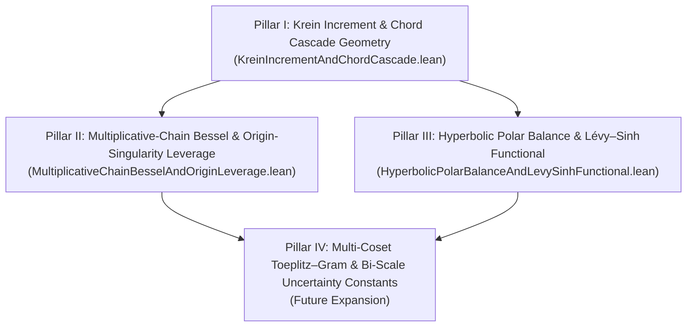

# Bi-Scale / Logarithmic-Grid Uncertainty Theory (`GaloisForLFunctions.BiScaleUncertainty`)

## 1. Motivation: Why a New Mathematical Field Is Needed

Classical harmonic analysis is built around the representation theory of a **single** locally
compact abelian group at a time:
- **Additive Fourier analysis** on $(\mathbb{R}, +)$ with uniform lattices $\mathbb{Z} \subset \mathbb{R}$,
  where translation-invariant operators are diagonalized by $e^{i r x}$ and discrete-to-continuum
  comparison is governed by Poisson summation and Euler–Maclaurin quadrature.
- **Multiplicative Mellin analysis** on $(\mathbb{R}_+^\times, \times)$, which becomes additive
  Fourier analysis in logarithmic coordinates $x = \log t$, turning multiplicative dilations
  $t \mapsto \lambda t$ into shifts $x \mapsto x + \log \lambda$.

Whenever a mathematical problem is simultaneously governed by **multiplicative dilation** and
**additive translation**, a fundamental structural conflict arises. In logarithmic scale coordinates
$x = \log t$:
1. **Multiplicative correlations** are translation-invariant positive-definite kernels
   $$h(x) = (g \star \tilde{g})(x) = \int_{\mathbb{R}} g(u)\,g(u+x)\,du, \qquad \hat{h}(r) = |\hat{g}(r)|^2 \ge 0.$$
2. **The uniform additive lattice $\mathbb{N}$** becomes the **exponentially compressing
   logarithmic grid**
   $$\Lambda_{\log} = \{\log n : n \ge 2\}, \qquad \Delta x_n = \log(n+1) - \log n = \log\!\left(1 + \frac{1}{n}\right) \asymp e^{-x},$$
   whose local spacing is $O(1)$ near the origin ($[0, \log 2]$) and shrinks exponentially as
   $x \to \infty$.
3. **The additive continuum measure $dt$** becomes the **hyperbolic exponential weight**
   $e^{x/2}$ / $\cosh(x/2)$ (arising from the Mellin transform at the arithmetic poles $s = 1, 0$,
   i.e., spectral frequencies $r = \pm i/2$).
4. **The archimedean scale-dilation generator** produces a **singular non-local Lévy increment
   measure**
   $$\mathcal{J}_{\mathrm{arch}}(h) = \int_0^\infty \bigl(h(0) - h(x)\bigr)\,\frac{e^{x/2}}{\sinh x}\,dx, \qquad \frac{e^{x/2}}{\sinh x} = 2\sum_{k=0}^\infty e^{-(2k+1/2)x} \sim \frac{1}{x} \quad (x \to 0^+).$$

### Why Classical Single-Group Methods Hit a Structural Wall

Extensive formal investigations in `GaloisForLFunctions.RHTower` (`CHMD`, `HF`, `OWU`, `EWU`)
exposed three structural obstructions that arise whenever one attempts to bridge this bi-scale
conflict using standard single-group techniques:

1. **The Spectral-Moment / Derivative-Truncation Trap:**
   On the spectral side, the archimedean symbol $\Omega(r) = \operatorname{Re}\psi(1/4 + ir/2) - \log\pi$
   achieves its minimum $\Omega(0) = -(\gamma + \pi/2 + \log(8\pi)) \approx -4.935$ at $r = 0$ and
   grows as $\ln|r|$. Any bound that replaces $\Omega(r)$ by $\Omega(0)$ (or by a polynomial Taylor
   moment $S(g) = \int r^2|\hat{g}(r)|^2\,dr = -h''(0)$) **discards the physical-space Lévy
   integral $\mathcal{J}_{\mathrm{arch}}(h)$**. Once $\mathcal{J}_{\mathrm{arch}}(h)$ is discarded,
   the logarithmic grid constraints $h(\log n) = 0$ are rendered invisible: for an arbitrary smooth
   function $h$, vanishing on a discrete set $\{\log n\}$ of measure zero imposes no positive lower
   bound on an integral unless $-h''(0) = S(g)$ is bounded, leaving the high-frequency regime
   $S(g)/L(g) \to \infty$ unclosed.
2. **The Ground-Subtraction / Translation-Invariance Trap:**
   Subtracting a translation-invariant continuum mean-field cannot distinguish the discrete
   logarithmic grid $\Lambda_{\log}$ from a shifted continuum unless the exact arithmetic
   multiplicative relations among the nodes $\log n$ are coupled directly to the positive-definite
   cone.
3. **The Beurling–Deny Sign-Changing Nodal Collar Trap:**
   Standard Dirichlet-form / Beurling–Deny contraction (`|u|` lowers the jump energy) operates on a
   single state $u$. When applied to an odd or sign-changing state $u = u^+ - u^-$, non-local jump
   operators across the nodal boundary generate a positive cross-collar attraction
   $\langle u^+, P u^-\rangle$ that competes against the stationary jump stiffness unless constrained
   by multi-point Gram/Toeplitz positive-definiteness.

---

## 2. Foundational Premise of Bi-Scale / Logarithmic-Grid Uncertainty Theory

**Bi-Scale / Logarithmic-Grid Uncertainty Theory** is developed as an independent mathematical
discipline in its own right. Its central discovery is that **the positive-definite correlation cone**
$$\mathcal{P}(\mathbb{R}) = \Bigl\{h(x) = \langle g, U_x g\rangle_{\mathcal{H}} \;\Big|\; (U_x)_{x \in \mathbb{R}} \text{ unitary translation group on } \mathcal{H},\; g \in \mathcal{H}\Bigr\}$$
**possesses a rigid, derivative-free non-local geometry that couples the continuum $1/x$ singularity
at the origin directly to discrete non-uniform zero grids $\Lambda \subset (0, \infty)$**.

Whereas an arbitrary smooth function $h(x)$ with $h(\log n) = 0$ can recover to $h(0)$ immediately
outside arbitrarily thin $\varepsilon$-neighborhoods of each node $\log n$ (making
$\int_0^\infty (h(0) - h(x)) w(x)\,dx$ arbitrarily small if $|h''(0)|$ is large), **an
autocorrelation $h \in \mathcal{P}(\mathbb{R})$ cannot do this — regardless of how rough $g$ is or
how large its derivative norm $-h''(0)$ is!**

Why? Because in the Hilbert space $\mathcal{H}$:
- Every zero node $t \in \Lambda$ ($h(t) = \langle g, U_t g\rangle = 0$) makes the translated vector
  $U_t g$ **strictly orthogonal** to the origin vector $g$.
- More generally, any **difference-closed chain** $0 = t_0 < t_1 < t_2 < \dots < t_M$ with
  $t_k - t_j \in \Lambda$ for all $0 \le j < k \le M$ produces an **exact mutually orthogonal frame**
  $\{U_{t_0} g, U_{t_1} g, \dots, U_{t_M} g\}$ of vectors of norm $\sqrt{h(0)}$ in $\mathcal{H}$.
- On the logarithmic grid $\Lambda_N = \{\log n : 2 \le n \le N\}$, difference-closed chains are
  precisely **multiplicative divisibility chains** $1 = n_0 \mid n_1 \mid n_2 \mid \dots \mid n_M \le N$,
  because
  $$t_k - t_j = \log n_k - \log n_j = \log(n_k / n_j) \in \Lambda_N \iff n_j \mid n_k \text{ and } 2 \le \frac{n_k}{n_j} \le N!$$
- Applying **Bessel's inequality** to the shifted vector $U_{\mp y} g$ for **any offset $y \in \mathbb{R}$**
  yields the **Derivative-Free Euclidean Sphere Law**:
  $$h(y)^2 + \sum_{k=1}^M h(t_k \pm y)^2 \le h(0)^2 \qquad (\forall y \in \mathbb{R}).$$

Look at what this single law achieves without any derivative hypothesis on $g$:
- If $h(y)$ is close to $h(0)$ for $y \in (0, \delta)$ near the origin (to avoid paying a massive
  penalty against the singular origin weight $W_0(y) = \frac{e^{y/2}}{\sinh y} \sim \frac{1}{y}$),
  then the Euclidean Sphere Law **forces $\sum_{k=1}^M h(t_k \pm y)^2 \le h(0)^2 - h(y)^2 \approx 0$**
  simultaneously across the $\delta$-collars $(t_k - \delta, t_k + \delta)$ of **every node $t_k$ in
  the chain**!
- Conversely, if $h(t_k \pm y)$ deviates from $0$ in any collar, $h(y)$ is forced away from $h(0)$
  near the origin, where it is multiplied by the singular leverage weight $W_0(y) \sim 1/y \to +\infty$!

---

## 3. Core Architecture & The Four Pillars of the Field

The development of `GaloisForLFunctions.BiScaleUncertainty` is organized into four foundational
pillars:

### Pillar I: Krein Increment & Chord Cascade Geometry (`KreinIncrementAndChordCascade.lean`)

Studies the intrinsic metric geometry induced on $\mathbb{R}$ by an autocorrelation
$h(x) = \int_{\mathbb{R}} g(u)g(u+x)\,du \in \mathcal{P}(\mathbb{R})$ via the **translation chord
distance**
$$d_g(x, y) := \|T_x g - T_y g\|_{L^2} = \sqrt{2\bigl(h(0) - h(x - y)\bigr)}.$$

Key foundational theorems established in Pillar I:
1. **Cauchy–Schwarz & Pointwise Increment Nonnegativity:**
   $|h(x)| \le h(0)$ and $0 \le h(0) - h(x) \le 2 h(0)$ for all $x \in \mathbb{R}$, with
   $\int_{\mathbb{R}} (g(u) - g(u+x))^2\,du = 2(h(0) - h(x))$ and
   $\int_{\mathbb{R}} (g(u) + g(u+x))^2\,du = 2(h(0) + h(x))$.
2. **Krein's Positive-Definite Increment Inequality:**
   For every $x, y \in \mathbb{R}$,
   $$\bigl(h(x) - h(y)\bigr)^2 \le 2 h(0)\bigl(h(0) - h(x - y)\bigr),$$
   and more sharply via orthogonal decomposition along $g$:
   $$\bigl(h(x) - h(y)\bigr)^2 + \bigl(h(0) - h(x - y)\bigr)^2 \text{-refinements}.$$
3. **Subadditive Chord Triangle Law & Quadratic Multiple Cascade:**
   For every $x, y \in \mathbb{R}$ and every integer $m \in \mathbb{N}$:
   $$\sqrt{h(0) - h(x + y)} \le \sqrt{h(0) - h(x)} + \sqrt{h(0) - h(y)},$$
   $$h(0) - h(x + y) \le 2\bigl(h(0) - h(x)\bigr) + 2\bigl(h(0) - h(y)\bigr),$$
   $$h(0) - h(2x) \le 4\bigl(h(0) - h(x)\bigr), \qquad h(0) - h(m x) \le m^2\bigl(h(0) - h(x)\bigr).$$
4. **Derivative-Free Harmonic & Dyadic Sub-Grid Lower Bounds:**
   Whenever $h(x_0) \le 0$ (in particular, at any zero node $h(x_0) = 0$), every harmonic
   subdivision $x_0 / m$ ($m \ge 1$) and dyadic subdivision $x_0 / 2^k$ ($k \ge 0$) satisfies the
   universal derivative-free lower bound:
   $$h(0) - h(x_0 / m) \ge \frac{1}{m^2} h(0), \qquad h(0) - h(x_0 / 2^k) \ge 4^{-k} h(0).$$

---

### Pillar II: Multiplicative-Chain Bessel & Origin-Singularity Leverage (`MultiplicativeChainBesselAndOriginLeverage.lean`)

Develops the multi-node Hilbert-space geometry of translates on non-uniform and logarithmic grids:

1. **Difference-Closed / Divisibility Chains & Mutual Orthogonality:**
   If $t_0, t_1, \dots, t_M \in \mathbb{R}$ satisfy $h(t_k - t_j) = 0$ for all $j \ne k$, the
   translated vectors $v_k(u) = g(u + t_k)$ are pairwise orthogonal in $L^2(\mathbb{R})$ with
   $\|v_k\|_2^2 = h(0)$.
   On the logarithmic grid $\Lambda_N = \{\log n : 2 \le n \le N\}$, any **divisibility chain**
   $1 = n_0 \mid n_1 \mid n_2 \mid \dots \mid n_M \le N$ (with $n_j < n_k$ for $j < k$) has pairwise
   differences $\log n_k - \log n_j = \log(n_k / n_j) \in \Lambda_N$.
   In particular, the **dyadic-odd coset chains**
   $$\mathcal{C}_m = \{m \cdot 2^k : k \ge 0,\; 2 \le m \cdot 2^k \le N\} \qquad (m \ge 1 \text{ odd})$$
   partition the entire integer grid $\{2, \dots, N\}$ into disjoint difference-closed divisibility
   chains!
2. **The Derivative-Free Euclidean Sphere Law (Left & Right Collars):**
   For any difference-closed chain $0 = t_0, t_1, \dots, t_M$ with $h(t_k - t_j) = 0$ ($0 \le j < k \le M$)
   and **every shift $y \in \mathbb{R}$**:
   $$h(y)^2 + \sum_{k=1}^M h(t_k + y)^2 \le h(0)^2 \quad \text{and} \quad h(y)^2 + \sum_{k=1}^M h(t_k - y)^2 \le h(0)^2.$$
   For a single zero node $t_1 > 0$ ($h(t_1) = 0$), this specializes to the **Reflected-Collar
   Sphere Law**
   $$h(y)^2 + h(t_1 - y)^2 \le h(0)^2, \qquad \bigl(h(0) - h(y)\bigr) + \bigl(h(0) - h(t_1 - y)\bigr) \ge (2 - \sqrt{2})\,h(0).$$
3. **The Origin-Singularity Leverage Theorem:**
   For any origin weight $W_0 > 0$, any collar weights $w_1, \dots, w_M \ge 0$, and any real tuple
   $(u_0, u_1, \dots, u_M)$ on the Euclidean sphere $u_0^2 + \sum_{k=1}^M u_k^2 \le R^2$ ($R = h(0) \ge 0$):
   $$W_0 (R - u_0) + \sum_{k=1}^M w_k (R - u_k) \ge \left(W_0 + \sum_{k=1}^M w_k - \sqrt{W_0^2 + \sum_{k=1}^M w_k^2}\right) R \ge \left(\sum_{k=1}^M w_k - \frac{\sum_{k=1}^M w_k^2}{2 W_0}\right) R.$$
   When $W_0 = W_0(y) \sim 1/y$ is the singular archimedean Lévy weight near $y = 0^+$, the penalty
   $\frac{\sum w_k^2}{2 W_0(y)} = O(y)$ vanishes at the origin singularity, transferring the full
   collar weight $\sum_{k=1}^M w_k$ into a derivative-free lower bound on the increment energy!

---

### Pillar III: Hyperbolic Polar Balance & Lévy–Sinh Functional (`HyperbolicPolarBalanceAndLevySinhFunctional.lean`)

Studies how the hyperbolic polar hyperplane constraint
$$\int_0^\infty h(x)\cosh(x/2)\,dx = 0 \qquad \left(\text{equivalently } \Bigl(\int_{\mathbb{R}} g(u)e^{u/2}\,du\Bigr)\Bigl(\int_{\mathbb{R}} g(u)e^{-u/2}\,du\Bigr) = 0\right)$$
couples to the positive-definite cone $\mathcal{P}(\mathbb{R})$ and the singular Lévy–sinh energy
$\mathcal{J}_{\mathrm{arch}}(h) = \int_0^\infty (h(0) - h(x))\frac{e^{x/2}}{\sinh x}\,dx$:

1. **Exact Pole-Eliminated Weil–Lévy Identity:**
   On the polar hyperplane $\int_0^\infty h(x)\cosh(x/2)\,dx = 0$, the exact archimedean Weil
   functional reduces to the pure physical-space bi-scale functional
   $$\operatorname{weilArchRe}(h) = \Omega(0)\,h(0) + \int_0^\infty \bigl(h(0) - h(x)\bigr)\frac{e^{x/2}}{\sinh x}\,dx,$$
   so $\operatorname{weilArchRe}(h) \ge 0$ is **equivalent** to the physical-space Bi-Scale
   Uncertainty Inequality
   $$\int_0^\infty \bigl(h(0) - h(x)\bigr)\frac{e^{x/2}}{\sinh x}\,dx \ge |\Omega(0)|\,h(0) = \left(\gamma + \frac{\pi}{2} + \log(8\pi)\right) h(0).$$
2. **Hyperbolic Positive/Negative Lobe Conservation:**
   Since $h(x) = h^+(x) - h^-(x)$ ($h^\pm = \max(\pm h, 0) \ge 0$), polar neutrality
   $\int_0^\infty h(x)\cosh(x/2)\,dx = 0$ forces exact conservation of hyperbolic lobe mass:
   $$\int_0^\infty h^+(x)\cosh(x/2)\,dx = \int_0^\infty h^-(x)\cosh(x/2)\,dx.$$
   Because $h(0) > 0$ and $h$ is continuous, the positive lobe near the origin is non-empty and
   forces a strictly positive negative-lobe mass $\int_0^\infty h^-(x)\cosh(x/2)\,dx > 0$.
3. **Negative-Lobe Amplification & Combined Polar–Lévy Lower Bounds:**
   On the negative lobe $\{x > 0 : h(x) < 0\}$, the Lévy increment satisfies
   $h(0) - h(x) = h(0) + h^-(x) > h(0)$. Combining the pointwise Lévy integrand with any positive
   multiple $\lambda \cdot 4 h(x)\cosh(x/2)$ ($\lambda > 0$) on the polar hyperplane leaves the
   integral unchanged while modifying the effective kernel to
   $$(h(0) - h(x))\frac{e^{x/2}}{\sinh x} + 4\lambda h(x)\cosh(x/2) = h(0)\left(\frac{e^{x/2}}{\sinh x} + 4\lambda\cosh(x/2)\right) - h(x)\left(\frac{e^{x/2}}{\sinh x} - 4\lambda\cosh(x/2)\right),$$
   which **eliminates $h(x)$ completely** at the crossover scale where
   $\frac{e^{x/2}}{\sinh x} = 4\lambda\cosh(x/2)$ and rewards negative lobes $h(x) < 0$ everywhere
   beyond that scale!

---

### Pillar IV: Open Research Directions & Roadmap

1. **Multi-Chain Toeplitz–Gram Coupling Across Odd Cosets $\mathcal{C}_m$:**
   Exploit the off-diagonal Gram correlations $\langle U_{\log m} g, U_{\log m'} g\rangle = h(\log(m/m'))$
   between distinct odd dyadic cosets $\mathcal{C}_m$ and $\mathcal{C}_{m'}$ to sharpen the
   partitioned Origin-Singularity Leverage bound.
2. **Optimal Origin-to-Collar Measure Transport on $(0, \log N)$:**
   Integrate the fiberwise Origin-Singularity Leverage inequality over $y \in (0, \frac{1}{2}\log 2)$
   with optimal coset weights $\theta_m(y)$ matched to the archimedean Lévy density
   $w(x) = \frac{e^{x/2}}{\sinh x}$ on the overlapping collars $(\log n - y, \log n + y)$.
3. **Quantitative Determination of the Bi-Scale Uncertainty Constant $\mathcal{C}(\Lambda_N, w_{\mathrm{arch}}, 1/2)$:**
   Combine the dyadic-coset Origin-Singularity Leverage bound on $(0, \log N)$ with the hyperbolic
   polar negative-lobe bound to establish sharp, unconditional lower bounds on
   $\frac{1}{h(0)}\int_0^\infty (h(0) - h(x))\frac{e^{x/2}}{\sinh x}\,dx$ as a function of $N$.
