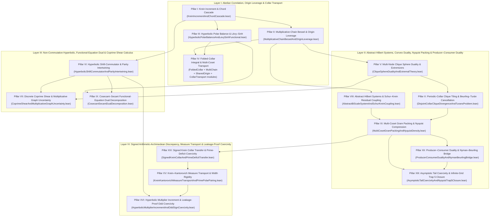

# Bi-Scale / Logarithmic-Grid Uncertainty Theory (`GaloisForLFunctions.BiScaleUncertainty`)

## 1. Motivation: Why a New Mathematical Field Is Needed

Classical harmonic analysis is built around the representation theory of a **single** locally
compact abelian group at a time:
- **Additive Fourier analysis** on $(\mathbb{R}, +)$ with uniform lattices $\mathbb{Z} \subset \mathbb{R}$,
  where translation-invariant operators are diagonalized by $e^{i r x}$ and discrete-to-continuum
  comparison is governed by Poisson summation and Euler–Maclaurin quadrature.
- **Multiplicative Mellin analysis** on $(\mathbb{R}_+^\times, \times)$, which becomes additive
  Fourier analysis in logarithmic coordinates $x = \log t$, turning multiplicative dilations
  $t \mapsto \lambda t$ into linear shifts $x \mapsto x + \log \lambda$.

Whenever a mathematical problem is simultaneously governed by **multiplicative dilation** and
**additive translation**, a fundamental structural conflict arises. In logarithmic scale coordinates
$x = \log t$:
1. **Multiplicative correlations** are translation-invariant positive-definite kernels
   $$h(x) = (g \star \tilde{g})(x) = \int_{\mathbb{R}} g(u)\,g(u+x)\,du, \qquad \hat{h}(r) = |\hat{g}(r)|^2 \ge 0.$$
2. **The uniform additive lattice $\mathbb{N}$** becomes the **exponentially compressing
   logarithmic grid**
   $$\Lambda_{\log} = \{\log n : n \ge 2\}, \qquad \Delta x_n = \log(n+1) - \log n = \log\!\left(1 + \frac{1}{n}\right) \asymp e^{-x},$$
   whose local spacing is $O(1)$ near the origin ($[0, \log 2]$) and shrinks exponentially as
   $x \to \infty$.
3. **The additive continuum measure $dt$** becomes the **hyperbolic exponential weight**
   $e^{x/2}$ / $\cosh(x/2)$ (arising from the Mellin transform at the arithmetic poles $s = 1, 0$,
   i.e., spectral frequencies $r = \pm i/2$).
4. **The archimedean scale-dilation generator** produces a **singular non-local Lévy increment
   measure**
   $$\mathcal{J}_{\mathrm{arch}}(h) = \int_0^\infty \bigl(h(0) - h(x)\bigr)\,\frac{e^{x/2}}{\sinh x}\,dx, \qquad \frac{e^{x/2}}{\sinh x} = 2\sum_{k=0}^\infty e^{-(2k+1/2)x} \sim \frac{1}{x} \quad (x \to 0^+).$$

**Bi-Scale / Logarithmic-Grid Uncertainty Theory** is the independent mathematical discipline that
studies the geometry, convex sphere duality, multi-node Gram/Schur residuals, non-commutative
hyperbolic multiplier calculus, and discrete coprime shear inequalities of correlation kernels and
unitary representations simultaneously constrained by **non-uniform / logarithmic zero grids** and
**hyperbolic / singular scale measures**.

---

## 2. Canonical Language, Mathematical Objects & Formal Dictionary

Every researcher or agent working in `GaloisForLFunctions.BiScaleUncertainty` should use the
following canonical objects, terminology, and Lean 4 declarations rather than reinventing ad-hoc
definitions:

### 2.1 Correlation Kernels, Chord Geometry & Lobes

| Concept / Object | Mathematical Definition | Lean 4 Declaration & Module |
| :--- | :--- | :--- |
| **Autocorrelation Kernel** | $h_f(x) := (f \star \tilde{f})(x) = \int_{\mathbb{R}} f(u)\,f(u+x)\,du$ | `autocorr f x` (`HyperbolicPolarBalanceAndLevySinhFunctional.lean`) |
| **Origin Energy (Radius)** | $R = h_f(0) = \int_{\mathbb{R}} f(u)^2\,du = \|f\|_{L^2}^2 \ge 0$ | `autocorr f 0` (`KreinIncrementAndChordCascade.lean`) |
| **Autocorrelation Increment** | $\Delta h_f(x) := h_f(0) - h_f(x) = \frac{1}{2}\int_{\mathbb{R}} (f(u) - f(u+x))^2\,du \ge 0$ | `autocorr f 0 - autocorr f x` (`KreinIncrementAndChordCascade.lean`) |
| **Translation Chord Distance** | $d_f(x, y) := \|T_x f - T_y f\|_{L^2} = \sqrt{2(h_f(0) - h_f(x - y))}$ | `autocorr_sqrt_sub_add_le` (`KreinIncrementAndChordCascade.lean`) |
| **Positive & Negative Lobes** | $h_f^+(x) := \max(h_f(x), 0)$, $h_f^-(x) := \max(-h_f(x), 0)$, $h_f = h_f^+ - h_f^-$ | `autocorrPos f x`, `autocorrNeg f x` (`HyperbolicPolarBalanceAndLevySinhFunctional.lean`) |
| **Hyperbolic Polar Hyperplane** | $\int_0^\infty h_f(x)\cosh(x/2)\,dx = 0 \iff \int_0^\infty h_f^+\cosh\frac{x}{2} = \int_0^\infty h_f^-\cosh\frac{x}{2}$ | `integral_autocorrPos_cosh_eq_autocorrNeg_cosh` (`HyperbolicPolarBalanceAndLevySinhFunctional.lean`) |

### 2.2 Difference-Orthogonal Cliques, Collars & Convex Sphere Duality

| Concept / Object | Mathematical Definition | Lean 4 Declaration & Module |
| :--- | :--- | :--- |
| **Zero Grid (Pinning Set)** | $\Lambda \subset (0, \infty)$ where $h_f(t) = 0$ for all $t \in \Lambda$ (e.g. $\Lambda_N = \{\log n : 2 \le n \le N\}$) | `hzeros` hypotheses across all modules |
| **Difference-Orthogonal Clique** | Finite family $\{t_i\}_{i \in s}$ with $h_f(t_i - t_j) = 0$ for all $i \ne j$ in $s$ | `horth : ∀ i ∈ s, ∀ j ∈ s, i ≠ j → autocorr f (t i - t j) = 0` |
| **Dyadic-Odd Coset** | $\mathcal{C}_m := \{\log(m \cdot 2^k) : 2 \le m \cdot 2^k \le N\}$ ($m$ odd); every $\mathcal{C}_m$ is a clique in $\Lambda_N$ | `autocorr_dyadic_coset_sphere_sub_le` (`MultiplicativeChainBesselAndOriginLeverage.lean`) |
| **Collar Evaluation Vector** | For collar offset $y \in \mathbb{R}$, the vector $u(y) = (h_f(y - t_i))_{i \in s}$ or $(h_f(t_i + y))_{i \in s}$ | `autocorr_finset_bessel_sq_le` (`MultiplicativeChainBesselAndOriginLeverage.lean`) |
| **Clique Sphere Duality Factor** | $\mathcal{D}_s(w) := \sum_{i \in s} w_i - \sqrt{\sum_{i \in s} w_i^2} \ge 0$ (for $w_i \ge 0$) | `cliqueSphereDualityFactor s w` (`CliqueSphereDualityAndExtremalTheory.lean`) |
| **Sphere Extremal Ray** | $u_i^* := \frac{w_i}{\sqrt{\sum_{j \in s} w_j^2}}\,R$, the unique ray saturating $\sum w_i(R - u_i) \ge \mathcal{D}_s(w) R$ on $\sum u_i^2 \le R^2$ | `cliqueSphereExtremizer s w R i` (`CliqueSphereDualityAndExtremalTheory.lean`) |
| **Scaled Frame Residual** | $\operatorname{Res}_s(e, R, x) := R x - \sum_{i \in s} \langle e_i, x\rangle e_i$ in any real inner product space $E$ | `scaledFrameResidual s e R x` (`AbstractBiScaleSystemAndSchurKreinCoupling.lean`) |
| **Selberg–Bombieri Row-Sum Bound** | $\sum_{j \in s} |\langle e_i, e_j\rangle| \le M_{\mathrm{row}} \implies \sum_{i \in s} \langle e_i, x\rangle^2 \le M_{\mathrm{row}}\|x\|^2$ | `abstract_selberg_bombieri_bessel_le` (`MultiCosetGramPackingAndNyquistDensity.lean`) |
| **Producer–Consumer Defect** | $\langle f, p\rangle - \sum_{i \in s} c_i\langle f, g_i\rangle = \langle f, p - \sum_{i \in s} c_i g_i\rangle$, bridging Weil consumers & FZZ-P producers | `producer_consumer_defect_eq`, `fzzp_nyman_beurling_orthogonal_duality_identity` (`ProducerConsumerDualityAndNymanBeurlingBridge.lean`) |

### 2.3 Archimedean Weights, Dual Kernels & Non-Commutative Operators

| Concept / Object | Mathematical Definition | Lean 4 Declaration & Module |
| :--- | :--- | :--- |
| **Forward Archimedean Lévy Weight** | $w_{\mathrm{arch}}(x) := \frac{e^{x/2}}{\sinh x}$; jump integrals restrict to $x>0$ | `archLevySinhWeight x` (`HyperbolicPolarBalanceAndLevySinhFunctional.lean`) |
| **Dual Archimedean Lévy Weight** | $w_{\mathrm{dual}}(x) := \frac{e^{-x/2}}{\sinh x}$ for $x > 0$ ($0$ for $x \le 0$), from $s \leftrightarrow 1 - s$ | `archDualLevySinhWeight x` (`CosecantSecantDualDecomposition.lean`) |
| **Hyperbolic Secant Weight** | $w_{\mathrm{sech}}(x) := \operatorname{sech}(x/2) = \frac{1}{\cosh(x/2)} > 0$, smooth & positive-definite on $\mathbb{R}$ | `archSechHalfWeight x` (`CosecantSecantDualDecomposition.lean`) |
| **Bi-Scale Lévy Energies** | $\mathcal{J}_{\mathrm{arch}}(f) = \mathcal{J}_{\mathrm{sech}}(f) + \mathcal{J}_{\mathrm{dual}}(f) = \int_0^\infty (h_f(0) - h_f(x))\,w(x)\,dx$ | `biScaleLevyEnergy f`, `biScaleSecantEnergy f`, `biScaleDualLevyEnergy f` |
| **Hyperbolic Multipliers** | $(C_\alpha f)(u) := \cosh(\alpha u) f(u)$, $(S_\alpha f)(u) := \sinh(\alpha u) f(u)$ | `coshMultiplier α f`, `sinhMultiplier α f` (`HyperbolicShiftCommutatorAndParityIntertwining.lean`) |
| **Discrete Multiplicative & Additive Shifts** | $(M_k v)(n) := v(kn)$, $(T_a v)(n) := v(n+a)$, $(\Delta_+ v)(n) := v(n+1) - v(n)$, $(\Delta_{\times, k} v)(n) := v(kn) - v(n)$ | `mulShift k v`, `addShift a v`, `addDiff v`, `mulJump k v` (`CoprimeShearAndMultiplicativeGraphUncertainty.lean`) |
| **Signed Collar-Increment Identity** | $(h_f(0) - h_f(t \pm y)) + h_f(t) = h_f(0) - (h_f(t \pm y) - h_f(t))$ (no blindness assumption) | `autocorr_signed_collar_add_eq`, `abstract_signed_collar_gram_identity` (`SignedKreinCollarAndPrimeDeficitTransfer.lean`) |
| **Reciprocal Archimedean Weight** | $w_{\mathrm{arch}}(y)^{-1} = e^{-y/2}\sinh y \le y e^{y/2}$ (vanishes linearly as $y \to 0^+$) | `inv_archLevySinhWeight_eq`, `exp_neg_half_mul_sinh_le` (`KreinKantorovichMeasureTransportAndPrimePolarPairing.lean`) |
| **Critical-Line Node Scaling** | $w_{\mathrm{arch}}(\log n) = \frac{2}{\sqrt{n}} + \frac{2}{\sqrt{n}(n^2 - 1)}$ ($n \ge 2$), matching $2\Lambda(n)/\sqrt{n}$ | `archLevySinhWeight_log_nat_eq` (`SignedKreinCollarAndPrimeDeficitTransfer.lean`) |

---

## 3. The Nine Structural Traps (Obstructions & Design Laws)

Extensive formal investigations across `GaloisForLFunctions.RHTower` (`CHMD`, `HF`, `OWU`, `EWU`)
and `GaloisForLFunctions.BiScaleUncertainty` have uncovered **nine structural traps**—four
classical single-group traps and five deep frontier traps that govern the design of this field.

### Part A: The Four Single-Group Traps

1. **Trap 1 — The Spectral-Moment / Derivative-Truncation Trap:**
   On the spectral side, the archimedean symbol $\Omega(r) = \operatorname{Re}\psi(1/4 + ir/2) - \log\pi$
   achieves its minimum $\Omega(0) = -\left(\frac{\gamma}{2} + \frac{\pi}{4} + \frac{3}{2}\log 2 + \frac{1}{2}\log\pi\right) \approx -2.752$
   at $r = 0$ and grows as $\ln|r|$. Any bound that replaces $\Omega(r)$ by $\Omega(0)$ or by a
   polynomial Taylor moment $S(g) = \int r^2|\hat{g}(r)|^2\,dr = -h''(0)$ **discards the
   physical-space Lévy integral $\mathcal{J}_{\mathrm{arch}}(h)$**. Once $\mathcal{J}_{\mathrm{arch}}(h)$
   is discarded, the discrete grid constraints $h(\log n) = 0$ are rendered invisible in the
   high-frequency regime $S(g)/L(g) \to \infty$.
2. **Trap 2 — The Ground-Subtraction / Translation-Invariance Trap:**
   Subtracting a translation-invariant continuum mean-field cannot distinguish the discrete
   logarithmic grid $\Lambda_{\log}$ from a shifted continuum unless the exact arithmetic
   multiplicative relations among the nodes $\log n$ are coupled directly to the positive-definite
   cone.
3. **Trap 3 — The Beurling–Deny Sign-Changing Nodal Collar Trap:**
   Standard Dirichlet-form / Beurling–Deny contraction (`|u|` lowers jump energy) operates on a
   single state $u$. When applied to an odd or sign-changing state $u = u^+ - u^-$, non-local jump
   operators across the nodal boundary generate a positive cross-collar attraction
   $\langle u^+, P u^-\rangle$ that competes against stationary jump stiffness unless constrained
   by multi-point Gram/Toeplitz positive-definiteness or additive regularity.
4. **Trap 4 — The Single-Point Non-Dyadic Interpolation Trap ($x = \frac{4}{5}\log 2$):**
   Even when $h(\log 2) = 0$ for a smooth positive-definite autocorrelation $h$, one **cannot** bound
   $h(0) - h(x) \ge c(x) h(0) > 0$ pointwise at every individual non-dyadic point $x \in (0, \log 2)$.
   As proved in `EvenSectorSmoothBlindInterpolationObstruction.lean`, a smooth pulse train $g_N$ with
   spacing $a = \frac{4}{5}\log 2$ satisfies $h_N(\log 2) = 0$ while
   $(h_N(0) - h_N(\frac{4}{5}\log 2)) / h_N(0) = \frac{1}{N+1} \to 0$.
   - **Resolution (`FoldedCollarIntegralAndObstructionResolution.lean`):** By the **Reflected-Collar
     Euclidean Sphere Law** $h(x)^2 + h(\log 2 - x)^2 \le h(0)^2$, making $h(\frac{4}{5}\log 2) \to h(0)$
     forces the reflected point $h(\frac{1}{5}\log 2) \to 0$. Folding the integral around the
     midpoint $\frac{1}{2}\log 2$ pairs $x$ with $\log 2 - x$ and restores an unconditional,
     strictly positive lower bound across all smooth tests!

### Part B: The Five Deep Frontier Traps (Why Layers I–III Must Extend to Layer IV)

5. **Trap 5 — The Distant-Copy Polar Decoupling Trap (`DistantCopyPolarEnforcement.lean` & `FiniteMomentEnergyInvariance.lean`):**
   Suppose we impose only **finitely many** logarithmic grid zeros $h(\log n) = 0$ ($2 \le n \le N_0$)
   on a compactly supported source $f$ (say supported in $[-D/2, D/2]$). Then replacing $f(u)$ by
   $$\operatorname{polarCopy}(f, T)(u) := f(u) - e^{-T/2} f(u - T)$$
   for a very large translation $T \gg \max(D, \log N_0)$ **automatically enforces the hyperbolic polar
   hyperplane constraint** $\int_0^\infty h(x)\cosh(x/2)\,dx = 0$, **preserves all grid zeros**
   $h(\log n) = 0$ for $2 \le n \le N_0$, and changes the normalized archimedean energy
   $\mathcal{J}_{\mathrm{arch}}(h) / h(0)$ by only $O(e^{-T}) \to 0$ as $T \to \infty$. More
   generally, any finite list of exponential source moments can be enforced at zero asymptotic cost.
   - **Infinite-Grid Resolution (`AsymptoticTailCoercivityAndNyquistTrap5Closure.lean`, Pillar XIII):**
     When the infinite logarithmic grid $\Lambda_{\log} = \{\log n : n \ge 2\}$ is active in the
     distant dyadic window $[\log N, \log(2N)]$ at scale $T = \log N$, the $N$ consecutive grid nodes
     $\log(N+k)$ have Nyquist spacing $\delta_k \le 1/N = e^{-T}$. Krein compression across these $N$
     cells forces $\int_{\log N}^{\log(2N)} h_f(x)^2\,dx \le \frac{2K}{N^2} h_f(0)$, while
     $\int_{\log N}^{\log(2N)} \cosh(x/2)^2\,dx \le 2 N \log 2$, so any negative polar lobe mass
     $\mu > 0$ placed at scale $T = \log N$ forces the kinetic / origin-collar constant $K$ to grow
     at least linearly in $N = e^T$: $N \mu^2 \le 4 \log 2 \, K \, h_f(0)$
     (`infinite_grid_distant_lobe_kinetic_coercivity`).
6. **Trap 6 — The Commutative Bochner / Beurling Trap (`FiniteSourceEnergyScalarization.lean` & `FiniteSpectralEnvelopeRealization.lean`):**
   As long as our theorems only use inner products of **additive translations**
   $\langle U_{t_i} f, U_{t_j} f \rangle = h(t_i - t_j)$ on $L^2(\mathbb{R})$, all operators $U_t$
   **commute** ($U_t U_s = U_{t+s}$) and are simultaneously diagonalized by the Fourier transform
   $\hat{h}(\omega) = |\hat{f}(\omega)|^2 \ge 0$. Moreover, finite vector correlations can be
   scalarized without increasing energy, and difference-closed chains on $\Lambda_N = \{\log n\}$
   only see the **multiplicative semigroup** $(\mathbb{N}, \times)$ via divisibility
   $m \mid n \implies \log n - \log m = \log(n/m)$. Any Beurling generalized number system has the
   exact same divisibility chains, even when it violates the Riemann Hypothesis!
   - **Strategic Consequence:** A complete theory must incorporate the **non-commutative affine
     $(ax+b)$ algebra** linking multiplicative dilations ($n \mapsto pn$, linear shifts
     $x \mapsto x + \log p$) to the **additive ring generator** ($n \mapsto n + 1$, the exponential
     shear $x \mapsto \log(e^x + 1)$ and hyperbolic multipliers $e^{\pm x/2}$).
7. **Trap 7 — The Odd-Sector Nodal Blind Spot & Hyperbolic Multiplier Leakage (`OddMultiplierLeakageFamily.lean`):**
   Origin-Singularity Leverage relies on $h(0) = \|f\|_2^2 > 0$ sitting directly on top of the
   $\frac{1}{\sinh x} \sim \frac{1}{x}$ singularity at $x = 0$. For an **odd** test function
   (`OWU` / `HF`), the hyperbolic multiplier $(S_\alpha f)(u) = \sinh(\alpha u)f(u)$ maps $f$ into
   an even state with positive origin energy. However, as proved in `OddMultiplierLeakageFamily.lean`,
   single-point source blindness $h_f(\log 2) = 0$ does **not** imply multiplier blindness
   $h_{S_\alpha f}(\log 2) = 0$: an odd 6-packet train can cancel $h_f(\log 2)$ between inner and
   outer pairs while $\sinh(\alpha u)$ weights the outer pair by $\asymp e^{2\alpha T}$, making
   $h_{S_\alpha f}(\log 2)/h_f(0)$ arbitrarily large.
   - **Resolution (`HyperbolicMultiplierIncrementAndOddSignCoercivity.lean`, Pillar XVI):**
     Instead of assuming $h_{S_\alpha f}(t) = 0$, combine the exact two-positive-term decomposition
     $$(h_{C_\alpha f}(0) - h_{C_\alpha f}(x)) + 2\sinh(\alpha x / 2)^2 h_f(0) = \cosh(\alpha x)(h_f(0) - h_f(x)) + (h_{S_\alpha f}(0) - h_{S_\alpha f}(x))$$
     with zero-grid coincidence $h_f(t) = 0 \implies h_{C_\alpha f}(t) = h_{S_\alpha f}(t)$ and
     signed collar leverage on $C_\alpha f$ (`coshMultiplier_signed_collar_ge_of_source_zero`),
     which absorbs the signed value $w h_{S_\alpha f}(t)$ and bounds the collar sum below by
     $\left(w - \frac{w^2}{2 W_0}\right)(h_f(0) + h_{S_\alpha f}(0))$.
8. **Trap 8 — The Midpoint Compression / Narrow-Support Escape (`InfiniteGridPolarRecovery.lean` & `LogarithmicCompressionEnergy.lean`):**
   For a fixed seed $f$, placing a distant polar copy at $T$ and requiring all-grid blindness
   $h(\log n) = 0$ ($\forall n \ge 2$) costs linear Lévy energy $\ge \frac{e^{-1/2}}{4}T$
   (`FiniteCopyTailRigidity.lean`). However, if one **compresses** the seed $f$ by scale
   $L = 8(D+1)(N+1)$ (`k = sourceRescale f L`) to support radius $r_1 = \frac{1}{8(N+1)} < \frac{1}{2(N+1)}$
   and places the polar copy at the **logarithmic midpoint** $T_N = \frac{\log N + \log(N+1)}{2}$,
   then every grid node $\log n$ ($n \ge 2$) lies outside the support of $h$, achieving
   $h(\log n) = 0$ ($\forall n \ge 2$) at normalized archimedean energy cost $\asymp \log N \asymp T_N$
   (`exists_smooth_infinite_grid_polar_recovery`).
   - **Bounded-Energy Resolution (`KreinKantorovichMeasureTransportAndPrimePolarPairing.lean`, Pillar XV):**
     Because $w_{\mathrm{arch}}(x) \ge e^{-r_2/2}/x$ on $[r_1, r_2]$, any source with $h_f(x) \le 0$
     on $[r_1, r_2]$ must pay Lévy energy at least $e^{-r_2/2}\log(r_2/r_1) h_f(0)$
     (`narrow_support_logarithmic_levy_lower_bound`). Thus in the bounded-energy regime relevant to
     `EWU`/`HF` ($\mathcal{J}_{\mathrm{arch}}(f) \le K h_f(0)$, e.g. $K = |\Omega(0)| \approx 2.752$),
     the support radius satisfies $r_1 \ge r_2\exp(-e^{r_2/2} K)$ (`bounded_levy_width_rigidity`) and
     **cannot** be compressed into a midpoint gap $(\log N, \log(N+1))$ once $N$ is large.
9. **Trap 9 — The Homogeneous Blind-Subspace Trap (Why $h_f(\log n) = 0$ Cannot Supply the Signed Full-Prime Estimate):**
   Restricting to the grid-blind subspace $h_f(\log n) = 0$ multiplies the arithmetic weights
   $\frac{\Lambda(n)}{\sqrt{n}}$ in $\mathcal{Q}_{\mathrm{prime}}(f) = 2\sum_{n \ge 2}\frac{\Lambda(n)}{\sqrt{n}}h_f(\log n)$
   by zero, erasing the prime distribution from the problem! Any theorem whose only arithmetic
   hypothesis is $h_f(\log n) = 0$ cannot distinguish $\zeta(s)$ from the off-line countermodel
   $\zeta(s-a)\zeta(s+a)$ (`NonTemperedShiftedZetaPairCountermodel.lean`), which shares the exact
   same support $\{\log p^k\}$. Furthermore, in `EWU` and `HF`, general test functions have
   **signed** prime correlations $h_f(\log n) \in \mathbb{R}$, and the discrete prime measure
   $\mu_\Lambda = \sum_{n \ge 2}\frac{\Lambda(n)}{\sqrt{n}}\delta_{\log n}$ must be paired directly
   against the continuum polar measure $\mu_{\mathrm{polar}} = 2\cosh(x/2)\,dx$.
   - **Resolution (`SignedKreinCollarAndPrimeDeficitTransfer.lean` & `KreinKantorovichMeasureTransportAndPrimePolarPairing.lean`, Pillars XIV–XV):**
     Drop the blindness hypothesis $h_f(t_i) = 0$ using the exact identity
     $(h_f(0) - h_f(t_i \pm y)) + h_f(t_i) = h_f(0) - (h_f(t_i \pm y) - h_f(t_i))$, lifting all
     Origin-Singularity Leverage and Selberg–Bombieri multi-coset bounds to the **signed
     archimedean-plus-arithmetic functional** $\mathcal{J}_{\mathrm{arch}}(f) + \sum_{i \in s} M_i h_f(t_i)$,
     and coupling discrete node evaluations to continuum collar integrals via **Krein–Kantorovich
     measure transport** with the linearly vanishing reciprocal weight
     $w_{\mathrm{arch}}(y)^{-1} = e^{-y/2}\sinh y \le y e^{y/2}$.

---

## 4. Core Architecture: The Four Layers & Sixteen Pillars of `BiScaleUncertainty`

To meet the standards of an independent mathematical discipline—and to supply the signed arithmetic
and operator tools required by `EWU`, `HF`, `CHMD`, and `OWU`—the library is organized into **four
layers** spanning **sixteen foundational pillars**:

---

### Layer I: Abelian Correlation, Origin Leverage & Collar Transport (Pillars I–IV)

#### Pillar I: Krein Increment & Chord Cascade Geometry (`KreinIncrementAndChordCascade.lean`)
Studies the intrinsic metric geometry induced on $\mathbb{R}$ by an autocorrelation
$h(x) = \int_{\mathbb{R}} g(u)g(u+x)\,du \in \mathcal{P}(\mathbb{R})$ via the **translation chord
distance** $d_g(x, y) := \|T_x g - T_y g\|_{L^2} = \sqrt{2\bigl(h(0) - h(x - y)\bigr)}$:
- **Cauchy–Schwarz & Pointwise Increment Nonnegativity:** $|h(x)| \le h(0)$ and
  $0 \le h(0) - h(x) \le 2 h(0)$.
- **Krein's Positive-Definite Increment Inequality:**
  $\bigl(h(x) - h(y)\bigr)^2 \le 2 h(0)\bigl(h(0) - h(x - y)\bigr)$.
- **Subadditive Chord Triangle Law & Quadratic Multiple Cascade:**
  $\sqrt{h(0) - h(x + y)} \le \sqrt{h(0) - h(x)} + \sqrt{h(0) - h(y)}$ and
  $h(0) - h(m x) \le m^2\bigl(h(0) - h(x)\bigr)$.
- **Derivative-Free Harmonic & Dyadic Sub-Grid Lower Bounds:**
  Whenever $h(x_0) \le 0$, $h(0) - h(x_0 / m) \ge \frac{1}{m^2} h(0)$ and
  $h(0) - h(x_0 / 2^k) \ge 4^{-k} h(0)$.

#### Pillar II: Multiplicative-Chain Bessel & Origin-Singularity Leverage (`MultiplicativeChainBesselAndOriginLeverage.lean`)
Develops the multi-node Hilbert-space geometry of translates on non-uniform and logarithmic grids:
- **Multi-Node Orthogonal-Frame Bessel Inequality (`autocorr_finset_bessel_sq_le`):**
  For any pairwise difference-orthogonal set $\{t_i\}_{i \in s}$ ($h(t_i - t_j) = 0$ for $i \ne j$),
  $\sum_{i \in s} h(y - t_i)^2 \le h(0)^2$ for every $y \in \mathbb{R}$.
- **Origin-Anchored & Reflected-Collar Euclidean Sphere Laws:**
  $h(y)^2 + \sum_{k=1}^M h(t_k \pm y)^2 \le h(0)^2$ and
  $(h(0) - h(y)) + (h(0) - h(t_1 - y)) \ge (2 - \sqrt{2})\,h(0)$.
- **The Origin-Singularity Leverage Theorem:**
  $$W_0 (R - u_0) + \sum_{k=1}^M w_k (R - u_k) \ge \left(W_0 + \sum_{k=1}^M w_k - \sqrt{W_0^2 + \sum_{k=1}^M w_k^2}\right) R \ge \left(\sum_{k=1}^M w_k - \frac{\sum_{k=1}^M w_k^2}{2 W_0}\right) R.$$
- **Logarithmic Divisibility & Dyadic-Coset Orthogonality:**
  On $\Lambda_N = \{\log n : 2 \le n \le N\}$, the dyadic-odd cosets
  $\mathcal{C}_m = \{m \cdot 2^k : 2 \le m \cdot 2^k \le N\}$ ($m$ odd) form disjoint
  difference-closed orthogonal chains.

#### Pillar III: Hyperbolic Polar Balance & Lévy–Sinh Functional (`HyperbolicPolarBalanceAndLevySinhFunctional.lean`)
Couples the hyperbolic polar hyperplane $\int_0^\infty h(x)\cosh(x/2)\,dx = 0$ to the positive-definite
cone and the singular Lévy–sinh energy `biScaleLevyEnergy`:
- **Exact Pole-Eliminated Weil–Lévy Identity (`weilArchRe_eq_polar_levy_sinh_form`):**
  $\operatorname{weilArchRe}(f) = \Omega(0)\,h(0) + \operatorname{biScaleLevyEnergy}(f)$.
- **Hyperbolic Positive/Negative Lobe Conservation (`integral_autocorrPos_cosh_eq_autocorrNeg_cosh`):**
  $\int_0^\infty h^+(x)\cosh(x/2)\,dx = \int_0^\infty h^-(x)\cosh(x/2)\,dx$.
- **Polar–Lévy Kernel Deformation & Crossover Floor (`polar_levy_deformation_lower_bound`).**

#### Pillar IV: Folded-Collar Integral Bounds, Multi-Coset Transport & Structural Invariance
- **Folded-Collar Obstruction Resolution (`FoldedCollarIntegralAndObstructionResolution.lean`):**
  Midpoint-folded reflected-collar integral lower bound resolving the $x = \frac{4}{5}\log 2$
  single-point obstruction unconditionally across all smooth real EWU tests
  (`RealSmoothEvenPolarTestFn.weilArchRe_ge_folded_collar_of_log_two_blind`).
- **Multi-Coset Gram & Sine Leverage (`SharedOriginMultiCosetLeverage.lean`, `MultiChainToeplitzGramCoupling.lean`, `OptimalOriginAllocation.lean`, `TriangularGramSineBound.lean`, `SynchronizedCosetSineLeverage.lean`, `ProfileStableCosetLeverage.lean`):**
  Shared-origin multi-coset sphere bounds, full Gram-energy square remainder identities,
  proportional origin-weight allocation, and triangular Gram / synchronized-coset sine leverage bounds.
- **Collar Coverage, Signed Partition & Duality (`OverlapSafeCollarMeasureTransport.lean`, `LogarithmicCollarCoverage.lean`, `SignedDyadicCollarPartition.lean`, `IntegratedOriginCollarLeverage.lean`, `CollarAllocationDuality.lean`):**
  Overlap-safe collar measure transport, exact coverage of $(\frac{1}{2}\log 2, \log N)$ by
  half-$\log 2$ collars around $\Lambda_N$, signed odd-coset partitions, measurable optimal origin
  shares, and explicit marginal-price collar allocation duality.
- **Polar Decoupling, Scalarization & Spectral Realization (`DistantCopyPolarEnforcement.lean`, `FiniteMomentEnergyInvariance.lean`, `FiniteSourceEnergyScalarization.lean`, `FiniteSpectralEnvelopeRealization.lean`):**
  Distant translated-copy subtraction proving Trap 5, invariance of finite-grid constants under any
  finite list of real exponential source moments, scalarization of finite vector correlations, and
  exact spectral envelope realization.

---

### Layer II: Abstract Hilbert Systems, Convex Duality & Beurling–Turán Theory (Pillars V, VIII, X)

#### Pillar V: Multi-Node Clique Sphere Duality & Extremizers (`CliqueSphereDualityAndExtremalTheory.lean`)
Establishes the canonical convex duality and extremal theory for arbitrary difference-orthogonal
cliques $s$ ($h(t_i - t_j) = 0$ for distinct $i, j \in s$):
1. **Exact Quadratic Sphere Defect Identity (`clique_sphere_quadratic_defect_identity`):**
   For any weights $w : \iota \to \mathbb{R}$, state vector $u : \iota \to \mathbb{R}$, radius $R$,
   and $W_2 := \sqrt{\sum_{i \in s} w_i^2}$:
   $$2 W_2 R \left(\sum_{i \in s} w_i (R - u_i) - \left(\sum_{i \in s} w_i - W_2\right) R\right) = W_2^2 \left(R^2 - \sum_{i \in s} u_i^2\right) + \sum_{i \in s} \left(W_2 u_i - w_i R\right)^2.$$
   This single algebraic identity simultaneously proves:
   - The **Multi-Node Clique Sphere Lower Bound**
     $\sum_{i \in s} w_i (h(0) - h(y - t_i)) \ge \left(\sum_{i \in s} w_i - \sqrt{\sum_{i \in s} w_i^2}\right) h(0)$,
   - **Exactness and Uniqueness of the Extremal Ray** $u_i^* = \frac{w_i}{W_2} R$ on the Euclidean
     sphere $\sum_{i \in s} u_i^2 = R^2$ (`clique_sphere_extremizer_achieves_bound`).
2. **Clique-Rank Amplification Law (`autocorr_clique_uniform_collar_sum_ge`):**
   For any $M$-element difference-orthogonal clique $s$ ($M = s.\mathrm{card}$),
   $$\sum_{i \in s} \bigl(h(0) - h(y - t_i)\bigr) \;\ge\; \bigl(M - \sqrt{M}\bigr)\,h(0) \qquad (\forall y \in \mathbb{R}),$$
   so the average collar defect per node is at least $\left(1 - \frac{1}{\sqrt{M}}\right) h(0) \to h(0)$
   as the clique size $M \to \infty$ (e.g. along growing dyadic chains $\{2^k\}$).
3. **Multi-Node Collar Integral Theorem (`integral_autocorr_clique_collar_ge`):**
   Integrates the $M$-node clique sphere bound against any family of continuous collar weights
   $w_i(y) \ge 0$ on $[a, b]$.

#### Pillar VIII: Abstract Hilbert-Unitary Systems & Multi-Node Schur–Krein Residual Coupling (`AbstractBiScaleSystemAndSchurKreinCoupling.lean`)
Lifts the theory from $L^2(\mathbb{R})$ convolutions to an arbitrary real inner product space
`(E, ⟪·, ·⟫)`:
1. **Division-Free Orthogonal-Frame Residual Identity (`inner_scaledFrameResidual_eq` & `norm_sq_scaledFrameResidual_eq`):**
   For any finite family $\{e_i\}_{i \in s}$ in a real inner product space $E$ with
   $\langle e_i, e_i\rangle = R$ and $\langle e_i, e_j\rangle = 0$ ($i \ne j$), the scaled residual
   $\operatorname{scaledFrameResidual}(s, e, R, x) := R x - \sum_{i \in s} \langle e_i, x\rangle e_i$
   satisfies
   $$\bigl\langle \operatorname{scaledFrameResidual}(s, e, R, x),\, \operatorname{scaledFrameResidual}(s, e, R, y)\bigr\rangle = R\left(R\langle x, y\rangle - \sum_{i \in s} \langle e_i, x\rangle\langle e_i, y\rangle\right).$$
2. **Multi-Node Schur–Krein Residual Coupling Inequality (`abstract_schur_krein_residual_coupling`):**
   Applying Cauchy–Schwarz to the orthogonal-frame residuals of two target vectors $x, y \in E$ yields
   the universal $2 \times 2$ Schur-complement Gram inequality over an $M$-node orthogonal frame:
   $$\left(R\langle x, y\rangle - \sum_{i \in s} \langle e_i, x\rangle\langle e_i, y\rangle\right)^2 \;\le\; \left(R\|x\|^2 - \sum_{i \in s} \langle e_i, x\rangle^2\right)\left(R\|y\|^2 - \sum_{i \in s} \langle e_i, y\rangle^2\right).$$
   - For $s = \{0\}$ ($M = 1$), this recovers Krein's classical 3-point inequality.
   - For arbitrary $M$-node cliques $s$, whenever two collar offsets $y, z \in \mathbb{R}$ are
     separated by a zero node $z - y \in \Lambda$ ($h(z - y) = 0$), the Euclidean inner product of
     the two collar correlation vectors $(h(y - t_i))_{i \in s}$ and $(h(z - t_i))_{i \in s}$ is
     bounded by the geometric mean of their Bessel slacks (`autocorr_collar_inner_sq_le_of_zero_lag`):
     $$\left(\sum_{i \in s} h(y - t_i)\,h(z - t_i)\right)^2 \;\le\; \left(h(0)^2 - \sum_{i \in s} h(y - t_i)^2\right)\left(h(0)^2 - \sum_{i \in s} h(z - t_i)^2\right).$$

#### Pillar X: Periodic-Collar Clique Tiling, Square-Root Cancellation & the Beurling–Turán Window Problem (`DisjointCollarCliqueDivergenceAndTuransProblem.lean`)
Establishes standalone theorems in classical harmonic analysis and Turán's extremal problem for
positive-definite functions with arithmetic or dyadic zero progressions:
1. **Exact Periodic-Collar Tiling Identity (`intervalIntegral_periodic_collar_sum_eq` & `intervalIntegral_periodic_collar_sum_eq_of_continuousOn`):**
   $$\int_{t_0}^{t_0 + K\delta} F(x)\,dx = \int_0^\delta \sum_{k=0}^{K-1} F(t_0 + k\delta + y)\,dy.$$
2. **The Beurling–Turán Window Divergence Theorem (`integral_autocorr_sub_ge_of_arithmetic_zeros`):**
   If $h = f \star \tilde{f}$ vanishes at the $M$ arithmetic nodes $m\delta$ ($1 \le m \le M$, $\delta > 0$),
   then $\{0, \delta, 2\delta, \dots, M\delta\}$ is an $(M+1)$-node difference-orthogonal clique whose
   right-hand collars $[k\delta, (k+1)\delta]$ ($0 \le k \le M$) tile $[0, (M+1)\delta]$ disjointly, yielding
   $$\int_0^{(M+1)\delta} \bigl(h(0) - h(x)\bigr)\,dx \;\ge\; \delta\bigl((M + 1) - \sqrt{M + 1}\bigr)\,h(0).$$
3. **The Square-Root Cancellation Law (`integral_autocorr_le_sqrt_of_arithmetic_zeros`):**
   Under the same arithmetic zero hypothesis $h(m\delta) = 0$ ($1 \le m \le M$), the average value
   of $h(x)$ over $[0, (M+1)\delta]$ exhibits universal square-root cancellation:
   $$\int_0^{(M+1)\delta} h(x)\,dx \;\le\; \delta\sqrt{M + 1}\,h(0), \qquad \frac{1}{(M+1)\delta}\int_0^{(M+1)\delta} h(x)\,dx \;\le\; \frac{h(0)}{\sqrt{M + 1}} \to 0.$$
4. **Bi-Scale Lévy Energy Lower Bound Across a Dyadic Progression (`biScaleLevyEnergy_ge_dyadic_clique_integral`):**
   If $h(m\log 2) = 0$ for $1 \le m \le M$, then
   $$\operatorname{biScaleLevyEnergy}(f) \;\ge\; \mathcal{C}_{\mathrm{dyadic}}(M)\,h(0), \qquad \mathcal{C}_{\mathrm{dyadic}}(M) := \int_0^{\log 2} \left(\sum_{k=0}^{M-1} w(\log 2 + k\log 2 + y) - \sqrt{\sum_{k=0}^{M-1} w(\log 2 + k\log 2 + y)^2}\right) dy \ge 0.$$

#### Pillar XI: Multi-Coset Gram Packing, Selberg–Bombieri Almost-Orthogonality & Nyquist Compression (`MultiCosetGramPackingAndNyquistDensity.lean`)
Upgrades Layer II from single-chain $O(\log N)$ cliques to **multi-coset Nyquist packing at additive
density $e^y = N$** across the $N$ nodes $\log N < \log(N+1) < \dots < \log(2N)$ in the dyadic window
$[\log N, \log(2N)]$:
1. **Selberg–Bombieri Almost-Orthogonal Bessel & Collar Amplification (`abstract_selberg_bombieri_bessel_le` & `almost_orthogonal_collar_uniform_sum_ge`):**
   If $\{t_i\}_{i \in s}$ is an $M$-node multi-coset family whose correlation row sums satisfy
   $\sum_{j \in s} |h_f(t_i - t_j)| \le (1 + \Delta) h_f(0)$ ($\Delta \ge -1$), then
   $$\sum_{i \in s} h_f(y - t_i)^2 \;\le\; (1 + \Delta)\,h_f(0)^2, \qquad \sum_{i \in s} \bigl(h_f(0) - h_f(y - t_i)\bigr) \;\ge\; \left(M - \sqrt{M(1 + \Delta)}\right) h_f(0),$$
   so the effective multi-coset Gram rank scales as $M / (1 + \Delta)$.
2. **Origin-Singularity Absorption on the Nyquist Collar (`archLevySinhWeight_ge_nat_on_nyquist_collar`):**
   On the Nyquist collar $(0, \log(n+1) - \log n]$ ($n \ge 1$), $\sinh y \le \frac{2n+1}{2n(n+1)} < \frac{1}{n}$
   and $e^{y/2} > 1$, so the archimedean Lévy weight satisfies
   $$(n : \mathbb{R}) \;\le\; \operatorname{archLevySinhWeight}(y).$$
3. **Derivative-Free Dyadic-Window Nyquist $L^2$ Compression (`integral_autocorr_sq_dyadic_window_le_levy_collar` & `integral_autocorr_sq_dyadic_window_le_biScaleLevyEnergy`):**
   Partitioning $[\log N, \log(2N)]$ into the $N$ Nyquist cells $[\log(N+k), \log(N+k+1)]$ ($0 \le k < N$)
   where $h_f(\log(N+k)) = 0$, the $N$-fold cell multiplicity is absorbed by
   $\operatorname{archLevySinhWeight}(y) \ge N$, yielding the derivative-free $L^2$ bound:
   $$\int_{\log N}^{\log(2N)} h_f(x)^2\,dx \;\le\; 2 h_f(0) \int_0^{\log(N+1) - \log N} \bigl(h_f(0) - h_f(y)\bigr)\,\operatorname{archLevySinhWeight}(y)\,dy \;\le\; 2 h_f(0)\,\operatorname{biScaleLevyEnergy}(f).$$

#### Pillar XII: Producer–Consumer Duality & the FZZ-P / Nyman–Beurling Bridge (`ProducerConsumerDualityAndNymanBeurlingBridge.lean`)
Establishes the Hilbert-space and correlation-space duality between **consumer routes**
(`BiScaleUncertainty`, lower-bounding the energy of grid-blind states $\langle f, g_n\rangle = 0$) and
**producer routes** (`FZZ-P` / Nyman–Beurling / Báez-Duarte, upper-bounding the $L^2$ approximation
error $\|p - \sum_{n \in s} c_n g_n\|^2$ of the pole functional $p$):
1. **Abstract Producer–Consumer Duality (`producer_consumer_defect_sq_le` & `consumer_polar_sq_le_producer_error`):**
   $$\left(\langle f, p\rangle - \sum_{i \in s} c_i\langle f, g_i\rangle\right)^2 \;\le\; \|f\|^2 \left\|p - \sum_{i \in s} c_i g_i\right\|^2,$$
   and whenever $f$ is grid-blind ($\langle f, g_i\rangle = 0$ for $i \in s$),
   $\langle f, p\rangle^2 \le \|f\|^2 \|p - \sum_{i \in s} c_i g_i\|^2$.
2. **Exact FZZ-P / Nyman–Beurling Orthogonal Duality Identity (`fzzp_nyman_beurling_orthogonal_duality_identity`):**
   Over any orthogonal clique $\{e_i\}_{i \in s}$ with $\langle e_i, e_i\rangle = R$,
   $$R\left\|p - \sum_{i \in s} c_i e_i\right\|^2 = \left(R\|p\|^2 - \sum_{i \in s} \langle e_i, p\rangle^2\right) + \sum_{i \in s} \bigl(R c_i - \langle e_i, p\rangle\bigr)^2,$$
   so the minimum-norm producer residual is identically equal to the consumer Bessel slack.
3. **Correlation-Space Polar–Producer Residual Bound (`correlation_producer_consumer_residual_sq_le` & `dyadic_window_producer_consumer_duality_le_levy`):**
   Couples any polar weight $P(x)$ (such as $\cosh(x/2)$) and collar producer weight $W(x)$ on $[a, b]$ via
   $$\left(\int_a^b h_f(x) P(x)\,dx + \int_a^b (h_f(0) - h_f(x)) W(x)\,dx - \left(\int_a^b W(x)\,dx\right) h_f(0)\right)^2 \;\le\; \left(\int_a^b h_f(x)^2\,dx\right)\left(\int_a^b (P(x) - W(x))^2\,dx\right).$$

#### Pillar XIII: Asymptotic Tail Coercivity & Infinite-Grid Closure of Trap 5 (`AsymptoticTailCoercivityAndNyquistTrap5Closure.lean`)
Defeats the finite-grid distant-copy construction (`DistantCopyPolarEnforcement.lean`, Trap 5) on
the infinite logarithmic grid $\Lambda_{\log} = \{\log n : n \ge 2\}$:
1. **$O(N^{-2})$ Dyadic-Window $L^2$ Correlation Decay (`integral_autocorr_sq_dyadic_window_le_of_quad_collar`):**
   Under quadratic origin-collar regularity $h_f(0) - h_f(y) \le K y^2$ on $[0, 1/N]$ ($K \ge 0$),
   the $N$ Nyquist-packed zeros $h_f(\log(N+k)) = 0$ ($0 \le k < N$) force
   $$\int_{\log N}^{\log(2N)} h_f(x)^2\,dx \;\le\; \frac{2 K}{N^2}\,h_f(0).$$
2. **$O(N)$ Hyperbolic Polar Weight Integral (`integral_cosh_half_sq_dyadic_window_le`):**
   $$\int_{\log N}^{\log(2N)} \cosh(x/2)^2\,dx \;\le\; 2 N \log 2.$$
3. **$O(N^{-1/2})$ Polar Tail Decay & Infinite-Grid Trap-5 Kinetic Coercivity (`integral_abs_autocorr_mul_cosh_dyadic_window_sq_le` & `infinite_grid_distant_lobe_kinetic_coercivity`):**
   $$\left(\int_{\log N}^{\log(2N)} |h_f(x)|\,\cosh(x/2)\,dx\right)^2 \;\le\; \frac{4 \log 2}{N}\,K\,h_f(0) \;\xrightarrow{N \to \infty}\; 0,$$
   and any state carrying negative polar lobe mass
   $\mu \le \int_{\log N}^{\log(2N)} h_f^-(x)\cosh(x/2)\,dx$ at scale $T = \log N$ must pay kinetic
   energy growing at least linearly in $N = e^T$:
   $$N\,\mu^2 \;\le\; 4 \log 2 \, K \, h_f(0).$$

---

### Layer III: Non-Commutative Hyperbolic, Functional-Equation Dual & Coprime Shear Calculus (Pillars VI, VII, IX)

#### Pillar VI: Hyperbolic Shift-Commutator & Parity Intertwining (`HyperbolicShiftCommutatorAndParityIntertwining.lean`)
Breaks out of the Commutative Bochner Trap (Trap 6) and the Odd-Sector Blind Spot (Trap 7) by
introducing the non-commutative calculus of **hyperbolic multipliers**
$(C_\alpha f)(u) = \cosh(\alpha u) f(u)$ and $(S_\alpha f)(u) = \sinh(\alpha u) f(u)$ alongside
translations $T_x$:
1. **Hyperbolic Parity Intertwining:**
   If $f$ is odd ($f(-u) = -f(u)$), then $S_\alpha f$ is **even** and $C_\alpha f$ is **odd**;
   conversely, if $f$ is even, $S_\alpha f$ is odd and $C_\alpha f$ is even. Thus $S_\alpha$ lifts
   odd prime-blind states (`OWU` / `HF`) directly into the even sector with origin energy
   $h_{S_\alpha f}(0) = \int_{\mathbb{R}} \sinh(\alpha u)^2 f(u)^2\,du \ge 0$.
2. **The Fundamental Hyperbolic Autocorrelation Intertwining Law (`autocorr_coshMultiplier_sub_sinhMultiplier`):**
   Because $\cosh(\alpha u)\cosh(\alpha(u+x)) - \sinh(\alpha u)\sinh(\alpha(u+x)) = \cosh(\alpha x)$
   is independent of $u$, every $f \in C_c(\mathbb{R})$ satisfies the exact identity:
   $$\operatorname{autocorr}(C_\alpha f)(x) - \operatorname{autocorr}(S_\alpha f)(x) = \cosh(\alpha x)\,\operatorname{autocorr}(f)(x) \qquad (\forall x \in \mathbb{R}).$$
3. **Zero-Grid Coincidence & Unconditional $\cosh$-Increment Coercivity (`autocorr_coshMultiplier_sub_ge_of_zero` & `autocorr_coshMultiplier_harmonic_subgrid_ge_of_nonpos`):**
   - At $x = 0$: $h_{C_\alpha f}(0) = h_f(0) + h_{S_\alpha f}(0)$.
   - At any zero node $x_0$ where $h_f(x_0) = 0$: $h_{C_\alpha f}(x_0) = h_{S_\alpha f}(x_0) \le h_{S_\alpha f}(0)$.
   - Therefore, at every zero node $x_0$ of $f$, the $\cosh$-weighted autocorrelation increment is
     bounded below by the **full unweighted origin energy $h_f(0)$**:
     $$h_f(x_0) = 0 \implies h_{C_\alpha f}(0) - h_{C_\alpha f}(x_0) \;\ge\; h_f(0),$$
     and along all harmonic subdivisions $x_0 / m$ ($m \ge 1$):
     $$h_{C_\alpha f}(0) - h_{C_\alpha f}(x_0 / m) \;\ge\; \frac{1}{m^2} h_f(0).$$

#### Pillar VII: Discrete Coprime Shear & Multiplicative Graph Uncertainty (`CoprimeShearAndMultiplicativeGraphUncertainty.lean`)
Establishes the discrete arithmetic-archimedean foundation on $\mathbb{N}$ that overcomes the
Beurling Obstruction (Trap 6) and couples the multiplicative prime graph (`CHMD` / `SourceGraph`)
to the additive successor lattice:
1. **Non-Commutative Multiplicative-Additive Telescoping (`addDiff_mulShift_eq_sum_addDiff` & `mulShift_addShift_comm_eq_sum_addDiff`):**
   For any sequence $v : \mathbb{N} \to \mathbb{R}$ and dilation factor $k \ge 1$, the dilated
   additive step $v(k(n+1)) - v(kn)$ telescopes across $k$ unit additive steps:
   $$v(k(n+1)) - v(kn) = \sum_{j=0}^{k-1} \bigl(v(kn + j + 1) - v(kn + j)\bigr).$$
2. **Bi-Scale Multiplicative-to-Additive Dirichlet Energy Inequality (`sum_addDiff_mulShift_sq_le`):**
   Using Cauchy–Schwarz and the disjointness of the residue blocks $\{kn + j : 0 \le j < k\}$,
   $$\sum_{n=0}^{N-1} \bigl(v(k(n+1)) - v(kn)\bigr)^2 \;\le\; k \sum_{m=0}^{kN - 1} \bigl(v(m+1) - v(m)\bigr)^2.$$
3. **Coprime Successor Coercivity on Divisor-Supported Fibers (`neighbor_addDiff_sq_eq_two_mul_sq_of_dvd_support`):**
   Because $\gcd(n, n+1) = 1$, no divisor $d \ge 2$ can divide both $n$ and $n+1$
   (`not_dvd_succ_of_dvd`). Hence if $v$ is supported on multiples of $d \ge 2$, every active node
   $d \mid n$ ($n \ge 1$) has $v(n-1) = v(n+1) = 0$, forcing
   $$\bigl(v(n) - v(n-1)\bigr)^2 + \bigl(v(n+1) - v(n)\bigr)^2 = 2\,v(n)^2.$$
4. **Nodal Sign-Change vs. Multiplicative Jump Decomposition (`nodal_mulJump_sq_decomp` & `four_mul_nodal_cross_le_addDiff_sum_sq`):**
   Decomposing $v = v^+ - v^-$ into positive and negative lobes yields the exact identity
   $$\bigl(v(kn) - v(n)\bigr)^2 = \bigl(|v(kn)| - |v(n)|\bigr)^2 + 4\bigl(v^+(kn)v^-(n) + v^-(kn)v^+(n)\bigr),$$
   bounding the opposite-sign multiplicative pairing $4\bigl(v^+(kn)v^-(n) + v^-(kn)v^+(n)\bigr)$
   directly by the multiplicative jump energy $\bigl(v(kn) - v(n)\bigr)^2$ and by the additive
   Dirichlet energy $(k-1)n\sum_{j=0}^{(k-1)n-1} (v(n+j+1)-v(n+j))^2$.
5. **Constructed Logarithmic Sobolev Traces (`CoprimeLogSobolevCoercivity.lean`):**
   Finite traces $w(j)=a(j)$ at interior multiples of $d\ge2$, and zero elsewhere,
   admit an explicitly constructed $L^2$ step velocity. Its primitive $F$ satisfies
   $F(j)=w(j)$; $f(x)=F(e^x)$ is locally absolutely continuous and
   $$\int_0^{\log(N+1)}e^{-x}|f'(x)|^2\,dx=2\sum_{j<N}|w(j)|^2.$$
   Every competing $L^2$ velocity has an exact energy decomposition into this trace
   energy, an explicit trace-error term, and a nonnegative interpolation defect.
   The same rough-state construction proves the nonlinear shear estimate.
   See `docs/reports/BiScaleUncertainty/CoprimeSobolevTrace.md`; compact-source graph admission follows below.
6. **Infinite-Edge Path Congestion (`MixedEdgePathCongestion.lean`):**
   For a constructed mixture of diffuse edges and countably many weighted lag lines,
   let $a_e=\min(u,u+h)$, $b_e=\max(u,u+h)$, and
   $K(y)=\int(e^{b_e}-e^{a_e})1_{(a_e,b_e]}(y)\,d\kappa(e)$. Actual L2 physical
   velocities give the extended-energy identity
   $$\int K(y)e^{-y}|f'(y)|^2\,dy
      =\int|f(u+h)-f(u)|^2\,d\kappa(e)+\int S(e)\,d\kappa(e),\qquad S\ge0.$$
   Every individual edge budget is finite; total energies may be infinite. The same
   bound controls four times the opposite-sign nodal pairing, including an arbitrary
   added constant. S-finiteness and joint measurability are proved, with no finite
   energy premise or finite edge truncation. Concrete congestion bounds remain necessary
   for finite graph-domain admission. See `docs/reports/BiScaleUncertainty/ContinuumPathCongestion.md`.
7. **Compact-Source Graph Admission (`CompactSourceGraphAdmission.lean`):**
   For any continuous compact source ψ and arbitrary nonnegative finite weights,
   construct diffuse density `w_arch(h)ψ(u)²ψ(u+h)²` and atom lags `log(n+2)`.
   Resistance cancels the diffuse singularity exactly; compact support kills all
   sufficiently large atom lags. Total resistance mass C is finite and the exact
   congestion satisfies `K≤C 1_[-B,B]`. Every physical L2 velocity therefore has
   finite derivative-weighted congestion, jump, slack and nodal energy. Weighted
   source mass is finite too, including arbitrary constants. No atom summability
   or finite-energy premise is imposed. See `docs/reports/BiScaleUncertainty/CompactSourceGraphAdmission.md`.
8. **Compact-Source Variance Coercivity (`CompactSourceGraphCoercivity.lean`):**
   For the same constructed graph and any actual logarithmic Sobolev state f, put
   `M=∫ψ²`, `A=∫ψ²f`, `Q=∫ψ²f²`. Its finite graph energy J satisfies
   `0≤MQ−A²≤sinh(2B)J`. The positive-lag pair integral is exactly `MQ−A²`;
   no positive-mass or connected-support premise is needed. Graph energy is zero
   exactly when f is constant across all points where ψ is nonzero, including
   different source components. Combining this lower bound with path congestion
   gives weighted variance control by actual additive Dirichlet energy.
   See `docs/reports/BiScaleUncertainty/CompactSourceVarianceCoercivity.md`.

#### Pillar IX: Cosecant–Secant Functional-Equation Dual Decomposition (`CosecantSecantDualDecomposition.lean`)
Unifies the forward archimedean Lévy weight $w_{\mathrm{arch}}(x) = \frac{e^{x/2}}{\sinh x}$ (from
$s = 1/2 + ir$), the time-reversed functional-equation dual weight
$w_{\mathrm{dual}}(x) = \frac{e^{-x/2}}{\sinh x}$ (from $1 - s = 1/2 - ir$), and the smooth
hyperbolic secant kernel $\operatorname{sech}(x/2) = \frac{1}{\cosh(x/2)}$ (`OWU`/`HF` plastic
crossover kernel):
1. **Exact Cosecant–Secant Half-Angle Decomposition (`archLevySinhWeight_eq_half_csch_add_half_sech` & `archDualLevySinhWeight_eq_half_csch_sub_half_sech`):**
   $$\frac{e^{x/2}}{\sinh x} = \frac{1}{2\sinh(x/2)} + \frac{1}{2\cosh(x/2)}, \qquad \frac{e^{-x/2}}{\sinh x} = \frac{1}{2\sinh(x/2)} - \frac{1}{2\cosh(x/2)} \qquad (x \ne 0).$$
2. **Exact Forward–Dual Secant Decomposition (`archLevySinhWeight_eq_sech_add_dual` & `biScaleLevyEnergy_eq_secant_add_dual`):**
   $$\frac{e^{x/2}}{\sinh x} = \frac{1}{\cosh(x/2)} + \frac{e^{-x/2}}{\sinh x} \qquad (x \ne 0),$$
   decomposing `biScaleLevyEnergy f` into the sum of two strictly nonnegative functionals:
   $$\operatorname{biScaleLevyEnergy}(f) = \operatorname{biScaleSecantEnergy}(f) + \operatorname{biScaleDualLevyEnergy}(f),$$
   with unconditional lower bounds `biScaleSecantEnergy_le_biScaleLevyEnergy` and
   `biScaleDualLevyEnergy_le_biScaleLevyEnergy`.
3. **Hyperbolic Multiplier Secant Identity (`autocorr_mul_archSechHalfWeight_eq_cosh_sub_sinh`):**
   Combining the secant kernel $\operatorname{sech}(x/2)$ with Pillar VI at $\alpha = 1/2$ yields
   $$\frac{h_f(x)}{\cosh(x/2)} = \frac{h_{C_{1/2} f}(x) - h_{S_{1/2} f}(x)}{\cosh(x/2)^2} = \frac{2\bigl(h_{C_{1/2} f}(x) - h_{S_{1/2} f}(x)\bigr)}{\cosh(x) + 1}.$$
   A zero of $h_f$ gives equality of the two multiplier correlations, not their vanishing.
   Transferring a clique bound requires control of the actual multiplier Gram matrix;
   the centered source bound below supplies one such control.
4. **Compensated Multiplier Gram Transfer (`HyperbolicMultiplierGramTransfer.lean`):**
   Set $C=C_{1/2}f$, $S=S_{1/2}f$, $R=h_f(0)$, $R_S=h_S(0)$,
   $x_i=t_i-y$, $v_i=b_i/\cosh(x_i/2)^2$, $W=\sum_i v_i$, and
   $D=\sum_{i,j}v_iv_jh_S(t_j-t_i)-R_S\sum_i v_i^2$. Then
   $$\sum_i\left[b_i h_f(x_i)\operatorname{sech}(x_i/2)+v_i\bigl(h_C(0)-h_C(x_i)\bigr)\right]
   \ge RW+R_S\left(W-\sqrt{\sum_i v_i^2}\right)-\sqrt{R_S\max(D,0)}.$$
   This holds for every real compact continuous source and arbitrary real weights; continuous
   collar weights also admit a compact-interval integral bound. It recovers the clique coefficient
   whenever $D\le0$, including an actual multiplier clique. This identity retains its cosine
   companion; the next result removes that companion using the actual source support.
5. **Uncompensated Squared-Jump Transfer (`HyperbolicJumpEnergyTransfer.lean`):**
   Choose $B>0$ enclosing the compact source support and set
   $K_B(x)=\sinh(B/2)\sinh((B+|x|)/2)$. The exact signed-sinh jump identity gives
   $$\cosh(x/2)R_S-h_S(x)\le K_B(x)\bigl(R-h_f(x)\bigr).$$
   For $v_i=b_i^2\operatorname{sech}(x_i/2)/K_B(x_i)$ and the measured defect $D$ above,
   $$\sum_i b_i^2\bigl(R-h_f(x_i)\bigr)\operatorname{sech}(x_i/2)
   \ge R_S\left(\sum_i v_i\cosh(x_i/2)-\sqrt{\sum_i v_i^2}\right)
   -\sqrt{R_S\max(D,0)}.$$
   No cosine companion or additive commutator error remains. Exact disjoint-collar tiling
   integrates the full-Gram version into `biScaleSecantEnergy`, for every compact continuous
   source. Support dependence and actual multiplier leakage remain; source blindness does
   not imply multiplier blindness. The next receiver handles the distinct plastic functional.
6. **Actual Plastic Crossover Receiver (`PlasticCrossoverGramReceiver.lean`):**
   At the plastic threshold $c_*$, put $k(x)=\operatorname{levyCoshKernel}(c_*,x)$,
   $V=\operatorname{levyCoshPotential}(c_*)$, $E=\int f(u)\cosh(u/2)\,du$,
   $O=\int f(u)\sinh(u/2)\,du$, and
   $$P(f)=VR+\iint f(u)f(v)\left[2\cosh((u-v)/2)-k(|u-v|)\right]du\,dv.$$
   The exact decomposition is
   $$P(f)=J_{\rm sech}(f)+R_{\rm plastic}(f)+2(E^2-O^2),\qquad R_{\rm plastic}(f)\ge0.$$
   Here the remainder weight $2k(x)-\operatorname{sech}(x/2)$ equals
   $4\cosh(x/2)-\operatorname{sech}(x/2)$ on the core and the dual Lévy weight
   beyond $c_*$. Every preceding integrated Gram bound $L\le J_{\rm sech}$
   therefore gives $L+R_{\rm plastic}+2(E^2-O^2)\le P$.
   Constructed odd sources have $E=0$ and even sine multipliers; the term $-2O^2$
   remains. A further theorem includes any origin coefficient, covering the full original
   crossover expression. Positivity requires control of this moment and actual Gram leakage.
7. **Exact Odd Multiplier Leakage (`OddMultiplierLeakageFamily.lean`):**
   A smooth compact odd six-packet family $f_T$ has fixed energy $h_{f_T}(0)=6m>0$
   and $h_{f_T}(d)=0$ at $d=\log 2$, while
   $$h_{S_{1/2}f_T}(d)=2M\sinh(|T|+2d)\sinh(d/2),\qquad M=\int\cosh(u)\phi(u)^2\,du\ge m>0.$$
   Consequently, this multiplier correlation exceeds any prescribed multiple of original
   source energy. The exact growth law and weighted packet mass are the positive survivor:
   transfer bounds need actual multiplier Gram data or further position/moment control.
   The construction imposes one logarithmic zero; the infinite-grid problem remains separate.
8. **Centered Source-Gram Receiver (`CenteredHyperbolicGramControl.lean`):**
   For the constructed odd source $F$, put $q_\lambda(u)=(\cosh(2\alpha u)-\lambda)F(u)$.
   Odd reflection gives the exact identity
   $$\int q_\lambda(u)F(u+x)\,du=2\cosh(\alpha x)h_{S_\alpha F}(x)+(\cosh^2(\alpha x)-\lambda)h_F(x).$$
   For off-diagonal node pairs set $d_{ij}=t_j-t_i$ and $a_{ij}=v_iv_j/(2\cosh(\alpha d_{ij}))$.
   The multiplier clique defect satisfies
   $$|D-E_\lambda|\le\sqrt{h_{q_\lambda}(0)\,G_F(a,d)},\qquad
   E_\lambda=\sum_{i\ne j}a_{ij}(\lambda-\cosh^2(\alpha d_{ij}))h_F(d_{ij}).$$
   Thus only original source Gram data on node differences and an actual weighted source
   energy are needed to bound multiplier leakage. The energy has an exact quadratic centering
   law and is minimized at its source-weighted mean, including the zero-energy case.
   At $\alpha=1/2$, the bound integrates into the full secant and odd plastic receivers,
   retaining the positive plastic remainder, negative odd moment, and source-support factor.
   Source clique zeros cancel $E_\lambda$; they do not diagonalize the difference-node Gram.

---

### Layer IV: Signed Arithmetic-Archimedean Discrepancy, Measure Transport & Leakage-Proof Coercivity (Pillars XIV–XVI)

#### Pillar XIV: Signed Krein Collar Transfer & Prime-Deficit Coercivity (`SignedKreinCollarAndPrimeDeficitTransfer.lean`)
Resolves **Trap 9 (The Homogeneous Blind-Subspace Trap)** by dropping the blindness hypothesis
$h_f(t_i) = 0$ completely and lifting all Origin-Singularity Leverage and Selberg–Bombieri
multi-coset Gram bounds to **arbitrary signed correlations** $h_f(t_i) \in \mathbb{R}$:
1. **Exact Signed Collar-Increment Identities (`autocorr_signed_collar_add_eq` & `autocorr_signed_collar_sub_eq`) & Pointwise Krein Coercivity (`autocorr_signed_collar_add_ge_krein`):**
   $$\bigl(h_f(0) - h_f(t \pm y)\bigr) + h_f(t) = h_f(0) - \bigl(h_f(t \pm y) - h_f(t)\bigr) \;\ge\; h_f(0) - \sqrt{2 h_f(0)\bigl(h_f(0) - h_f(y)\bigr)},$$
   and for any $W_0 > 0$, $w \ge 0$ (`autocorr_signed_collar_origin_leverage_add`):
   $$\left(w - \frac{w^2}{2 W_0}\right) h_f(0) \;\le\; W_0\bigl(h_f(0) - h_f(y)\bigr) + w\bigl(h_f(0) - h_f(t \pm y)\bigr) + w\,h_f(t).$$
2. **Exact Abstract Hilbert-Space Multi-Node Signed Collar Completion of Squares (`abstract_signed_collar_gram_identity` & `abstract_signed_collar_gram_ge`):**
   In any real inner product space $E$ with $\|x\|^2 = \|x_y\|^2 = R$:
   $$W_0\bigl(R - \langle x, x_y\rangle\bigr) + \sum_{i \in s} w_i\bigl(R - \langle e_i, x_y\rangle\bigr) + \sum_{i \in s} w_i\langle e_i, x\rangle
     = \left(\sum_{i \in s} w_i\right) R - \frac{1}{2 W_0}\sum_{i, j \in s} w_i w_j \langle e_i, e_j\rangle
       + \frac{1}{2 W_0}\left\|\sum_{i \in s} w_i e_i - W_0(x_y - x)\right\|^2.$$
   Specializing to orthogonal cliques (`abstract_signed_clique_origin_leverage_ge`) and
   Selberg–Bombieri almost-orthogonal multi-coset families
   (`abstract_signed_almost_orthogonal_origin_leverage_ge`) lifts the multi-node $\ell^1$-vs-$\ell^2$
   gain directly to the signed functional $\sum_{i \in s} w_i \langle e_i, x\rangle$.
3. **Exact Critical-Line $2/\sqrt{n}$ Node Scaling Law (`archLevySinhWeight_log_nat_eq`, `archLevySinhWeight_log_nat_ge_two_div_sqrt`, & `archLevySinhWeight_log_nat_sub_two_div_sqrt_le`):**
   At every logarithmic grid node $\log n$ ($n \ge 2$),
   $$\operatorname{archLevySinhWeight}(\log n) = \frac{2}{\sqrt{n}} + \frac{2}{\sqrt{n}(n^2 - 1)}, \qquad 0 \le \operatorname{archLevySinhWeight}(\log n) - \frac{2}{\sqrt{n}} \le \frac{8}{3\,\sqrt{n}\,n^2},$$
   showing that the archimedean Lévy density at $\log n$ matches the critical-line exponent
   $n^{-1/2}$ of the Weil prime weight $2\Lambda(n)/\sqrt{n}$ up to $O(n^{-5/2})$.

#### Pillar XV: Krein–Kantorovich Measure Transport, Prime–Polar Pairing & Width Rigidity (`KreinKantorovichMeasureTransportAndPrimePolarPairing.lean`)
Couples discrete node evaluations to continuum collar integrals via **Krein–Kantorovich measure
transport** and closes **Trap 8 (The Midpoint Compression Escape)** in the bounded-energy regime:
1. **Linear Origin-Vanishing of the Reciprocal Archimedean Weight (`inv_archLevySinhWeight_eq` & `exp_neg_half_mul_sinh_le`):**
   $$\frac{1}{\operatorname{archLevySinhWeight}(y)} = e^{-y/2}\sinh y = \frac{1}{2}e^{y/2}(1 - e^{-2y}) \;\le\; y\,e^{y/2} \qquad (y \ge 0).$$
   Thus the $1/y$ origin singularity of $\operatorname{archLevySinhWeight}(y)$ becomes a **linearly
   vanishing factor $O(y)$** in the dual transport penalty!
2. **Pointwise & Integrated Krein–Kantorovich Collar Measure-Transport Inequalities (`krein_kantorovich_pointwise_abs_le` & `collar_measure_transport_abs_diff_le_levy`):**
   For any $f \in C^2_c(\mathbb{R})$, node $t \in \mathbb{R}$, and continuous transport density
   $\rho \ge 0$ on $[a, \delta]$ ($0 < a \le \delta$):
   $$\left|\left(\int_a^\delta \rho(y)\,dy\right) h_f(t) - \int_a^\delta h_f(t + y)\,\rho(y)\,dy\right|
     \;\le\; \int_a^\delta \bigl(h_f(0) - h_f(y)\bigr)\,\operatorname{archLevySinhWeight}(y)\,dy
       + \frac{h_f(0)}{2}\int_a^\delta \rho(y)^2 e^{-y/2}\sinh y\,dy.$$
3. **Logarithmic Energy Cost of Narrow Support & Bounded-Energy Width Rigidity (`narrow_support_logarithmic_levy_lower_bound` & `bounded_levy_width_rigidity`):**
   Because $\operatorname{archLevySinhWeight}(x) \ge e^{-r_2/2}/x$ on $(0, r_2]$
   (`archLevySinhWeight_ge_exp_neg_half_div`), any source with $h_f(x) \le 0$ on $[r_1, r_2]$
   ($0 < r_1 \le r_2$) must pay archimedean Lévy energy
   $$\exp(-r_2 / 2)\,\log\!\left(\frac{r_2}{r_1}\right)\,h_f(0)
     \;\le\; \int_{r_1}^{r_2} \bigl(h_f(0) - h_f(x)\bigr)\,\operatorname{archLevySinhWeight}(x)\,dx.$$
   Consequently, if this collar energy is bounded by $K\,h_f(0)$ ($h_f(0) > 0$), then
   $\log(r_2 / r_1) \le \exp(r_2 / 2)\,K$, so the autocorrelation support radius cannot be
   compressed below $r_2\exp(-\exp(r_2/2)K)$ to hide inside a distant midpoint gap
   $(\log N, \log(N+1))$.

#### Pillar XVI: Hyperbolic Multiplier Increment Calculus & Leakage-Proof Odd-Sector Coercivity (`HyperbolicMultiplierIncrementAndOddSignCoercivity.lean`)
Resolves **Trap 7 (Hyperbolic Multiplier Leakage, `OddMultiplierLeakageFamily.lean`)** by replacing
the false hypothesis $h_{S_\alpha f}(t) = 0$ with signed collar leverage on $C_\alpha f$ and
$S_\alpha f$:
1. **Exact Two-Positive-Term Hyperbolic Multiplier Defect Decomposition (`coshMultiplier_defect_add_sinh_half_sq_eq`):**
   $$\bigl(h_{C_\alpha f}(0) - h_{C_\alpha f}(x)\bigr) + 2\sinh(\alpha x / 2)^2 h_f(0)
     = \cosh(\alpha x)\bigl(h_f(0) - h_f(x)\bigr) + \bigl(h_{S_\alpha f}(0) - h_{S_\alpha f}(x)\bigr),$$
   yielding two-way domination bounds (`sinhMultiplier_defect_le_coshMultiplier_defect` and
   `cosh_mul_source_defect_le_coshMultiplier_defect`).
2. **Leakage-Proof Zero-Grid Coincidence Lift (`coshMultiplier_signed_collar_ge_of_source_zero` & `joint_base_sinhMultiplier_collar_ge_of_source_zero`):**
   Whenever the base source is blind at $t$ ($h_f(t) = 0$), $h_{C_\alpha f}(t) = h_{S_\alpha f}(t)$,
   so the signed multiplier correlation $w\,h_{S_\alpha f}(t)$ combines with the $C_\alpha f$ collar
   defect to bound **both** $h_f(0)$ and the full multiplier energy $h_{S_\alpha f}(0)$:
   $$\left(w - \frac{w^2}{2 W_0}\right)\bigl(h_f(0) + h_{S_\alpha f}(0)\bigr)
     \;\le\; W_0\bigl(h_{C_\alpha f}(0) - h_{C_\alpha f}(y)\bigr)
       + w\bigl(h_{C_\alpha f}(0) - h_{C_\alpha f}(t + y)\bigr) + w\,h_{S_\alpha f}(t).$$

---

## 5. Foundational Module Map (`formal/GaloisForLFunctions/BiScaleUncertainty/`)

| # | Module | Layer / Pillar | Primary Mathematical Role |
| :--- | :--- | :--- | :--- |
| 1 | `KreinIncrementAndChordCascade.lean` | Layer I / Pillar I | Translation chord distance, Krein increment inequality, quadratic & dyadic cascades, sub-grid lower bounds |
| 2 | `MultiplicativeChainBesselAndOriginLeverage.lean` | Layer I / Pillar II | Multi-node Bessel inequality, origin-anchored & reflected sphere laws, Origin-Singularity Leverage, dyadic cosets |
| 3 | `HyperbolicPolarBalanceAndLevySinhFunctional.lean` | Layer I / Pillar III | Pole-eliminated Weil–Lévy identity, hyperbolic lobe conservation $h^+ \leftrightarrow h^-$, Polar–Lévy deformation |
| 4 | `FoldedCollarIntegralAndObstructionResolution.lean` | Layer I / Pillar IV | Midpoint-folded collar integral bound resolving the $4\log 2 / 5$ non-dyadic interpolation obstruction |
| 5 | `SharedOriginMultiCosetLeverage.lean` | Layer I / Pillar IV | Shared-origin multi-coset sphere bound and rationalized cross-coset cost |
| 6 | `MultiChainToeplitzGramCoupling.lean` | Layer I / Pillar IV | Full Gram-energy square remainder identity and off-diagonal cross-coset coupling |
| 7 | `OptimalOriginAllocation.lean` | Layer I / Pillar IV | Proportional origin-weight allocation across multiple odd dyadic cosets |
| 8 | `TriangularGramSineBound.lean` | Layer I / Pillar IV | Triangular Gram matrix bounds and sine-profile lower bounds |
| 9 | `SynchronizedCosetSineLeverage.lean` | Layer I / Pillar IV | Synchronized odd-coset sine leverage inequalities |
| 10 | `ProfileStableCosetLeverage.lean` | Layer I / Pillar IV | Profile-stable multi-coset leverage under correlation perturbations |
| 11 | `OverlapSafeCollarMeasureTransport.lean` | Layer I / Pillar IV | Overlap-safe measure transport across logarithmic node collars |
| 12 | `LogarithmicCollarCoverage.lean` | Layer I / Pillar IV | Exact coverage of $(\frac{1}{2}\log 2, \log N)$ by radius-$\frac{1}{2}\log 2$ collars around $\Lambda_N$ |
| 13 | `SignedDyadicCollarPartition.lean` | Layer I / Pillar IV | Disjoint signed odd-coset collar partition of $(0, \log N)$ |
| 14 | `IntegratedOriginCollarLeverage.lean` | Layer I / Pillar IV | Integrated finite-interval collar transport with measurable optimal origin shares |
| 15 | `CollarAllocationDuality.lean` | Layer I / Pillar IV | Marginal-price convex duality, radial/directional remainder, and capacity monotonicity |
| 16 | `DistantCopyPolarEnforcement.lean` | Layer I / Pillar IV | Distant translated-copy construction proving Trap 5 (polar decoupling at finite $N$) |
| 17 | `FiniteMomentEnergyInvariance.lean` | Layer I / Pillar IV | Invariance of finite-grid constants under any finite list of real exponential source moments |
| 18 | `FiniteSourceEnergyScalarization.lean` | Layer I / Pillar IV | Exact scalarization of finite vector correlations without energy increase |
| 19 | `FiniteSpectralEnvelopeRealization.lean` | Layer I / Pillar IV | Spectral envelope realization for finite grid correlation constraints |
| 20 | `CliqueSphereDualityAndExtremalTheory.lean` | Layer II / Pillar V | Division-free quadratic sphere defect identity, unique extremal rays, Clique-Rank Amplification Law |
| 21 | `AbstractBiScaleSystemAndSchurKreinCoupling.lean` | Layer II / Pillar VIII | Abstract Hilbert-space orthogonal-frame residuals and Multi-Node Schur–Krein Residual Coupling |
| 22 | `DisjointCollarCliqueDivergenceAndTuransProblem.lean` | Layer II / Pillar X | Periodic-collar tiling, Beurling–Turán Window Divergence Theorem, and Square-Root Cancellation Law |
| 23 | `HyperbolicShiftCommutatorAndParityIntertwining.lean` | Layer III / Pillar VI | Non-commutative hyperbolic multipliers $C_\alpha, S_\alpha$, parity intertwining, and $\cosh$-increment coercivity |
| 24 | `CoprimeShearAndMultiplicativeGraphUncertainty.lean` | Layer III / Pillar VII | Multiplicative-additive telescoping, Dirichlet energy inequality, coprime successor coercivity, nodal cross bounds |
| 25 | `CosecantSecantDualDecomposition.lean` | Layer III / Pillar IX | Functional-equation dual kernel decomposition $w_{\mathrm{arch}} = w_{\mathrm{sech}} + w_{\mathrm{dual}}$ and secant multiplier bridge |
| 26 | `HyperbolicMultiplierGramTransfer.lean` | Layer III / Pillars VI–IX | Compensated secant and signed-kernel transfer, explicit clique-defect penalty, and compact collar integration |
| 27 | `HyperbolicJumpEnergyTransfer.lean` | Layer III / Pillars VI–IX | Signed-sinh jump identity, source-support envelope, uncompensated clique transfer, and full secant-energy bound |
| 28 | `ContinuumShearDirichlet.lean` | Layer III / Pillar VII | Exact continuum trace defects, logarithmic shear, dilated cells, affine commutator control |
| 29 | `ContinuumMultiplicativeEdgeControl.lean` | Layer III / Pillar VII | Finite weighted multiplicative and nodal edge bounds |
| 30 | `SobolevTraceEnergy.lean` | Layer III / Pillar VII | Actual L2 primitives, absolute continuity, and exact interval trace energy |
| 31 | `CoprimeSobolevInterpolation.lean` | Layer III / Pillar VII | Constructed finite divisor traces and attained coprime energy |
| 32 | `SobolevLogarithmicTransport.lean` | Layer III / Pillar VII | Rough logarithmic derivative and finite weighted Dirichlet energy |
| 33 | `CoprimeLogSobolevCoercivity.lean` | Layer III / Pillar VII | Sharp logarithmic coprime coercivity with explicit trace error and interpolation defect |
| 34 | `PlasticCrossoverGramReceiver.lean` | Layer III / Pillars VI–IX | Exact secant/positive-remainder decomposition and multiplier Gram transfer into the actual signed plastic crossover, including odd-source moment and origin coefficient |
| 35 | `LogarithmicPathKernel.lean` | Layer III / Pillar VII | Measurable continuum paths, finite local budgets, exact nonnegative edge slack |
| 36 | `MixedEdgePathCongestion.lean` | Layer III / Pillar VII | Infinite diffuse/countable-line jump and nodal transfer with exact congestion identity |
| 37 | `OddMultiplierLeakageFamily.lean` | Layer III / Pillars VI–IX | Smooth odd fixed-energy logarithmic-zero family, exact hyperbolic leakage law, and failure of source-energy-only multiplier control |
| 38 | `CompactSourceResistanceMass.lean` | Layer III / Pillar VII | Exact singular cancellation, finite arithmetic support and finite total resistance mass |
| 39 | `CompactSourceGraphAdmission.lean` | Layer III / Pillar VII | Constructed compact-source congestion bound and unconditional weighted energy-domain admission |
| 40 | `MultiCosetGramPackingAndNyquistDensity.lean` | Layer II / Pillar XI | Selberg–Bombieri almost-orthogonal Bessel bounds, multi-coset collar amplification, and dyadic Nyquist compression |
| 41 | `ProducerConsumerDualityAndNymanBeurlingBridge.lean` | Layer II / Pillar XII | Abstract & correlation-space Producer–Consumer (FZZ-P / Nyman–Beurling) duality and orthogonal Bessel slack identity |
| 42 | `AsymptoticTailCoercivityAndNyquistTrap5Closure.lean` | Layer II / Pillar XIII | $O(N^{-2})$ dyadic $L^2$ decay, $O(N^{-1/2})$ polar tail decay, and Infinite-Grid Trap-5 Kinetic Coercivity Theorem |
| 43 | `SignedKreinCollarAndPrimeDeficitTransfer.lean` | Layer IV / Pillar XIV | Signed collar-increment identities, multi-node Hilbert signed Gram completion of squares, and $2/\sqrt{n}$ node scaling law |
| 44 | `KreinKantorovichMeasureTransportAndPrimePolarPairing.lean` | Layer IV / Pillar XV | Linearly vanishing reciprocal archimedean weight, Krein–Kantorovich collar measure transport, and Bounded-Energy Width Rigidity (closing Trap 8) |
| 45 | `HyperbolicMultiplierIncrementAndOddSignCoercivity.lean` | Layer IV / Pillar XVI | Two-positive-term hyperbolic multiplier defect decomposition and zero-grid coincidence signed collar lift (resolving Trap 7) |
| 46 | `CenteredHyperbolicGramControl.lean` | Layer III / Pillars VI–IX | Exact odd source cross-correlation, centered weighted variance, source difference-Gram leakage bound, and full secant/plastic receiver |
| 47 | `CompactSourcePairVariance.lean` | Layer III / Pillar VII | Exact finite weighted-pair variance, positive-lag transport and pointwise zero-variance rigidity |
| 48 | `CompactSourceGraphCoercivity.lean` | Layer III / Pillar VII | Actual mixed-graph variance floor, nullspace classification and additive Dirichlet coupling |

---

## 6. Canonical Open Problems & Guide for Future Research Agents

When extending `GaloisForLFunctions.BiScaleUncertainty`, future agents should orient their work
around the following four canonical frontier problems while respecting the **Nine Structural Traps**:

1. **Signed Prime-to-Polar Measure Transport & Chebyshev Discrepancy Coupling (`EWU` / `HF` / `CHMD`):**
   Do **not** restrict to the grid-blind subspace $h_f(\log n) = 0$ (Trap 9). Instead, use Pillar XIV
   (`SignedKreinCollarAndPrimeDeficitTransfer.lean`) and Pillar XV
   (`KreinKantorovichMeasureTransportAndPrimePolarPairing.lean`) to couple the discrete von Mangoldt
   measure $d\mu_\Lambda = \sum_{n \ge 2}\frac{\Lambda(n)}{\sqrt{n}}\delta_{\log n}$ directly to the
   continuum polar measure $d\mu_{\mathrm{polar}} = 2\cosh(x/2)\,dx$, combining local
   Krein–Kantorovich collar transport (penalized by $w_{\mathrm{arch}}(y)^{-1} = e^{-y/2}\sinh y \le y e^{y/2}$)
   with global Stieltjes integration by parts against the Chebyshev prime-counting error
   $\psi(e^x) - e^x$.
2. **Leakage-Proof Odd-Sector & Plastic Crossover Coercivity (`OWU` / `HF`):**
   Do **not** assume source blindness $h_f(t) = 0$ implies multiplier blindness $h_{S_\alpha f}(t) = 0$
   (Trap 7, `OddMultiplierLeakageFamily.lean`). Instead, use Pillar XVI
   (`HyperbolicMultiplierIncrementAndOddSignCoercivity.lean`) to pair the signed multiplier value
   $w h_{S_\alpha f}(t)$ with the $C_\alpha f$ collar defect via zero-grid coincidence
   $h_f(t) = 0 \implies h_{C_\alpha f}(t) = h_{S_\alpha f}(t)$.
3. **Bounded-Energy Exclusion of Distant-Copy & Midpoint-Compression Escapes (`EWU` / `HF`):**
   Combine the infinite-grid Nyquist tail coercivity (Pillar XIII) with Bounded-Energy Width Rigidity
   (`bounded_levy_width_rigidity`, Pillar XV) across all dyadic shells $[\log(2^j), \log(2^{j+1})]$
   for sources in the moderate-energy regime $\mathcal{J}_{\mathrm{arch}}(f) \le |\Omega(0)|\,h_f(0)$
   (where Trap 8's midpoint compression is excluded because compressed sources require energy
   $\asymp \log N \gg |\Omega(0)|$).
4. **Continuum Coprime Shear & Non-Commutative $(ax+b)$ Graph Coercivity (`CHMD`):**
   Combine the discrete Multiplicative-to-Additive Dirichlet Energy Inequality and Coprime Successor
   Coercivity (Pillar VII) with the compact-source mixed-edge path congestion and resistance bounds
   (`MixedEdgePathCongestion.lean`, `CompactSourceGraphAdmission.lean`) to bound sign-changing nodal
   states on `SourceGraph`.
