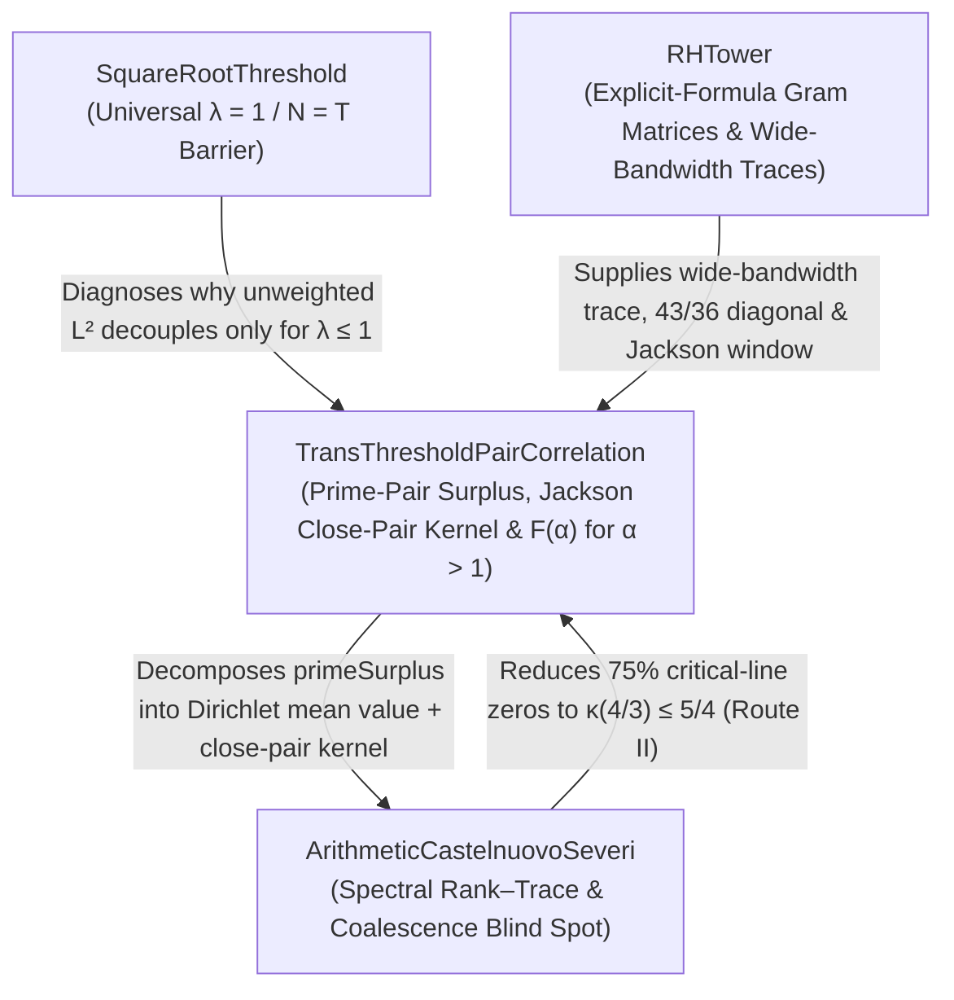

# Trans-Threshold Pair Correlation Theory

**Trans-Threshold Pair Correlation Theory** is the analytic and operator-theoretic discipline that studies the interaction of primes, Dirichlet polynomials, and spectral Gram matrices **beyond the Montgomery–Vaughan square-root threshold** $\lambda > 1$ ($X = (T/2\pi)^\lambda > T$).

Below the threshold $\lambda \le 1$, logarithmic prime frequencies $y_n = \log n$ ($n \le X \le T$) have minimum spacing
$$
\delta_n = \log\!\left(1 + \frac{1}{n}\right) \asymp \frac{1}{n} \ge \frac{1}{X} \ge \frac{1}{T},
$$
which exceeds the inverse length $1/T$ of the vertical observation window $I = [T, 2T]$. The Montgomery–Vaughan weighted Hilbert inequality therefore decouples off-diagonal prime pairs $(n \neq m)$ automatically, reducing the prime-side Frobenius norm $\operatorname{tr}(\widetilde{G}^2)$ of the Weil–explicit-formula Gram matrix to its archimedean and prime-diagonal main terms with normalized second-moment constant $\kappa(1) = \frac{4}{3}$ and critical-line proportion $2 - \kappa(1) = \frac{2}{3}$ ($66.67\%$).

Once the prime cutoff crosses $\lambda > 1$ — and in particular at the canonical target bandwidth $\lambda = \frac{4}{3}$ ($X = (T/2\pi)^{4/3}$), where the unconditional diagonal + archimedean + pole constant drops from $\frac{4}{3}$ to $\frac{43}{36} = \frac{5}{4} - \frac{1}{18}$ — adjacent logarithmic frequencies $\log n, \log m \in (\log T, \frac{4}{3}\log T]$ can sit as close as $X^{-1} \asymp T^{-4/3} \ll T^{-1}$. Inside the coalescent band $|\log(n/m)| \lesssim T^{-1}$, the Hilbert denominator $(\log n - \log m)^{-1}$ ceases to oscillate over $[T, 2T]$: absolute-value Hilbert bounds lose a factor of $X/T = T^{\lambda - 1}$ and blow up. Advancing unconditional critical-line zero proportions past $\frac{2}{3}$ toward $\frac{3}{4}$ ($75\%$) and $1$ ($100\%$) therefore requires a dedicated mathematical theory of **signed trans-threshold prime-pair correlation** and **close-pair kernel cancellation**.

---

## 1. Why This Field Exists: The $\lambda = 1$ Barrier and the $\lambda = 4/3$ Frontier

### 1.1 The Sub-Threshold Regime ($\lambda \le 1$) and Why It Stops at $2/3$

In the explicit-formula rank–trace method, a band-limited test profile $\varphi$ supported on $[-L, L]$ with $L = \lambda l$, $l = \log(T/2\pi)$, generates a $d \times d$ Gram matrix $\widetilde{G} = L^{-1} G$ on the vertical grid $\tau_k = T + k h$ ($h = 2\pi / L$, $d = \lfloor LT/2\pi\rfloor$) from the prime-side density
$$
\nu_X(\tau) = \mu(\tau) + \Pi_X(\tau) + P_X(\tau), \qquad P_X(\tau) = -\frac{1}{\pi} \sum_{n \le X} \frac{\Lambda(n)}{\sqrt{n}} \cos(\tau \log n).
$$
By the Poisson summation formula on the grid (`LocalHypsCoreW.poisson`), the Frobenius norm $\operatorname{tr}(\widetilde{G}^2)$ equals the continuous bilinear form
$$
\mathcal{M}[\nu_X, \nu_X] = \iint_{[T,2T]^2} \Phi(\tau - \tau')^2 \nu_X(\tau) \nu_X(\tau')\,d\tau\,d\tau'
$$
up to the grid end-effect form $E(\nu_X, \nu_X) = \operatorname{endForm}(p, F, \nu_X, \nu_X)$. Expanding $\nu_X = \mu + \Pi_X + P_X$ splits $\operatorname{tr}(\widetilde{G}^2)$ into:
1. **The Diagonal + Archimedean + Pole Core:**
   $$
   \mathcal{M}[\mu,\mu] + \frac{1}{2\pi^2} \mathcal{D} + 2\mathcal{M}[\mu, P_X] + 2\mathcal{M}[\mu, \Pi_X] + \mathcal{M}[\Pi_X, \Pi_X], \qquad \mathcal{D} = \sum_{n \le X} a_n^2 A^-(\log n, \log n),
   $$
   which evaluates **unconditionally at every bandwidth $\lambda > 0$** to
   $$
   \frac{T L}{2\pi}\left(\ell_1^2 + \frac{L^2}{3}\right) + O\!\left(T l^2 + T^{\lambda/2}\log^2 T\right) = \left(\frac{1}{\lambda} + \frac{\lambda}{3} + o(1)\right) (aL)^2 \frac{T\ell_1}{2\pi}.
   $$
2. **The Frobenius Surplus ($\mathcal{S} = \text{frobSurplus}$):**
   $$
   \mathcal{S} = \frac{1}{2\pi^2}\bigl(\mathcal{O}_1 + \mathcal{O}_2\bigr) + 2\mathcal{M}[P_X, \Pi_X] + E(\nu_X, \nu_X),
   $$
   where $\mathcal{O}_1 = \text{ppOffDiag}(\Phi, T, X) = \sum_{n \neq m \le X} a_n a_m A^-(\log n, \log m)$ is the **prime-pair off-diagonal difference-frequency sum** and $\mathcal{O}_2 = \text{ppSumFreq}(\Phi, T, X)$ is the sum-frequency term.

When $\lambda \le 1$, the Montgomery–Vaughan inequality bounds $|\mathcal{O}_1| \ll L^2 X = O(T \log^2 T) = o(T l^3)$, so $\mathcal{S}$ is negligible and the normalized Frobenius norm is $\kappa(\lambda) = \frac{1}{\lambda} + \frac{\lambda}{3}$, minimized on $(0, 1]$ at $\lambda = 1$ with $\kappa(1) = \frac{4}{3}$ and certified critical-line proportion $2 - \frac{4}{3} = \frac{2}{3}$.

### 1.2 What Happens at Bandwidth $\lambda = 4/3$ ($X = (T/2\pi)^{4/3}$)

When $\lambda$ increases from $1$ to $\frac{4}{3}$:
- The unconditional diagonal + archimedean + pole core (`RHTower.diagonal_main_le`) drops to
  $$
  \frac{1}{4/3} + \frac{4/3}{3} = \frac{3}{4} + \frac{4}{9} = \frac{43}{36} = \frac{5}{4} - \frac{1}{18}.
  $$
- The prime–pole cross term $2|\mathcal{M}[P_X, \Pi_X]|$ remains unconditionally $O(T^{5/6}\log^2 T) = o(T/\log T)$ (`RHTower.abs_Mform_PX_PiX_params43_le`), and the sum-frequency term $\mathcal{O}_2 = O(X L) = O(T^{4/3}\log T)$ remains negligible only if its phase oscillation in $[T, 2T]$ or grid weighting is exploited.
- The **entire analytic barrier to $75\%$ of the zeros of $\zeta(s)$ on the critical line** reduces to proving that the normalized prime-side surplus (`RHTower.PrimeSurplusFourThirds`) does not exceed the remaining $\frac{1}{18}$ budget:
  $$
  \text{primeSurplus}(p_{4/3}, F_{4/3}) \le \left(\frac{1}{18} + o(1)\right) (aL)^2 \frac{T\ell_1}{2\pi}.
  $$
  On the spectral side, this $\frac{1}{18}$ prime-surplus budget is **identically equivalent** (`frobeniusFormFactor_four_thirds_le_five_fourths_iff`, `primeSurplusRatio_bridge`) to the trans-threshold form-factor integral bound
  $$
  \int_1^{4/3} \left(\frac{4}{3} - \alpha\right) F(\alpha)\,d\alpha \le \frac{1}{9},
  $$
  which is **twice** the GUE / Montgomery pair-correlation prediction $\int_1^{4/3} (\frac{4}{3} - \alpha)\cdot 1\,d\alpha = \frac{1}{18}$ (where the prime surplus itself equals $-\frac{1}{144}$, leaving an unconditional slack margin of $\frac{1}{18} - (-\frac{1}{144}) = \frac{1}{16}$).

---

## 2. Core Objects and Canonical Language

| Symbol / Lean Declaration | Mathematical Definition | Structural Role |
| :--- | :--- | :--- |
| `Aminus Φ T y y'` | $\iint_{[T,2T]^2} \Phi(\tau - \tau')^2 \cos(\tau(y - y') + \dots)\,d\tau\,d\tau'$ | Difference-frequency prime-pair kernel $A^-(y, y')$ |
| `AminusCos Φ T y y'` | $\bigl(C^+(y) + C^+(y')\bigr)\frac{\sin(2T(y - y')) - \sin(T(y - y'))}{y - y'}$ | Symmetric cosine-moment part of $A^-(y, y')$ for even $\Phi$ |
| `AminusSin Φ T y y'` | $\bigl(S^+(y') - S^+(y)\bigr)\frac{\cos(2T(y - y')) + \cos(T(y - y'))}{y - y'}$ | Antisymmetric sine-moment part of $A^-(y, y')$; **nonsingular** as $y \to y'$ |
| `ppOffDiag Φ T X` | $\sum_{n \neq m \le X} a_n a_m A^-(\log n, \log m)$ | Full prime-pair off-diagonal difference-frequency sum $\mathcal{O}_1$ |
| `ppOffDiagCos Φ T X` | $\sum_{n \neq m \le X} a_n a_m A^-_{\cos}(\log n, \log m)$ | Cosine-moment off-diagonal sum |
| `ppOffDiagSin Φ T X` | $\sum_{n \neq m \le X} a_n a_m A^-_{\sin}(\log n, \log m)$ | Sine-moment off-diagonal sum (no close-pair pole) |
| `ppOffDiagFourier g T X` | $\sum_{n \neq m \le X} a_n a_m \pi\bigl(g(\log n) + g(\log m)\bigr)\frac{\sin(2T\theta) - \sin(T\theta)}{\theta}$ | Exact Fourier-weighted off-diagonal cosine sum ($C^+(y) \mapsto \pi g(y)$) |
| `primeDirichletCos w X τ` | $\sum_{n \le X} a_n w(\log n) \cos(\tau \log n)$ | Real cosine prime Dirichlet polynomial $C_w(\tau)$ |
| `primeDirichletSin w X τ` | $\sum_{n \le X} a_n w(\log n) \sin(\tau \log n)$ | Real sine prime Dirichlet polynomial $S_w(\tau)$ |
| `endForm p F u v` | $L^{-2} \sum_{k,l < d} G_{kl}(u) G_{kl}(v) - \mathcal{M}[u, v]$ | Symmetric bilinear grid end-effect form $E(u, v)$ |
| `jacksonPairKernel b s₀ s₁ L r θ` | $\frac{L}{2\pi} \int_{\mathbb{R}} W(s + rh) W(s) e^{i\theta s}\,ds$ | Continuous close-pair kernel for Jackson-weighted Gram matrices; compactly supported in $|\theta| < 4b$ |
| `jacksonCloseApprox` | $\frac{1}{2}\operatorname{Re} \sum_{|r| < d} A_n(r)\overline{A_m(r)} K_r(y_n - y_m)$ | Continuous kernel approximation to the $(n, m)$ weighted Frobenius entry |
| `frobeniusFormFactor F lam` | $\frac{1}{\lambda} + \frac{2}{\lambda^2}\int_0^\lambda (\lambda - \alpha) F(\alpha)\,d\alpha$ | Spectral normalized Frobenius norm as a functional of the pair-correlation form factor $F(\alpha)$ |
| `transThresholdIntegral F lam` | $\int_1^\lambda (\lambda - \alpha) F(\alpha)\,d\alpha$ | Trans-threshold pair-correlation integral governing $\kappa(\lambda)$ for $\lambda > 1$ |
| `primeSurplusRatioOfIntegral I` | $\frac{9}{8} I - \frac{5}{72} = \frac{9}{8}\bigl(I - \frac{1}{18}\bigr) - \frac{1}{144}$ | Normalized prime-pair surplus at $\lambda = 4/3$ as a function of $I = \int_1^{4/3} (4/3 - \alpha)F(\alpha)\,d\alpha$ |

---

## 3. Core Mechanisms of the Programme

### Mechanism 1: Parity Splitting of $A^-(y, y')$ and Pole Cancellation in $A^-_{\sin}$
In the classical treatment (`Zeta23.PrimeSide.O1_bound`), $(y - y') A^-(y, y')$ is expanded into eight half-line moment terms involving $C^\pm(y)$ and $S^\pm(y)$, and each is bounded separately by the Montgomery–Vaughan inequality. Beyond $\lambda = 1$, this loses sight of parity.
Because $\Phi$ is even, $C^-(y) = C^+(y)$ and $S^-(y) = -S^+(y)$ (`Cm_eq_Cp_of_even`, `Sm_eq_neg_Sp_of_even`), collapsing the eight terms into two structural pieces (`sub_mul_Aminus_eq_of_even`, `Aminus_eq_AminusCos_add_AminusSin`):
$$
A^-(y, y') = \underbrace{\bigl(C^+(y) + C^+(y')\bigr) \frac{\sin(2T\theta) - \sin(T\theta)}{\theta}}_{A^-_{\cos}(y, y')} + \underbrace{\bigl(S^+(y') - S^+(y)\bigr) \frac{\cos(2T\theta) + \cos(T\theta)}{\theta}}_{A^-_{\sin}(y, y')}, \qquad \theta = y - y'.
$$
Because $S^+(y) = \int_0^T \Phi(x)^2 \sin(xy)\,dx$ is Lipschitz in $y$ with constant $\int_0^T \Phi(x)^2 |x|\,dx \le \int_{\mathbb{R}} \Phi(x)^2 |x|\,dx$ (`abs_Sp_sub_Sp_le`), the difference $S^+(y') - S^+(y)$ cancels the denominator $\theta = y - y'$! Thus $A^-_{\sin}$ has **no close-pair singularity whatsoever**:
$$
|A^-_{\sin}(\Phi, T, y, y')| \le 2 \int_{\mathbb{R}} \Phi(x)^2 |x|\,dx \qquad \forall\, y, y' \in \mathbb{R} \quad (\text{\texttt{abs\_AminusSin\_le}}).
$$

### Mechanism 2: Second-Moment Tail Reduction of $C^+(y)$ and Exact Dirichlet Mean-Value Identity
For the remaining cosine kernel $A^-_{\cos}$, evenness of $\Phi$ gives $2 C^+(y) = \int_{-T}^T \Phi(x)^2 \cos(xy)\,dx$, while the full Fourier transform is $\int_{\mathbb{R}} \Phi(x)^2 \cos(xy)\,dx = 2\pi g(y)$. Chebyshev's inequality on $|x| > T$ bounds the tail by the second moment (`abs_Cp_sub_pi_mul_g_le`):
$$
|C^+(y) - \pi g(y)| \le \frac{1}{2T^2} \int_{\mathbb{R}} \Phi(x)^2 x^2\,dx.
$$
Applying the Montgomery–Vaughan Hilbert inequality to this $O(T^{-2})$ tail across all off-diagonal prime pairs up to $X = (T/2\pi)^{4/3}$ replaces $C^+(\log n)$ by $\pi g(\log n)$ with total error
$$
\bigl|\text{ppOffDiagCos}(\Phi, T, X) - \text{ppOffDiagFourier}(g, T, X)\bigr| \le \frac{4C}{T^2}\left(\int_{\mathbb{R}} \Phi(x)^2 x^2\,dx\right) \sum_{n \le X} \Lambda(n)^2 = O\!\left(\frac{\log T}{T^{2/3}}\right) \to 0
$$
unconditionally (`abs_ppOffDiagCos_sub_fourier_le`, `exists_abs_ppOffDiagCos_sub_fourier_params43_le`)!
Once $C^+(\log n)$ is replaced by $\pi g(\log n)$, the off-diagonal sinc kernel $(\sin(2T\theta) - \sin(T\theta))/\theta$ integrates back to $\int_T^{2T} \cos(\tau \theta)\,d\tau$, yielding the **exact Dirichlet-polynomial mean-value identity** (`ppOffDiagFourier_eq_primeDirichlet_integral`):
$$
\text{ppOffDiagFourier}(g, T, X) = 2\pi \int_T^{2T} \bigl(C_g(\tau) C_1(\tau) + S_g(\tau) S_1(\tau)\bigr)\,d\tau - 2\pi T \sum_{n \le X} a_n^2 g(\log n).
$$
Furthermore, adding the prime diagonal $\text{ppDiag}(\Phi, T, X)$ cancels the diagonal term $2\pi T \sum_{n \le X} a_n^2 g(\log n)$ identically (`abs_ppDiag_add_ppOffDiagFourier_sub_integral_le`)!

### Mechanism 3: Bilinear Splitting of the End-Effect Form $E(\nu_X, \nu_X)$
Instead of bounding $E(\nu_X, \nu_X)$ monolithically via the combined sup-norm $B = l + 4\sqrt{X}$ (which produces $O(L l \log l \cdot X) = O(T^{4/3}\log^2 T \log\log T)$ at $\lambda = 4/3$), `endForm_nuX_split` expands $E(\mu + \Pi_X + P_X, \mu + \Pi_X + P_X)$ into its six bilinear components. Using the $X$-independent global growth bound $|\mu(\tau)| \le C_0 l + \log^+(|\tau|/4T)$ (`mu_nuBound`), `exists_abs_endForm_mu_mu_le` proves unconditionally at every bandwidth $\lambda \le 2$ that
$$
|E(\mu, \mu)| \le C \cdot L \cdot l^3 \log l = O(\log^4 T \log\log T),
$$
eliminating the archimedean end-effect from the trans-threshold barrier.

### Mechanism 4: Jackson-Weighted Grid Filtering and Strict Band-Limiting of Close Pairs
For the sharp indicator $\mathbf{1}_{[T, 2T]}$, the grid sum $\sum_{k,l < d} G_{kl}(P_X)^2$ suffers $O(1/|\theta|)$ boundary leakage from the endpoints $T$ and $2T$. Weighting the grid by a smooth Jackson window $W_k = W(\tau_k)$ whose Fourier transform is supported in $(-2b, 2b)$ makes the product window $W(s + rh)W(s)$ strictly band-limited to $(-4b, 4b)$ (`integral_jacksonProduct_mul_cexp_eq_zero`). Consequently:
- The continuous close-pair kernel $K_r(\theta) = \text{jacksonPairKernel}(b, s_0, s_1, L, r, \theta)$ **vanishes identically for $|\theta| \ge 4b$** (`jacksonPairKernel_eq_zero_of_le_abs`).
- Every far pair $|\log(n/m)| \ge 4b$ and every sum-frequency term $\log(nm)$ is annihilated up to the outer Jackson tail mass $E_0 = O(M^{-3} + L M^{-2})$, leaving **only** the close prime pairs $|\log(n/m)| < 4b$ (`abs_weighted_frobenius_pp_sub_closeKernel_le`).

---

## 4. Known Traps and Structural Obstructions

> [!WARNING]
> Every route in Trans-Threshold Pair Correlation Theory must respect four formally diagnosed traps:

1. **The Monolithic Absolute-Value Hilbert Trap:**
   Bounding $\sum_{n \neq m \le X} a_n a_m A^-(\log n, \log m)$ by triangle inequality on the eight half-line moments (`O1_bound`) gives $O(L^2 X)$. For $\lambda > 1$, $L^2 X = (\lambda l)^2 (T/2\pi)^\lambda \gg T l^3$: discarding the sign of $\sin(2T\theta) - \sin(T\theta)$ and the Lipschitz cancellation in $S^+(y') - S^+(y)$ forfeits all trans-threshold cancellation.
2. **The Sharp-Cutoff Endpoint Leakage Trap:**
   In the unweighted $[T, 2T]$ integral $\int_T^{2T} \cos(\tau \theta)\,d\tau = (\sin 2T\theta - \sin T\theta)/\theta$, pairs with $|\theta| \gg T^{-1}$ still contribute $O(1/|\theta|)$ because of the sharp boundary at $\tau = T, 2T$. Smooth vertical weighting (or Jackson grid weighting `JacksonWeightedPrimeFrobeniusDecomposition`) is required to localize the off-diagonal kernel strictly to $|\theta| < 4b \asymp T^{-1}$.
3. **The Nonnegative Shift-Inequality Ceiling ($8/3$ Gap):**
   Montgomery's shift method bounds $\int_1^{4/3} (\frac{4}{3} - \alpha) F(\alpha)\,d\alpha$ using only $F(\alpha) \ge 0$ and the sub-threshold identity $F(\alpha) = |\alpha|$ on $[-1, 1]$ by majorizing $(\frac{4}{3} - \alpha)$ with the shifted Fejér kernel $W(\alpha) = (1 - |\alpha|)_+ + \frac{1}{2}(1 - |\alpha - \frac{1}{3}|)_+ + \frac{1}{2}(1 - |\alpha + \frac{1}{3}|)_+$. Because $W(\alpha)$ also covers $[-2/3, 1]$ and $[4/3, 5/3]$, dropping those intervals by $F \ge 0$ yields the upper bound $\frac{8}{27}$, which is an exact factor of $\frac{8}{3}$ above the $\frac{1}{9}$ threshold needed for $75\%$ (`fejer_shifted_bound_gap`). Purely positive spectral majorants supported in $[-1, 1]$ cannot cross $\frac{1}{9}$ without arithmetic input on $[1, 4/3]$.
4. **The Higher-Moment Rudnick–Sarnak Bandwidth Cap:**
   Attempting to bypass the $k = 2$ pair-correlation barrier at $\lambda = 4/3$ by using $k$-th order ($k \ge 3$) trace / Lasserre certificates $\operatorname{tr}(\widetilde{G}^k)$ in their unconditional sub-threshold regime forces $k\lambda \le 1$, which restricts $\lambda \le 1/k \le 1/3 < 2/3$ (`higherMoment_rudnick_sarnak_cap`). Higher moments shrink the unconditional bandwidth rather than expanding it.

---

## 5. Fundamental Questions and Open Research Topics

1. **The Bandwidth-$4/3$ Prime-Surplus Bound (`RHTower.PrimeSurplusFourThirds`):**
   Prove unconditionally (or under the weakest possible arithmetic mean-value input) that
   $$
   \text{primeSurplus}(p_{4/3}, F_{4/3}) \le \left(\frac{1}{18} + o(1)\right) (aL)^2 \frac{T\ell_1}{2\pi},
   $$
   or equivalently via `ppOffDiagFourier_eq_primeDirichlet_integral` that the mixed prime Dirichlet mean value $\frac{1}{\pi}\int_T^{2T} (C_g(\tau)C_1(\tau) + S_g(\tau)S_1(\tau))\,d\tau$ is bounded by $(\frac{4}{9} + \frac{1}{18} + o(1))(aL)^2 \frac{T\ell_1}{2\pi} = (\frac{1}{2} + o(1))(aL)^2 \frac{T\ell_1}{2\pi}$.
2. **Prime-Component End-Effect Elimination via Jackson-Weighted Gram Traces:**
   Replace the unweighted Frobenius norm $\operatorname{tr}(\widetilde{G}^2)$ in the bandwidth-$4/3$ trace assembly by the Jackson-weighted Frobenius norm (`abs_weighted_frobenius_pp_sub_closeKernel_le`), where both the sum-frequency term $\mathcal{O}_2$ and the far prime pairs $|\log(n/m)| \ge 4b$ are bounded by the outer Jackson mass $O(M^{-3} + L M^{-2})$ rather than $O(X L)$.
3. **Close-Pair Sieve and Bilinear Dispersion in Short Multiplicative Intervals:**
   For prime pairs $T < m < n \le T^{4/3}$ with $0 < n - m = h \ll m / T$, control the signed correlation $\sum_{m, h} \frac{\Lambda(m)\Lambda(m+h)}{m} K(T \log(1 + h/m))$ beyond the factor-of-$2$ parity barrier of upper-bound Brun–Titchmarsh sieves.
4. **Continuous Exchange Rate $\lambda \mapsto H^*(\lambda, B)$ Just Above $\lambda = 1$:**
   By `RHTower.opt_sub_two_thirds`, *any* finite upper bound $F(\alpha) \le B$ on $(1, 1 + \delta)$ strictly beats $\frac{2}{3}$ by $\frac{1}{3(3B - 2)}$ at $\lambda^* = \frac{3B - 2}{3(B - 1)}$. Establish unconditional upper bounds on the close-pair energy in narrow trans-threshold strips $\lambda = 1 + \delta$.

---

## 6. Foundational Pillar Theorems

### Pillar 1: Parity Decomposition of `ppOffDiag`, Nonsingularity of `AminusSin`, Second-Moment Tail Reduction, and Exact Dirichlet Mean-Value Identity
- **Module:** [`PrimeSurplusAnatomyAndDirichletMeanValue.lean`](file:///Users/michael/Documents/code/hgt/formal/GaloisForLFunctions/TransThresholdPairCorrelation/PrimeSurplusAnatomyAndDirichletMeanValue.lean)
- **Key Theorems:**
  - [`sub_mul_Aminus_eq_of_even`](file:///Users/michael/Documents/code/hgt/formal/GaloisForLFunctions/TransThresholdPairCorrelation/PrimeSurplusAnatomyAndDirichletMeanValue.lean#L73-L82) & [`ppOffDiag_eq_cos_add_sin`](file:///Users/michael/Documents/code/hgt/formal/GaloisForLFunctions/TransThresholdPairCorrelation/PrimeSurplusAnatomyAndDirichletMeanValue.lean#L110-L129): Exact decomposition of `Aminus` and `ppOffDiag` into `ppOffDiagCos` and `ppOffDiagSin`.
  - [`abs_Sp_sub_Sp_le`](file:///Users/michael/Documents/code/hgt/formal/GaloisForLFunctions/TransThresholdPairCorrelation/PrimeSurplusAnatomyAndDirichletMeanValue.lean#L141-L166) & [`abs_AminusSin_le`](file:///Users/michael/Documents/code/hgt/formal/GaloisForLFunctions/TransThresholdPairCorrelation/PrimeSurplusAnatomyAndDirichletMeanValue.lean#L170-L186): Uniform Lipschitz cancellation of the $1/(y - y')$ pole in `AminusSin`, giving $|A^-_{\sin}(\Phi, T, y, y')| \le 2\int_{\mathbb{R}} \Phi(x)^2 |x|\,dx$ for all $y, y' \in \mathbb{R}$.
  - [`abs_ppOffDiagCos_sub_fourier_le`](file:///Users/michael/Documents/code/hgt/formal/GaloisForLFunctions/TransThresholdPairCorrelation/PrimeSurplusAnatomyAndDirichletMeanValue.lean#L281-L333) & [`exists_abs_ppOffDiagCos_sub_fourier_params43_le`](file:///Users/michael/Documents/code/hgt/formal/GaloisForLFunctions/TransThresholdPairCorrelation/PrimeSurplusAnatomyAndDirichletMeanValue.lean#L540-L606): Unconditional $O(T^{-2/3}\log T)$ reduction of `ppOffDiagCos` to `ppOffDiagFourier` at bandwidth $\lambda = 4/3$.
  - [`ppOffDiagFourier_eq_primeDirichlet_integral`](file:///Users/michael/Documents/code/hgt/formal/GaloisForLFunctions/TransThresholdPairCorrelation/PrimeSurplusAnatomyAndDirichletMeanValue.lean#L465-L473) & [`abs_ppDiag_add_ppOffDiagFourier_sub_integral_le`](file:///Users/michael/Documents/code/hgt/formal/GaloisForLFunctions/TransThresholdPairCorrelation/PrimeSurplusAnatomyAndDirichletMeanValue.lean#L480-L506): Exact representation of `ppOffDiagFourier` in terms of the $[T, 2T]$ mean value of the prime Dirichlet polynomials and exact cancellation of the diagonal main term $2\pi T \sum_{n \le X} a_n^2 g(\log n)$ against `ppDiag`.

### Pillar 2: Bilinear Splitting of the End-Effect Form and Unconditional $X$-Independent Archimedean End-Effect Bound
- **Module:** [`ArchimedeanEndEffectAndSurplusSplitting.lean`](file:///Users/michael/Documents/code/hgt/formal/GaloisForLFunctions/TransThresholdPairCorrelation/ArchimedeanEndEffectAndSurplusSplitting.lean)
- **Key Theorems:**
  - [`endForm_trinomial`](file:///Users/michael/Documents/code/hgt/formal/GaloisForLFunctions/TransThresholdPairCorrelation/ArchimedeanEndEffectAndSurplusSplitting.lean#L78-L108) & [`endForm_nuX_split`](file:///Users/michael/Documents/code/hgt/formal/GaloisForLFunctions/TransThresholdPairCorrelation/ArchimedeanEndEffectAndSurplusSplitting.lean#L112-L132): Exact six-term bilinear decomposition of `endForm p F (nuX X) (nuX X)` along $\nu_X = \mu + \Pi_X + P_X$.
  - [`exists_abs_endForm_mu_mu_le`](file:///Users/michael/Documents/code/hgt/formal/GaloisForLFunctions/TransThresholdPairCorrelation/ArchimedeanEndEffectAndSurplusSplitting.lean#L138-L161) & [`exists_abs_endForm_mu_mu_params43_le`](file:///Users/michael/Documents/code/hgt/formal/GaloisForLFunctions/TransThresholdPairCorrelation/ArchimedeanEndEffectAndSurplusSplitting.lean#L165-L181): Unconditional $X$-independent bound $|E(\mu, \mu)| \le C \cdot L \cdot l^3 \log l$ at every bandwidth $\lambda \le 2$, and $O(l^4 \log l)$ at $\lambda = 4/3$.

### Pillar 3: Global Jackson-Weighted Prime–Prime Frobenius Decomposition and Close-Pair Reduction
- **Module:** [`JacksonWeightedPrimeFrobeniusDecomposition.lean`](file:///Users/michael/Documents/code/hgt/formal/GaloisForLFunctions/TransThresholdPairCorrelation/JacksonWeightedPrimeFrobeniusDecomposition.lean)
- **Key Theorems:**
  - [`jacksonPairKernel_eq_zero_of_le_abs`](file:///Users/michael/Documents/code/hgt/formal/GaloisForLFunctions/TransThresholdPairCorrelation/JacksonWeightedPrimeFrobeniusDecomposition.lean#L39-L51) & [`sum_jacksonCloseApprox_eq_close`](file:///Users/michael/Documents/code/hgt/formal/GaloisForLFunctions/TransThresholdPairCorrelation/JacksonWeightedPrimeFrobeniusDecomposition.lean#L74-L85): Exact vanishing of `jacksonPairKernel` for $|\theta| \ge 4b$ and exact reduction of the all-pairs continuous kernel sum to close pairs $|y_n - y_m| < 4b$.
  - [`alias_sep_diff_of_mem_Icc`](file:///Users/michael/Documents/code/hgt/formal/GaloisForLFunctions/TransThresholdPairCorrelation/JacksonWeightedPrimeFrobeniusDecomposition.lean#L91-L104) & [`alias_sep_sum_of_mem_Icc`](file:///Users/michael/Documents/code/hgt/formal/GaloisForLFunctions/TransThresholdPairCorrelation/JacksonWeightedPrimeFrobeniusDecomposition.lean#L108-L124): Automatic alias separation on the frequency band $[2b, L/2 - 2b]$.
  - [`abs_weighted_frobenius_pp_sub_closeKernel_le`](file:///Users/michael/Documents/code/hgt/formal/GaloisForLFunctions/TransThresholdPairCorrelation/JacksonWeightedPrimeFrobeniusDecomposition.lean#L156-L184): Global Jackson-weighted prime–prime Frobenius approximation by the close-pair continuous kernel with factored outer-mass error $2E_0 \sum_{|r| < d} (\sum_{n \in s} |c_n| \|A_n(r)\|)^2$.

### Pillar 4: Trans-Threshold Form-Factor Laws, Prime-Surplus Bridge, and the Fejér Shift Barrier
- **Module:** [`FormFactorThresholdAndShiftInequality.lean`](file:///Users/michael/Documents/code/hgt/formal/GaloisForLFunctions/TransThresholdPairCorrelation/FormFactorThresholdAndShiftInequality.lean)
- **Key Theorems:**
  - [`frobeniusFormFactor_eq_split`](file:///Users/michael/Documents/code/hgt/formal/GaloisForLFunctions/TransThresholdPairCorrelation/FormFactorThresholdAndShiftInequality.lean#L55-L76) & [`frobeniusFormFactor_four_thirds_le_five_fourths_iff`](file:///Users/michael/Documents/code/hgt/formal/GaloisForLFunctions/TransThresholdPairCorrelation/FormFactorThresholdAndShiftInequality.lean#L86-L90): Exact split of the normalized Frobenius norm and equivalence of $\kappa(4/3) \le 5/4$ with $\int_1^{4/3} (4/3 - \alpha) F(\alpha)\,d\alpha \le 1/9$ (twice the GUE value $1/18$).
  - [`primeSurplusRatio_bridge`](file:///Users/michael/Documents/code/hgt/formal/GaloisForLFunctions/TransThresholdPairCorrelation/FormFactorThresholdAndShiftInequality.lean#L114-L123): Exact algebraic bridge reconciling the spectral split $9/8 + (9/8)I$ with the prime-side split $43/36 + S$, proving $S = \frac{9}{8}(I - \frac{1}{18}) - \frac{1}{144}$ and $S \le \frac{1}{18} \iff I \le \frac{1}{9}$.
  - [`four_thirds_sub_le_two_mul_shiftedFejer`](file:///Users/michael/Documents/code/hgt/formal/GaloisForLFunctions/TransThresholdPairCorrelation/FormFactorThresholdAndShiftInequality.lean#L143-L157) & [`fejer_shifted_bound_gap`](file:///Users/michael/Documents/code/hgt/formal/GaloisForLFunctions/TransThresholdPairCorrelation/FormFactorThresholdAndShiftInequality.lean#L164-L167): Formalization of the $\alpha_0 = 1/3$ shifted Fejér majorant and its exact $8/3$ ratio gap above $1/9$.
  - [`excess_formFactor_of_coalescence`](file:///Users/michael/Documents/code/hgt/formal/GaloisForLFunctions/TransThresholdPairCorrelation/FormFactorThresholdAndShiftInequality.lean#L174-L191) & [`higherMoment_rudnick_sarnak_cap`](file:///Users/michael/Documents/code/hgt/formal/GaloisForLFunctions/TransThresholdPairCorrelation/FormFactorThresholdAndShiftInequality.lean#L196-L206): Coalescence excess-mass conservation and the $\lambda \le 1/k \le 1/3$ Rudnick–Sarnak cap for $k \ge 3$ trace certificates.

---

## 7. Position in the Research Corpus and Relation to Neighboring Programmes

- **Relation to [`ArithmeticCastelnuovoSeveri`](file:///Users/michael/Documents/code/hgt/formal/GaloisForLFunctions/ArithmeticCastelnuovoSeveri/README.md):**
  `ArithmeticCastelnuovoSeveri` proves that every positive-semidefinite Gram certificate at $\lambda = 1$ ($\kappa = 4/3$) faces the **Coalescence Blind Spot** between a double critical zero and a symmetric off-line pair, and establishes two routes to $75\%$: Route I (breaking the blind spot at $\lambda = 1$ via $c = 3$ or `zeroSideSlack`) and Route II (lowering $\kappa$ from $4/3$ to $5/4$ at $\lambda = 4/3$). `TransThresholdPairCorrelation` is the dedicated analytic engine for Route II.
- **Relation to [`SquareRootThreshold`](file:///Users/michael/Documents/code/hgt/formal/GaloisForLFunctions/SquareRootThreshold/README.md):**
  `SquareRootThreshold` proves why generic $L^2$ Hilbert-inequality methods hit a phase transition at $\lambda = 1$ ($N \asymp T$) and proves the double-window minimum-aperture law $\min(r, \rho) \le \log 2$. `TransThresholdPairCorrelation` takes over above $\lambda = 1$, replacing generic $L^2$ bounds with parity cancellation (`AminusSin`), second-moment Fourier reduction (`ppOffDiagFourier`), and band-limited close-pair kernels (`jacksonPairKernel`).
- **Relation to `RHTower`:**
  `RHTower` develops the explicit-formula Gram matrix infrastructure (`ZetaTraceWide`, `ZetaFrobeniusSurplusSplit`, `ZetaThreeQuartersOfPrimeSurplus`, `ZetaWeightedFrobeniusClose`). `TransThresholdPairCorrelation` builds directly on these modules to isolate, decompose, and bound the trans-threshold prime surplus.

---

## 8. Criteria for Contributions and Programme Success

1. **Unconditional Proof Integrity:**
   Every theorem in `formal/GaloisForLFunctions/TransThresholdPairCorrelation/` must be $100\%$ unconditional: no `sorry`, no added axioms, and no unproved analytic premises hidden in theorem binders or structures.Where an open frontier (such as `PrimeSurplusFourThirds`) is analyzed, contributions must prove unconditional decompositions, unconditional bounds on sub-components (such as `ppOffDiagSin`, `ppOffDiagCos - ppOffDiagFourier`, `endForm μ μ`), or exact equivalences.
2. **Genuine Trans-Threshold Content ($\lambda > 1$):**
   A contribution to this programme must address phenomena specific to $\lambda > 1$ ($X > T$): close prime pairs $|\log(n/m)| \lesssim T^{-1}$, mixed Dirichlet polynomial mean values $\int_T^{2T} P_g(\tau)\overline{P_1(\tau)}\,d\tau$, wide-bandwidth end effects, or the pair-correlation form factor $F(\alpha)$ on $\alpha > 1$.
3. **Success Criteria of the Programme:**
   - **Stage 1 (Completed in Pillars 1–4):** Eliminate all non-essential error terms from `primeSurplus` at $\lambda = 4/3$ (the sine-moment pole via `abs_AminusSin_le`, the cosine-moment finite-$T$ tail via `exists_abs_ppOffDiagCos_sub_fourier_params43_le`, the archimedean end-effect via `exists_abs_endForm_mu_mu_params43_le`, and the far-pair/sum-frequency leakage via `abs_weighted_frobenius_pp_sub_closeKernel_le`), reducing the entire $75\%$ problem to the exact Fourier/Dirichlet mean-value core `ppOffDiagFourier` and the close-pair kernel `jacksonCloseApprox`.
   - **Stage 2 (Active Frontier):** Bound the weighted prime-pair close-pair sum / mixed Dirichlet mean value at $\lambda = 1 + \delta$ and $\lambda = 4/3$ within the $\frac{1}{18}$ normalization budget, discharging `PrimeSurplusFourThirds` and yielding $75\%$ of the zeros of $\zeta(s)$ on the critical line.
